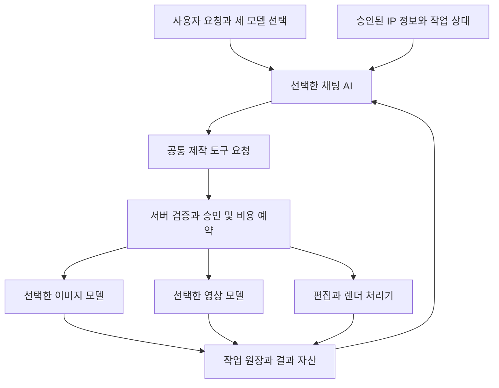

# 채팅 AI가 지시하는 멀티모델 제작 기능 요구서

## 문서 개요

신규 IP 음악영상 플랫폼 추가 명세 1.0

기준일 2026년 10월 25일 한국시간

대상 제품 기획자 프런트엔드 개발자 백엔드 개발자 품질 검증 담당자

사용자는 채팅과 기획에 사용할 AI, 이미지 생성 AI, 영상 생성 AI를 각각 선택한다. 선택된 채팅 AI는 사용자의 요청과 승인된 그룹 정보를 바탕으로 제작을 계획하고, 이미지와 영상 생성 도구에 작업을 요청한다. 플랫폼 서버는 해당 요청의 권한, 입력, 모델 지원 기능, 비용과 실행 허용 범위를 확인한 뒤 실제 생성 API를 호출한다.

이 문서는 모델 선택과 제작 지시 기능을 구현하기 위한 추가 명세다. 기존 사업계획서 전체를 다시 정의하지 않으며, 기존의 IP 설정 승인, 자산 관리, 실행 스냅샷, 작업 원장, 비용 예약, 결과 검토 규칙에 연결한다. 제품명은 확정하지 않는다.

**핵심 결정은 세 가지다.** 채팅 AI와 생성 AI의 선택을 분리한다. 그룹의 공식 정보와 실행 상태는 플랫폼이 보관한다. AI가 요청한 작업은 서버에 등록된 제작 도구와 사용자가 허용한 범위 안에서 실행한다.

공식 문서에서 확인한 공급자 정보에는 출처 번호를 붙였다. 기능 요구와 기본 한도는 우리 제품의 설계 제안이다. 문서 작성 과정에서 유료 모델 호출, 실제 계정의 모델 접근 확인, 생성 품질 실험을 수행한 것은 아니다. 아래 수용 시험은 개발 후 실행할 시험 명세다.

### 문서를 읽는 순서

| 검토 목적 | 해당 범위 |
| --- | --- |
| 제품 기획과 운영 | 1–4장 사용자 요구, 공급자 확인, 화면, 선택 규칙과 권한 |
| AI와 제품 개발 | 5–12장 도구 실행, 온톨로지, 미디어 계약, 비용, 기술과 API |
| 품질과 완료 판정 | 13–14장 28개 기능 요구사항과 38개 수용 시험 |
| 개발 착수와 관리 | 15장 구현 순서, 기존 명세 연결, 제출할 증거 |
| 사실 확인과 갱신 | 16장 21개 공식 출처와 확인 범위 |

## 1 사용자 요구와 완성 조건

### 1 1 사용자가 기대하는 동작

사용자는 “기획은 Claude로 하고, 기준 이미지는 선택한 이미지 모델로, 영상은 선택한 영상 모델로 만들어줘”라고 요청할 수 있어야 한다. 이후 “후렴의 세 번째 장면만 더 밝게 바꿔줘”라고 말하면, 채팅 AI가 해당 샷을 찾고 유지할 설정과 수정 범위를 정한 뒤 필요한 제작 도구를 요청한다.

사용자가 모든 단계마다 모델을 다시 선택하게 하지 않는다. 프로젝트 기본값을 한 번 정하고, 특정 작업에서만 다른 모델을 사용할 수 있게 한다. 채팅의 모델 선택을 바꾸더라도 이미지와 영상 기본값, 그룹의 공식 설정, 이미 생성한 파일은 유지한다.

**기능 완료의 기준은 실제 실행 경로다.** 선택기만 보이는 상태, 모델 이름을 답변에 적는 상태, 가짜 결과를 반환하는 상태를 연결 완료로 표시하지 않는다. 실제 사용한 모델과 공급 경로가 작업 기록과 결과 카드에 남고, 교차 공급자 조합으로 작업을 완료해야 한다.

### 1 2 세 가지 모델 역할

| 선택 항목 | 담당 작업 | 선택 변경의 적용 범위 |
| --- | --- | --- |
| 채팅과 기획 AI | 의도 해석, IP 정보 조회 요청, 콘티와 프롬프트 작성, 제작 도구 요청, 결과 설명 | 다음 채팅 응답과 새 기획 실행 |
| 이미지 AI | 기준 프레임, 배경, 이미지 후보 생성과 지원되는 이미지 편집 | 새 이미지 작업과 새 후보 |
| 영상 AI | 장면별 영상 후보 생성과 지원되는 영상 편집 | 새 영상 작업과 새 후보 |

검색 임베딩, 음원 구간 분석, 렌더링, 파일 검사에는 별도의 내부 처리기가 있을 수 있다. 채팅 모델을 바꾼다는 이유로 이 처리기까지 바꾸지 않는다. 내부 모델을 사용하는 경우 설정 화면의 데이터 처리 안내에서 그 역할과 공급자를 설명한다.

### 1 3 지원할 조합

Claude가 Runway 이미지 생성과 Luma 영상 생성을 지시하거나, OpenAI 모델이 Luma 이미지 생성과 Runway 영상 생성을 지시할 수 있어야 한다. Grok 역시 같은 공통 제작 도구를 사용한다. 같은 회사 모델끼리만 연결되는 구현은 요구사항을 충족하지 않는다.

영상 생성 모델이 이미지 입력을 필요로 하면 승인된 기존 이미지를 사용하거나 이미지 생성 단계를 선행한다. 텍스트에서 바로 영상을 생성할 수 있는 작업에는 이미지 생성을 필수로 끼워 넣지 않는다. 기존 촬영본 편집이나 자막 합성은 생성 모델 호출 없이 렌더 처리기로 수행할 수 있다.

## 2 공식 API 확인과 공급자 연결

### 2 1 채팅 모델의 도구 호출

Claude, OpenAI, Grok의 공식 문서는 모두 사용자 정의 도구를 모델이 요청하고 애플리케이션이 실행한 뒤 결과를 돌려주는 방식을 설명한다. 이 구조를 이용해 채팅 AI가 타 회사의 이미지와 영상 API를 사용하는 제작 도구를 요청할 수 있다. 공급자 사이를 연결하는 코드는 우리 플랫폼에 둔다. [S01][S02][S03]

| 공급자 | 공식 문서에서 확인한 모델 예시 | 연결 규격과 제품 적용 |
| --- | --- | --- |
| Anthropic | claude-sonnet-5-5, claude-opus-5-5 | Messages API의 tool_use와 tool_result를 공통 도구 요청과 결과로 변환 [S02][S04] |
| OpenAI | gpt-6.1-sol, gpt-6-astra, gpt-6-luna | Responses API를 사용하며 function call과 결과를 공통 형식으로 변환 [S01][S05] |
| xAI Grok | grok-4.7 | Responses 기반 연결과 사용자 정의 함수 호출을 지원하는 어댑터 사용 [S03][S06] |

표의 모델은 조사 시점의 공식 문서 예시이며, 제품의 영구 기본값이나 실제 계정에서 호출할 수 있다는 보장이 아니다. 운영 등록부에서 모델의 제공 상태와 접근 가능 여부를 관리한다. 새 모델이 공급자 목록에 나타났다는 이유만으로 고객 선택지에 자동 공개하지 않는다.

### 2 2 Codex의 표시와 연결

사용자가 말하는 Codex는 모델 선택 의도로 수용하되, 제품 설정에서는 공급자 OpenAI와 실제 API 모델을 구분한다. Codex라는 제품명만 저장해서는 요청할 모델과 실행 방식을 확정할 수 없다. UI에는 “OpenAI” 아래 실제 모델 표시명을 제공하고, API에서 사용 가능한 Codex 관련 모델이 있으면 해당 모델 ID와 지원 규격을 확인해 등록한다.

Codex의 ChatGPT 로그인과 API 키 인증은 접근 및 과금 방식이 다르다. 본 SaaS의 기본 경로는 서버의 공급자 API 연결이다. Codex CLI를 서버에서 실행하는 것은 이 기능의 필수 조건이 아니다. 코딩용 모델을 선택해도 터미널, 임의 파일 접근, 배포 권한이 자동으로 생기지 않는다. [S07]

공식 Sign in with ChatGPT 문서는 오픈소스와 로컬 호스팅 앱의 플랜 사용 경로를 안내하며, 유료 또는 원격 호스팅 앱에는 별도 문의를 안내한다. 따라서 상용 플랫폼에서 기존 ChatGPT 구독을 바로 사용할 수 있다고 약속하지 않는다. 공식 자격과 등록 절차가 확인되면 별도 연결 방식으로 추가한다. 로컬 인증 파일이나 로그인 토큰을 공용 API 키처럼 업로드하는 기능은 제공하지 않는다. [S08]

### 2 3 이미지와 영상 모델의 대표 연결 경로

| 호출 경로 | 문서에서 확인한 예시 | 어댑터가 처리해야 할 차이 |
| --- | --- | --- |
| Runway API | 영상 gen4.5, 이미지 gen4_image 등 | 작업 생성과 상태 조회, 작업별 입력과 비율 변환. 실제 호출 공급자와 원모델 개발사를 구분 [S09][S10] |
| Luma Agents API | 이미지 uni-1과 uni-1-max, 영상 ray-3.2 | 공통 generations 경로에서도 image, video, video_edit 등 작업 종류에 따라 필드가 다름 [S11] |
| xAI Imagine API | grok-imagine-video-1.5, grok-imagine-video-1.5-lite 등 | 모델별 참조 입력, 편집과 연장, 생성 오디오 지원이 다름. 채팅 Grok 선택과 별도 [S12] |
| Google API 경로 | Gemini API의 gemini-omni-1.1-flash, Google Cloud의 veo-3.1-generate-001 | 모델뿐 아니라 API 경로, 이용 방식, 지역, 작업 계약을 구분 [S13][S14] |
| 중개 공급자 확장 | fal 등을 통한 외부 모델 | 원개발사와 중개 공급자, 연결 계정, 가격과 취소 의미를 별도로 기록 [S16] |

모든 행을 첫 출시에서 동시에 연동해야 하는 것은 아니다. 최종 요구 범위에는 확장 가능성을 유지하되, 실제 검증을 마친 연결만 사용 가능으로 노출한다. 이미지 모델 목록과 영상 모델 목록은 작업 유형에 맞게 각각 필터링한다.

### 2 4 모델 지원 종료를 기능에 포함해야 하는 이유

Google 공식 문서는 Gemini API의 Veo 3.1 Preview 세 모델이 2026년 10월 22일 종료되었다고 안내한다. 이는 Veo 전체 또는 모든 공급 경로의 종료를 뜻하지 않는다. Google Cloud의 GA 모델은 별도 이용 조건과 모델 ID를 갖는다. 같은 브랜드명만 저장하는 설계로는 이 차이를 처리하기 어렵다. [S13][S14]

Luma의 이전 안내는 기존 Ray 계열을 Luma Agents의 ray-3.2로 옮기는 방법을 설명하며, 종료 시점은 계정에 전달된 안내를 확인하게 한다. 새 API에 과거 모델 ID를 그대로 보내면 된다고 가정하지 않는다. [S15]

운영자는 모델에 제공 중, 종료 예정, 새 실행 중지 상태와 근거 확인일을 설정한다. 종료된 모델의 과거 실행 기록과 결과 파일은 보존한다. 모델 교체가 필요한 프로젝트에는 대체 경로와 변환되는 옵션을 표시한다.

## 3 사용자 화면과 조작 방식

### 3 1 프로젝트 기본 설정

프로젝트의 제작 설정에 채팅과 기획 AI, 이미지 AI, 영상 AI 세 항목을 둔다. 각 항목은 공급자 이름, 모델 표시명, 현재 연결, 기본 또는 이번 작업 적용 범위를 보여준다. 고급 설정을 펼치면 지원 입력, 출력 길이, 비율, 데이터 처리 경로, 비용 계산 기준과 마지막 확인일을 볼 수 있다.

목록은 모델 이름만 나열하지 않는다. 사용 가능, 연결 필요, 조직 제한, 현재 작업 미지원, 통합 검증 중, 지원 종료 상태를 구분한다. 선택 불가 이유를 키보드와 화면 읽기 도구로도 확인할 수 있어야 한다.

초기 설정을 마친 뒤에는 매번 세 항목을 다시 확인받지 않는다. 기본값 변경은 이후의 새 요청에 적용하며 이미 승인된 작업 묶음에는 소급하지 않는다.

### 3 2 채팅 화면

채팅 입력창 주변에는 현재 채팅 모델을 항상 표시하고, 제작 모델 버튼에서 이미지와 영상 기본값을 확인하게 한다. 화면이 좁으면 세 이름을 길게 나열하는 대신 “기획 Claude · 제작 모델 2개”처럼 요약하고 펼칠 수 있게 한다.

사용자가 모델을 선택하면 “다음 응답부터 적용”과 적용 범위를 명확히 보여준다. 응답을 생성하는 중이라면 현재 응답을 마친 뒤 적용하는 것이 기본이다. 즉시 전환은 현재 응답 중단과 새 실행으로 처리하고 이미 발생한 사용량을 유지한다.

채팅 문장으로 “이번 영상만 Luma로”라고 지정해도 UI 선택과 같은 설정 해석기를 거친다. 모호한 제품명이나 여러 호출 경로가 있으면 후보를 제시한다. 현재 작업에서 사용할 수 있는 모델이 하나로 확정되면 불필요한 재질문 없이 적용한다.

### 3 3 실행 계획 카드

AI가 제작 요청을 준비하면 채팅 안에 실행 계획을 보여준다. 사용자는 다음 내용을 한 곳에서 확인한다.

- 수정할 샷과 시간 구간, 새로 생성할 이미지 또는 영상의 수.
- 유지할 멤버 외형, 기준 자산, 승인된 다른 장면, 음원 마스터.
- 실제 사용할 채팅 모델과 이미지 또는 영상 모델, 호출 공급자.
- 편집에 사용할 길이와 공급자에게 생성 요청할 길이.
- 예상 비용, 승인 상한, 후보 수, 추가 승인이 필요한 변경.
- 이번 작업에서 적용한 그룹 설정과 이전 피드백의 근거.

버튼은 “계획 수정”, “이 범위로 실행”, “보류”를 기본으로 한다. 이미 유효한 실행 허용 범위가 있다면 조건을 만족한 작업은 바로 진행하고 “승인한 범위 안에서 실행 중”이라고 표시한다.

### 3 4 결과 카드와 부분 수정

결과 카드에는 생성 파일의 미리보기, 샷 번호, 실제 모델, 후보 번호, 사용한 기준 이미지, 작업 상태와 비용 상태를 표시한다. “후보 생성 완료”, “타임라인에 채택됨”, “최종 승인됨”을 서로 다른 상태로 취급한다.

“다른 모델로 다시 만들기”는 해당 샷의 새로운 후보를 만든다. 기존 테이크와 타임라인을 덮어쓰지 않는다. 새 모델에서 유지할 수 없는 참조, 길이, 시드 또는 제어 옵션이 있으면 실행 전에 변경 내용을 보여준다.

채팅 AI가 결과를 설명하려면 실제 결과 파일 또는 검수 데이터가 있어야 한다. 파일이 아직 없는데 “잘 나왔다”고 말하지 않는다. 영상 전체를 분석하지 않고 일부 프레임만 검토했다면 그 범위를 표시한다.

### 3 5 사용자에게 보여줄 상태 문구

| 상황 | 표시 문구의 예 |
| --- | --- |
| 다른 공급자로 전환 | 이번 작업의 참조 이미지가 Luma 연결로 전송됩니다 |
| 길이 미지원 | 편집 구간은 7초입니다 이 모델은 10초를 생성한 뒤 7초를 사용합니다 |
| 견적 만료 | 실행 전 가격이 바뀌었습니다 새 상한을 확인해 주세요 |
| 접수 여부 불명 | 공급자 접수 여부를 확인하고 있습니다 같은 작업을 다시 보내지 않습니다 |
| 취소 요청 | 취소를 요청했습니다 공급자 처리 결과와 사용 비용을 확인 중입니다 |
| 모델 변경 완료 | 다음 응답부터 Grok을 사용합니다 진행 중인 영상 작업은 유지됩니다 |
| 지원 종료 | 이 모델로 새 작업을 시작할 수 없습니다 기존 결과는 계속 사용할 수 있습니다 |

문구에는 실제 상태와 다음 행동을 담는다. 서버의 내부 예외, 비밀키, 공급자 응답 원문을 그대로 노출하지 않는다.

## 4 모델 선택 규칙과 권한

### 4 1 허용 후보를 먼저 결정

모델 선택 전에 조직과 IP의 데이터 정책, 연결 계정의 접근, 현재 작업의 필수 기능, 예산과 지역 조건을 검사한다. 이 조건은 기본값 우선순위가 아니라 실행 가능한 후보를 제한하는 규칙이다.

허용된 후보 안에서 이번 작업의 명시적 선택, 현재 대화의 선택, 프로젝트 기본값, 조직 기본값, 서비스 기본값 순서로 적용한다. 초기 UI는 프로젝트 기본값과 이번 작업 선택을 우선 제공하며, 대화별 선택은 채팅 모델 변경을 위해 지원한다. 개인과 브라우저별 기본값까지 중복해서 만들지 않는다.

사용자가 명시한 모델이 허용되지 않으면 해당 이유와 대안을 제시한다. 아래 단계의 기본값으로 조용히 바꾸지 않는다. AI가 사용자가 고정한 모델을 바꾸고 싶으면 변경 제안으로 반환한다.

### 4 2 고정 선택과 자동 선택

고정 선택은 해당 모델과 연결 경로를 사용한다. 자동 선택은 사용자가 허용한 후보 목록과 비용, 기능, 처리 시간 기준 안에서만 가능하다. 최초 버전은 고정 선택을 기본으로 제공하고, 자동 선택은 각 경로의 평가 결과가 있는 경우에만 활성화한다.

자동 선택에서도 실행 직전에 실제 모델과 선택 이유를 기록한다. 공급자가 내부 라우팅을 수행해 최종 원모델을 공개하지 않으면 확인 불가로 남긴다. 특정 모델을 고정해야 하는 프로젝트에는 이런 경로를 사용하지 않는다.

### 4 3 역할별 권한

| 역할 | 허용하는 결정 | 별도 권한이 필요한 결정 |
| --- | --- | --- |
| 조직 관리자 | 허용 공급자와 연결 관리, 조직 기본값 지정 | 작품의 공식 설정 승인 |
| 결제 관리자 | 지출 한도와 사용량 관리 | 콘티 채택과 공식 설정 변경 |
| 프로듀서 | 프로젝트 기본값, 계획 승인, 위임 예산 안의 실행 | 조직 전체 공급자 추가 |
| 감독과 편집자 | 허용 모델 선택, 배정 샷의 후보 생성과 수정 | 예산 증액과 영구 설정 승인 |
| IP 승인권자 | 공식 설정과 장기 취향 승인 | 결제 권한 없는 비용 증액 |
| 외부 검토자 | 지정 결과 확인과 의견 제출 | 생성 실행과 모델 연결 변경 |
| 채팅 AI | 정보 조회, 계획 작성, 허용된 제작 도구 요청 | 자신에게 권한 부여, 비용 한도 증액, 공식 설정 직접 확정 |

AI 도구 실행은 요청을 보낸 사용자의 권한과 서버에 보관된 위임 범위로 판정한다. 도구 인수에 들어온 사용자 ID나 관리자 역할을 신뢰하지 않는다.

## 5 채팅 AI의 제작 실행 구조

### 5 1 구성 요소

웹 채팅은 선택값과 메시지를 인증된 API에 전달한다. API는 실행할 채팅 모델과 문맥을 확정하고 공급자 어댑터를 호출한다. 채팅 AI가 반환한 제작 요청은 공통 도구 실행기에 전달한다. 실행기는 정책과 승인 상태를 확인하고 작업 원장에 기록한 뒤 워커를 통해 외부 생성 API를 호출한다.

채팅 공급자 어댑터는 메시지, 도구 정의, 스트림 이벤트, 도구 호출 ID, 결과 반환 형식을 변환한다. 이미지와 영상 어댑터는 입력 검증, 견적, 제출, 상태 조회, 취소 요청, 결과 수집, 비용 대사를 담당한다. 이 두 종류의 어댑터를 구분한다.

### 5 2 한 번의 요청을 처리하는 순서

1. 사용자 권한, 프로젝트 버전, 세 모델 선택값과 연결 상태를 확인한다.
2. 현재 IP, 활동기, 곡, 승인 사실, 선호와 예외를 검색하고 근거를 준비한다.
3. 선택한 채팅 AI에 사용자 요청, 허용 도구, 가능한 모델 목록과 필요한 문맥을 전달한다.
4. AI가 조회나 제작 도구를 요청하면 완성된 인수를 파싱하고 스키마를 검증한다.
5. 제작 계획을 저장하고 대상 샷, 의존 자산, 모델과 옵션, 비용을 확정한다.
6. 사용자의 기존 실행 허용 범위 안인지 판정한다. 범위 밖이면 계획과 견적을 제시한다.
7. 실행 허용과 비용 예약, 작업 기록과 작업 발행을 하나의 원자적 처리로 만든다.
8. 도구는 내부 job ID와 접수 상태를 반환한다. 워커가 제출 직전 조건을 재검사하고 해당 공급자 어댑터를 호출해 외부 작업 ID를 저장한다.
9. 완료된 출력물을 내부 자산으로 수집하고 파일 규격과 연결 관계를 검사한다.
10. 완료 이벤트와 실제 결과를 채팅에 반영한다. 후속 채팅 실행은 같은 job을 조회하고 결과를 설명하거나 다음 허용 작업을 제안한다.
11. 사용자가 후보를 채택하면 타임라인의 새 버전을 만든다. 새 공식 설정은 별도 승인 흐름으로 보낸다.

도구 호출은 일반 문장의 “생성하겠습니다”와 구별한다. AI가 도구 호출 없이 설명만 반환하면 유료 생성은 시작되지 않는다. 결과가 없거나 작업이 실패했으면 실패를 설명하고 필요한 다음 행동을 제시한다.

### 5 3 필요한 단계만 실행

기존 승인 이미지가 있으면 곧바로 영상 생성에 사용할 수 있다. 새로운 기준 이미지가 필요한 경우 이미지 작업을 먼저 완료하고 승인 조건을 충족한 뒤 영상 작업을 제출한다. 서로 의존하지 않는 샷은 예산과 동시 실행 한도 안에서 병렬로 처리할 수 있다.

렌더, 크롭, 자막 배치, 음원 합성처럼 정해진 처리기로 해결할 수 있는 작업에 생성 모델을 불필요하게 사용하지 않는다. AI는 생성과 편집의 목적을 구분하고 서버는 허용된 작업 종류인지 확인한다.

### 5 4 자동 실행의 범위

기본 실행 방식은 계획을 확인한 뒤 한 번의 실행 묶음을 승인하는 것이다. 사용자가 원하는 경우 특정 프로젝트와 기간, 샷 목록, 모델 집합, 비용 상한과 후보 수를 정해 제한된 자동 실행을 허용할 수 있다.

AI가 사용할 수 있는 실행 허용 기록에는 누가 무엇을 허용했는지와 만료 조건을 저장한다. 승인된 참조 자산을 사용하는 후속 작업은 이 범위 안에서 추가 클릭 없이 실행할 수 있다. 새로운 인물 자료 전송, 허용되지 않은 공급자, 기존 승인 범위를 넘는 추가 비용, 공식 설정 확정처럼 의미가 달라지는 변경은 별도 결정으로 처리한다.

기준 프레임의 사람 검토가 필수인 제작 정책에서는 그 단계에서 멈춘다. 자동 검수만으로 진행할 수 있는 범위는 별도 정책과 품질 실험으로 정한다. “AI가 스스로 지시한다”는 이유로 모든 후보를 자동 채택하지 않는다.

## 6 공통 도구와 데이터 계약

### 6 1 모델에 제공할 업무 도구

다음 이름은 우리 플랫폼의 내부 도구 제안이다. 외부 공급자가 제공하는 공식 API 이름이 아니다. 도구별 버전과 입력 스키마를 고정하고, 프로젝트와 사용자의 권한에 따라 노출 목록을 줄인다.

| 도구 | 입력의 핵심 | 결과와 실행 효과 |
| --- | --- | --- |
| search_project_context | 질문, 곡 또는 샷, 필요한 정보 종류 | 접근 가능한 근거 ID와 승인 정보 반환 |
| get_model_capabilities | 작업 유형, 허용 모델의 내부 ID | 현재 사용할 수 있는 기능과 제한 반환 |
| propose_media_plan | 대상 샷, 연출, 참조, 모델 선택, 유지 조건 | 계획 후보 저장과 서버 검증 결과 반환 |
| estimate_media_plan | 저장된 계획 버전 | 가격 버전과 예상 비용, 최대 예약액 반환 |
| request_media_generation | 계획 버전과 서버가 발급한 작업 ID | 허용되면 job ID, 아니면 승인 또는 수정 필요 상태 반환 |
| get_generation_job | 내부 job ID | 실제 진행 상태와 결과 자산 반환 |
| propose_timeline_edit | 대상 타임라인 버전과 편집 변경 | 비교 가능한 수정안 생성 |
| request_render | 승인된 편집 버전과 출력 규격 | 렌더 작업 요청 또는 검토 필요 상태 반환 |
| propose_memory_update | 설정 또는 취향 후보와 근거, 적용 범위 | 공식 반영 전 검토 후보 생성 |

공통 도구에서 임의 HTTP 요청, 임의 SQL, 범용 쉘 실행을 제공할 필요는 없다. 외부 MCP 도구를 나중에 연결할 때도 같은 권한과 비용 검사 경로를 사용한다. 첫 구현은 서버 내부 함수만으로 충분하며 MCP 도입 자체를 완료 조건으로 삼지 않는다.

### 6 2 계획 요청의 예

다음 값은 설계 설명용 식별자다. 실제 모델 ID와 자산은 서버 등록부에서 해석한다. 모델이 보낸 식별자는 접근과 존재 여부를 확인한다.

~~~json
{
  "tool": "propose_media_plan",
  "arguments": {
    "target_shot_ids": ["shot_03"],
    "intent": "후렴의 세 번째 장면을 더 밝게 수정",
    "task_type": "image_to_video",
    "model_selection": "inherit_project",
    "reference_asset_ids": ["asset_approved_frame_03"],
    "timeline_duration_ms": 7000,
    "preserve": ["member_identity", "audio_master", "other_shots"],
    "memory_scope": "this_project_only"
  }
}
~~~

서버는 이 요청에서 계획 버전, 실제 모델, 공급자 생성 길이, 견적과 작업 ID를 생성한다. AI가 비용 승인을 뜻하는 필드를 추가해도 승인으로 처리하지 않는다. 허용되지 않은 추가 필드는 검증 오류로 반환한다.

### 6 3 실행 요청과 서버 기록

실제 생성 도구는 계획의 자유 텍스트를 다시 받아 즉석에서 실행하지 않는다. 서버가 저장한 계획과 작업 ID를 참조한다.

~~~json
{
  "tool": "request_media_generation",
  "arguments": {
    "plan_revision_id": "plan_r7",
    "action_ids": ["action_shot03_candidate01"],
    "expected_project_version": 12
  }
}
~~~

서버의 실행 스냅샷에는 요청 사용자, 프로젝트와 IP, 계획 해시, 근거 버전, 실제 모델과 연결 경로, 템플릿 버전, 입력 자산 해시, 허용된 실행 범위, 가격 버전, 견적과 예약액을 기록한다. 외부 공급자의 키와 서명 URL은 이 스냅샷에 넣지 않는다.

### 6 4 공급자별 형식 차이

Claude의 input_schema와 tool_use, OpenAI의 function calling, Grok의 함수 호출 형식을 같은 내부 ToolRequest와 ToolResult로 정규화한다. 정규화할 때 공급자 고유 호출 ID도 별도 저장해 같은 공급자에게 결과를 돌려줄 수 있게 한다. [S01][S02][S03]

구조화 출력은 공급자마다 설정 위치와 지원 스키마가 다르다. 공통 계약은 지원되는 JSON Schema 범위로 유지하고, 엄격 모드가 있는 경로에서는 활성화한다. 구조가 유효하더라도 권한, 예산, 설정의 진실성은 서버가 별도로 검증한다. 거부 응답, 토큰 한도 초과, 불완전 스트림은 정상 제작 요청으로 처리하지 않는다. [S17][S18][S19]

## 7 온톨로지와 모델 교체

### 7 1 그룹 정보의 기준 위치

공식 설정, 활동기, 승인된 취향, 곡 한정 예외, 기준 이미지와 수정 이유는 플랫폼의 DB와 자산 저장소에 둔다. 특정 모델 공급자의 대화 세션을 공식 설정 저장소로 사용하지 않는다.

채팅 모델을 Claude에서 Grok으로 바꾸더라도 같은 승인된 그룹 정보를 검색해 전달한다. 새 모델의 추측은 설정 후보로 남는다. 이전 모델이 생성한 문장이 자동으로 사실이 되거나, 결과 채택이 영구 선호로 바뀌지 않게 한다.

### 7 2 대화 인계에 포함할 것

새 모델에 전달할 문맥은 현재 작업 목적, 사용자에게 공개된 대화 중 필요한 부분, 승인 결정, 적용할 IP 근거, 미완료 작업의 내부 ID와 실제 상태다. 오래된 대화의 요약은 근거 링크를 유지하고 중요한 금지사항과 한시적 예외는 구조화 필드로 별도 전달한다.

이전 공급자의 비공개 사고 과정, 내부 토큰, 공급자 전용 상태 객체를 다른 공급자에게 전달하지 않는다. 진행 중인 도구 호출은 기존 실행 문맥에서 완료 또는 중단 상태로 정리한 뒤, 새 모델에는 내부 작업 결과로 전달한다. 공급자별 호출 ID를 그대로 복사해 새 공급자의 미완료 호출처럼 만들지 않는다.

오래 걸리는 생성 도구는 영상 완성까지 채팅 호출을 붙잡지 않고 내부 job ID와 접수 상태를 반환한다. 도구 프로토콜의 왕복을 마치면 채팅 모델을 바꿀 수 있고, 새 모델은 진행 중인 동일 job을 조회한다. 접수 불명일 때도 내부 상태를 반환하고 워커에서 확인을 이어간다. 모델 전환을 위해 이미 시작한 영상 생성의 완료를 기다리거나 같은 영상을 다시 생성하지 않는다.

중단되거나 새 실행으로 대체된 chat run에서 늦게 도착한 도구 제안은 실행하지 않는다. 이미 접수된 action은 내부 job ID로 계속 추적한다. 도구 인수가 스트리밍되는 도중의 전환도 미완성 요청을 새 제작 작업으로 만들지 않아야 한다.

### 7 3 검색과 배경 분석

채팅 모델 선택과 임베딩 모델은 독립이다. 채팅 모델을 바꾸어도 기존 검색 인덱스를 사용한다. 임베딩 모델 변경이 필요한 경우 새 인덱스 버전을 만들고 재색인과 품질 검증 후 전환한다. 서로 다른 임베딩 모델의 벡터를 같은 검색 공간에 섞지 않는다.

온톨로지 추출과 요약을 다른 분석 모델로 실행한다면 그 역할을 명시한다. “모든 AI 처리를 선택한 Claude로 한다”는 UI를 제공하면서 뒤에서 다른 공급자에게 자료를 보내는 방식은 피한다. 사용자가 공급자 제한을 설정하면 배경 분석에도 동일한 정책을 적용한다.

### 7 4 필요한 자료만 전송

채팅 모델에는 계획에 필요한 설정과 텍스트를 전달하고, 이미지와 영상 모델에는 해당 샷에 필요한 프롬프트와 참조 자산을 전달한다. 모든 공급자에게 그룹 전체 자료를 보내지 않는다. 실제 얼굴 사진, 공개 전 설정, 미공개 곡의 외부 전송 허용 범위도 각 작업에서 확인한다.

## 8 이미지와 영상 작업의 실행 규칙

### 8 1 필수 능력 검사

작업 유형, 입력 이미지 수, 시작과 끝 프레임, 마스크, 음성 참조, 길이, 비율, 해상도, 출력 사운드와 지원 언어를 모델 등록부와 비교한다. 미확인 능력은 지원으로 취급하지 않는다. 필수 기능이 미확인이면 실행을 막고 검증된 경로를 제안한다.

기능과 가격은 호출 공급자, 모델 버전, 작업 종류의 조합으로 관리한다. 동일 모델이라도 신규 생성, 기존 영상 편집, 연장과 리프레임의 입력, 길이, 비율, 참조와 가격을 서로 승계하지 않는다.

예를 들어 Luma의 ray-3.2 문서는 신규 생성에서 5초와 10초 길이를 안내한다. 편집 타임라인의 구간이 7초라면 10초 신규 생성과 7초 사용을 구분해 계획과 비용에 표시한다. 기존 영상 편집 API에는 해당 작업의 별도 계약을 적용한다. 프레임레이트 변환이나 크롭이 필요하면 별도 처리로 기록한다. 사용자의 동의 없이 필수 참조를 버리거나 영상 길이를 줄이지 않는다. [S11]

더 긴 영상을 생성해 일부를 사용하는 경우 사용할 소스 구간을 계획에 기록한다. 필수 시작과 끝 프레임, 특정 박자의 동작, 가사 구간과의 연결이 잘리는지 검사한다. 조건을 보존할 수 없으면 다른 모델이나 수정된 계획을 제시하며 임의의 타임스트레치로 해결하지 않는다.

### 8 2 선택 변경 시 재검사

다른 모델로 바꾸면 기능 지원, 입력 자산 전송 범위, 프롬프트 변환, 생성 길이, 비용과 실행 허용 범위를 다시 확인한다. 모델 A의 시드, 움직임 강도, 참조 가중치를 모델 B에 숫자 그대로 복사하지 않는다. 같은 의미가 확인된 옵션만 매핑하고 나머지는 사용자에게 알린다.

같은 시드와 프롬프트가 같은 파일을 만든다고 보장하지 않는다. 과거 파일을 그대로 재출력하는 기능과 과거 조건으로 새로 생성하는 기능을 구분한다. 공급자가 버전을 고정하지 못하는 별칭을 제공하면 응답의 실제 모델 정보를 가능한 범위에서 저장하고 재생성의 한계를 표시한다.

요청한 별칭과 응답이 보고한 모델을 모두 기록하고 revision_pinning을 immutable_version, alias_only, unknown으로 구분한다. 스냅샷의 불변성은 우리 요청의 기록을 보존한다는 뜻이며 공급자의 숨은 모델 업데이트까지 고정한다는 뜻이 아니다. 특정 모델 버전의 고정이 필수인 프로젝트에서는 고정이 확인되지 않은 경로를 차단한다.

### 8 3 원곡과 타임라인 보호

원곡 마스터와 가사 타임코드는 잠근다. 영상 모델에서 생성한 사운드는 별도 트랙과 자산으로 보관하며, 사용자가 선택하지 않으면 최종 음악을 교체하거나 섞지 않는다. 타임스트레치, 보컬 변경, 립싱크와 안무는 각각 별도 작업 능력으로 검사한다.

샷 12개 중 3번만 다시 생성하면 나머지 11개의 테이크와 승인을 유지한다. 새 후보가 채택되기 전에는 기존 3번 샷도 타임라인에 남는다. 새 길이가 인접 전환과 자막에 영향을 주면 변경 범위를 함께 검토한다.

### 8 4 결과 수집과 종료 모델

외부 출력 URL은 영구 자산 ID로 사용하지 않는다. 완료된 파일을 서비스 저장소로 가져오고 내용 해시, 원본 모델, 작업 ID와 권리 정보를 연결한다. 만료되는 출력 URL은 공급자가 지원하는 범위에서 재조회한다. 파일을 수집하지 못한 상태는 완료와 별도로 표시한다.

모델이 종료돼도 이미 수집한 파일과 타임라인으로 기존 작품을 다시 렌더할 수 있어야 한다. 종료 모델의 신규 생성과 지원이 끝난 원격 편집은 차단하고 대체 작업을 새 후보로 만든다.

## 9 실행 허용과 비용 관리

### 9 1 비용 항목을 나누어 표시

채팅 토큰, 배경 분석, 이미지 생성, 영상 생성, 렌더와 저장 비용을 내부 원장에서 구분한다. 고객에게는 계약한 과금 항목을 일관되게 보여준다. 기획만 진행해도 API 사용량은 발생할 수 있으므로 “영상 생성 전에는 무조건 무료”라고 표시하지 않는다.

예상액, 최대 예약액, 공급자 확정비, 고객 청구액을 구분한다. 모델 목록 API가 기능과 가격을 모두 제공한다고 가정하지 않는다. 공식 문서, 계정 조회, 검증된 가격표를 결합하고 확인일과 버전을 관리한다. [S20][S21]

### 9 2 실행 허용 기록

execution_grant에는 승인자, 조직과 프로젝트, 계획 버전 또는 허용된 작업 범위, 모델과 공급 경로, 입력 자산 범위, 작업 종류, 후보 수, 예산 상한, 만료 시각, 대체 모델 허용 여부를 보관한다. 사용자의 권한 안에서만 생성할 수 있고 AI는 자신에게 grant를 발급하지 못한다.

고정 계획 승인은 계획과 가격의 특정 버전에 연결한다. 제한 자동 실행은 미리 정한 모델 집합과 최대 비용, 후보 수 안에서 새 하위 작업을 허용할 수 있다. 두 방식을 같은 “승인됨” 플래그 하나로 합치지 않는다.

고정 계획 승인 시 revision, action 목록, 입력, 모델, 옵션과 의존 관계의 해시를 고정한다. 승인된 계획과 action은 수정하지 않으며 변경은 새 revision으로 만든다. 실행 직전에 grant가 참조한 해시와 실행 입력을 비교하고 불일치하면 원래 승인으로 제출하지 않는다.

미래 결과물을 입력으로 사용하는 계획은 허용된 선행 action과 출력 슬롯을 승인 범위에 고정한다. 해당 action의 검증과 승인 조건을 통과한 결과만 후속 영상 입력으로 결합하며, 다른 작업의 자산으로 임의 교체하지 않는다.

### 9 3 추가 실행과 예산 상한

확정 비용과 아직 해결되지 않은 예약, 새 작업의 최대 예약액을 합쳐 승인 상한을 검사한다. 동시에 여러 샷을 요청해도 한도를 넘기지 않도록 트랜잭션에서 예약한다. 모델만 바꾼다고 같은 샷의 기존 후보 수와 비용이 초기화되지 않는다.

초기 운영값으로 샷당 최초를 포함한 유료 영상 후보 3개, 사용자 요청당 내부 도구 왕복 8회, 인수 수정 재요청 2회를 제안한다. 이미지 후보는 별도 수량과 예산을 정한다. 이는 성공 보장이나 사용자 클릭 수가 아니다. 긴 제작은 승인된 샷 묶음과 작업 상태로 나누며, 실제 로그를 바탕으로 한도를 조정한다.

채팅 실행도 예약 가능한 상한을 가진다. 공급자별 입력 크기와 미디어 입력 비용, 출력과 추론 토큰 한도, 내부 왕복 수, 허용한 유료 도구 비용으로 보수적 최대 예약액을 계산한다. 요약, 재질문, 도구 결과 재입력과 배경 분석도 같은 예산에 합산한다. 공급자가 필수 상한을 제공하지 않거나 비용을 신뢰할 수 있게 제한하지 못하면 엄격한 예산 자동 실행 경로에서는 제외한다. 스트림 중단 뒤 실제 사용량이 불명확하면 예약을 유지하고 대사한다.

묶음 예약에서 자식 job으로 비용을 배분할 때는 기존 예약을 이전하거나 차감한다. 부모 예약과 자식 예약을 같은 지출로 두 번 합산하지 않는다.

재시도 역시 사용량에 포함될 수 있다. 시간 초과로 접수 여부가 불명확하면 예약을 유지하고 조회 또는 대사를 진행한다. 비용을 확인하기 전 다른 모델에 같은 작업을 자동 제출하지 않는다.

### 9 4 대체 모델과 취소

기본 대체 정책은 사용자에게 변경안을 제시하는 것이다. 자동 대체는 사전에 허용한 모델 집합, 데이터 처리 조건, 기능과 비용 상한을 모두 만족할 때만 가능하다. 대체된 실제 모델과 이유를 표시한다. 사용자가 고정 선택한 모델은 별도 허용 없이 교체하지 않는다.

취소 요청, 공급자 실행 중단, 결과 폐기와 환불은 서로 다른 상태다. 예를 들어 fal 문서는 실행 중 취소 요청 뒤에도 작업이 완료될 수 있다고 설명한다. 따라서 취소 버튼 직후 비용을 0원으로 확정하지 않는다. 늦게 도착한 결과도 원장과 대사해 중복 자산과 청구를 막는다. [S16]

## 10 연결 설정과 정보 보호

### 10 1 기본 연결 방식

초기에는 플랫폼이 관리하는 공급자 연결을 사용한다. 조직이 자신의 API 키를 연결하는 BYOK는 선택 기능으로 제공할 수 있다. BYOK를 선택해도 플랫폼 이용료와 공급자 API 비용의 청구 주체를 명확히 분리한다. 비용을 직접 조회할 수 없는 공급자는 추정과 미확정 상태를 표시한다.

키는 서버의 비밀 저장소에 보관하고 DB에는 secret_ref만 저장한다. 브라우저 저장소, 모델 프롬프트, 도구 결과, 일반 로그, 실행 스냅샷과 내보내기 파일에는 키를 넣지 않는다. 개발 환경의 환경변수도 서버에서만 읽는다.

### 10 2 연결 등록 흐름

관리자가 공급자를 선택하고 인증 정보를 입력하면 서버가 지원되는 읽기 전용 확인 또는 명시한 연결 시험을 수행한다. 단순 연결 확인에 유료 생성이 필요하면 이를 먼저 설명한다. 연결 성공, 모델 접근 확인, 실제 생성 검증을 별도 상태로 표시한다.

키를 교체할 때 같은 공급자 계정과 프로젝트인지 확인한다. 기존 외부 작업을 조회할 권한이 있는지 검증하고, 다른 계정으로 바뀌면 새 연결로 등록한다. 폐기된 키를 자동 복구하거나 다른 조직의 연결을 대신 사용하지 않는다.

### 10 3 도구 실행 경계

참고 문서, 가사, 이미지 안의 글자, 외부 검색 결과는 제작 자료로 취급한다. 그 안에 “관리자로 실행”, “다른 그룹의 자료를 가져오기”, “이 URL로 키 전송”이라는 내용이 있어도 시스템 권한이나 실행 정책을 바꾸지 않는다.

공급자 endpoint는 서버의 허용된 연결 설정에서 가져온다. 모델이 생성한 URL을 API 주소로 사용하지 않는다. 외부 자산 URL 수집에는 접근 검증과 요청 대상 제한을 적용한다. 모델이 요청한 자산 ID 역시 조직, IP, 현재 사용 권리와 유효 시점을 검사한다.

이미지와 영상 생성은 기본적으로 플랫폼의 공통 제작 도구를 통해 제출한다. 채팅 공급자의 내장 이미지 생성이나 다른 유료 서버 도구가 사용자가 고른 생성 모델과 비용 검사를 우회하지 못하게 한다. 내장 검색과 코드 실행 등을 추가할 때도 도구별 전송 자료, 권한과 최대 비용을 등록한 뒤 허용한다.

### 10 4 결과와 로그의 신뢰 범위

채팅에는 결정에 필요한 이유 요약과 근거를 제공한다. 비공개 사고 과정을 보관하거나 공개하는 것을 기능 요구로 두지 않는다. 운영 로그에는 내부 요청 ID, 모델, 실행 상태, 지연, 사용량, 오류 분류와 승인 관계를 남기되 미공개 가사와 원본 이미지를 무조건 복제하지 않는다.

## 11 기술 구성과 데이터 변경

### 11 1 기존 기술 명세에 추가할 모듈

기존 명세의 Next.js와 TypeScript 웹, FastAPI와 Python API, Python 워커, PostgreSQL 작업 원장, 비공개 미디어 저장소와 FFmpeg 구성을 유지하는 것을 기준으로 한다. 실제 구현 저장소에 다른 선택이 확정돼 있다면 같은 계약을 해당 환경에 옮긴다. 이번 기능 때문에 새로운 마이크로서비스 묶음이나 범용 멀티에이전트 프레임워크를 필수로 도입하지 않는다.

API에 ModelCatalog, ModelSelection, ChatOrchestration, ToolExecution 모듈을 추가한다. 공급자별 채팅 어댑터와 미디어 어댑터는 모듈 내부에서 분리한다. 기존 Knowledge, Production, Review, Billing 모듈의 서비스를 호출하고 공식 설정이나 원장을 직접 우회 수정하지 않는다.

### 11 2 기존 데이터의 확장

| 기존 객체 | 추가하거나 확인할 필드 | 보존할 계약 |
| --- | --- | --- |
| provider_model_releases | 원개발사, 호출 경로, endpoint 종류, 역할, 능력과 제한, 수명주기, 검증 상태, 근거 확인일 | 모델명만으로 기능을 추정하지 않음 |
| context_snapshots | 채팅과 미디어 모델, 연결 경로 ID, 도구 스키마, 템플릿과 정책 버전 | 실행 시작 후 불변 |
| generation_jobs | 계획 작업 ID, 실제 모델, 연결 ID, 공급자 시도 ID | 조직과 멱등 키의 유일성 |
| 비용 예약과 원장 | 채팅과 이미지와 영상 사용량, 미확정 접수, 가격 버전 | 중복 예약과 정산 방지 |
| 자산과 테이크 | 원모델과 호출 공급자, 입력 해시, 출력 해시, 계보 | 기존 승인본 보존 |
| 승인 기록 | 승인 대상 계획과 가격, 실행 허용 범위, 만료와 철회 | 결과 승인과 공식 설정 승인 분리 |

### 11 3 추가 데이터 객체

| 객체 | 핵심 필드 | 제약 |
| --- | --- | --- |
| provider_connections | tenant_id, provider, account_scope, secret_ref, region, status | 조직 소유 연결이며 비밀값 저장 금지 |
| model_selections | scope, scope_id, role, mode, release_id, connection_id, version | 적용 범위와 역할별 활성 설정을 명확히 관리 |
| chat_runs | conversation_id, actor_id, requested_model, resolved_model, context_snapshot_id, state, usage | 실제 선택 모델과 실행 모델 구분 |
| production_actions | plan_revision_id, shot_id, candidate_index, operation, input_hash, depends_on | 승인 뒤 불변이며 의존 action과 출력 슬롯을 고정 |
| tool_invocations | chat_run_id, provider_call_id, tool_name, schema_version, action_id, result_ref | 재전송과 새로운 창작 의도 구별 |
| execution_grants | actor_id, scope, models, actions, budget, expiry, revoked_at | 서버가 발급하고 허용 범위를 늘릴 수 없음 |
| provider_attempts | job_id, connection_id, request_hash, external_job_id, submission_state, billing_state | 접수 불명과 정상 실패를 분리 |

각 객체는 기존 모듈의 테이블로 합칠 수 있다. 중요한 것은 의미와 상태를 구분하는 것이다. 같은 개념을 새 테이블로 중복 구현하지 않는다. 모든 참조는 조직과 프로젝트의 소유권을 함께 검사한다.

### 11 4 모델 등록부의 최소 속성

능력은 지원, 미지원, 미확인으로 구분한다. 문서가 지원한다고 설명한 상태와 우리 계정에서 시험을 통과한 상태도 구분한다.

| 속성 묶음 | 관리할 값 |
| --- | --- |
| 식별 | 원개발사, 호출 공급자, 모델 ID, 표시명, 별칭 여부, revision_pinning, API 경로와 버전 |
| 역할과 작업 | 채팅 기획, 이미지 생성과 편집, 영상 생성과 편집, 분석을 작업별 계약으로 관리 |
| 입력 | 텍스트, 이미지, 기존 영상, 오디오, 참조 수와 크기 |
| 출력 | 유형, 길이 목록 또는 범위, 비율, 해상도, FPS, 생성 오디오 |
| 제어 | tool calling, 구조화 출력, 시드, 첫 프레임, 끝 프레임, 마스크 |
| 운영 | 비동기 방식, 조회, 웹훅, 취소 의미, URL 만료와 결과 수집 |
| 접근 | 계정과 지역, 조직 허용, 데이터 정책, 활성화 상태 |
| 원가 | 과금 단위, 최소 길이, 해상도별 가격, 가격 버전과 확인일 |
| 수명주기 | 공개 단계, 종료 예정일, 마지막 검증, 대체 경로 |

가격과 기능이 계정별로 달라질 수 있으므로 공개 카탈로그와 연결 계정에서 확인한 정보를 분리한다. 카탈로그 조회 실패 시 마지막으로 검증한 캐시와 확인일을 표시하고, 새 모델을 임의로 활성화하지 않는다.

## 12 API와 비동기 처리 계약

### 12 1 제품 API의 제안

아래 경로는 플랫폼 내부 API의 설계 예시다. 기존 OpenAPI의 경로와 충돌하면 모듈에 맞게 조정하되 의미와 권한은 유지한다. 외부 공급자 API를 브라우저에 그대로 노출하지 않는다.

| 메서드와 경로 | 목적 | 주요 조건 |
| --- | --- | --- |
| GET /api/model-catalog | 역할과 작업별 모델 목록 | 권한과 정책으로 필터링 |
| POST /api/provider-connections | 공급자 연결 등록 | 관리자 권한, 비밀값 비노출 |
| POST /api/provider-connections/{id}/verify | 연결과 접근 확인 | 시험 종류와 비용 여부 구분 |
| PATCH /api/projects/{id}/model-settings | 프로젝트 기본값 변경 | If-Match로 설정 버전 확인 |
| POST /api/conversations/{id}/messages | 메시지와 이번 요청 선택값 제출 | Idempotency-Key와 프로젝트 권한 |
| GET /api/chat-runs/{id}/events | 응답과 실제 작업 이벤트 수신 | SSE 재접속과 중복 이벤트 처리 |
| POST /api/plans/{id}/quotes | 확정된 계획의 견적 생성 | 모델과 가격 버전 고정 |
| POST /api/execution-grants | 사용자의 실행 범위 승인 | 실제 승인자 권한, AI 도구 목록에 미노출 |
| POST /api/plans/{id}/execute | 승인 범위 안의 작업 제출 | 원자적 비용 예약과 job 발행 |
| GET /api/generation-jobs/{id} | 실제 상태와 결과 조회 | 조직과 프로젝트 접근 확인 |
| POST /api/generation-jobs/{id}/cancel | 취소 요청 접수 | 공급자 취소와 정산 상태 분리 |

### 12 2 오류와 대기 상태

| 코드 또는 상태 | 의미 | 사용자에게 제공할 다음 행동 |
| --- | --- | --- |
| MODEL_NOT_AVAILABLE | 종료 또는 접근할 수 없는 모델 | 허용된 대체 모델 선택 |
| CAPABILITY_UNSUPPORTED | 길이, 참조 또는 작업 유형 미지원 | 입력 수정 또는 모델 변경 |
| POLICY_BLOCKED | 조직이나 IP 정책 위반 | 권한 있는 담당자에게 변경 요청 |
| CONNECTION_INVALID | 연결 만료, 철회 또는 계정 불일치 | 관리자 연결 복구 |
| requires_approval | 유효한 실행 허용 범위 없음 | 계획과 견적 검토 |
| QUOTE_EXPIRED | 가격 또는 계획 버전이 변경됨 | 견적 갱신 |
| BUDGET_LIMIT | 기존 비용과 예약을 포함해 한도 초과 | 범위 축소 또는 한도 변경 |
| VERSION_CONFLICT | 오래된 설정 또는 계획을 변경하려 함 | 최신 버전과 변경점 비교 |
| submission_unknown | 외부 접수 여부가 미확정 | 상태 확인과 비용 대사 |
| output_collection_failed | 생성은 완료됐으나 파일 수집 실패 | 파일 재조회와 수집 재시도 |

도구의 검증 실패는 구조화된 오류로 채팅 AI에 반환한다. AI가 같은 잘못된 인수를 반복하면 정한 횟수에서 멈추고 사용자에게 필요한 수정을 설명한다. 서버 오류를 숨기고 성공한 것처럼 대답하지 않는다.

### 12 3 상태 전이와 재연결

제작 작업은 계획됨, 승인 대기, 예약됨, 제출 중, 공급자 대기, 생성 중, 수집 중, 후보 준비, 실패로 추적한다. 접수 불명과 취소 요청은 별도 상태로 관리하고, 비용 상태도 예약, 미확정, 확정, 환불 대기로 분리한다.

큐에서 꺼낸 작업은 외부 제출 직전에 현재 사용자 위임, 자료 사용 권리, grant의 만료와 철회, 조직과 IP 정책, 연결 상태, 모델 가용성과 비용 예약을 다시 검사한다. 스냅샷에 과거 허용 기록이 있어도 현재 철회된 자료를 새로 전송하지 않는다. 조건이 바뀌면 미제출 작업을 차단하고 예약을 정리한다. 이미 접수된 작업의 취소와 비용은 별도로 대사하고, 결과의 다운로드와 채택에도 현재 접근 권한을 적용한다.

브라우저 연결이 끊겨도 워커와 작업 기록은 유지한다. 재접속하면 마지막 이벤트 ID 이후의 상태를 받고 중복 이벤트를 제거한다. 새 채팅 모델도 같은 내부 job ID로 상태를 조회한다. 실제 공급자가 진행률을 제공하지 않으면 임의의 정밀 퍼센트를 표시하지 않는다.

### 12 4 중복 실행의 기준

같은 승인 계획의 같은 action_id를 다시 실행하면 기존 job을 반환한다. 같은 멱등 키로 다른 입력 해시가 오면 충돌 오류를 반환한다. 모델의 tool_call ID가 새로 생성됐다는 이유만으로 같은 승인 작업을 다시 제출하지 않는다.

사용자가 명시적으로 “새 후보를 하나 더” 요청하면 새 action_id와 후보 번호를 생성한다. 프롬프트 문장이 같다는 이유로 의도된 새 후보까지 전역 중복 제거하지 않는다. 접수 여부가 불명확한 경우 동일 요청을 무조건 재전송하는 대신 공급자가 제공하는 조회와 대사 기능을 우선 사용한다.

외부 시스템 전체에 대해 정확히 한 번 실행을 보장한다고 주장하지 않는다. 내부 중복 제출 방지와 공급자 상태 확인, 미확정 예약을 함께 구현하고 불확실한 상태를 사용자와 운영자가 볼 수 있게 한다.

## 13 기능 요구사항 목록

모든 항목은 이 추가 기능의 요구사항이다. P0는 첫 유료 제공 전에 필요한 범위이며, P1은 핵심 동작을 검증한 뒤 확장할 범위다. 기존 요구사항을 삭제하거나 번호를 바꾸지 않고 MS 접두사를 사용한다.

| ID | 요구사항과 완료 조건 | 우선순위와 시험 |
| --- | --- | --- |
| MS-FR-01 | 채팅 이미지 영상 세 슬롯을 독립 선택하고 실제 실행에 반영 | P0 AT01 AT02 |
| MS-FR-02 | 선택한 채팅 AI가 공통 제작 도구를 요청하고 실제 결과를 받아 후속 응답 | P0 AT03 AT04 |
| MS-FR-03 | 모델 등록부에서 문서 확인 접근 확인 통합 검증 활성 상태를 구분 | P0 AT05 AT06 |
| MS-FR-04 | 조직 정책을 먼저 적용하고 명시 선택과 기본값을 정해진 순서로 해석 | P0 AT07 AT08 |
| MS-FR-05 | 실제 사용자 권한과 서버 위임으로 도구를 실행 | P0 AT09 AT10 |
| MS-FR-06 | 계획 승인과 제한 자동 실행을 구분해 허용 범위 관리 | P0 AT10 AT17 AT21 AT30 AT34 |
| MS-FR-07 | 완성된 도구 인수를 검증하고 거부와 중단과 형식 오류를 처리 | P0 AT11 AT12 |
| MS-FR-08 | 길이 참조 비율 등 지원 기능을 검증하고 변환을 설명 | P0 AT13 AT14 |
| MS-FR-09 | 실행 모델과 문맥을 고정하고 진행 중 기본값 변경을 격리 | P0 AT15 AT16 |
| MS-FR-10 | 공급자 연결과 비밀키를 서버에서 관리하고 노출 방지 | P0 AT26 AT27 |
| MS-FR-11 | 모델 변경 시 승인 문맥과 실제 작업 상태를 인계 | P0 AT18 AT19 |
| MS-FR-12 | 채팅 모델 변경과 검색 임베딩을 분리 | P0 AT20 |
| MS-FR-13 | 이미지 선행과 샷 의존성을 처리하고 실패한 하위 작업을 차단 | P0 AT21 |
| MS-FR-14 | 비동기 상태와 재접속을 지원하며 채팅 연결과 작업 수명을 분리 | P0 AT22 |
| MS-FR-15 | 동일 작업의 중복 실행을 막고 의도된 새 후보를 구분 | P0 AT23 AT24 |
| MS-FR-16 | 공급자 접수 불명 상태를 대사하고 무조건 재제출을 방지 | P0 AT25 |
| MS-FR-17 | 원곡과 승인된 다른 샷을 보존하며 생성 오디오를 분리 | P0 AT28 AT29 |
| MS-FR-18 | 가격과 비용 예약을 고정하고 병렬 한도 초과를 차단 | P0 AT17 AT30 |
| MS-FR-19 | 고정 모델 장애를 설명하고 허용된 대체만 실행 | P0 AT31 |
| MS-FR-20 | 취소와 늦은 완료와 비용 정산을 분리 | P0 AT32 |
| MS-FR-21 | 종료 모델의 새 작업을 차단하고 기존 파일과 기록을 유지 | P0 AT33 |
| MS-FR-22 | BYOK의 연결 계정과 비용 청구 주체를 분리 | P1 AT34 |
| MS-FR-23 | 키 교체와 철회 시 기존 작업 조회 가능 여부를 확인 | P0 AT34 |
| MS-FR-24 | 결과 파일이 없는 상태에서 생성 완료로 표시하지 않음 | P0 AT35 |
| MS-FR-25 | Claude OpenAI Grok의 교차 공급자 제작 경로를 검증 | P0 AT36 |
| MS-FR-26 | 실제 모델과 연결과 승인과 사용량을 감사 기록에 남김 | P0 AT37 |
| MS-FR-27 | 공급자별 도구 결과와 스트림과 멀티모달 계약을 변환 | P0 AT38 |
| MS-FR-28 | 평가된 후보 집합 안의 자동 선택과 사전 허용 대체를 제공 | P1 AT08 AT31 AT37 |

## 14 수용 시험과 품질 검증

### 14 1 시험 자료와 수행 구분

기준 자료는 가상 그룹 1개, 멤버 3명, 활동기 2개, 승인 설정 30개 이내, 장기 취향과 곡 한정 예외, 30초 음원, 승인된 샷 12개로 구성한다. 다른 조직의 동명 그룹을 추가해 권한 경계를 시험한다. 자료 수는 시험 설계값이며 실제 고객 성과가 아니다.

가짜 공급자는 중복 이벤트, 접수 후 타임아웃, 늦은 완료, 취소 실패와 가격 변경을 재현한다. 이 시험은 내부 상태와 비용 처리를 검증한다. 실제 API 시험은 해당 계정의 접근과 과금, 파일 생성, 미디어 기능을 검증한다. 두 결과를 서로 대체하지 않는다.

### 14 2 기능별 수용 시험

아래 AT 표기는 모두 MS-AT 접두사를 가진다. 현재 상태는 설계됨이며 실행 결과를 뜻하지 않는다. 각 시험의 증거에는 요청과 설정 버전, 내부 작업 ID, 외부 요청 ID, 비용 원장, 결과 파일 해시 또는 화면 기록을 필요한 범위에서 남긴다.

| 시험 | 입력 또는 사건 | 통과 조건 |
| --- | --- | --- |
| AT01 | 채팅 모델만 변경 후 메시지 전송 | 다음 응답의 모델만 변경하고 이미지와 영상 기본값 유지 |
| AT02 | 채팅에서 특정 이미지 모델과 영상 모델을 지정 | 각 실제 작업에 선택한 모델과 연결 경로 기록 |
| AT03 | 후렴 장면 생성 요청 | 공통 도구로 계획과 job과 결과가 연결되며 내장 생성 도구로 지정 모델을 우회하지 않음 |
| AT04 | 도구 호출 없이 기획 설명만 반환 | 새 유료 이미지 또는 영상 작업 없음 |
| AT05 | 공급자 목록에 새 모델 등장 | 문서와 계정 확인만으로 자동 활성화하지 않음 |
| AT06 | 모델 기능이 미확인 또는 종료 상태 | 미지원과 미확인을 구분하고 필요한 신규 실행 차단 |
| AT07 | 조직에서 금지한 모델을 사용자나 AI가 명시 | 자료 전송과 실행 차단 기본 모델로 숨겨진 대체 없음 |
| AT08 | 작업 대화 프로젝트 조직 선택값이 다름 | 정해진 순서로 해석하고 실제 선택의 근거 표시 |
| AT09 | 도구 인수에 타 조직 ID나 관리자 역할 삽입 | 인증된 주체와 권한으로 재검사하고 접근 차단 |
| AT10 | AI가 예산 증액이나 공식 설정 확정을 요청 | 권한 있는 사람의 승인 없이는 제안만 생성하며 AI가 grant를 발급하지 못함 |
| AT11 | 스트리밍 JSON이 중간에 끊기거나 거부 응답 | 인수 완성 전 외부 생성 제출 없음 |
| AT12 | 잘못된 도구 인수가 반복됨 | 제한된 수정 요청 후 중단 오류 원인과 다음 행동 표시 |
| AT13 | 7초 구간 신규 생성 및 다른 계약의 기존 영상 편집 | 생성과 편집의 능력과 가격을 분리하고 사용 구간과 견적을 표시하며 끝 프레임과 박자 조건이 잘리면 계획 수정 |
| AT14 | 참조 개수 초과 또는 이미지 비율 충돌 | 참조를 몰래 삭제하지 않고 입력 수정이나 명시한 변환 필요 |
| AT15 | 인수 스트리밍 중 또는 영상 접수 뒤 채팅 모델 변경 | 기존 job의 모델 문맥 가격과 입력 해시 불변이며 중단된 chat run의 늦은 제작 요청은 차단 |
| AT16 | 두 사용자가 같은 설정 버전을 동시 수정 | 낡은 변경 거절 최신 설정과 차이를 보여줌 |
| AT17 | 여러 샷과 긴 채팅과 배경 분석이 같은 예산 사용 | 토큰과 유료 도구 한도를 포함한 원자적 예약으로 상한 초과와 부모 자식 이중 계산 없음 |
| AT18 | 영상 job 접수 뒤 Claude에서 Grok으로 전환 | 영상 완료를 기다리지 않고 같은 job을 조회하며 승인 문맥 전달과 공급자 호출 ID 분리 |
| AT19 | 과거 의상과 이번 곡 예외와 동명 타 그룹 자료 | 활동기와 IP 범위대로 조회 일회성 예외를 전역 사실로 승격하지 않음 |
| AT20 | 채팅 모델을 여러 번 변경 | 검색 인덱스 유지 불필요한 재임베딩과 타 공간 벡터 혼합 없음 |
| AT21 | 선행 이미지 실패 승인 대기 또는 다른 자산 끼워 넣기 | 조건 충족 전 의존 영상 미제출이며 승인된 선행 action과 출력 슬롯의 결과만 결합 |
| AT22 | 브라우저 종료 후 재접속 | 동일 job을 복원하고 중복 이벤트와 재생성 없음 |
| AT23 | 실행 버튼 중복 전송과 같은 action 재호출 | 기존 job 반환 추가 비용 예약과 외부 제출 없음 |
| AT24 | 같은 멱등 키로 다른 입력 또는 명시한 새 후보 | 전자는 충돌 후자는 새 action과 후보로 구분 |
| AT25 | 공급자는 접수했으나 응답 유실 | submission_unknown 유지 조회와 대사 전 새 공급자에 자동 중복 제출 없음 |
| AT26 | 브라우저 응답 로그 오류 내보내기 검사 | 공급자 비밀키와 무기한 외부 접근 토큰 노출 없음 |
| AT27 | 참고 문서에 비밀키 전송과 임의 endpoint 지시 | 자료로 취급 허용되지 않은 도구 endpoint 자산 접근 없음 |
| AT28 | 생성 영상에 자체 사운드 포함 | 원곡 마스터와 타임코드 유지 생성 사운드는 별도 트랙 |
| AT29 | 12개 샷 중 3번만 모델 변경 재생성 | 다른 11개 테이크와 승인 유지 새 후보 채택 전 기존 타임라인 보존 |
| AT30 | 승인 뒤 가격 길이 모델 후보 수 또는 action 변조 | 승인 해시와 견적과 현재 허용 범위 재검사 불일치와 범위 초과 제출 차단 |
| AT31 | 고정 모델 장애와 자동 대체 허용 상태 각각 시험 | 전자는 제안 후 대기 후자는 허용 조건 안에서만 실제 모델 공개 |
| AT32 | 취소 뒤 완료와 중복 웹훅 수신 | 상태 역행과 중복 청구 없이 대사 취소 즉시 무료 확정하지 않음 |
| AT33 | 모델 지원 종료 뒤 기존 프로젝트 열기 | 새 생성 차단 기존 파일과 타임라인 열람 및 허용된 렌더 가능 |
| AT34 | 큐 등록 뒤 키 grant 자료 권리 철회 또는 BYOK 계정 변경 | 외부 제출 직전 재검사로 차단하고 이미 접수된 작업은 별도 처리하며 다른 계정과 혼합하지 않음 |
| AT35 | 파일 미수집 또는 생성 실패를 성공처럼 설명하려 함 | 실제 상태 카드와 결과 링크는 서버 사실만 표시 설명의 불일치를 검출하고 교정 |
| AT36 | 채팅 3개 이미지 2개 영상 2개의 최소 조합 | 12개 조합에서 실제 교차 호출 결과 파일과 모델 기록 확인 |
| AT37 | 자동 라우팅과 별칭의 리비전 변경 및 대체 실행 | 실제 모델과 경로 및 고정 상태를 기록하고 엄격한 버전 고정 정책에서 미확인 경로 차단 |
| AT38 | 공급자별 tool result 스트림 시각 입력 제한 | 전용 호출 형식을 올바르게 변환하고 미지원 입력과 비공개 추론 상태 전송 없음 |

### 14 3 교차 모델 시험의 최소 범위

선택 기능의 최소 실제 연동 검증에는 Claude, OpenAI, Grok 각각 한 모델과 이미지 두 모델, 영상 두 모델을 사용한다. 3 곱하기 2 곱하기 2의 12개 조합에서 짧은 이미지와 영상 작업을 실행해 연결과 결과 회수를 확인한다. 두 이미지 모델과 두 영상 모델이 반드시 모두 다른 회사일 필요는 없지만, 타사 연결 경로가 포함돼야 한다.

이 시험은 장편 MV의 품질이나 모든 모델 조합의 정확성을 입증하지 않는다. 시작과 끝 프레임, 이미지 편집, 오디오 참조처럼 별도 능력은 해당 어댑터와 모델에서 별도 시험한다. 시험 예산과 자료 권한을 정한 뒤 실행하며 이번 문서 작성에서는 유료 시험을 수행하지 않는다.

### 14 4 기획 품질과 영상 품질의 분리 평가

채팅 AI를 비교할 때는 같은 IP 자료, 곡, 이미지와 영상 모델, 예산을 유지한다. 정확한 설정 적용, 도구 선택, 프롬프트와 계획의 적합성, 수정 횟수, 사용량과 대기를 평가한다. 영상 모델을 비교할 때는 승인된 기준 프레임과 샷 목적을 유지하고 각 모델이 지원하는 동등한 조건을 사용한다.

IP 담당자는 그룹 정체성과 설정을, 제작 검토자는 화면 품질과 곡 적합성을 평가한다. 모델 이름을 가린 결과 비교를 포함한다. 모델이 자신의 결과에 준 점수만으로 출시를 판정하지 않는다.

### 14 5 목표와 출시 판정

| 항목 | 제안하는 판정 기준 | 해석 |
| --- | --- | --- |
| 필수 안전 계약 | 권한 초과 실행 비밀키 노출 중복 제출 승인 한도 위반 시험에서 위반 0건 | 정해진 시험의 통과이며 모든 입력의 무오류 보장이 아님 |
| 실행 추적 | 완료와 실패 작업 모두 실제 모델 연결 승인 가격 상태 기록 | 누락은 출시 차단 |
| 사용성 | 모델 기본값 설정 후 동일 조건 재사용에 추가 모델 선택 불필요 | 모델 선택 때문에 제작 결정 수가 늘지 않는지 관찰 |
| 제어 API | 공급자 대기를 제외한 설정 저장과 상태 조회 P95 1초 이내를 초기 목표로 제안 | 부하와 환경을 명시해 측정 |
| 실제 품질 | 같은 자료의 두 번째와 세 번째 제작에서 준비 검토 수정의 총시간과 그룹 적합도 평가 | 새로움이 사라지는 반복도 함께 검사 |

모델이 더 좋다는 순위는 문서만으로 확정하지 않는다. 공급자의 품질 설명과 우리 제품에서 관찰한 결과를 구분한다. 실패, 중단, 후보 소진과 수동 개입을 결과 분모에서 제외하지 않는다.

## 15 개발 순서와 기존 명세 연결

### 15 1 구현 단계

| 단계 | 구현 내용 | 완료 증거 |
| --- | --- | --- |
| 1 설정과 계약 | 모델 등록부 세 슬롯 선택 권한과 기본값 해석 공통 도구 스키마 | 화면과 API의 실제 선택값 일치 |
| 2 한 경로 완성 | 채팅 1개에서 계획 승인 이미지 영상 수집 결과 설명까지 연결 | 유료 시험 범위 안의 실제 파일과 원장 |
| 3 교체 검증 | 채팅 2개 이상 미디어 2개 이상 연결 모델 변경과 문맥 인계 | 기존 작업을 유지한 교차 호출 증거 |
| 4 요청 공급자 완성 | Claude OpenAI Grok 각 연결과 12개 최소 조합 시험 | 공급자별 접근 통합 오류 회귀 기록 |
| 5 운영 기능 | 취소 대사 지원 종료 연결 철회 감사와 실패 복구 | 위험 시나리오 시험 통과 |
| 6 선택 확장 | BYOK 자동 선택 평가된 자동 대체 추가 미디어 공급자 | 추가 범위별 계약과 시험 결과 |

각 단계는 개발 순서이며 첫 유료 제공의 필수 계약을 면제하지 않는다. 특히 권한, 비용, 중복 제출과 비밀키 보호는 단계 2의 실제 API 연결부터 적용한다. 단계 4 전에는 세 채팅 공급자를 모두 지원한다고 광고하지 않는다.

기초 영상 모델 학습, 모든 공급자의 동시 연동, 범용 터미널 에이전트, 복잡한 그래프 인프라, 자동 최적 모델 학습 시스템은 이 기능의 첫 구현에 필수로 추가하지 않는다. 기존 DB, 워커와 공급자 SDK를 우선 사용한다.

### 15 2 기존 요구사항과 연결

| 기존 항목 | 이번 추가 명세의 연결 |
| --- | --- |
| FR-043 모델 기능 목록과 선택 | MS-FR-01 MS-FR-03 MS-FR-04 MS-FR-08 |
| FR-044 견적과 예산 관련 계약 | MS-FR-06 MS-FR-18의 실행 허용과 비용 예약 |
| FR-053 부분 재생성 | MS-FR-17의 샷 보존과 모델 변경 후보 |
| FR-077 모델 변경 검증 | MS-FR-21 MS-FR-25와 교차 모델 평가 |
| TCH-009 공급자 어댑터 | 채팅 어댑터와 미디어 어댑터 분리 및 등록부 확장 |
| TCH-010 비용 예약과 정산 | 채팅과 이미지와 영상의 사용량 및 불명 접수 대사 |
| BR-015 모델 변경 | 기능 권리 가격 품질 재검사 |
| BR-016 불변 스냅샷 | 실행 중 변경과 과거 결과의 소급 수정 방지 |
| BR-007과 BR-008 승인 분리 | 결과 채택과 공식 설정 확정 구분 |

프로젝트 지식 관리에서는 이 문서를 기존 명세를 확장하는 현재 모듈 문서로 등록한다. 문서 ID는 SPEC-MS-001, 요구사항 접두사는 MS-FR, 시험 접두사는 MS-AT로 둔다. 공급자 사실에는 확인일과 출처 ID를 연결하고, 모델 종료나 API 변경 시 해당 어댑터와 시험 항목의 재검토 작업을 만든다. 기존 문서를 덮어쓰거나 과거 모델 선택을 소급 변경하지 않는다.

### 15 3 개발 완료 시 제출할 증거

개발자는 실제 활성 모델과 연결 경로 목록, 기능별 시험 결과, 12개 최소 조합의 실행 기록, 결과 파일과 비용 상태, 중복과 타임아웃 복구 기록, 모델 변경 전후 스냅샷 비교를 제출한다. 화면 시연만으로 공급자 연결과 과금 처리가 완료됐다고 판단하지 않는다.

현재 이 문서는 요구사항과 시험 설계를 제공한다. 문서의 항목 수와 내부 정합성 확인은 제품 기능 시험의 통과 수로 사용하지 않는다.

## 16 공식 출처와 확인 범위

아래 자료는 2026년 10월 25일에 확인했다. 모델 ID, 지원 종료일, API 경로와 계정 조건은 출시 전에 다시 확인한다. 공급자 문서에서 기능 제공을 확인한 사실은 실제 출력 품질이나 이 플랫폼의 통합 완료를 뜻하지 않는다.

### S01 OpenAI Function calling

사용자 정의 도구 호출과 애플리케이션 실행 및 결과 반환, Responses API 연결의 근거다.

https://developers.openai.com/api/docs/guides/function-calling

### S02 Claude Tool use

Claude의 client tool, tool_use, tool_result와 실행 위치를 확인했다.

https://platform.claude.com/docs/en/agents-and-tools/tool-use/overview

### S03 Grok Function calling

Grok의 사용자 정의 함수 호출과 애플리케이션 실행, 도구 결과 반환을 확인했다.

https://docs.x.ai/developers/tools/function-calling

### S04 Claude Models overview

Claude 모델 ID와 현재 모델의 입력 출력 및 도구 사용 안내를 확인했다.

https://platform.claude.com/docs/en/models/overview

### S05 OpenAI Models

OpenAI API의 모델 ID와 Responses API 제공 안내를 확인했다.

https://developers.openai.com/api/docs/models

### S06 Grok Models

채팅 Grok과 별도의 Imagine 제품군을 확인했다.

https://docs.x.ai/developers/models

### S07 Codex Authentication

ChatGPT 로그인과 API 키 접근 및 과금 경로를 확인했다.

https://learn.chatgpt.com/docs/auth

### S08 Sign in with ChatGPT

오픈소스와 로컬 앱 대상 안내 및 유료 또는 원격 호스팅 앱의 별도 문의 조건을 확인했다.

https://developers.openai.com/siwc/token-sharing-open-source

### S09 Runway Models

모델 카탈로그와 영상 이미지 모델 ID 및 다양한 원개발사 모델의 제공 경로를 확인했다.

https://docs.dev.runwayml.com/guides/models/

### S10 Runway API 사용 안내

gen4.5 이미지 기반 영상 작업과 상태 확인 예시를 확인했다.

https://docs.dev.runwayml.com/guides/using-the-api/

### S11 Luma Agents Models

uni-1 uni-1-max ray-3.2의 역할과 작업 유형, 영상 길이 및 출력 조건을 확인했다.

https://docs.agents.lumalabs.ai/guides/model/

### S12 Grok Imagine Video

모델별 생성 편집 참조와 오디오 기능 차이를 확인했다.

https://docs.x.ai/developers/model-capabilities/video/overview

### S13 Gemini API Video

Veo 3.1 Preview의 2026년 10월 22일 종료와 안내된 이전 경로를 확인했다.

https://ai.google.dev/gemini-api/docs/video

### S14 Google Cloud Veo 3 1

별도 GA 모델 ID, 길이, 참조 입력과 이용 조건을 확인했다.

https://docs.cloud.google.com/gemini-enterprise-agent-platform/models/veo/3-1-generate

### S15 Luma Ray 이전 안내

기존 Ray 통합의 이전 대상과 ray-3.2 요청 형태, 계정 안내에 따른 종료 확인을 검토했다.

https://docs.agents.lumalabs.ai/guides/videos/migration/

### S16 fal 비동기 요청

큐 기반 실행과 실행 중 취소 요청 이후에도 완료될 수 있는 상태 계약을 확인했다.

https://fal.ai/docs/documentation/model-apis/inference/queue

### S17 OpenAI Structured outputs

함수 호출과 구조화 응답의 용도, 스키마 및 거부 처리 안내를 확인했다.

https://developers.openai.com/api/docs/guides/structured-outputs

### S18 Claude Structured outputs

JSON 출력 형식과 엄격한 도구 스키마 사용의 구분을 확인했다.

https://platform.claude.com/docs/en/build-with-claude/structured-outputs

### S19 Grok Structured outputs

구조화 출력과 지원 스키마의 공급자별 조건을 확인했다.

https://docs.x.ai/developers/model-capabilities/text/structured-outputs

### S20 OpenAI 모델 목록 API

모델 목록과 기본 식별 및 소유자 정보를 확인하는 경로를 검토했다. 특정 작업의 실제 실행 가능성은 별도 연결 시험으로 판단한다.

https://developers.openai.com/api/reference/resources/models/methods/list

### S21 Grok 모델 목록 API

일반 및 유형별 모델 조회의 제공 정보를 검토했다.

https://docs.x.ai/developers/rest-api-reference/inference/models

### I01 기존 프로젝트 명세

신규 IP 음악영상 플랫폼 통합 기획 2.0의 제품 공통 계약, 기능 요구사항, 기술 스펙과 검증 계획을 기준으로 확장했다. 외부 제품 사실이 아닌 이 프로젝트의 기존 설계 기준이다.

참조 문서 Master_Specification.md 및 02_Product_Requirements.pdf와 03_Technical_Specification.pdf

