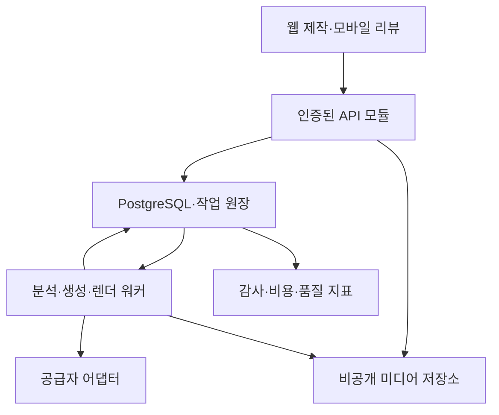

# 04. 기술 명세·데이터 계약·운영 요구서

> 문서 상태: 2026-10-23 기준 설계안. 신규 IP 음악영상 제작 플랫폼의 내부 계약이며, 실제 서비스·외부 유료 생성·성능 시험 결과가 아니다. Aethon의 코드, 고객, 데이터, 검증 결과를 승계하지 않는다. 명시된 성능·품질·복구 수치는 출시 판정을 위한 **제안 목표**다. 공급자 기능·단가는 연결 시점에 다시 확인한다.

## 4.1 기술적으로 약속할 수 있는 범위

제품의 핵심은 생성 모델 자체보다 **어떤 설정을 언제, 누구의 승인으로, 어떤 장면에 적용했는지 기록하고 다음 작업에서 재사용하는 제작 시스템**이다. 관계형 데이터베이스에도 타입, 관계, 제약, 유효 시점, 출처, 승인 이력을 명확히 두면 온톨로지를 구현할 수 있다. 그래프 데이터베이스를 사용했다는 사실만으로 서사 일관성이나 이미지 동일성이 보장되지는 않는다.

다음 세 가지를 구분한다.

| 구분 | 이 문서의 약속 | 검증 방식 | 한계 |
|---|---|---|---|
| 결정적 처리 | 승인된 입력·버전·권한·비용 상한을 정확히 적용 | 계약·통합·장애 주입 시험 | 구현 전에는 달성 아님 |
| 확률적 생성 | 제약·참조를 제공하고 실패를 감지·수정 | 고정 평가 세트, 사람이 보는 블라인드 평가 | 같은 프롬프트도 결과가 달라질 수 있음 |
| 장기 제품 비전 | 이전 작품을 활용해 적은 수정으로 다음 작품 제작 | IP별 종단 평가, 재구매·실제 작업 시간 | 자동 기억만으로 취향·완성도를 보장할 수 없음 |

G0 기술 실증은 승인된 이미지와 짧은 생성 클립을 조합하는 15~30초 음악영상부터 검증한다. G1 유료 파일럿은 G0 통과 후 30~60초 범위로 확장하며, 같은 품질을 더 긴 길이에서도 유지하는지 별도로 측정한다. 완성형에는 긴 MV, 다인물 장면, 표정·립싱크·안무, 외부 편집기 교환, 팀 승인, 다국어·다중 포맷을 포함하되 각각 별도 기능 게이트를 통과해야 한다. 모델이 제공하지 않는 정밀 안무·동일 인물 유지 기능을 프롬프트만으로 확정 가능하다고 판매하지 않는다.

### G1 유료 운영 전 통과해야 하는 최소 불변조건

전체 기능의 고도화 시점과 유료 서비스가 반드시 지켜야 하는 최소 조건을 구분한다. FR의 완성형 `release_gate`가 G2여도 아래 `baseline_gate=G1` 조건은 G1 시작 전에 실제 실행 시험을 통과해야 한다. 이 문서가 현재 그 시험을 통과했다는 뜻은 아니다.

| G1 최소 조건 | 반드시 확인할 동작 | 연결 기술·시험 | G2에서 고도화할 수 있는 범위 |
|---|---|---|---|
| 권리 철회·권한 차단 | 사용 중지 자료의 새 검색·URL 발급·생성 전송 차단 | TCH-008/013, NFR-007/009, TCT-01/02/19/27/32 | 자동 권리 영향 분석·복잡한 외부 연동 |
| 버전·승인 충돌 방지 | 구버전 편집 덮어쓰기 거절; 결과 승인과 정사 승인 분리 | TCH-007/011/012, TCT-03/05/21 | 실시간 동시 편집·정교한 분기 비교 |
| 삭제·철회 처리 | 즉시 접근 차단, 온라인 삭제 전파, 예외·백업 보관 상태 표시 | NFR-009/010, TCT-27/28 | 다중 공급자 삭제 자동화·관리 UI |
| 이동용 내보내기 | 승인 결과·허용 원본·JSON 타임라인·출처의 파일/해시 일치 | TCH-015, NFR-013, TCT-36 | 외부 NLE·새 공간의 완전한 왕복 호환 |
| 백업 복원 | 격리 환경에서 DB·객체·키 참조 복원 후 삭제 tombstone 재적용 | NFR-006/013, TCT-28 | 대규모 지역 장애·자동 재해복구 |
| 비용·결제 일관성 | 중복 예약·정산 방지, 불명 과금 유지, 해지·늦은 결제 사건의 올바른 처리 | NFR-008/014, TCT-09~17/31/33~35 | 자동 대사·복잡한 요금제·완전한 복구 UI |

최소 조건을 수동 운영으로 만족시키는 경우에도 책임자·처리 기한·감사 기록·실행 증거가 있어야 한다. ‘G2 기능’이라는 이유로 권리 철회, 데이터 반출, 삭제, 복구를 G1에서 생략할 수 없다. 구독 자동갱신을 제공하면 해지 경로는 G1 필수이며, 자동 결제를 사용하면 늦은·중복 결제 콜백 방어도 G1 필수다. NFR-006/007/008/009/010/013의 최소 안전 기준은 G1 전 시험하고 이후 정기 회귀한다. 월 가용성처럼 운영 기간이 필요한 지표는 관측 기간을 명시하며, 출시 당일부터 30일 실측을 이미 달성했다고 표시하지 않는다.

## 4.2 기술 결정 기록

| ID | 결정 | 목적 | 출시 조건 |
|---|---|---|---|
| TCH-001 | Next.js/TypeScript 웹, FastAPI/Python API, 독립 Python 워커 | 제작 UI와 오래 걸리는 처리를 분리 | 의존성 버전 잠금·보안 업데이트 책임 지정 |
| TCH-002 | PostgreSQL 원장 + 명시적 관계 + pgvector | 승인·비용·버전을 한 트랜잭션 경계에 유지 | 테넌트·IP 권한·복합 FK 시험 |
| TCH-003 | 모듈형 단일 API, 작업별 워커 풀 | 초기 운영 복잡도 제한 | 모듈별 소유권·계약·마이그레이션 분리 |
| TCH-004 | PostgreSQL job/outbox/lease 큐 | 요청 수락·비용 예약·작업 발행의 원자성 | 프로세스 종료·중복 전달 복구 시험 |
| TCH-005 | 비공개 S3 호환 저장소 + FFmpeg/ffprobe | 원본 보존·프록시·결정적 합성 | 코덱·음원·색·비율 검증 |
| TCH-006 | 사실·자산·선호·피드백의 분리 | 출력물이 자동으로 공식 설정이 되는 오류 방지 | 승인 종류 간 권한 분리 시험 |
| TCH-007 | 불변 스냅샷과 입력 계보 | 과거 재현·영향 장면만 수정 | 수정 후 과거 원본 해시 불변 |
| TCH-008 | 권한·시점·분기 필터 후 검색 | 타 IP·초안·폐기 설정의 유출 방지 | RAG 교차 테넌트 누출 0건 |
| TCH-009 | 공급자 어댑터와 버전별 능력 등록부 | 생성 모델 교체·지원 불가 기능 통제 | 문서 확인과 실측 시험 모두 기록 |
| TCH-010 | 비용 예약·정산 원장 | 재시도·병렬 호출의 예산 초과 방지 | 동시 요청·미확인 과금 대사 시험 |
| TCH-011 | 생성·공식설정·배포 승인 분리 | 사용자의 의도를 정확히 반영 | 잘못된 자동 승격 0건 |
| TCH-012 | 프로젝트·샷 변경의 낙관적 잠금 | 편집 충돌·오래된 결과 덮어쓰기 방지 | 버전 충돌 시 409/412와 비교 UI |
| TCH-013 | 입력 격리·URL 통제·삭제 전파 | 미디어 수집과 장기 기억의 위험 통제 | 업로드·SSRF·삭제 복원 시험 |
| TCH-014 | 실제 생성량·채택량·수정 시간을 계측 | ‘몇 번이면 되는가’를 데이터로 판단 | 분모·중단·재시도 로그 누락 없음 |
| TCH-015 | 내보내기와 이동 가능한 데이터 계약 | 고객 IP와 제작 자산의 이식성 | JSON/원본/타임라인 묶음 복원 검증 |

FastAPI 공식 문서는 무거운 백그라운드 계산의 별도 프로세스·큐 사용을 안내한다. 이 설계는 요청 프로세스 내 `BackgroundTasks`만으로 생성 작업을 운영하지 않는다. PostgreSQL 문서는 `SKIP LOCKED`를 여러 소비자가 큐 형태 테이블을 처리하는 데 사용할 수 있다고 설명한다. 이를 바탕으로 초기에는 별도 메시지 브로커 없이 내구성 작업 테이블을 선택했다. 내구성·멱등성·비용 통제는 아래 자체 계약으로 구현해야 한다. [S-T02][S-T04]

### 최소 실행 구성과 확장 경계

API 모듈은 Identity, Knowledge, Media, Planning, Production, Review, Billing, Operations로 나눈다. 각 모듈은 다른 모듈의 테이블을 임의 수정하지 않고 서비스 함수·도메인 이벤트를 사용한다. 장시간 생성과 렌더는 별도 컨테이너에서 실행하며, API 배포와 독립적으로 워커 수를 조절한다. 초기에는 자체 GPU를 필수로 두지 않는다. 음원 분석·프록시 비용과 외부 영상 생성 비용을 별도로 집계한다.

**확장 검토 조건(제안):** 제어 API의 목표 지연을 2주 연속 넘기고 큐 쿼리가 DB 부하의 20% 이상을 차지하면 큐 분리를 검토한다. 24시간 이상 유지되는 외부 승인·복구 단계가 빈번하거나 팀이 직접 상태 전이를 안전하게 관리하지 못하면 Temporal 등 내구성 워크플로 엔진을 비교 실험한다. 특정 렌더 작업이 다른 큐 대기 시간을 침해하면 렌더 워커 풀을 먼저 분리한다. 이 임계치는 마이그레이션의 자동 명령이 아니라 원인 분석을 시작할 운영 기준이다.

## 4.3 도메인 계층과 기억의 의미

계층은 `workspace(tenant) → IP → era/campaign → song/project → shot → take → revision`이다. 곡은 여러 프로젝트에서 재사용할 수 있고, 하나의 캠페인에 티저·MV·가사 영상·세로 클립 프로젝트가 각각 존재한다. 공개 작품의 순서, 세계관 안의 사건 순서, 시스템에 기록된 순서는 별도다.

| 기억 종류 | 예시 | 권한·수명 | 다음 생성에서의 처리 |
|---|---|---|---|
| 공식 설정 | 멤버의 왼쪽 눈 문양, 두 역할의 관계 | 설정 관리자의 명시적 승인; 분기·시대 제한 | 적용 가능한 승인 버전만 강한 제약으로 사용 |
| 제작 자산 | 승인된 얼굴·의상·로고·3D 모델·기존 클립 | 소유·라이선스·허용 용도·버전 | 사용 가능한 정확한 자산 버전을 참조 |
| 선호 규칙 | 이 IP는 후렴에서 빠른 컷을 선호 | IP/캠페인/개인 범위, 근거·확신·만료 | 공식 설정을 침해하지 않는 연출 가중치 |
| 피드백 사건 | 이 테이크는 얼굴은 좋지만 색이 과하다 | 특정 샷·버전·작성자·시간 | 학습 후보의 근거; 즉시 전체 규칙으로 승격 금지 |

**인물 분리:** 실존 출연자(`human_person`)와 허구 역할(`fictional_character`)은 다른 엔티티다. `portrays` 관계는 허용되지만 역할의 나이·성격·사건을 실존자의 사실로 복사할 수 없다. 가사는 우선 `lyric_text` 자료이며 은유를 실제 연애·사망·정치적 견해로 추론하여 공식 설정에 기록하지 않는다.

**타입이 있는 관계:** `member_of`, `portrays`, `wears`, `belongs_to_era`, `appears_in`, `rival_of`, `recalls_event`, `visual_motif_of`를 버전이 있는 술어로 정의한다. 술어마다 주어·목적어 허용 타입, 단일값 여부, 시간 범위, 역관계, 허용 적용 범위를 지정한다. 자유 텍스트 관계는 검토 후보로 보존할 수 있지만 승인된 스키마를 통과하기 전 공식 제약에 쓰지 않는다.

**시간과 분기:** assertion revision에는 `valid_story_from/to`, 선택적인 `story_ordinal_from/to`, `recorded_at`, `branch_id`, `era_id`, 근거 연결(`evidence_links`), `confidence`, `supersedes_id`를 둔다. 세계관이 달력 날짜를 쓰지 않으면 별도 이야기 순서값과 라벨을 사용한다. 날짜를 억지로 실제 생일처럼 만들지 않는다. `main`, `alternate`, `dream` 등의 분기는 사용자에게 보이는 이름이고 내부에는 UUID와 부모 분기를 저장한다. 부모 분기의 어떤 승인 스냅샷을 상속했는지 고정해야 나중 변경이 새 분기에 조용히 섞이지 않는다.

**충돌 해결:** 서로 다른 승인 사실이 동일한 단일값 관계·시간 범위에 겹치면 자동으로 최근 값을 선택하지 않는다. 후보 충돌을 표시하고 설정 관리자에게 수정·시간 분리·다른 분기 선택을 요청한다. 소수 신뢰도 차이로 정사를 결정하지 않는다. 프로젝트 override는 해당 프로젝트의 예외이며 원래 공식 설정을 수정하지 않는다. 의상 같은 허용 가능한 예외와 인물 정체성·권리 같은 금지 제약을 구분한다.

예를 들어 ‘은발’이었던 캐릭터가 새 활동기에서 ‘흑발’로 바뀌어도 이전 MV의 스냅샷은 은발을 유지한다. 새 활동기에 흑발 사실과 적용 시작 시점을 승인한다. 기존 MV의 리마스터에서는 제작자가 ‘원작 설정 유지’와 ‘새 설정 적용’을 선택하고, 후자의 경우 영향 장면·새 예상 비용·기존 결과 유지 여부를 확인한다.

## 4.4 데이터 사전

아래는 SQL 설계에 대응하는 주요 테이블이다. 대부분의 도메인 테이블은 `(tenant_id, id)` 복합 유일키와 같은 테넌트를 강제하는 복합 외래키를 가진다. 공통 시간은 UTC `timestamptz`, 프레임·샘플 위치는 정수와 유리수 timebase, 금액은 부동소수점이 아닌 `numeric`을 사용한다. 이 SQL은 검토 가능한 설계 출발점이며 운영 DB에 적용한 마이그레이션이 아니다.

### 신원·권한·IP

| 테이블 | 핵심 필드 | 관계 | 핵심 제약 |
|---|---|---|---|
| tenants | id, name, status, revision | 최상위 작업공간 | 삭제 상태에서 새 생성 금지 |
| principals | id, external_subject, status | 외부 IdP 식별자 | 외부 subject 유일; 주민정보 저장 금지 |
| memberships | tenant_id, principal_id, role | 사용자와 작업공간 | 기본 역할 1개 + 복수 세부 grant |
| ips | name, default_locale, revision | tenant 소속 | 범위 없는 전역 기억 금지 |
| eras | ip_id, name, starts_at, ends_at | IP 활동기/캠페인 | 시작 ≤ 종료 |
| narrative_branches | ip_id, parent_id, fork_snapshot_id | IP의 세계관 분기 | 순환 상속 금지; fork 불변 |
| access_grants | principal_id, ip_id/project_id/asset_id, permission | 객체 단위 접근권 | 대상 하나; 만료·철회 즉시 적용 |

### 지식·근거·선호

| 테이블 | 핵심 필드 | 관계 | 핵심 제약 |
|---|---|---|---|
| entities | ip_id, entity_type, stable_key | 인물·의상·장소·사건 | 실존자·역할 타입 분리 |
| entity_revisions | entity_id, revision, attributes, schema_version | 엔티티 불변 버전 | 엔티티 내 버전 유일 |
| predicate_definitions | key, subject_types, object_types, value_schema | 타입이 있는 관계 정의 | 승인되지 않은 타입 변경 금지 |
| assertions | ip_id, subject_id, predicate_id | 사실/관계의 안정 ID | IP·주어 일치 |
| assertion_revisions | assertion_id, object_entity_id/value, branch_id, validity, confidence | 사실·관계 버전 | 객체·리터럴 중 하나; 확신 0~1 |
| evidence_links | assertion_revision_id, asset_revision_id, locator, quote_hash | 근거 원문·구간 | 원본 삭제 시 근거 삭제 상태 표시 |
| preference_rules | ip_id, scope, key | 취향 규칙의 안정 ID | IP/캠페인/프로젝트/개인 범위 |
| preference_revisions | rule_id, rule, confidence, evidence_count, expires_at | 선호 버전 | 만료·부정 증거 함께 조회 |
| approval_decisions | target_kind, target_id, decision, actor_id, expected_revision | 각종 승인 사건 | 대상 종류별 권한; append-only |
| feedback_events | project_id, take_id, dimensions, reason, actor_id | 관측된 피드백 | 채택/거절 이유와 적용 범위 보존 |

### 미디어·프로젝트·생성

| 테이블 | 핵심 필드 | 관계 | 핵심 제약 |
|---|---|---|---|
| assets | ip_id, kind, rights_status, deletion_state | 원본 자산 | 권리 미확인 시 외부 전송 제한 |
| asset_revisions | asset_id, object_key, sha256, media_info, version | 자산 불변 버전 | 원본 덮어쓰기 금지; 경로 유일 |
| songs | ip_id, audio_revision_id, lyrics_revision_id | 곡과 승인 음원 | 음원·가사 버전 분리 |
| song_segments | song_id, start_sample, end_sample, label, confidence | 구간·박자·가사 정렬 | 범위 유효; 수동 수정 버전 보존 |
| projects | ip_id, era_id, branch_id, song_id, status, revision | 산출물 단위 | 곡/IP/분기 범위 일치 |
| context_snapshots | project_id, manifest, manifest_hash, policy_version | 검색·설정·자산·가격 고정 | 불변; 변경 시 새 스냅샷 |
| shots | project_id, order_key, current_revision | 논리 장면 | 정렬키·ID 분리 |
| shot_revisions | shot_id, revision, in_frame, out_frame, spec, snapshot_id | 장면 계획 버전 | 양수 길이; 과거 계획 불변 |
| shot_dependencies | shot_revision_id, source_kind, source_id, source_hash | 부분 재생성 계보 | 타입·해시·정확한 버전 저장 |
| takes | shot_revision_id, asset_revision_id, job_id, ordinal | 생성 후보 | 후보 선택 ≠ 공식설정 승인 |
| project_versions | project_id, revision, edit_decisions, snapshot_id | 컷 편집·타임라인 버전 | 선택 테이크와 정확한 in/out 고정 |
| reviews | project_version_id, actor_id, at_frame, body, status | 시간대별 검토 | 댓글 대상 버전 고정 |
| exports | project_version_id, profile, artifact_revision_id, job_id | 내보내기 | 출력 프로필과 결과 해시 보존 |

### 작업·비용·운영

| 테이블 | 핵심 필드 | 관계 | 핵심 제약 |
|---|---|---|---|
| provider_model_releases | provider, model, revision, capability, price_version | 공급자 모델 등록 | 미확인 능력은 false가 아닌 unknown |
| generation_jobs | scope_kind, project_id/ip_id, kind, state, snapshot_id, idempotency_key, lease_until | 비동기 작업 | 테넌트+키 유일; 요청 해시 일치 |
| provider_attempts | job_id, attempt_no, external_id, submission_state, cost_status | 외부 접수 단위 | 접수 미확인 시 자동 새 생성 금지 |
| job_events | job_id, sequence, event_type, payload | 상태 변화 | 작업별 단조 증가; 재연결 재생 |
| budget_accounts | currency, posted_balance, reserved_balance | 고객·공급자 원가 계정 | 통화별 계산; 잔액 잠금 |
| budget_reservations | account_id, job_id, amount, state, expires_at | 승인 비용 상한 | 작업당 중복 예약 금지 |
| ledger_entries | account_id, reservation_id, posted_delta, reserved_delta, event_key | 예약·정산·해제 원장 | append-only; 사건 키 유일 |
| webhook_inbox | provider, dedupe_key, signature_status, received_at | 외부 이벤트 수신 | 중복은 수신하되 처리 1회 |
| outbox_events | aggregate_id, event_key, payload, published_at | 트랜잭션 후 전달 | DB commit과 같은 트랜잭션 |
| retrieval_chunks | asset_revision_id, ip_id, text, embedding_config, embedding | 승인 자료 검색 | ACL 재검증; 모델 차원 일치 |
| audit_events | actor_id, action, target_id, before_hash, after_hash | 변경·접근 감사 | 민감 원문 대신 ID·해시 |
| deletion_requests | scope, target_id, state, propagation, requested_by | 삭제·철회 파이프라인 | 저장소별 완료·예외 상태 |

완성형 보조 테이블은 `planning_artifacts`(계획·스토리보드·견적·영향 분석), `memory_proposals`, `share_links`, `releases`, `upload_sessions`, `integrations`, `api_keys`, `support_access`, `editing_presets`다. SQL 파일은 전체 51개 테이블, 그중 tenant 열이 있는 48개 테이블을 포함한다. 프로젝트가 아직 없는 업로드·삭제·자료 추출 작업도 실행할 수 있도록 job은 workspace/IP/project 범위 중 하나를 지정한다.

초대·구독·결제·평가 실험·배정·자동저장 초안·게시 예약·기업 SSO의 완성형 API도 정의했으나, 이 보조 기능의 상세 저장 마이그레이션은 해당 기능 구현 게이트에서 추가한다. 구독·자동 결제를 G1에 활성화한다면 구독 주기·해지 의도·검증된 결제 사건 저장과 복구는 G1 전 구현해야 하며 G2로 미룰 수 없다. 현재 SQL을 완성형 서비스 전체의 운영 스키마라고 부르지 않는다. 파일은 핵심 온톨로지·제작·과금·보안 경계를 구체화하는 설계 스키마다.

**별도 애플리케이션 제약:** SQL만으로 충분하지 않은 같은 IP/프로젝트 일치, 분기 순환, 승인 상태의 의미, 실제 타입별 JSON Schema, 리뷰 권한, 자산 라이선스 범위, 정책 우선순위는 도메인 서비스에서 검증한다. 모든 쓰기는 서비스 경로를 사용하며 SQL 직접 접근은 이 검증을 대체하지 못한다. SQL 파일에 그 경계를 주석으로 명시한다. 배포 전 실제 PostgreSQL+pgvector에서 FK·RLS·마이그레이션 시험을 추가해야 한다.

## 4.5 기억 생성·검색·적용 알고리즘

### 자료 수집에서 승인까지

1. 업로드 자산은 검역 상태로 저장하고 해시·실제 파일 형식·크기·영상 길이·권한 선언을 확인한다. 문서·가사·기존 MV의 추출 결과에는 페이지, 타임코드 또는 샘플 범위가 붙는다.
2. 추출기는 인물·속성·관계·색·카메라·편집 스타일을 **후보**로 제시한다. 신뢰도는 정답 확률로 표현하지 않고 모델 추정치로 표시한다. 낮은 신뢰 후보는 재확인 대상이다.
3. 타입 검사와 중복 병합 제안을 수행한다. 동일 이름이라도 실존자/역할, 다른 IP, 다른 분기이면 자동 병합하지 않는다.
4. 설정 관리자는 후보를 채택·수정·거절하고 분기·시대·유효 범위를 지정한다. 승인 사건이 없으면 공식 설정 검색에 들어가지 않는다.
5. 제작자는 자산의 용도와 선호 후보를 따로 승인한다. 선호 한 건에 반대 피드백이 생기면 기존 규칙 삭제 대신 새 버전·확신 조정 제안을 만든다.

### 새 프로젝트 컨텍스트 구성

1. 인증된 사용자, tenant, IP/project grant를 확인한다. 사용자가 보낸 tenant ID만으로 DB 컨텍스트를 설정하지 않는다.
2. 프로젝트의 IP·활동기·세계관 분기·공식설정 시점·허용 자산·비용 정책을 확정한다.
3. 적용 가능한 승인 사실을 타입·시간·분기로 먼저 가져온다. 반드시 지킬 규칙은 의미 검색 순위와 무관하게 넣는다.
4. 접근 가능한 자료 집합 안에서 키워드 검색과 벡터 검색을 수행한다. 소규모는 정확 검색으로 시작한다. 대규모 ANN 도입 시 필터 후 recall과 IP 간 간섭을 측정한다. pgvector 공식 문서는 근사 인덱스 필터링과 다중 테넌트 recall의 주의를 설명한다. [S-T03]
5. 관계를 제한된 깊이로 확장한다. 초기 제안은 2 hop, 최대 100 엔티티이며 실제 유효성·토큰 예산을 평가해 조정한다. ‘관계가 있다’는 이유만으로 모든 과거 정보를 넣지 않는다.
6. 공식설정 → 프로젝트에서 승인한 예외 → 해당 활동기 선호 → IP 선호 → 개인 UI 선호의 적용 순서를 정한다. 상충되는 필수 제약은 생성 전에 차단한다. 개인 UI 선호가 IP 공식설정을 바꾸지 않는다.
7. 선택한 사실·자산·선호 버전, 제외된 충돌, 출처, 프롬프트 템플릿, 검색기/임베딩 버전, 정책, 모델 능력·가격 버전을 `context_snapshot`에 고정한다.
8. 장면 계획자는 샷마다 사용한 항목을 `shot_dependencies`로 기록한다. 생성 직전에 권한 철회·삭제·권리 만료를 다시 검사한다. 과거 스냅샷은 감사에 남아도 철회된 자산을 재전송할 권리를 만들지 않는다.

검색 자료와 업로드 문서는 명령으로 실행하지 않는다. 문서 안의 ‘다른 IP 파일을 불러오라’는 문장은 분석 대상 텍스트다. 도구 호출은 서버가 정한 허용 목록과 구조화된 인자로만 수행하며, 모델이 제안한 URL·파일 경로·비용·권한은 신뢰하지 않는다.

### 기억이 사용됐다는 설명

UI에는 ‘이 장면에 적용됨: 왼쪽 눈 문양 v3 / 2기 검은 의상 v2 / 지난 영상의 파란 역광 선호’처럼 사람이 읽는 출처를 보여준다. 기술 로그에는 정확한 ID와 해시를 남긴다. 설명은 실제로 컨텍스트에 포함된 항목과 모델에 전달된 참조만을 근거로 하며, 넣지 않은 설정을 사후 설명으로 꾸미지 않는다. 특정 설정을 프롬프트에 넣었다는 사실과 출력이 실제로 지켰다는 품질 판정도 구분한다.

## 4.6 제작 파이프라인과 부분 재생성

| 단계 | 입력 → 출력 | 자동 검증 | 사람의 결정 |
|---|---|---|---|
| 음원 분석 | 승인 음원 → 구간·박자·가사 정렬 후보 | 길이·샘플레이트·무음·인코딩 | 분석이 어긋나면 경계 수정 |
| 기획 | 스냅샷·목표 → 콘셉트·장면 계획 | 금지 제약·길이·예산 | 콘셉트와 사용 설정 승인 |
| 스토리보드 | 샷 계획 → 키프레임·참조 묶음 | 인물/의상/로고/구도 점검 | 승인 컷을 생성 기준으로 고정 |
| 생성 | 샷별 키프레임·제약 → 복수 테이크 | 공급자 상태·파일·길이·기술 결함 | 후보 선택 또는 구체적 수정 |
| 조립 | 선택 테이크·음원·EDL → 프록시 | 빈 구간·잘린 가사·오디오 길이 | 시간대별 검토·부분 변경 |
| 최종 출력 | 승인 타임라인 → MP4 등 | 전체 디코드·영상/음성 스트림·해시 | 배포 승인·다운로드 |
| 다음 작업 준비 | 검토·선택 → 선호/설정 후보 | 범위·반대 증거·권리 | 기억 업데이트를 별도 승인 |

**부분 수정 규칙:** ‘재킷 색만 변경’은 그 자산·설정을 참조한 샷을 찾는다. 배경만 영향을 받는 샷은 배경 수정 후보, 인물과 배경이 결합된 영상은 재생성 후보로 표시한다. 모델이 부분 편집을 지원하지 않으면 ‘해당 샷 전체를 다시 생성’이라고 설명한다. 픽셀 수준 선택 수정이 항상 가능한 것처럼 표현하지 않는다.

사용자는 변경 영향 목록, 새 버전 스냅샷, 예상 추가 비용, 유지되는 샷을 검토한다. 해당 샷의 새 테이크를 만들어 선택하기 전에는 현재 프로젝트 버전을 바꾸지 않는다. 영상 길이·노래 구간이 변경되면 인접 전환·가사 위치·음원 정렬·출력 프로필까지 의존성을 전파한다. 의존성이 불완전하면 ‘자동 영향 판정 불확실’로 표시하고 비교 검토를 요구한다.

**재현성의 정의:** 원본 파일과 선택 테이크로 같은 컷 편집을 복원하는 것은 목표다. 동일 모델·seed·프롬프트로 외부 모델 출력을 비트 단위 재생성할 수 있다고 약속하지 않는다. 모델 버전이 중단되어도 기존 생성 파일·메타데이터·타임라인을 보존해 다시 내보낼 수 있게 한다.

## 4.7 비동기 작업·실패·과금 계약

### 상태 모델

`draft → validated → reserved → queued → submitting → running → validating_output → succeeded`를 정상 경로로 둔다. 별도 상태는 `blocked`, `submission_unknown`, `retry_wait`, `cancel_requested`, `cancelled`, `failed`, `reconciliation_required`다. 생성 완료 상태와 `cost_status=pending/confirmed/disputed`는 서로 독립적이다.

| 상황 | 상태·행동 | 재시도 원칙 | 사용자 표시 |
|---|---|---|---|
| 접수 전 로컬 검증 실패 | blocked; 외부 호출 없음 | 입력 수정 후 새 검증 | 실패 항목·추가 비용 0 |
| 공급자가 명확히 거절 | failed 또는 retry_wait | 공식 재시도 조건·상한 적용 | 거절 이유·재시도 예상비용 |
| 접수 요청 중 타임아웃 | submission_unknown | 공급자 식별자/멱등성 기능으로 대사; 맹목 POST 금지 | 접수 확인 중·예약금 유지 |
| 접수 후 워커 재시작 | lease 회수·동일 외부 작업 조회 | 상태 조회 재개, 새 생성 금지 | 작업 복구 중 |
| 늦게 도착한 완료 이벤트 | 상태 확인·파일 검증 | 종료 상태 후 역행 금지 | 유효 결과와 비용을 대사 |
| 사용자 취소 | cancel_requested | 지원 시 취소 요청; 미지원이면 추가 샷 제출 중단 | 이미 발생한 비용은 남을 수 있음 |
| 모델 출력 불량 | 기술 실패 또는 품질 거절 | 새 유료 생성은 상한 내·사용자 정책대로 | 실패 종류와 누적 생성 횟수 |

**워커 계약:** 작업 lease 60초, heartbeat 15초를 초기 제안으로 둔다. lease 만료는 ‘외부 작업이 없었다’는 증거가 아니다. 워커는 공급자 시도 레코드를 먼저 읽고 접수 상태를 복구한다. 각 단계는 입력 해시와 완료 마커를 보존한다. 예산·종속성·권한을 다시 확인한 후에만 다음 단계로 넘어간다. 사용자 취소 이후에도 이미 실행된 공급자 결과가 도착할 수 있으며 보존·정산 정책을 적용한다.

**중복·역순 수신:** webhook은 공급자마다 공식 인증 방식을 적용하고 원문 바이트 기준으로 검증한다. 내부의 정규화 이벤트 형식은 외부 공급자의 실제 payload 규격이라고 주장하지 않는다. `(provider, external_event_id)` 또는 공식 event ID가 없을 때 안전하게 구성한 해시로 중복을 제거한다. 수신을 DB에 저장한 뒤 신속하게 응답하고 후속 처리는 워커가 수행한다. 단순 상태 숫자 비교 대신 허용 전이표와 공급자 현재 상태를 사용한다. AWS도 S3 이벤트의 중복과 순서 변경 가능성을 명시한다. [S-T05]

### 비용 예약과 정산

1. 서버가 공급자·모델·해상도·생성 초수·입력 미디어·최대 재시도·합성 비용으로 상한 견적을 만든다. 견적에는 단가 버전, 통화, 세금 포함 여부, 유효기간을 넣는다.
2. 사용자가 승인한 견적과 비용 상한을 제출한다. 같은 트랜잭션에서 계정을 잠그고 사용 가능한 잔액, 기존 예약, 프로젝트 한도를 검증한다.
3. `reservation`과 `ledger(reserve)`를 만들고 `generation_job + outbox`를 commit한다. job 생성 실패로 예약만 남지 않도록 한다.
4. 공급자 실제 접수 건마다 `attempt_no`, request hash, 외부 ID, 실제 과금 단위를 기록한다. 입력 영상·레퍼런스에도 비용이 붙는 모델은 이를 원가에 포함한다. Runway 공개 요금표도 모델별로 출력 초수뿐 아니라 입력·참조 과금을 구분한다. [S-T08]
5. 확인된 비용만 `settle`로 정산하고 잔여 예약을 해제한다. 실패·취소가 무조건 무료라는 가정을 두지 않는다. 공급자 청구서와 월별 대사한다.
6. 접수 미확인 비용은 `pending_liability`로 구분한다. 30분 이상이면 운영 알림, 24시간 이상이면 수동 대사 큐를 제안한다. 실제 보유 기간·고객 크레딧 처리 약관은 상용화 전에 확정한다. 미확인 예약을 자동 해제한 직후 같은 생성을 중복 제출하지 않는다.

고객 청구액(KRW), 공급자 원가(USD), 내부 크레딧은 다른 계정·단위다. 환율·가격·할인·세금 스냅샷 없이 합산하지 않는다. 상한은 **추가 제출을 제어하는 한도**이며, 공급자의 단가 변경·보고 지연 등에서 물리적으로 모든 외부 청구를 0오차로 차단한다는 약속이 아니다. 가격 버전이 달라지면 제출 전에 새 견적 동의를 받는다. 운영자도 로그 없이 상한을 올릴 수 없다.

**후보 상한:** 기본 실행 묶음은 샷당 첫 시도를 포함해 총 3개 후보에서 자동 중지한다. 이를 초과하는 품질 탐색은 계획·원인·추가 견적·예산을 다시 승인한 새 실행으로 처리한다. 내부 통신 재전송과 유료 후보 생성 횟수는 각각 집계한다.

기획·추출·분석처럼 구독에 포함된 처리도 공급자 원가와 tenant별 한도를 기록한다. API의 `x-billable=false`는 개별 유료 미디어 생성 승인을 받는 경로가 아니라는 뜻이며 원가 0을 뜻하지 않는다. 이러한 작업에는 입력 크기·출력 토큰·실행 횟수·월 포함량의 서버 상한을 적용하고, 상한을 넘기는 경우 유료 전환 견적 또는 중단을 명시한다.

**멱등성:** 과금 가능 POST는 `Idempotency-Key`를 필수로 한다. 서버는 operation과 클라이언트 키를 합친 이름공간 키를 원장에 저장한다. 키와 요청 body 해시가 같으면 기존 결과/작업을 반환한다. 키는 같은데 body가 다르면 409다. 내부 키 보존은 최소 30일로 제안하며 회계 원장의 중복 방지 키는 보존 기간 동안 유지한다. 네트워크 복구를 위한 동일 요청 재전송과 품질 개선을 위한 새 생성은 다른 동작이다. 후자는 새 attempt 또는 새 job과 명시적 비용 예약을 사용한다.

## 4.8 모델 어댑터와 능력 매트릭스

어댑터 내부 인터페이스는 `validate_input`, `estimate`, `submit`, `query`, `cancel`, `fetch_output`, `reconcile_cost`로 설계한다. 이는 본 플랫폼의 인터페이스이며 어느 공급자의 실제 API 경로나 매개변수라고 주장하지 않는다. 공급자별 구현은 공식 문서와 계약 테스트로 연결한다.

| 능력 필드 | 값의 형태 | 운영 원칙 | 미확인일 때 |
|---|---|---|---|
| input/output 모달리티 | text/image/video/audio 목록 | 작업 종류별 등록 | 선택 UI 숨김 |
| duration·resolution·fps·ratio | 허용 범위/열거값 | 생성·출력 조건 별개 | 제출 차단 |
| references | 종류별 최대 수·용량·길이 | 인물/스타일 참조 구분 | 얼굴 고정 약속 금지 |
| first/last frame·edit mask | supported/unsupported/unknown | 실제 지원 장면만 노출 | 대체 제작 방식 제시 |
| audio·lip-sync·motion | 지원 언어·길이·조건 | 음원 보존/합성 여부 명시 | 자동 립싱크 비활성 |
| cancel·idempotency·webhook | 지원 상태·문서 URL | 없는 기능을 내부에서 가정하지 않음 | 폴링·대사 전략 필요 |
| pricing | 단위·최소과금·입력과금·버전 | 견적과 실제 비용 대사 | 유료 호출 금지 |
| license·retention·training | 계약 근거·상업 사용·보관·학습 조건 | 고객 자료 전송 적합성 검토 | 기업 IP 전송 차단 |
| test evidence | 날짜·실험셋·결과·샘플 수 | 모델 업데이트 시 회귀 | ‘문서상 지원’으로만 표시 |

문서상 능력과 실측 성공률은 별도 필드다. 다인물·특수 의상·작은 로고·손·춤·한글 가사·빠른 컷에서 각각 평가한다. 특정 공급자가 모든 항목을 지원한다는 전제로 모델 이름을 하드코딩하지 않는다. 모델별 최대 입력 길이와 참조 수가 없는 상태에서 조용히 잘라내지 않고 사용자에게 어떤 자료가 제외되는지 설명한다.

초기 어댑터 1개를 안정화한 뒤 대체 공급자 1개를 붙여 동일 평가 세트에서 품질·원가·지연·정책 적합성을 비교한다. 장애 시 자동 대체는 사전에 사용자가 허용한 모델·원가·데이터 처리 지역·품질 조건 안에서만 한다. 조건을 만족하는 대안이 없으면 중단한다.

## 4.9 내부 API 계약

첨부 `technical_contracts.openapi.yaml`은 **설계용 OpenAPI 3.1 문서**다. 116개 경로·143개 operation·122개 데이터 스키마를 포함한다. 33개 operation은 상세 `core` 계약, 110개는 완성형 범위를 명시한 `planned` 계약이며 모두 미구현 상태다. `core`는 구현 완료나 검증 완료를 뜻하지 않는다. 각 operation에 16개 모듈 중 하나의 `x-module`, 권한, 비동기 여부, 과금 여부, 관련 FR을 표시했다. 실행 중인 서버나 공급자 API 문서가 아니다. 아래 경로 앞에는 기본적으로 `/v1/workspaces/{workspaceId}`가 붙는다. `200/201`은 동기 결과, `202`는 작업 수락이며 결과 완료를 뜻하지 않는다.

### 공통 규칙

- 인증은 외부 OIDC/JWT 검증을 가정한다. 서버가 토큰 subject와 membership을 연결한다. 브라우저에 공급자 비밀키를 보내지 않는다.
- 명령별 권한을 검사한다. 예: `knowledge.propose`, `knowledge.approve`, `production.generate`, `production.approve`, `billing.manage`, `release.approve`. 역할은 권한 묶음이며 이름만으로 권한을 추정하지 않는다. membership의 기본 역할 하나에 여러 세부 capability grant를 더할 수 있다. Owner/Admin도 공식설정 승인권을 자동 부여받지 않으며 명시적인 `knowledge.approve`가 필요하다.
- 수정은 `If-Match` 또는 `expectedRevision`을 필수로 한다. 리소스가 권한 범위 밖이면 기본 404로 처리하여 존재 여부를 노출하지 않는다.
- 목록은 cursor 기반, 기본 50개·최대 200개를 제안한다. 대용량 전체 내보내기는 별도 비동기 작업이다.
- 오류 body는 `code`, `message`, `requestId`, `retryable`, `details`를 가진다. 내부 스택·토큰·다른 고객 이름을 노출하지 않는다.
- 공통 오류: 400 형식, 401 인증, 403 권한, 404 없음/비공개, 409 상태·키 충돌, 412 오래된 버전, 413 크기, 422 의미/능력 불일치, 429 사용량, 503 일시 불가. `BUDGET_EXCEEDED`, `PRICE_CHANGED`, `SUBMISSION_UNKNOWN`, `RIGHTS_REQUIRED`, `CANON_CONFLICT`를 업무 코드로 구분한다.

### 조회·지식·미디어

| 경로·메서드 | 입력 → 출력 | 필수 권한 | 주요 실패 |
|---|---|---|---|
| GET/POST /ips | 목록/이름·언어 → IP | ip.read / ip.manage | 중복 stable key |
| GET/PATCH /ips/{ipId} | revision·변경 → 새 revision | ip.manage | 412 충돌 |
| POST /ips/{ipId}/eras | 활동기 범위 → era | ip.manage | 날짜 역전 |
| POST /ips/{ipId}/branches | 부모·fork snapshot → branch | knowledge.manage | 순환·다른 IP |
| GET/POST /ips/{ipId}/entities | 타입·속성 → entity revision | knowledge.propose | 타입 위반 |
| POST /entities/{entityId}/revisions | 새 속성·예상 버전 → revision | knowledge.propose | 잘못된 병합 |
| GET/POST /ips/{ipId}/assertions | 주어·관계·값·출처 → 후보 | knowledge.propose | 범위·타입 위반 |
| POST /assertions/{assertionId}/revisions | 수정 후보 → revision | knowledge.propose | 값·객체 동시 입력 |
| POST /approvals | 대상·결정·이유 → 승인 사건 | 대상별 approve | 권한/종류 불일치 |
| GET/POST /ips/{ipId}/preferences | 규칙·범위·근거 → 후보 | preferences.propose | 공식설정 충돌 |
| POST /uploads | 파일 정보 → 업로드 ID·서명 URL | assets.create | 권한·형식·용량 |
| POST /uploads/{uploadId}/complete | 해시·part 목록 → 검사 job | assets.create | 불일치·만료 |
| POST /imports/url | 승인 도메인 URL → 가져오기 job | assets.create | SSRF·권리 미확인 |
| GET /assets/{assetId} | ID → 메타데이터·버전 | assets.read | 삭제·권한 없음 |
| POST /assets/{assetId}/download-links | version·purpose → 짧은 URL | assets.read | 철회·만료 |
| POST /songs | 음원/가사 버전 → song | projects.create | 권리·IP 불일치 |
| PATCH /songs/{songId}/segments | 예상 분석 버전·경계 → 새 분석 | projects.edit | 겹침·범위 이탈 |

### 프로젝트·생성·검토·운영

| 경로·메서드 | 입력 → 출력 | 필수 권한 | 주요 실패 |
|---|---|---|---|
| GET/POST /projects | 곡·분기·목표 → project | projects.read/create | 스코프 불일치 |
| GET/PATCH /projects/{projectId} | revision·변경 → project | projects.edit | 412 충돌 |
| POST /projects/{projectId}/context-snapshots | 기준 시점·범위 → snapshot | projects.edit | 설정 충돌 |
| POST /projects/{projectId}/plans | snapshot·brief → plan job | production.plan | 불완전 입력 |
| GET /projects/{projectId}/shots | cursor → shot 목록 | projects.read | 비공개 |
| POST /shots/{shotId}/revisions | 장면 사양·revision → 새 버전 | projects.edit | 길이·모델 불가 |
| POST /projects/{projectId}/estimates | 샷·모델·시도 상한 → 견적 | production.generate | 단가 미확인 |
| POST /projects/{projectId}/generations | 견적·상한·snapshot → job | production.generate | 예산/가격 변경 |
| POST /projects/{projectId}/impact-preview | 변경 버전 → 영향 샷·견적 | projects.edit | 계보 불완전 |
| POST /projects/{projectId}/regenerations | 선택 영향 샷·견적 → job | production.generate | 오래된 영향표 |
| GET /jobs/{jobId} | ID → 상태·단계·비용 | jobs.read | 비공개 |
| GET /jobs/{jobId}/events | last event → SSE | jobs.read | 오래된 cursor |
| POST /jobs/{jobId}/cancel | 이유 → 취소 요청 | jobs.cancel | 이미 종료 |
| POST /jobs/{jobId}/retry | 허용 오류·새 견적 → 후속 job | production.generate | 접수 미확인 |
| POST /takes/{takeId}/selection | revision·선택 이유 → 선택 사건 | production.approve | 다른 샷·구버전 |
| POST /projects/{projectId}/versions | EDL·take IDs → version | projects.edit | 누락 구간·권한 |
| POST /projects/{projectId}/feedback | 대상·평가 차원·이유 → event | review.comment | 대상 버전 없음 |
| GET/POST /projects/{projectId}/reviews | version·frame·comment → review | review.read/comment | 공개 토큰 범위 |
| POST /projects/{projectId}/exports | 승인 version·profile → job | production.export | 미승인·권리 만료 |
| POST /projects/{projectId}/releases | export·승인 → release event | release.approve | 검토 미완료 |
| GET /billing/usage | 기간·통화 → 원가·예약·채택률 | billing.read | 통화 혼합 |
| GET /billing/subscription | 현재 구독·주기·해지 확정 → 이용 권한 | billing.read | 오래된 상태·대사 중 |
| POST /billing/subscription/cancel | expected revision·endAtPeriod → job | billing.manage | 구독 충돌·공급자 미확인 |
| POST /billing/subscription/resubscribe | 새 견적·주기·명시적 동의 → job | billing.manage | 과거 주기·새 결제 미확인 |
| GET /model-capabilities | task type → 검증된 후보 | production.plan | 연결 가능 모델 없음 |
| GET /audit-events | 기간·대상 → 감사 목록 | audit.read | 허용되지 않은 범위 |
| POST /deletion-requests | 범위·대상·이유 → deletion job | data.delete | 보존 의무/권한 |
| POST /data-exports | 범위·형식 → 이동용 export job | data.export | 라이선스 제외 자산 |

### 완성형 보조 경로와 구현 경계

| 범위 | 대표 추가 경로 | 계약 내용 | 남은 구현 게이트 |
|---|---|---|---|
| 조직·인계 | /invitations, /policies, /ownership-transfers | 초대 만료·복수 grant·정책·소유권 | 재인증·마지막 Owner 보호·초대 전달 |
| IP·자료 | /ips/{ipId}/search, /handoffs, /assets/{assetId}/extractions | 권한 검색·요약·근거 후보 | 추출 오류 보정·후보 승인 |
| 취향·음악 | /preference-experiments, /songs/{songId}/parts | 기억 대조 실험·멤버 파트 | 평가 프로토콜·파트 검토 UI |
| 편집·검토 | /draft, /assignments, /notifications | 자동저장·외주 샷 배정·알림 | 동시 수정·회수·알림 권한 |
| 납품·분석 | /release-schedules, /clones, /evaluations | 예약 배포·복제·모델 평가 | 실행 직전 재승인 조건·보류 평가셋 |
| 요금·운영 | /billing/subscription, /refund-requests, /checkout-sessions, /support-tickets | 구독·환불 검토·호스팅 결제·지원 | 결제사업자 계약·대사·지원 권한 |
| 확장 | /batch-runs, /enterprise-auth, /performance-jobs | 반복 제작·기업 인증·고급 연출 | 정밀 제약·권리·모델 능력별 독립 시험 |

보조 경로의 `Resource` 응답은 계획된 공통 봉투 형식이며, 해당 기능 개발 전에 좁은 응답 스키마를 추가해야 한다. 백업 복구·배포 관리·접근성은 API 한 개로 충족할 수 없다. 별도의 runbook, CI/CD, UI 시험을 요구한다. `api_requirement_reference_map.json`은 전체 96개 FR의 관련 경로를 표시하며, 그 연계가 기능 구현을 증명하지 않는다는 주석을 포함한다.

생성 요청은 `snapshotId`, `estimateId`, `shotRevisionIds`, `maxAttemptsPerShot`, `budgetLimit:{amount,currency}`, `expectedProjectRevision`을 포함한다. 응답은 `jobId`, `state`, `reservationId`, `statusUrl`, `eventsUrl`을 포함한다. 실패 샷의 재생성은 승인된 샷 ID 목록만 대상으로 하며 전체 프로젝트를 기본 재생성하지 않는다.

### 구독 해지·재구독·늦은 결제 사건

구독 해지는 계정 탈퇴·작품 삭제와 다른 명령이다. `cancelSubscription`은 `expectedSubscriptionRevision`과 `endAtPeriod`를 받는다. `endAtPeriod=true`이면 확인된 유료 이용 기간이 끝날 때 갱신을 중지하고, 그때까지 남은 권한과 적용 예정일을 표시한다. 즉시 해지를 지원하는 정책에서는 `false`의 영향과 적용 시점을 먼저 설명한다. 해지 요청만으로 콘텐츠를 삭제하거나 기존 공급자 생성 비용을 환불 처리하지 않는다. 공급자 확인이 비동기라면 ‘해지 확인 중’과 확인된 종료일을 구분한다.

`resubscribe`는 `priceQuoteId`, 현재 revision, `resumeMode`를 받는다. 동일 유료 주기 안에서 해지 예약을 철회하는 경우와 이미 끝난 구독에 새 결제 주기를 여는 경우를 구분한다. 새 동의·현행 가격·검증된 결제 없이 과거 결제 성공 이벤트를 근거로 구독을 재활성화하지 않는다. 구독이 다시 활성화되어도 이전에 철회한 IP/객체 접근권을 자동 복원하지 않는다.

`/v1/payment-webhooks/{provider}`는 결제사업자별 공식 인증·payload를 연결하는 수신 경계다. 검증된 원문을 저장하고 `(provider,eventId)`로 중복을 제거한다. 외부 customer/subscription/invoice ID를 신뢰된 내부 레코드와 연결하고 `billingCycleId`, 내부 revision, 공급자의 현재 상태를 대사한다. 과거 주기의 늦은 `paid` 사건은 과거 원장에 기록하되 현재 해지·재구독 상태를 덮어쓰지 않는다. 실패·성공 이벤트가 역순으로 와도 도착 순서나 browser redirect만으로 이용 권한을 바꾸지 않는다. 결제 실패 시 초안·이력은 보존하고 고지한 정책에 따라 새 유료 작업만 제한한다.

## 4.10 미디어·편집 계약

편집의 기준 시간은 오디오 원본의 샘플 위치와 프로젝트의 유리수 FPS다. 29.97 같은 값을 30으로 근사하지 않는다. 각 클립의 VFR 여부·timebase·원본 FPS를 기록하고 프록시 변환 과정에서 매핑을 보존한다. UI의 초 단위 표시는 편의용이며 저장은 정수 프레임/샘플을 사용한다.

기본 제안 출력은 1920×1080 또는 1080×1920, H.264 MP4, AAC이며 정확한 인코딩 프리셋과 라이선스는 배포 환경에서 확정한다. 원본 WAV/FLAC 등은 변형 없이 보존한다. 비디오 후보의 오디오는 기본 음소거하고 사용자 승인 음원을 타임라인 기준으로 사용한다. 음원 교체·가사 수정·노멀라이즈는 별도 명령이다. ‘영상 스타일 변경’ 요청이 노래를 다시 생성하거나 자르는 원인이 되지 않는다.

합성은 FFmpeg 필터·인코딩 파이프라인을 사용한다. 사용자 입력을 shell 문자열로 연결하지 않고 검증한 인자 배열과 안전한 임시 경로로 실행한다. 자막·폰트·로고·화면비별 안전영역은 구조화된 레이어로 저장한다. FFmpeg가 필터그래프와 변환을 지원한다는 사실과 우리 편집기의 완성도는 별개이며, 실제 미디어를 이용한 교차 검증이 필요하다. [S-T07]

완성형 내보내기는 MP4, 음원, 자막(SRT/VTT), 샷별 원본, JSON 타임라인, 선택적으로 표준 편집 교환 포맷을 제공한다. 특정 NLE와 완전 호환을 주장하기 전 실제 해당 프로그램에서 import→재생→수정→export를 검사한다. 폰트·플러그인·전환 호환이 부족하면 렌더된 클립과 원본 구조를 함께 제공하고 제한을 밝힌다.

## 4.11 권한·보안·보존

### 접근 제어

작업공간 Owner/Admin, IP 설정 관리자, Producer, Creator, Reviewer, Viewer, 운영 지원자를 권한 묶음으로 정의한다. Producer가 생성 예산을 사용할 수 있어도 IP 정사를 승인할 권한은 별개다. 외부 리뷰어는 허용된 프로젝트 버전·프록시·댓글만 볼 수 있으며 원본·정사 전체·다른 프로젝트 검색에 접근하지 못한다. 공개 공유 링크는 별도 토큰 해시·만료·암호 옵션·다운로드 허용 여부를 갖는다.

DB의 RLS는 테넌트 방어선이다. 애플리케이션 역할은 테이블 owner/superuser/BYPASSRLS가 아니어야 한다. PostgreSQL은 이러한 역할의 RLS 우회를 문서화하므로 `FORCE ROW LEVEL SECURITY`와 역할 분리를 함께 적용한다. RLS만으로 세부 IP 권한이 완성되었다고 주장하지 않고 API·검색·파일 URL 발급에서도 검사한다. [S-T01]

캐시 키에는 tenant, IP, 사용자 권한 버전, 데이터 버전이 포함된다. 문서·embedding·검색 결과 캐시의 권한 철회 전파를 시험한다. 모델 프롬프트·로그·평가 세트·지원 도구를 통해서도 다른 고객 자료가 섞이지 않아야 한다. 운영 지원자는 기본 열람권이 없고 고객 승인 또는 계약상 허용된 사건 대응 범위에 한정된 시간제 권한과 감사 로그를 사용한다.

### 업로드와 URL 수집

업로드의 `Content-Type`은 믿지 않는다. 허용 확장자·magic bytes·실제 파싱·길이·해상도·압축 해제 크기·악성코드를 검사한다. 초기에는 PDF/TXT/PNG/JPEG/WAV/FLAC/MP3/MP4처럼 필요한 형식만 허용하고 실행 파일·매크로·무제한 압축 파일은 받지 않는다. 검역 저장소는 생성 공급자에 접근 불가능하다. OWASP의 업로드 지침은 다층 검증의 근거다. [S-T09]

URL 수집은 별도 제한 네트워크 워커로 실행한다. 기본적으로 자동 redirect를 거부하고, 필요한 공급 도메인만 제한적인 redirect를 허용한다. 허용된 HTTPS 도메인과 포트만 사용하고, DNS 해석 및 모든 redirect 단계에서 private/loopback/link-local/클라우드 metadata 주소를 차단한다. 주소에 사용자명·암호를 받지 않는다. DNS rebinding을 고려한 목적지 검증과 outbound 방화벽을 병행한다. 임의 로그인 세션·사용자 쿠키를 대리 이용하지 않는다. 공개 URL이라고 저작권이 해결되는 것은 아니므로 수집과 생성 사용 권한을 따로 기록한다. [S-T10]

저장 데이터는 저장소·DB 암호화와 관리형 키를 사용하고 전송은 TLS로 보호한다. 고객용 API 키는 해시만 저장하고 공급자·외부 연결 토큰은 비밀 관리 서비스 참조를 저장한다. 결제는 결제사업자의 호스팅 세션으로 처리하고 원시 카드 정보를 받지 않는다. 결제 완료 redirect만으로 크레딧을 충전하지 않고 검증된 결제 사건과 원장 멱등성으로 반영한다. 고위험 권한 부여·소유권 이전·비밀 관리에는 재인증과 관리자 MFA를 요구한다.

서명 URL은 bearer token이므로 로그·분석 도구·리퍼러에 남기지 않는다. 기본 다운로드 유효기간은 5분, 공급자 전달용은 작업에 필요한 최소 기간을 제안한다. 즉시 철회가 필요한 공유는 서명 URL만으로 처리하지 않고 매 요청 권한을 검사하는 전달 경로를 사용한다. S3 공식 문서는 서명 URL의 보유자가 권한을 행사할 수 있음을 설명한다. [S-T06]

### 삭제와 보존

삭제 요청 수락 즉시 대상은 `tombstoned`로 바뀌고 새 조회·검색·다운로드 URL·외부 전송을 차단한다. 이후 원본/프록시/자막/썸네일/embedding/캐시/파생물 목록을 추적해 삭제한다. 다른 결과에 포함된 자료의 처리 여부를 사용자 정책에 따라 명시하고 기존 링크를 계속 살려두지 않는다. 공급자 보관은 계약·API가 허용하는 범위에서 삭제를 요청하고 결과를 기록한다.

초기 제안은 온라인 저장소의 삭제 전파 24시간 이내, 백업 만료 35일 이내다. 이는 법적 보존 기간을 정한 사실이 아니라 제품 정책 후보다. 회계·계약상 보존이 필요한 최소 기록은 콘텐츠 원문과 분리하고 예외 사유·기간을 표시한다. 백업 복구 시 삭제 tombstone 목록을 재적용한 뒤 서비스를 개방한다. 이미 다운로드된 파일, 외부 게시본, 공급자가 삭제를 확인해 주지 않는 데이터까지 ‘완전 삭제 완료’로 표시하지 않는다.

## 4.12 비기능 목표와 관측

모든 수치는 출시 전 시험해야 할 목표다. 기준 부하 초안은 100개 작업공간, IP당 승인 항목 10,000개 이하, 전체 검색 chunk 1,000,000개 이하, 동시 활성 편집자 50명, 제어 요청 20 RPS, 동시에 실행되는 외부 생성 20건이다. 고객 수만으로 성능을 정의하지 않고 샷 수·자료 크기·필터 선택도·업로드 대역폭을 함께 기록한다.

| ID | 제안 목표 | 측정·분모 | 출시 조건 |
|---|---|---|---|
| NFR-001 | 제어 API 가용성 월 99.5% | 5xx/timeout 포함한 유효 요청; 계획 중단도 별도 공개 | 측정 30일·에러 버짓 운영 |
| NFR-002 | 일반 조회 p95 700ms 이하 | 서버 수신~응답; 큰 미디어 제외 | 기준 부하 30분·cold/warm 별도 |
| NFR-003 | 생성 요청 수락 p95 1.5초 이하 | 검증·예약·job commit; 생성 완료 제외 | 동시 예산 요청 포함 |
| NFR-004 | 프로젝트 검색 p95 2초 이하 | 권한 필터·검색·출처 조합 | recall@20 및 접근 누출 함께 보고 |
| NFR-005 | 서버 저장 후 자동저장 확인 p95 2초 이하 | 변경→ack; 오프라인은 별도 | 강제 새로고침·충돌 복구 |
| NFR-006 | DB RPO 15분·RTO 4시간 이내 | 실제 복구된 마지막 commit·서비스 복원 | 분기별 격리 복구 훈련 |
| NFR-007 | 잘못된 테넌트/권한 자료 노출 0건 | 교차 경로 공격 시험 전 사례 | 미해결 1건이면 출시 차단 |
| NFR-008 | 내부 중복 예약·정산 0건 | 같은 event key 동시 요청 시험 | DB 고유키와 원장 대사 |
| NFR-009 | 삭제 후 새 접근 차단 1분 이내 | API·검색·URL 발급·캐시 | 기존 발급 URL 정책 포함 |
| NFR-010 | 온라인 삭제 전파 24시간 이내 | 대상 저장소별 상태; 외부 예외 공개 | 미완료 알림·재처리 |
| NFR-011 | 키보드 핵심 플로우 수행 가능 | 생성·검토·오류·비용 승인 | 접근성 수동·자동 점검 |
| NFR-012 | 3분 출력의 누적 A/V drift 1프레임 이하 | 원본 기준 시작·중간·끝 비교 | 여러 FPS·VFR 입력 시험 |
| NFR-013 | 원본·선택 테이크·프로젝트 이력 복원 | hash/manifest/FK/파일 존재 확인 | 샘플 복원 실패 0건 |
| NFR-014 | 지표별 원가 대사 차이 설명 가능 | 공급자 청구 vs attempt 원장 | 미확인·환불·지연 별도 계정 |
| NFR-015 | model version 변경 회귀 관리 | 고정 IP 평가셋 및 분리된 테스트셋 | 임계 품질 하락 시 이전 모델 유지 |

가용성·API 속도와 외부 생성 대기 시간을 섞지 않는다. 생성 완료 시간은 공급자·해상도·길이·재시도 별 p50/p95·실패율로 공개하며, 실제 표본 이전에 ‘3분 완성’을 판매 문구로 쓰지 않는다. 렌더 시간도 worker 사양, 입력 길이, 효과 수를 함께 보고한다.

DB 백업은 base backup과 연속 WAL 보관으로 PITR을 구성한다. PostgreSQL 문서는 복구에 연속된 WAL과 사전 검증이 필요함을 설명한다. 저장소 버전 관리, 오프사이트 백업, 키 복구, 삭제 tombstone 재적용을 포함한 훈련을 해야 RPO/RTO 달성을 주장할 수 있다. [S-T11]

OpenTelemetry를 이용해 요청→job→attempt→렌더→정산의 trace를 연결한다. 공식 개념의 traces/metrics/logs를 기반으로 다음 제품 지표를 별도 설계한다. 프롬프트 원문과 얼굴 파일을 일반 로그에 넣지 않는다. [S-T12]

- **생성 효율:** 요청 샷 수, 실제 외부 접수 수, 생성 초수, 채택 초수, 실패 초수, 편집 후 유지된 초수.
- **사용자 노력:** 초기 설정 시간, 프로젝트별 입력 시간, 검토 시간, 수정 명령 수, 생성 라운드 수, 유료 시도 수. 클릭 수와 생성 시도 수를 별도 계산한다.
- **기억 효용:** 새 작업에서 사용된 승인 항목, 잘못된 기억 적용, 사람이 수정한 설정, 기억을 끈 대조군 대비 품질·시간 변화.
- **원가:** 모델·입력·출력·렌더·저장·전송·지원 비용, 예약·확정·불명 비용, 채택 1초당 원가.
- **운영:** queue age, lease recovery, webhook duplicate, status disagreement, permission denial, deletion lag, backup age.

### 배포·장애 대응의 구현 요구

개발·검증·운영 환경은 DB, 저장소, 비밀키, 모델 계정 및 비용 한도를 분리한다. PR 검증은 타입/스키마 검사, 모듈 단위 테스트, 격리된 PostgreSQL/pgvector 통합 테스트, 공급자 mock 계약, 권한 부정 테스트를 수행한다. 실제 공급자 소액 검증은 별도 승인된 비용 예산·평가 세트에서 실행하고 매 PR마다 불필요하게 유료 생성하지 않는다.

DB 변경은 새 필드·인덱스 추가 → 양쪽 버전 읽기 → 데이터 이행 검증 → 이전 필드 제거 순서로 배포한다. 마이그레이션 실패는 API 배포를 중단하고, 처리 중 job이 읽는 payload 버전은 이전 워커에서도 이해하거나 명시적으로 재라우팅되어야 한다. 모델·프롬프트·템플릿 변경에는 버전과 실험 코호트를 붙인다. 기능 플래그와 공급자별 제출 차단 스위치로 새로운 유료 요청을 멈추되 이미 접수된 작업의 조회·비용 대사는 계속 수행한다.

장애 대응자는 사건 ID, 영향 tenant 수, 진행 중 외부 작업, 잠정·확정 비용, 데이터 위험, 임시 우회, 복구 기준을 기록한다. 알림은 queue age·과금 불명 증가·RLS/권한 이상·삭제 지연·백업 노후 등 실제 행동이 필요한 신호에 연결한다. 사건 종료 후 재발 방지 작업과 고객에게 전달할 범위를 정리한다. 재시작을 곧바로 ‘실패한 모든 요청 다시 생성’으로 처리하지 않는다.

## 4.13 계약·통합 시험 시나리오

아래는 실행할 시험 목록이다. 현재 실제 서비스가 없으므로 **미실행**이다. 외부 모델의 예술적 품질 평가는 별도 사용자 실험과 함께 수행한다. Mock 공급자 통과가 실제 영상 품질 통과를 의미하지 않는다.

| ID | 시나리오 | 기대 결과 | 연결 요구 |
|---|---|---|---|
| TCT-01 | A tenant 토큰으로 B IP/파일/검색/캐시 접근 | 존재 정보·콘텐츠 노출 없음 | TCH-008, NFR-007 |
| TCT-02 | 같은 tenant의 다른 IP Reviewer 접근 | 허용 프로젝트 프록시·댓글만 가능 | TCH-008, TCH-013 |
| TCT-03 | 얼굴 승인 테이크를 선택 | 영상 선택만 변경; 공식설정 불변 | TCH-006, TCH-011 |
| TCT-04 | 가사의 ‘죽었다’를 실존자 사실로 추출 | 후보 검토 표시; 자동 정사 승인 없음 | TCH-006 |
| TCT-05 | 새 활동기 머리색 승인 후 과거 MV 열기 | 과거 snapshot·파일 해시 동일 | TCH-007 |
| TCT-06 | 분기마다 상충된 관계를 검색 | 선택 분기에 맞는 사실만 전달 | TCH-008 |
| TCT-07 | 같은 단일값·시간 범위의 충돌 사실 승인 | 충돌 해결 전 생성 차단 | TCH-006 |
| TCT-08 | 한 번 거절한 컷에서 취향 학습 | 제한 범위 후보만 생성; 전체 IP 규칙 자동 수정 없음 | TCH-011 |
| TCT-09 | 같은 Idempotency-Key 100개 동시 제출 | job·예약 1개; 같은 응답 | TCH-010, NFR-008 |
| TCT-10 | 같은 키로 다른 body 제출 | 409; 추가 예약·호출 없음 | TCH-010 |
| TCT-11 | 잔액이 한 건뿐일 때 두 생성 동시 제출 | 한 건만 예약 성공 | TCH-010 |
| TCT-12 | 공급자는 수락했으나 응답이 유실 | submission_unknown; 새 POST 없음 | TCH-004, TCH-010 |
| TCT-13 | 공급자 접수 직후 워커 종료 | lease 복구 후 기존 task 조회 | TCH-004 |
| TCT-14 | completed 후 running webhook 도착 | 완료 상태 유지; 원장 중복 없음 | TCH-004, NFR-008 |
| TCT-15 | 같은 webhook을 반복·서명 위조 | 중복 1회 처리; 위조 거절 | TCH-013 |
| TCT-16 | 취소와 완료가 동시에 도착 | 결과·상태·실비 일관; 무료 취소로 오표시하지 않음 | TCH-010 |
| TCT-17 | 견적 후 모델 가격 변경 | 새 가격 승인 전 호출 차단 | TCH-009, TCH-010 |
| TCT-18 | 참조 수·영상 길이가 모델 한도 초과 | 422; 조용한 잘라내기 없음 | TCH-009 |
| TCT-19 | 모델의 상업 사용·보관 조건 unknown | 해당 기업 자산 외부 전송 차단 | TCH-009, TCH-013 |
| TCT-20 | 특정 의상 버전을 수정 | 의존 샷만 후보; 기존 테이크 보존 | TCH-007 |
| TCT-21 | 부분 재생성 도중 다른 편집자가 타임라인 변경 | 412 또는 새 branch; 기존 편집 보존 | TCH-012 |
| TCT-22 | 원본 음원 유지한 채 영상 스타일 변경 | 음원 asset hash와 샘플 배치 동일 | TCH-005 |
| TCT-23 | VFR·29.97·세로 입력 혼합 렌더 | 길이·프레임·가사·A/V drift 목표 충족 | NFR-012 |
| TCT-24 | 악성 PDF·확장자 위장·압축 폭탄 업로드 | 검역 거절; 워커 권한 확장 없음 | TCH-013 |
| TCT-25 | URL redirect가 metadata/private 주소로 이동 | 네트워크 접근 차단 | TCH-013 |
| TCT-26 | 문서 안 프롬프트가 다른 IP 자산 요구 | 도구/권한 경계 유지 | TCH-008, TCH-013 |
| TCT-27 | 자료 삭제 후 검색·서명 URL 발급·재생성 | 새 접근 차단; 파생물 처리 추적 | NFR-009, NFR-010 |
| TCT-28 | 삭제 이전 백업을 복구 | tombstone 재적용 후 서비스 개방 | NFR-006, NFR-013 |
| TCT-29 | 선택 공급자 장애·대체 공급자 권리 조건 불충족 | 자동 전환하지 않고 중단 | TCH-009 |
| TCT-30 | 완성 프로젝트 이동용 export→새 공간 import | 허용 자산·타임라인·출처 일관; 새 권한 적용 | TCH-015 |
| TCT-31 | 생성 완료지만 비용 pending | 결과 상태와 원가 확인 중을 별도 표시 | TCH-010, NFR-014 |
| TCT-32 | 사용자 권한 철회 후 오래된 SSE 연결 | 새 이벤트 중단·재인증·캐시 무효화 | TCH-008, TCH-013 |
| TCT-33 | 기간 말 구독 해지를 두 번 요청 | 해지 의도 1개; 확정 종료일까지 권한 유지; 콘텐츠 삭제 없음 | FR-079, TCH-010 |
| TCT-34 | 해지 후 과거 주기의 paid·failed 사건이 역순·중복 도착 | 과거 원장만 대사; 현재 구독 임의 재활성화·중복 과금 없음 | FR-084, NFR-008 |
| TCT-35 | 새 주기로 재구독 중 과거 결제 성공 도착 | 새 동의·주기·검증 결제만 권한 활성화; 철회한 IP grant 유지 | FR-079/084, TCH-008/010 |
| TCT-36 | G1 최소 이동용 묶음 내보내기 | 승인 결과·허용 원본·JSON·출처 존재와 해시 일치; 권리 제외 항목 설명 | TCH-015, NFR-013 |

### 출시 전 확정할 기술 항목

G1 유료 운영 전 최소 권리 철회·권한/버전 충돌·삭제·이동용 내보내기·격리된 백업 복원을 실행해 통과해야 한다. 공급자 최소 1곳의 실제 API 계약·상업 이용·자료 보관 조건, 실제 입력 형식과 제한, 생성 실패·취소 과금, 모델별 품질 평가, PostgreSQL 마이그레이션/RLS 실행 시험, 3분 이상 미디어 합성 회귀, 비용·시간 기준 부하, 장애·삭제·복구 훈련을 완료해야 한다. 이 중 어느 하나도 설계 문서나 OpenAPI 파싱 성공만으로 완료 처리하지 않는다.

## 4.14 기술 근거

아래 자료의 확인일은 모두 2026-10-23이다. 외부 문서는 기술 기능·주의점의 근거이며, 본 플랫폼의 성능·품질 달성을 입증하지 않는다. 구체적인 제품 목표·수치·운영 정책은 본 문서의 제안이다.

- [S-T01] PostgreSQL, Row Security Policies — https://www.postgresql.org/docs/current/ddl-rowsecurity.html
- [S-T02] PostgreSQL, SELECT / SKIP LOCKED — https://www.postgresql.org/docs/current/sql-select.html
- [S-T03] pgvector 공식 저장소, filtering / multitenancy / iterative scans — https://github.com/pgvector/pgvector
- [S-T04] FastAPI, Background Tasks — https://fastapi.tiangolo.com/tutorial/background-tasks/
- [S-T05] AWS S3, Event ordering and duplicate events — https://docs.aws.amazon.com/AmazonS3/latest/userguide/notification-how-to-event-types-and-destinations.html
- [S-T06] AWS S3, Presigned URLs — https://docs.aws.amazon.com/AmazonS3/latest/userguide/using-presigned-url.html
- [S-T07] FFmpeg 공식 저장소 FAQ — https://github.com/FFmpeg/FFmpeg/blob/master/doc/faq.texi
- [S-T08] Runway, API Pricing & Costs — https://docs.dev.runwayml.com/guides/pricing/
- [S-T09] OWASP, File Upload Cheat Sheet — https://cheatsheetseries.owasp.org/cheatsheets/File_Upload_Cheat_Sheet.html
- [S-T10] OWASP, SSRF Prevention Cheat Sheet — https://cheatsheetseries.owasp.org/cheatsheets/Server_Side_Request_Forgery_Prevention_Cheat_Sheet.html
- [S-T11] PostgreSQL, Continuous Archiving and PITR — https://www.postgresql.org/docs/current/continuous-archiving.html
- [S-T12] OpenTelemetry, Signals — https://opentelemetry.io/docs/concepts/signals/
