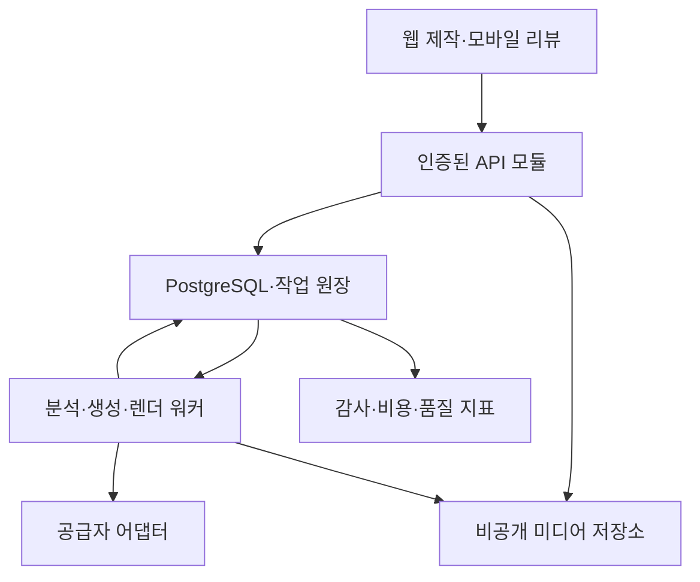
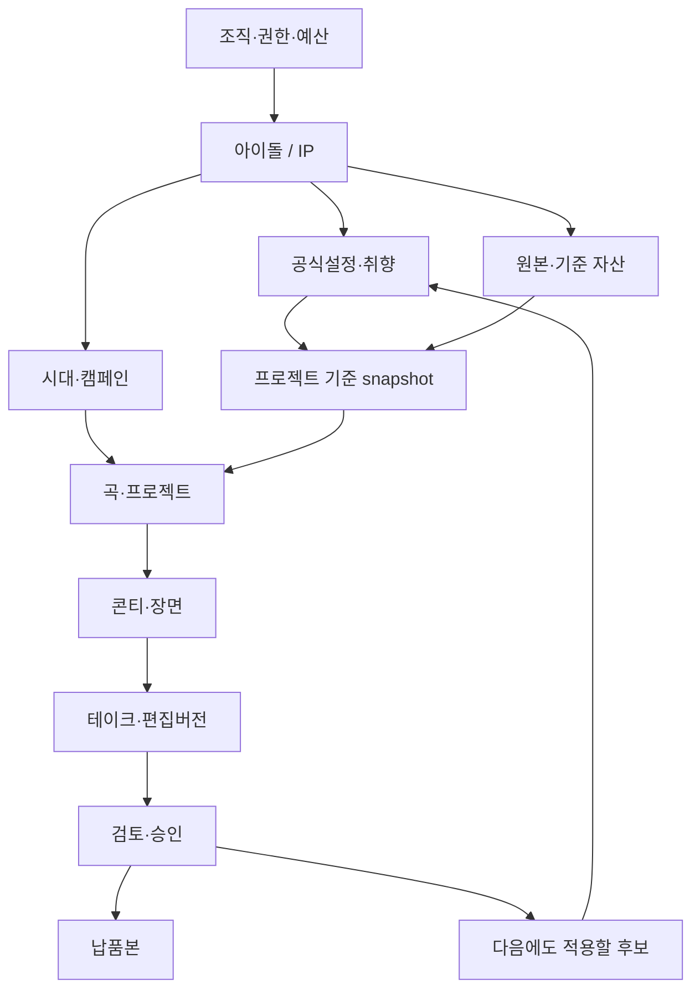

# 신규 IP 음악영상 제작 플랫폼 — 통합 원문

2026년 10월 23일 · 제안 버전 1.0 · Aethon과 별도 사업

이 문서는 네 권의 읽기용 문서에 포함한 장을 하나로 묶은 원문이다. 실제 제품·모델·고객 실험은 미실행이다. 상세 파일 안내는 README.md를 참고한다.


---

# 신규 IP 음악영상 제작 플랫폼 통합 기획

문서 기준일 2026년 10월 23일 · 제안 버전 1.0

## 제품 정의

이 플랫폼은 아이돌과 가상 아티스트의 설정, 승인된 이미지, 곡, 제작 이력, 수정 이유를 프로젝트 사이에 이어서 사용하는 음악영상 제작 도구다. 사용자는 새 곡과 이번 활동의 목적을 입력하고, 기존 IP 정보를 불러온 기획안을 검토한 뒤, 장면 생성과 편집을 진행한다. 제작 결과와 선호는 검토를 거쳐 다음 프로젝트에 반영된다.

사업의 핵심 가설은 반복 제작에서 발생하는 재설명과 재검토 비용을 줄이면 팀이 지속적으로 비용을 지불한다는 것이다. 영상 생성 품질, 고객의 반복 결제 의사, 취향 반영 효과는 아직 검증되지 않았다. 본 요구서의 수치는 출시 약속이 아니라 검증할 목표다. 제공되는 SQL과 OpenAPI는 개발 계약 초안이며 실행 중인 서비스나 완료된 구현을 뜻하지 않는다.

Aethon과 별도 사업으로 관리한다. 회사명, 제품명, 기존 코드, 고객, 계약, 매출, 실험 결과를 승계한 것으로 간주하지 않는다. 공유 기술을 재사용하려면 별도 의사결정 기록에 소유권, 비용, 의존성과 운영 책임을 남긴다.

## 가장 먼저 증명해야 할 가치

첫 작품에서 괜찮은 영상을 만드는 능력과, 두 번째·세 번째 작품에서 같은 팀다운 결과를 더 적은 설명과 수정으로 만드는 능력을 별도로 측정한다. 전자는 영상 제작 도구의 기본 요건이고 후자는 이 사업의 주요 가치 가설이다.

고객이 체감해야 할 변화는 다음과 같다.

1. 새 프로젝트를 만들면 해당 IP의 현재 활동기, 승인된 멤버 이미지, 자주 쓰는 색과 금지사항이 준비되어 있다.
2. 기획안의 각 장면에서 어떤 설정과 지난 피드백이 반영됐는지 확인하고, 잘못 적용된 항목 하나만 제외할 수 있다.
3. 지난번에 거절한 연출을 반복하면 그 이유를 확인할 수 있으며, 이번 활동기에서만 다른 취향을 선택할 수 있다.
4. 마음에 들지 않는 샷을 수정해도 승인한 다른 샷과 음악 타이밍이 유지된다.
5. 제작비, 추가 생성비, 공급자 처리 중인 비용이 구분되고, 정한 한도에서 자동 실행이 멈춘다.
6. 완성 영상의 장면이 새 공식 설정 후보로 제안될 수는 있지만, 담당자의 별도 승인 없이 세계관을 바꾸지 않는다.

이 여섯 조건을 화면, 데이터, API, 테스트, 제품 분석 이벤트에 모두 연결한다. 단순 만족도 설문만으로 달성했다고 판단하지 않는다.

## 완성형 범위와 출시 단계

완성형은 여러 IP와 활동기, 여러 역할의 협업, 반복 제작, 검토, 비용 관리, 납품, 설정 변경 이력을 포함한다. 단계 표시는 기능을 최종 범위에서 제외한다는 뜻이 아니다. 다음 단계에 진입하려면 앞 단계의 검증 증거가 필요하다.

| 단계 | 완성해야 할 결과 | 출시 판단 근거 |
|---|---|---|
| G0 설계와 기술 검증 | 실제 자료로 설정 분리, 한 샷 생성, 비용 원장, 위험한 실패 복구가 작동하는 수직 경로 | 기능 계약 검사와 공급자 샌드박스 검증, 고객 문제 확인 |
| G1 제한된 유료 제작 | 하나의 IP로 30~60초 영상과 후속 작품을 제작하고 담당자가 납품 승인 | 지원 필수 경로의 수용 시험 통과, 미해결 P0·지원 범위의 출시 차단 P1 없음, 팀별 3개 작품 비교, 실제 결제·재사용 |
| G2 팀 제품 | 다중 IP, 활동기, 외주 협업, 비교 검토, 긴 프로젝트, 세분화된 비용 정책 | 권한·데이터 격리, 운영 안정성, 반복 비용 절감, 단위경제성 |
| G3 완성형 운영 | 자동화 템플릿, 외부 연동, 기업 관리, 고급 제작 모드, 조직 단위 분석 | 각 확장 기능의 별도 품질·권리·원가 기준 통과 |

G0~G3는 기간 약속이 아니다. 인력, 예산, 공급자 실측, 실제 고객 자료가 확정되면 작업별 예상 공수와 범위를 다시 산정한다. G1이 통과하지 못하면 G3의 확장 기능 개발을 중단하고 원인을 먼저 해결한다.

## 영상 모드별 제품 약속

| 모드 | 처리 방식 | 기본 제공 조건 | 보증에서 제외할 항목 |
|---|---|---|---|
| 승인 일러스트 기반 | 승인된 캐릭터 이미지, 타이포그래피, 카메라 이동, 합성, 음악 타이밍 | 입력 이미지와 음악의 사용 범위가 확인되고 출력 QA 통과 | 새 포즈·안무를 원본만으로 복원한다는 약속 |
| 혼합 제작 | 승인 캐릭터와 촬영물에 생성 배경·이펙트·보조 샷 결합 | 합성 경계와 시각 검토 통과 | 생성 배경이 모든 설정을 정확히 묘사한다는 약속 |
| 생성 서사형 | 참조 이미지와 장면 계획을 이용한 이미지·영상 생성 | 해당 캐릭터 수·스타일·모델 조합의 품질 표본 확보 | 얼굴·의상·다인 동작의 완전한 동일성 |
| 고난도 퍼포먼스 | 립싱크, 안무, 실존 인물 합성, 긴 다인 장면 | 개별 모델의 지원, 권리 확인, 별도 품질·원가 기준 통과 | 기본 요금으로 무제한 수정하거나 모든 곡을 자동 완성한다는 약속 |

초기 검증은 앞의 두 모드와 제한된 생성 서사형에서 시작한다. 사용자는 모드 선택 시 필요한 자료와 지원 한계를 확인한다. 기술적으로 미지원인 조합은 생성 버튼을 비활성화하고 구체적인 대안을 제공한다. 지원 여부와 권리 확인 여부는 별도 항목이다.

## 공통 용어

| 용어 | 제품 안에서의 의미 |
|---|---|
| 조직 | 계약·결제·권한의 경계인 고객 계정 |
| IP | 그룹, 솔로 아티스트 또는 가상 캐릭터를 관리하는 지속 단위 |
| 활동기 | 앨범·컴백·시즌 등 시간 범위와 스타일이 지정된 제작 맥락 |
| 공식 설정 | 승인권자가 승인한 인물·관계·사건·규칙과 적용 범위 |
| 설정 후보 | 추출 또는 생성으로 발견했지만 아직 공식으로 승인되지 않은 사실 |
| 분기 | 평행 세계, 별도 캠페인, 비공식 실험처럼 서로 섞이면 안 되는 맥락 |
| 취향 | 색감·연출·리듬·카메라·편집 등에 대한 선호와 금지 규칙 |
| 프로젝트 | 곡과 목적, 제작 계획, 샷, 검토·납품 버전을 묶는 작업 |
| 샷 | 시간 구간과 연출 목표가 있는 편집 단위 |
| 테이크 | 한 샷에 대해 생성하거나 업로드한 후보 결과물 |
| 스냅샷 | 생성·승인 시 사용한 자료와 설정의 변경 불가능한 버전 묶음 |
| 공식 설정 승인 | 해당 정보가 IP의 사실로 사용될 수 있음을 승인하는 행위 |
| 결과물 승인 | 특정 버전의 영상이나 샷을 납품·편집에 사용해도 된다는 승인 |
| 비용 예약 | 생성 요청 전 예산 일부를 잠그는 행위로, 확정 청구와 다름 |
| 공급자 상태 미확정 | 요청이 접수되거나 과금됐는지 아직 확인되지 않은 상태 |

## 역할과 결정권

역할은 기본 프리셋이며 중요한 권한은 별도 capability로 검사한다. 소규모 팀에서는 한 사람이 여러 역할을 가질 수 있다. 조직 소유자가 결제 권한을 가진다는 이유만으로 자동으로 공식 설정 승인권자가 되는 구조는 피한다.

| 역할 | 주요 업무 | 기본 결정권 | 기본 제한 |
|---|---|---|---|
| 조직 소유자 | 계약, 구성원, 조직 정책 | 역할 위임, 요금·보관 정책 | IP 내용 승인은 명시적 위임 필요 |
| 결제 관리자 | 한도, 사용량, 정산 | 예산 배정, 결제 수단 관리 | 작품 내용과 공식 설정 수정 불가 |
| 프로듀서 | 일정, 브리프, 검토, 납품 | 기획 승인, 예산 내 실행 위임 | 공식 설정 승인권은 별도 부여 |
| IP 승인권자 | 멤버, 세계관, 브랜드 규칙 | 공식 설정·장기 취향·권리 승인 | 공급자 비용 한도 변경은 별도 권한 |
| 감독·편집자 | 기획안, 샷, 생성, 편집 | 허용 예산 내 제작과 버전 생성 | 전사 정책·공식 설정 직접 변경 불가 |
| 외부 창작자 | 지정 자산·샷 제작 | 배정 범위 업로드와 수정 제안 | 다른 IP·미배정 자산·결제 접근 불가 |
| 아티스트 검토자 | 모바일 검토와 피드백 | 지정 결과물의 승인·수정 요청 | 유료 생성 실행과 전체 설정 열람 불가 |
| 열람자 | 진행 확인 | 허용 버전 읽기 | 수정·승인·다운로드는 각각 별도 권한 |
| 운영 지원자 | 장애·정산 처리 | 사건 단위 승인된 임시 접근 | 고객 자료의 상시 열람·무기록 수정 불가 |

## 사업과 기술의 결정 기준

첫 번째 기준은 반복 제작 비용이다. 등록 시간이 줄어도 검토 시간이 늘면 성공으로 보지 않는다. 준비, 생성 대기, 실제 검토, 수정, 납품까지 구분해서 기록한다. 두 번째는 정체성이다. 자동 점수와 함께 해당 IP 담당자가 블라인드 비교에서 자신의 팀다운 결과인지 평가해야 한다. 세 번째는 통제 가능성이다. 취향이 왜 적용됐는지, 어디에 적용됐는지, 어떻게 취소할 수 있는지 사용자가 알 수 있어야 한다.

네 번째는 원가다. 결제된 생성 초수, 폐기 테이크, 인력 지원, 환불, 저장·렌더 비용을 포함한다. 다섯 번째는 권리와 신뢰다. 고객 간 데이터 혼합, 미승인 실존 인물 사용, 과금 상태 누락과 같은 사건은 평균 품질로 상쇄할 수 없다. 여섯 번째는 개발 복잡도다. 자체 영상 기초모델이나 복잡한 그래프 인프라는 고객 가치와 운영 지표가 요구할 때 추가한다.

## 요구서 사용 방법

사업·검증 문서는 구매 가설과 실험 판단을 다룬다. 기능 요구서는 FR 번호로 기능별 입력, 동작, 저장, 실패와 수용 조건을 정의한다. 기술 스펙은 데이터, API, 비동기 처리, 권한, 비용 원장을 정한다. UI UX 문서는 역할별 화면, 상태와 흐름, Refero 조사 근거를 제공한다. 구조화된 목록에는 같은 ID를 사용하며 추적표에서 연결한다.

각 항목의 상태는 설계 제안, 문서 검사 완료, 구현 예정, 실행 미실시 중 하나로 표기한다. 기능 테스트 계획에 합격 기준이 있다고 해서 해당 기능이 합격한 것은 아니다. 실제 릴리스 때 빌드 번호, 공급자·모델 버전, 테스트 데이터, 결과물, 측정 시간을 추가해야 실행 증거가 된다.


---

# 1. 사업계획: 신규 IP 음악영상 제작 플랫폼

## 1.1 판단과 문서의 전제

**사업화 가능성은 있으나, 현재 근거로 사업성이 검증되었다고 판단할 수는 없다.** 추진할 만한 가설은 ‘AI가 한 번에 좋은 뮤직비디오를 만든다’가 아니라, **같은 IP의 두 번째·세 번째 제작에서 기존 설정과 승인 이유를 정확히 재사용하여 준비·검토·재작업 비용을 줄인다**는 것이다. 최초 고객은 반복 제작이 있는 소규모 레이블, 버추얼 그룹 운영팀, 여러 IP를 맡는 영상 제작팀으로 좁힌다. 생성 품질만으로 경쟁하기보다 제작 운영을 개선해야 한다.

이 계획은 Aethon과 별개의 신규 사업이다. 기존 프로젝트의 고객, 유료 의향, 인력, 코드, 제휴, 데이터, 성과를 승계하지 않는다. 창업자 구성·자금·실제 접근 가능한 고객 수는 미정이다. 아래 가격·목표·인력 단가·전환율·일정은 전부 **검증 전 설계 가정**이다. 현재 실행된 고객 실험, 결제, 생성 파이프라인 성능 측정은 없다. ‘완성형 제품의 요구’와 ‘상용 출시가 가능한 것으로 입증된 기능’을 구분한다.

### 사업 가설의 우선순위

| 구분 | 현재 판단 | 판단을 바꿀 증거 |
|---|---|---|
| 문제가 존재하는가 | 반복 설명과 승인 조율의 존재는 타당한 가설 | 실제 제작 로그에서 반복 설명·설정 오류·검토 시간이 확인됨 |
| 고객이 돈을 내는가 | 미확인 | 창업자 대행 없이 쓰는 유료 고객의 반복 결제 |
| 기술로 차이를 만드는가 | 부분적으로 구현 가능, 결과 품질은 미확인 | 동일 모델·예산의 대조군보다 3번째 프로젝트에서 개선 |
| 방어 가능한가 | 온톨로지 자체의 독점성은 약함 | 도메인 평가 데이터, 승인 이력 활용 정확도, 업무 정착, 전환 비용 |
| 대규모 성장 가능한가 | 고객 수·빈도·CAC가 없어 판단 유보 | 직접 접근 가능한 고객 명부와 채널별 전환·유지 데이터 |

## 1.2 고객, 구매자, 사용자, 승인자

‘버튜버 시장’ 전체를 고객으로 묶으면 예산과 작업 방식의 차이를 놓친다. 같은 영상을 두고도 돈을 내는 사람, 제작 도구를 쓰는 사람, 세계관을 승인하는 사람이 다를 수 있다.

| 고객군 | 구매·사용 구조 | 먼저 확인할 구매 이유 |
|---|---|---|
| 소규모 버추얼 레이블·그룹 운영팀 | 대표/프로듀서가 구매, 영상 담당이 사용, IP 담당·멤버가 승인 | 여러 곡과 숏폼에서 멤버·설정·연출 기준을 유지하는 시간 절약 |
| 반복 수주 영상 스튜디오·프리랜서 팀 | 제작 책임자가 구매, 편집자·기획자가 사용, 외부 클라이언트가 승인 | 클라이언트별 자료 찾기와 승인 전달 감소, 재수주 인수인계 |
| 지하아이돌·인디 그룹 운영팀 | 매니저/대표가 구매, 외주 제작자 또는 운영자가 사용, 멤버가 초상·연출 승인 | 기존 촬영본과 신곡으로 티저·리릭·숏폼을 일관되게 제작 |
| 꾸준히 곡을 내는 개인 VTuber | 구매자·사용자·승인자가 겹침 | 적은 준비로 반복 제작하되 최종 취향 통제 가능 |
| 큰 기획사·브랜드 조직 | 구매·보안·재무·IP 검수와 제작 조직이 분리 | 감사·권한·자산 체계 통합. 초기에는 조달 부담이 큼 |

**초기 ICP의 조건은 가설이다.** 동일 IP로 향후 8–12주 안에 서로 다른 제작 요청을 3건 이상 수행할 계획이 있고, 재사용 가능한 공식 자료가 있으며, 최종 승인자가 지정되어 있고, 실제 작업시간을 기록할 수 있는 팀을 우선한다. 월 2편 같은 고정 빈도를 시장의 사실로 간주하지 않는다. 짧은 티저 2편과 신곡 MV 1편처럼 실제 운영 주기에 맞춰 검증한다.

대상은 AI 생성 또는 AI 보조 사용 범위를 팀이 결정할 수 있고, 사용 자료의 권한을 확인할 수 있어야 한다. 정확한 다인 안무, 모든 프레임의 완전한 외형 고정, 무수정 풀 MV가 구매 조건인 팀은 초기 실험의 적합도가 낮다. 이 수요를 제거하는 대신 기존 촬영·3D 렌더·일러스트를 가져와 편집하고 승인하는 경로로 대응한다.

## 1.3 확인된 외부 사실과 해석의 한계

밍글 스튜디오는 프리미엄 MV 제작의 예상 금액을 200만–400만 원, VAT 별도로 안내한다. 60만 원부터 시작하는 원테이크 상품은 스튜디오 대여가 중심이며 편집·진행비 등이 별도다. 이는 전문 제작에 지출하는 고객이 존재하는 정황이다. 생성형 이미지·영상 제품이 모션캡처·연기·3D 연출의 결과와 비용을 모두 대체한다는 근거는 아니다. [S-B07]

Coconala는 2026년 10월 갱신한 안내에서 커버곡 MV 14,000–48,000엔, 오리지널곡 MV 20,000–100,000엔, 애니메이션 MV 41,000–130,000엔을 제시한다. 출품 가격과 최근 12개월 거래 등을 바탕으로 한 해당 플랫폼의 범위이며, 한국 전체 시장 평균이나 본 제품 구독료의 근거가 아니다. 저렴한 외주 대안과 비교해야 한다. [S-B08]

PXstudio는 창작자 제작비와 별도로 5% 시스템 이용료, 선택형 진행 관리의 도입 가격 5,000엔을 공개한다. In Fleur는 전담 PM과 기획·콘티 확인·중간 검토·최종 수정으로 이어지는 서비스를 안내한다. 제작 운영 자체에 가격을 붙이는 사업이 있다는 사실은 확인되지만, 해당 업체의 매출·수익성·유지율이나 본 제품 수요를 입증하지는 않는다. [S-B09][S-B11]

AI 사용을 모두가 선호한다고 가정해서도 안 된다. VGen은 현재 공개된 2023년 정책에서 조건이 충족되기 전 AI 아트를 허용하지 않는 입장을 유지하고 있다. 하나의 플랫폼 정책을 전체 팬덤 태도로 일반화하지 않고, 고객·아티스트·유통 채널별 실제 허용 범위를 조사한다. [S-B12]

**조사 범위에서 확인되지 않은 것:** 구매 가능한 국내 팀의 수, 월별 제작 빈도 분포, 본 제품에 대한 지불 의향, 반복 결제율, 자동화로 대체할 수 있는 인건비, 저가 소비자 도구에서 유료 전환할 비율. 이 값 없이 TAM이나 성공 확률을 숫자로 제시하지 않는다.

## 1.4 경쟁 구도와 현실적인 차별화

공식 페이지의 기능 설명은 공급자의 주장이다. 아래 ‘확인’은 공개 제공 설명을 확인했다는 뜻이며, 성능이나 완성도를 직접 테스트했다는 뜻이 아니다. 공개 자료에 없다는 사실을 해당 기능이 없다는 증거로 취급하지 않는다.

| 비교 대상 | 공개적으로 확인한 방식 | 본 제품에 주는 시사점 |
|---|---|---|
| Character App | World의 Bible·Cast·Look, 사람의 사실 승인, 최근 에피소드 문맥을 활용하는 Director | 지속 세계관과 승인형 기억만으로 차별화할 수 없음 [S-B01][S-B02] |
| Tunee | 업로드 곡에서 콘셉트·콘티·영상, 프로젝트 자산 통합, 선호 기억을 표방 | 곡→MV 자동화와 취향 기억 모두 경쟁 영역 [S-B03][S-B04] |
| LTX Studio | Enterprise Brand Kit의 공유 자산·권한·관리자 통제 | 공통 자산·브랜드 관리·팀 승인 역시 기존 영역 [S-B05] |
| Adobe Brand Intelligence | 자료·승인 피드백으로 brand ontology 구성, 검증·조합, 별도 FDE 도입 | 온톨로지·피드백 자체는 신규성이 약함. 서사 MV와의 적합성은 별도 [S-B06] |
| 전문 제작사·외주 플랫폼 | 사람이 기획·제작·검토·납품을 책임 | 품질 책임과 운영 편의까지 포함해 대체 가능성을 비교 [S-B07][S-B08][S-B09][S-B11] |

Character App의 공개 구독료는 월 $19.99, $39.99, $99.99이며 생성 크레딧이 포함된다. 안내된 생성 초 수를 완성 영상의 길이나 성공 테이크 수로 읽으면 안 된다. 저가 영상 도구보다 높은 팀 요금을 받으려면 운영 효과를 입증해야 한다. [S-B13]

### 차별화 가설

1. **IP·곡·공개 시점에 맞게 기억을 적용한다.** 실제 멤버와 MV 속 역할, 공식 서사와 꿈·은유, 그룹 취향과 특정 앨범의 예외를 분리한다. 단순히 정보를 많이 저장하는 것이 아니라 해당 요청에 적용할 사실을 정확히 고른다.
2. **왜 그렇게 만들었는지 검토할 수 있다.** 장면별 설정 근거, 채택한 취향, 제외한 충돌 규칙, 사용한 자료 버전을 제시한다. 검토자가 틀린 근거를 수정하면 영향받는 장면이 드러난다.
3. **승인과 기억 갱신을 분리한다.** 좋은 장면으로 채택했다고 세계관 사실로 승격시키지 않는다. ‘이 곡에서만’, ‘앞으로도’, ‘이 멤버에게만’을 명시적으로 선택한다.
4. **수정 범위를 줄인다.** 의상 규칙 변경이 관련 샷에만 반영되고, 승인된 다른 샷·음원·가사는 잠긴다. 무엇이 유지되고 무엇을 다시 만들며 얼마가 드는지 실행 전에 보여준다.
5. **사용할수록 설명 비용이 줄었는지 숫자로 보인다.** 두 번째·세 번째 제작에서 준비 시간, 중복 설명, 오류 수정, 생성비를 측정한다. 선호 적합도와 창작의 새로움이 동시에 유지되는지도 본다.

이 다섯 가지는 경쟁사에 절대로 없는 기능이라는 주장이 아니다. 실제 음악 IP 제작팀에서 더 잘 작동한다는 것을 검증할 제품 방향이다. 고객 데이터의 축적은 고객 내부의 재사용 가치다. 여러 고객의 데이터를 자동으로 묶는 네트워크 효과나 자유롭게 재학습할 수 있는 독점 데이터로 계산하지 않는다. 내보내기와 이관 가능성을 제공하면서 신뢰와 업무 적합성으로 유지한다.

## 1.5 판매할 제품과 결과 책임

완성형 상품은 IP 자료 관리, 근거 있는 기획, 곡 구간 분석, 콘티·샷 계획, 생성·기존 자산 혼합, 검토·부분 수정, 출력·인수인계, 승인 이력의 재사용을 제공한다. 가격이 생성 크레딧의 양만으로 설명되면 공급자 모델의 대체재가 된다. 구매자는 ‘매번 감독과 편집자가 다시 설명해야 하는 일을 줄이는 작업 공간’을 산다는 가설로 제안한다.

제작 형태는 세 가지를 포함한다. 첫째, 승인된 일러스트와 가사·타이포그래피 위주의 영상이다. 둘째, AI 생성 짧은 장면을 기존 영상·일러스트와 혼합한 MV·티저다. 셋째, 촬영·모션캡처·외부 편집을 포함하는 제작팀의 관리·검수 공간이다. 모든 고객에게 완전 생성형 영상을 강제하면 유효 시장을 불필요하게 좁힌다.

초기 상용 약속은 지원되는 유형·길이·출력 규격 안에서 검증한 범위에만 부여한다. 다인 정확 안무·정밀 손동작·긴 립싱크·완전한 캐릭터 일관성은 개별 평가를 통과해야 지원 표시에 포함한다. 사람이 수동으로 완성한 결과는 ‘자동 성공’과 분리하여 운영비와 실험 보고에 기록한다.

## 1.6 가격 가설과 청구 원칙

아래는 한국 B2B 검증용 제안 가격이며 시장에서 검증한 가격이 아니다. 세금·견적 표시와 계약 조건은 실제 판매 관할 및 결제 사업자의 검토를 거쳐 확정한다. 표의 금액은 비교 편의를 위해 VAT 제외 가정이다.

| 가격 가설 | 제안 범위 | 검증할 가정 |
|---|---|---|
| Team: 월 249,000원 | 소규모 팀의 IP 기억·제작·승인·내보내기. 초기 실험 기준 3 IP/제작자 5명 | 월 구독으로 운영 시간 절약에 지불하는가 |
| Studio: 월 599,000원 | 여러 고객 IP, 외부 검토자, 승인 단계·사용량 통합. 용량은 실사용 후 확정 | 여러 고객의 인수인계·분리 관리가 추가 가치를 만드는가 |
| 유료 초기 정리: 199,000원부터 | 자료 정리·설정 후보 검수 보조를 별도 작업 범위로 견적 | 온보딩을 사람이 대행하는 원가를 회수할 수 있는가 |
| 생성·렌더 사용량: 별도 | 승인된 실행 견적·실사용·수수료를 분리 표시 | 불필요한 재생성을 줄이고 비용을 예측할 수 있는가 |

회원 수·저장 공간·지원 시간의 제한은 실제 원가 실험 후 계약으로 확정한다. 처음부터 무제한 생성·무제한 수정·무제한 운영자 지원을 판매하지 않는다. 낮은 사용 빈도 고객에게는 프로젝트 단위 또는 휴면 보관 요금 실험을 검토하되, 이용 중단 후에도 데이터 이관 경로를 유지한다.

생성비는 원화 견적의 적용 환율·모델·해상도·최소 과금 단위·예상 후보 수·최대 예약액을 표시한다. 원가에 운영료를 붙인다면 원가와 운영료를 구분한다. 예컨대 10% 운영료는 **실험 가정**이며 결제·재정산·지원비를 감당한다는 보장은 없다. 공급자와의 관리형 API 제공·재판매 가능 범위는 조달 단계에서 확인해야 한다.

환불은 원인별로 설계한다. 플랫폼 중복 요청, 고객이 승인한 정상 후보의 미채택, 공급자 오류, 진행 중 취소, 과금 여부 미확인의 다섯 상태를 구분한다. 취소 버튼을 눌렀다는 이유로 이미 발생한 공급자 비용이 자동 환불되었다고 표시하지 않는다. 공급자 크레딧 반환과 고객 금전 환불은 별도 원장으로 연결한다. 약관과 실제 공급자 정책이 정해지기 전 환불 가능 범위를 확정 광고하지 않는다.

## 1.7 생성 비용과 단위 경제성

### 직접 생성비

조회한 Runway API의 크레딧 가격은 $0.01이며, 예시 모델 `gen4_turbo`는 초당 5크레딧($0.05), `gen4.5`는 초당 12크레딧($0.12), `gen4_image` 1080p는 장당 8크레딧($0.08)이다. 이것은 가격 비교용 예시이며 모델 간 품질·속도·권리 조건이 같다는 뜻이 아니다. [S-B10]

기본식은 `영상 생성비 = 완성 타임라인 길이 × 새로 생성하는 비율 × 과금 배수 × 초당 단가`다. 여기서 과금 배수는 **총 청구된 생성 초 / 최종 채택된 새 생성 초**다. 버린 후보, 사용하지 않은 구간, 모델의 최소 길이, 실패 과금이 반영된다. 샷당 후보 상한 3개가 과금 배수 3을 보장하지 않는다. 5초 클립에서 2초만 쓰면 같은 후보 수라도 배수가 늘어난다.

| 최종 새 생성 분량 | 과금 배수 | $0.05/초의 비용 | $0.12/초의 비용 |
|---|---:|---:|---:|
| 30초 | 3배 | $4.50 | $10.80 |
| 60초 | 3배 | $9.00 | $21.60 |
| 180초 | 1배 | $9.00 | $21.60 |
| 180초 | 3배 | $27.00 | $64.80 |
| 180초 | 5배 | $45.00 | $108.00 |

이는 관측된 평균 원가가 아닌 산술 시나리오다. 180초 영상의 50%만 새 생성이면 위 영상비의 절반이다. 36개 샷의 참조 이미지를 각각 3장 만든다면 예시 이미지비 $8.64가 추가된다. 분석 LLM·음원 처리·저장·전송·렌더·결제·지원·외부 편집은 별도다. 립싱크용 모델이 영상 생성 자체를 담당하는 경우 같은 초 수의 생성비를 또 더하지 않도록 실행 경로별 원가를 계산한다.

원화 환산이 필요한 기획표에서는 **1달러=1,400원을 임의 환율 가정**으로만 쓸 수 있다. 현재 환율이라는 뜻이 아니다. 예시 $64.80+$8.64=$73.44는 이 가정에서 102,816원이다. 계약 견적에는 실행 시 적용 환율과 유효시간을 사용한다.

### 구독 고객당 공헌이익 예시

다음은 원가 구조를 드러내기 위한 모델이다. 월 매출은 Team 249,000원, 생성비는 별도 정산하므로 제외한다. 결제비 3.3%, 인프라 20,000원, 별도 검수·운영 배부 10,000원, 환불·보상 충당 가정 5,000원, 지원 인력 시간당 40,000원을 입력한다. 실제 계약 수수료·임금·보상률은 미확인이다.

| 월 지원 시간 | 고객당 직접비 | 고객당 공헌이익 | 공헌이익률 |
|---|---:|---:|---:|
| 15분 | 53,217원 | 195,783원 | 78.63% |
| 60분 | 83,217원 | 165,783원 | 66.58% |
| 180분 | 163,217원 | 85,783원 | 34.45% |

이 지표는 회계상 공식 매출총이익의 판정이 아니라 운영 의사결정용 공헌이익이다. 개발·경영·영업의 고정 인건비, 사무·법무·세무 비용과 CAC는 별도다. 창업자가 무료로 자료를 고치고 영상을 완성한 시간도 대체 인력 단가로 기록해야 한다.

임의 월 고정 운영비가 1,200만 원이고 기본 시나리오의 공헌이익이 165,783원이면 손익분기 고객 수는 `ceil(12,000,000 / 165,783)=73팀`이다. 지원 180분 시나리오는 140팀이다. 인원·급여·사업 규모가 정해지지 않았으므로 이것은 채용 계획이나 매출 예측이 아니다. 데이터가 생기면 수식을 유지하고 입력값만 교체한다.

지급·청구가 늘수록 부가 작업이 늘 수 있으므로 생성비 운영료를 순이익으로 보지 않는다. 원가 $73.44의 실행에 10% 운영료를 붙여도 위 환율 가정에서 추가 수입은 약 10,282원이다. 결제비, 환불·재정산, 10–20분의 추가 지원만으로 상당 부분이 소진될 수 있다. 무료 무제한 지원이 필요하면 SaaS가 아니라 제작 대행 서비스의 원가 구조로 다시 가격을 정해야 한다.

## 1.8 고객 규모와 획득 계획

### 아래에서 계산하는 접근 가능한 매출

직접 접근 가능한 팀 수를 모르므로 시장 전체 고객 수를 만들지 않는다. 초기 SOM은 ‘리서치된 잠재 고객 명부 × ICP 통과 비율 × 접촉 가능 비율 × 유료 전환 × 유지’로 계산하되, **아직 모든 입력은 미측정**이다. 명부를 확보하면 회사·그룹·제작사 단위 중복을 제거하고, 담당자 연결·제작 주기·예산 주체·AI 허용 범위까지 확인한다.

매출 민감도만 보면 Team 가격으로 유료 30팀은 월 747만 원, 100팀은 2,490만 원, 300팀은 7,470만 원이다. 모두 VAT·사용량 제외의 산술이다. 실제 획득 가능한 고객 수나 예상 시점이 아니다. 300팀을 지원하는 조직·제품 완성도가 존재한다는 가정도 하지 않는다.

### 단계별 획득과 판매

| 단계 | 실행할 일 | 다음 단계 조건 |
|---|---|---|
| 문제 확인 | 목표군 12–15팀과 최근 제작물·수정 내역·일정·지출 구조를 확인 | 반복되는 손실이 있고 승인자가 실험 참여를 허용 |
| 유료 파일럿 | 3팀, 팀당 서로 다른 요청 3건. 사용료·생성비·대행비를 분리 | 2팀 이상 실제 결제, 다음 제작 계획과 재사용 이유 확인 |
| 비공개 베타 | 8–12팀으로 확장, 3번째 요청까지 동일 정의로 측정 | 시간·선호·품질·원가가 정해진 기준에 도달 |
| 반복 판매 | 비교 가능한 유료 코호트에서 지원·환불·반복 결제 관찰 | 최소 3개 청구 주기의 데이터와 실증된 채널 |
| 조달 확장 | 스튜디오·레이블에 계약·감사·분리 권한·정산 자료 제공 | 고객별 맞춤 코드 없이 반복 도입 가능 |

위 표는 실제 진행한 실험이 아니다. 3팀 중 2팀의 결제는 초기 추진 신호일 뿐 수요의 통계적 입증이 아니다. 지인의 호의, 큰 할인, 창업자의 무제한 대행을 분리 기록한다. 구두 사용 의향·무료 가입·테스트 결제 후 환불은 정상 반복 매출로 계산하지 않는다.

유입 채널은 기존 영상 제작자·일러스트레이터·믹싱·매니지먼트 파트너, 직접 문제 인터뷰, 제작 전후 사례 공개, 고객 소개 순으로 시험한다. 의뢰 플랫폼을 무단 수집하거나 이용약관을 어기는 접촉을 가정하지 않는다. 현재 제휴는 확보되지 않았다. 파트너에게 생성 대행 단가보다 승인 관리·고객 자료 인수인계·재수주 효율을 제안한다. 사례 공개에는 고객의 별도 동의를 받는다.

CAC는 광고·행사·수수료뿐 아니라 판매 상담·데모·온보딩 영업 인건비를 포함해 계산한다. LTV는 유지 코호트가 없는 상태에서 임의 이탈률의 역수로 부풀리지 않는다. 초기에는 관찰된 누적 공헌이익, 실제 결제 횟수, 90일 내 제작 기회가 있었는지를 함께 보고한다.

## 1.9 조직, 조달, 운영

필요한 역량은 제품·고객 조사, 웹·권한·정산, AI/영상 파이프라인, 데이터·평가, 영상 제작 검수, 디자인·접근성, 고객 운영이다. 몇 명이 겸임하는지는 창업팀과 자금에 따라 결정한다. 1인 개발이나 기존 인력을 전제하지 않는다. 고정 인력 없이 외부 제작자가 완성도를 보완한다면 그 비용을 프로젝트 원가에 넣는다.

모델 조달은 샘플 품질만 보지 않고 허용 입력·상업 제공 범위·보관 정책·학습 사용·가용 리전·가격 변경·사용량 한도·장애 알림·과금 조회·취소 지원·버전 보존·지원 응답을 비교한다. 새 공급자는 동일 데이터셋과 비용 상한으로 회귀 평가를 통과한 후 라우팅에 추가한다. 공급자 장애 시 다른 모델로 자동 전환하면서 고객 승인 단가나 이미지 이용 범위를 바꾸지 않는다.

판매 시 필요한 자료는 제품 범위표, 지원되는 생성 유형, 입력 권한 체크 항목, 개인정보·자산 처리 흐름, 승인 역할표, 가격·환불 조건, 사용량 원장, 데이터 내보내기 예시, 장애·지원 연락 구조다. 고객 계약의 법적 판단이나 규정 준수 완료를 이 문서만으로 선언하지 않는다. 실제 판매 단계에서 담당 검토를 거쳐 확정한다.

## 1.10 완성형 비전과 증거에 따른 확장

완성형 요구를 한 번에 모두 구현하는 것을 출시 기준으로 삼지 않는다. 공통 데이터 구조·프로젝트 경계·승인·과금·내보내기는 먼저 맞추되, 생성 유형은 검증된 능력 범위부터 제공한다. 공통 개발 단계는 G0 문제 확인·내부 기술 경로, G1 제한 유료 제작, G2 팀 제품·반복 운영, G3 완성형 확장이다. 다음 B0~B5는 그 안에서 확인하는 사업 증거의 구분이다.

| 단계 | 검증할 결과 | 중단·범위 조정 기준 |
|---|---|---|
| B0: 문제·자료 / G0 | 반복 제작 손실과 실제 자료·권한·승인자 확인 | 고객이 프로젝트를 반복하지 않거나 자료 제공·실험이 불가능 |
| B1: 내부 경로 / G0 | 자료→기억 후보→승인→곡→콘티→샷→출력→다음 요청까지 연결 | 기억이 출처 없이 확정되거나 예산·권한이 통제되지 않음 |
| B2: 유료 파일럿 / G1 | 지원 범위 안의 결과와 유료 재사용 신호 | 사람의 숨은 대행을 빼면 가치·품질이 성립하지 않음 |
| B3: 기억 효과 / G2 | 3개 요청에서 대조군 대비 준비·재작업·선호 지표 개선 | 간단한 폴더·브랜드 문서보다 이득이 없거나 관리 부담이 큼 |
| B4: 반복 운영 / G2 | 유료 유지, 지원 원가, 실패 정산, 모델 변경 회귀 통제 | 목표 가격에서 공헌이익이 지속적으로 낮음 |
| B5: 범위 확대 / G3 | 긴 MV·다인·립싱크·추가 포맷·기관 조달을 각각 검증 | 기본 기능의 비용·품질을 악화시키는 확장 |

가설 수립·인터뷰 준비, 내부 구현, 파일럿, 베타의 기간은 인력·조달·고객 제작 일정이 확정된 뒤 산정한다. ‘몇 주면 완성’ 또는 ‘3번이면 어떤 MV든 성공’으로 계약하지 않는다. 각 단계는 빠른 달성보다 해제 조건과 남은 위험의 기록이 중요하다.

## 1.11 중단 기준과 방향 전환

| 위험 | 조기 확인 신호 | 의사결정 |
|---|---|---|
| 반복 수요 부족 | 적합 팀 인터뷰에서도 다음 3개 요청을 확보하기 어려움 | 월 구독보다 프로젝트·대행 운영 도구 가설을 재검토 |
| 기억의 추가 가치 부족 | 3번째 요청에서도 시간·선호 개선 없이 관리 작업만 증가 | 온톨로지 범위 축소, 검색·승인 인수인계 제품으로 검증 |
| 생성 품질 한계 | 지원 유형에서도 후보 3개 상한 후 잦은 수동 복구 | 혼합 편집·기존 자산 중심으로 범위 변경 |
| 고객별 무제한 맞춤 | 새 팀마다 별도 코드·수작업 규칙이 필요 | 컨설팅 서비스로 재가격하거나 제품화를 중단 |
| 마진 훼손 | 지원·환불을 포함한 공헌이익이 목표에 반복 미달 | 가격·지원 범위 조정. 개선 증거 전 유입 확대 중단 |
| 치명적 신뢰 문제 | 타 IP 노출, 무단 서사 확정, 승인 상한 초과 실행 | 해당 기능·출시를 중지하고 원인·복구·재발 검증 |
| 채널 부적합 | 고객·파트너의 AI 사용 범위와 결과물이 충돌 | 자료·편집·검수 중심 모드의 실수요를 별도 검증 |

예시 중단 규칙은 사전에 등록한다. 유료 파일럿 3팀 중 2팀의 결제가 발생하지 않으면 범위·가격·구매자 문제를 인터뷰한 뒤 한 차례 수정 실험을 한다. 비공개 베타에서도 비교 가능한 3개 요청을 확보하지 못하거나 핵심 효과가 반복 관찰되지 않으면 완성형 확장 투자를 보류한다. 작은 표본의 임계값은 의사결정 규칙이지 시장 전체의 성공·실패 확률 추정이 아니다.

## 1.12 사업 요구사항 등록부

| ID | 요구사항 | 확인 증거 |
|---|---|---|
| BUS-001 | Aethon과 고객·자산·성과 가정을 분리한다 | 사업 가정 등록부와 출처 |
| BUS-002 | 고객·구매자·사용자·IP 승인자를 프로젝트별 지정한다 | 인터뷰·온보딩 기록 |
| BUS-003 | 반복 요청·자료 권한·승인자를 가진 ICP부터 검증한다 | 적합 판정과 제외 사유 |
| BUS-004 | 모든 비교는 공개 사실·공급자 주장·자사 가설을 구분한다 | 출처 등록부·검증 상태 |
| BUS-005 | 차별화를 3개 요청의 절약 시간·선호·원가로 측정한다 | EXP-004, EXP-005 |
| BUS-006 | 구독료·생성비·사람의 대행비를 분리한다 | 가격표·청구서·작업 원장 |
| BUS-007 | 유료 실행 전 상한과 실패·취소 정산 방식을 알린다 | 견적 승인·과금 조정 기록 |
| BUS-008 | 지원·환불·미채택 후보·영업 인건비를 원가에 포함한다 | 고객·실행별 공헌이익 |
| BUS-009 | 미확인 시장 규모와 고객 수를 추정 사실로 쓰지 않는다 | 중복 제거 잠재 고객 명부 |
| BUS-010 | 실제 결제·반복 제작·제작 기회를 별도로 측정한다 | EXP-002, EXP-014 |
| BUS-011 | 공급자 조건·단가·버전 변경을 조달 및 회귀 게이트에 연결한다 | 공급자 등록부·EXP-015 |
| BUS-012 | 단계별 증거가 확보되기 전 자동화·품질 보장을 광고하지 않는다 | 출시 범위표·게이트 승인 |
| BUS-013 | 무료 창업자 대행을 제품 성공이나 순이익으로 숨기지 않는다 | 지원 시간·대행 역할 로그 |
| BUS-014 | 고객 데이터 축적을 무단 공동학습·네트워크 효과로 계산하지 않는다 | 데이터 처리·내보내기 정책 |
| BUS-015 | 중단·가격 변경·지원 범위 조정 기준을 실험 전에 정한다 | 사전등록 프로토콜 |

참고 문헌의 URL·조회일·주장의 한계는 `research/business_sources.json`에 수록한다. 사업 가설을 측정하는 상세 프로토콜은 제6장 및 `output/evaluation_protocol.json`을 사용한다.


---

# 기능별 개발 요구서

이 문서는 완성형 제품의 기능 계약이다. 모든 항목은 구현 예정이며 실제 실행 검증은 미실시 상태다. G1·G2·G3 표시는 출시 단계이며 최종 범위의 우선순위를 구분한다. 공통 접근·권리·예산·감사 규칙은 개별 항목에서 반복하지 않아도 적용한다.

## 공통 동작 원칙

화면에서 숨기는 것만으로 권한을 구현하지 않는다. API, 검색, 미디어 URL, 생성 문맥, 비동기 워커까지 같은 범위를 검사한다. 승인과 과금처럼 중요한 변경에는 기반 버전과 멱등 키를 적용한다. 자동화는 사용자가 승인한 대상·기간·비용 한도 안에서만 동작한다.

입력과 결과의 저장 상태를 분리한다. 입력 검증 실패는 원본을 변경하지 않는다. 네트워크 오류가 발생하면 서버 처리 여부를 먼저 조회하고, 처리 여부가 불명확한 유료 요청은 새로 제출하지 않는다. 모든 화면은 빈 상태, 불러오는 중, 일부 완료, 오류, 권한 철회, 버전 충돌을 구분한다.

수용 조건은 자동 검사만으로 끝나지 않는다. 사실·권한·원장·버전은 결정적 테스트로 검사하고, 외형·스타일·음악 적합성은 고정 자료와 사람 평가로 검증한다. 같은 샷 여러 개를 서로 독립적인 고객 표본으로 계산하지 않는다.

## 조직과 권한

로그인된 사용자와 유효한 조직 구성원 관계가 필요하다. 모든 접근에서 서버가 조직과 자원 권한을 다시 검사한다.

### FR-001 조직과 계정 분리

대상 조직 소유자 / 전체 기능 단계 G1 / 테스트 AT-001-A · AT-001-B

**입력** 조직명, 소유자, 국가·통화, 인증 수단

**동작** 조직을 만들고 계정 전환 시 현재 조직을 항상 표시한다. 다른 조직의 최근 항목과 자동 완성은 노출하지 않는다.

**저장** 조직 ID, 구성원 ID, 정책 버전, 생성 감사 기록

**실패와 예외** 조직을 찾지 못하거나 접근이 없으면 자원 존재를 드러내지 않는 오류를 반환한다.

**정상 수용 조건** 두 조직에서 같은 IP 이름을 사용해도 검색·다운로드·생성 문맥이 섞이지 않는다.

**반례 수용 조건** 다른 조직의 자산 ID를 URL과 API에 직접 넣어도 제목·썸네일·서명 URL을 받지 못한다.

### FR-002 구성원 초대와 세부 권한

대상 조직 소유자 · 프로듀서 / 전체 기능 단계 G1 / 테스트 AT-002-A · AT-002-B

**입력** 초대 대상, 역할, IP·프로젝트 범위, 만료일

**동작** 범위를 지정해 초대한다. 공식 설정 승인, 유료 생성, 결과물 승인, 다운로드, 결제 권한을 독립 부여한다.

**저장** 초대 토큰 해시, 수락 이력, 권한 변경 이력

**실패와 예외** 만료·취소·다른 수신자 초대는 수락할 수 없다. 마지막 소유자를 제거할 수 없다.

**정상 수용 조건** 초대된 외주자는 배정 프로젝트만 보고 담당 샷에만 업로드한다.

**반례 수용 조건** 프로듀서 역할만 있고 canon.approve가 없는 사용자가 설정을 승인하면 거부되고 데이터가 변경되지 않는다.

### FR-003 권한 철회와 세션 갱신

대상 조직 소유자 / 전체 기능 단계 G1 / 테스트 AT-003-A · AT-003-B

**입력** 사용자, 철회 범위, 사유

**동작** 철회 즉시 새 API·다운로드·스트림 접근을 차단한다. 이미 실행된 공급자 작업은 중단 가능 여부를 조회하고 결과 접근을 막는다.

**저장** 철회 시각, 정책 버전, 작업 영향 목록

**실패와 예외** 클라이언트 캐시를 신뢰하지 않는다. 이미 내려받은 파일은 회수할 수 없음을 표시한다.

**정상 수용 조건** 열린 검토 화면에서 권한이 철회되면 새 댓글·승인·파일 요청이 차단된다.

**반례 수용 조건** 철회 전에 얻은 장기 URL이 계속 유효하지 않도록 짧은 URL 만료와 미디어 게이트를 검사한다.

### FR-004 조직 제작 정책

대상 조직 소유자 · IP 승인권자 · 결제 관리자 / 전체 기능 단계 G2 / 테스트 AT-004-A · AT-004-B

**입력** 허용 공급자, 제작 모드, 승인 단계, 예산 정책

**동작** IP 규칙이 조직의 금지 규칙을 약화할 수 없게 한다. 정책 변경 시 영향을 받는 계획과 예약 비용을 표시한다.

**저장** 정책 버전, 범위, 효력 시작 시각, 승인자

**실패와 예외** 정책 충돌은 자동 우회하지 않고 차이를 보여준다.

**정상 수용 조건** 조직에서 실존 인물 합성을 막으면 프로젝트의 허용 설정으로 다시 켤 수 없다.

**반례 수용 조건** 정책 변경 전 견적을 이용해 금지된 새 작업을 시작하려고 하면 재검증으로 차단된다.

### FR-005 감사 기록과 활동 이력

대상 조직 소유자 · 프로듀서 · 운영 지원자 / 전체 기능 단계 G1 / 테스트 AT-005-A · AT-005-B

**입력** 기간, 행위자, 자원, 사건 종류

**동작** 승인·생성·권한·요금 변경을 기록한다. 사용자에게 필요한 요약과 운영용 세부 정보의 열람 범위를 분리한다.

**저장** 행위자, 요청 ID, 전후 버전, 결과, 시각, 사유

**실패와 예외** 비밀키와 원본 프롬프트 전체를 일반 감사 화면에 넣지 않는다.

**정상 수용 조건** 어떤 설정과 비용 승인으로 특정 테이크를 생성했는지 요청 ID로 추적된다.

**반례 수용 조건** 지원자가 감사 기록을 수정·삭제하려고 하면 불가하고 해당 시도도 기록된다.

### FR-006 계정 탈퇴와 조직 이전

대상 조직 소유자 · 구성원 / 전체 기능 단계 G2 / 테스트 AT-006-A · AT-006-B

**입력** 탈퇴·이전·삭제 선택, 대상 조직·소유자, 확인

**동작** 개인 탈퇴, 소유권 이전, 조직 삭제를 구분한다. 진행 작업과 보존 의무·사용 중 파일을 확인한 뒤 영향 목록을 제시한다.

**저장** 이전 수락, 삭제 요청, 처리 기한, 예외 보존 목록

**실패와 예외** 진행 중 정산과 합법적 보존 필요 항목은 이유와 만료일을 남긴다. 삭제를 완료했다고 조기 표시하지 않는다.

**정상 수용 조건** 소유권을 수락한 사용자에게만 이전되고 기존 소유자의 후속 접근이 정책에 맞게 바뀐다.

**반례 수용 조건** 마지막 소유자가 후임 없이 탈퇴하면 차단되고 다른 구성원의 작업은 유지된다.

**G1 최소 계약** G1에는 구독 해지와 계정 삭제를 분리하고 요청·인계·자료 회수 경로를 운영한다. 고급 조직 이전 UI는 G2다.

## IP와 활동기

해당 IP의 범위와 수정 권한을 검사한다. 현실 인물의 개인정보와 공개 캐릭터 정보는 별도 보호한다.

### FR-007 IP 생성과 최소 등록

대상 프로듀서 · IP 승인권자 / 전체 기능 단계 G1 / 테스트 AT-007-A · AT-007-B

**입력** IP명, 유형, 승인자, 대표 이미지, 이번 목표

**동작** 필수 입력을 최소화하고 나머지는 자료 추출 후보로 채운다. 등록 상태와 실제 제작 가능 상태를 구분한다.

**저장** IP 프로필, 등록 진행 상태, 누락 필수 항목

**실패와 예외** 정보가 없으면 추측으로 멤버·성격·세계관을 채우지 않는다.

**정상 수용 조건** 이름과 권한 있는 자료로 시작해 후보 검토를 거쳐 최초 제작 준비를 마친다.

**반례 수용 조건** 공식 자료가 없을 때 임의의 멤버 관계가 공식 설정으로 저장되지 않는다.

### FR-008 멤버와 시각적 정체성

대상 IP 승인권자 · 감독·편집자 / 전체 기능 단계 G1 / 테스트 AT-008-A · AT-008-B

**입력** 멤버 ID, 별칭, 기준 이미지, 정면·측면·의상, 사용 범위

**동작** 멤버별 참조를 지정하고 실존 인물과 공연 페르소나를 연결하되 동일 객체로 합치지 않는다.

**저장** 인물·페르소나 관계, 참조 버전, 외형 규칙, 권리 상태

**실패와 예외** 동일 별칭 충돌과 참조 간 외형 차이를 알려주고 기준 선택을 요청한다.

**정상 수용 조건** 동명 멤버가 있는 다른 IP와 참조를 혼합하지 않고 선택한 의상 버전을 사용한다.

**반례 수용 조건** 실제 연락처·계약 정보가 프롬프트 문맥이나 외부 공급자 입력으로 전달되지 않는다.

### FR-009 활동기와 캠페인

대상 프로듀서 · IP 승인권자 / 전체 기능 단계 G1 / 테스트 AT-009-A · AT-009-B

**입력** 활동기명, 기간, 곡 목록, 스타일, 공식 분기

**동작** 기존 IP 설정을 상속하면서 활동기별 추가 규칙을 둔다. 새 활동기 생성 시 이전 규칙의 유지·종료를 비교한다.

**저장** 활동기, 효력 구간, 상속 관계, 규칙 변경 이력

**실패와 예외** 서로 배타적인 활동기·시간 규칙을 무음 병합하지 않는다.

**정상 수용 조건** 지난 활동기의 붉은 의상 규칙을 종료한 뒤 다음 활동기에 자동 재사용하지 않는다.

**반례 수용 조건** 미래 활동기의 설정이 과거 시점 프로젝트에 들어오면 충돌로 표시하고 제외한다.

### FR-010 세계와 분기 관리

대상 IP 승인권자 · 프로듀서 / 전체 기능 단계 G2 / 테스트 AT-010-A · AT-010-B

**입력** 세계, 분기, 공식·비공식 여부, 분기 시작 버전

**동작** 본편, 평행 세계, 팬 실험을 분리한다. 복사와 병합은 차이와 충돌을 검토한 새 버전으로 수행한다.

**저장** 분기 ID, 부모 버전, 병합 제안과 승인 기록

**실패와 예외** 분기 간 근거가 충돌하면 사용자가 해결하기 전 공식 병합을 막는다.

**정상 수용 조건** 실험 분기에서 변경한 성격이 본편의 새 기획에 반영되지 않는다.

**반례 수용 조건** 같은 사건을 상반되게 정의한 분기를 병합하면 자동 덮어쓰기 없이 충돌 목록을 반환한다.

### FR-011 IP 자산함과 검색

대상 프로듀서 · 감독·편집자 · 외부 창작자 / 전체 기능 단계 G1 / 테스트 AT-011-A · AT-011-B

**입력** 태그, 멤버, 활동기, 권리, 승인 상태, 파일 유형

**동작** 원본과 파생본을 묶고 사용 가능한 버전만 생성 선택기에 표시한다. 즐겨찾기와 공식 사용 승인을 다르게 표시한다.

**저장** 원본 체크섬, 파생 관계, 태그, 승인·보관 상태

**실패와 예외** 삭제·권리 만료·접근 불가 파일은 썸네일 캐시를 포함해 새 사용을 제한한다.

**정상 수용 조건** 동일 파일을 재업로드하면 기존 파일과 연결할 수 있으며 권리 정보는 별도 확인한다.

**반례 수용 조건** 즐겨찾기만 한 미승인 이미지가 승인 자산 전용 선택기에 나타나지 않는다.

### FR-012 프로젝트 간 인계 요약

대상 프로듀서 · 감독·편집자 / 전체 기능 단계 G1 / 테스트 AT-012-A · AT-012-B

**입력** 이전 프로젝트, 새 곡, 활동기, 유지·변경 선택

**동작** 지난 승인 결과, 거절 이유, 반복 규칙을 요약한다. 이번 프로젝트에 불필요한 개인·일회성 지시를 제외할 수 있다.

**저장** 인계 요약, 항목별 출처, 사용자가 제외한 이유

**실패와 예외** 이전 프로젝트의 미해결 의견은 확정 취향으로 승격하지 않는다.

**정상 수용 조건** 두 번째 작품 시작 시 재입력 없이 이전 승인 규칙을 확인하고 일부만 제외한다.

**반례 수용 조건** 이전 영상의 한 장면에만 적용한 확대 지시가 전체 IP의 영구 취향이 되지 않는다.

## 자료 입력과 권리

자료의 사용 권한, 접근 범위, 처리 가능 형식을 확인한다. 업로드 콘텐츠는 시스템 명령이 아니라 분석 대상이다.

### FR-013 파일 업로드와 중단 복구

대상 프로듀서 · 감독·편집자 · 외부 창작자 / 전체 기능 단계 G1 / 테스트 AT-013-A · AT-013-B

**입력** 이미지·음원·영상·PDF·텍스트, 파일명, 범위

**동작** 허용 형식·크기·체크섬을 검증하고 업로드 진행과 중단 복구를 제공한다. 분석 전 원본을 격리한다.

**저장** 업로드 세션, 해시, 미디어 정보, 검사 결과

**실패와 예외** 확장자 위장, 손상 파일, 압축 폭탄, 초과 용량은 이유와 교체 방법을 제공한다.

**정상 수용 조건** 중단된 대용량 파일을 이어 올려도 원본 체크섬이 일치하고 자산이 중복 생성되지 않는다.

**반례 수용 조건** 실행 파일을 이미지 이름으로 올려도 분석 워커에서 실행되지 않고 격리된다.

### FR-014 문서와 영상에서 정보 추출

대상 프로듀서 · IP 승인권자 / 전체 기능 단계 G1 / 테스트 AT-014-A · AT-014-B

**입력** 선택 자료, 언어, 추출할 항목

**동작** OCR·전사·장면 분석으로 인물·설정·선호 후보를 만든다. 원문 위치나 타임코드를 붙여 검토한다.

**저장** 추출 후보, 출처 범위, 확신도, 추출기 버전

**실패와 예외** 읽기 어려움과 추론을 사실과 구분하고 빈 값을 임의 보완하지 않는다.

**정상 수용 조건** 승인 전에는 추출된 관계가 공식 설정 검색 문맥에 들어가지 않는다.

**반례 수용 조건** 문서에 포함된 외부 전송·권한 변경 지시가 실행되거나 도구 호출로 이어지지 않는다.

### FR-015 외부 자료와 링크 가져오기

대상 프로듀서 · 감독·편집자 / 전체 기능 단계 G2 / 테스트 AT-015-A · AT-015-B

**입력** 허용 URL 또는 승인된 연결 서비스의 파일

**동작** 출처와 접근 권한을 보존한다. URL은 허용 프로토콜, 리다이렉트, 목적지 IP를 검증한다.

**저장** 외부 식별자, 소유자, 가져온 시각, 원본 해시

**실패와 예외** 사설 주소·메타데이터 주소·로그인 우회 다운로드를 차단한다.

**정상 수용 조건** 허용된 공개 파일 또는 사용자 승인 연결 파일을 동일한 자료 검토 흐름으로 가져온다.

**반례 수용 조건** 허용 URL에서 내부망으로 리다이렉트하면 서버가 요청하지 않고 실패 사유를 반환한다.

### FR-016 사용 권리와 동의 관리

대상 IP 승인권자 · 프로듀서 / 전체 기능 단계 G1 / 테스트 AT-016-A · AT-016-B

**입력** 권리자, 라이선스, 상업·AI 처리·변형 허용, 만료, 인물 동의

**동작** 권리 상태를 사용 가능·검토 필요·금지로 분리한다. 실존 인물의 얼굴·음성 합성에는 목적과 범위가 맞는 근거를 요구한다.

**저장** 권리 근거, 검토자, 범위, 효력 시각, 공급자 전달 허용

**실패와 예외** 불명확한 권리는 확정 권리로 표시하지 않는다. 제한에 맞지 않는 생성·내보내기를 차단한다.

**정상 수용 조건** AI 처리 불허 자료는 보관·일반 편집 가능 여부와 외부 생성 전송 가능 여부가 구분된다.

**반례 수용 조건** 상업 이용 불가 음원을 포함한 상업 납품이 자동 통과하지 않고 관련 항목을 지목한다.

### FR-017 분석 작업과 수동 보정

대상 감독·편집자 · 프로듀서 / 전체 기능 단계 G1 / 테스트 AT-017-A · AT-017-B

**입력** 분석 대상, 수정한 이름·타임코드·언어

**동작** 분석 대기·일부 완료·실패를 파일별 표시하고 성공한 결과를 유지한다. 사용자가 결과를 직접 수정할 수 있다.

**저장** 분석 실행, 성공 범위, 수동 수정 버전, 재분석 차이

**실패와 예외** 재분석은 수동 교정을 덮어쓰지 않고 병합 비교를 제공한다.

**정상 수용 조건** 가사 일부 전사 실패에도 성공 구간을 보존하고 실패 구간만 다시 분석한다.

**반례 수용 조건** 수동으로 고친 멤버명이 재분석 후 이전 오인식으로 되돌아가지 않는다.

### FR-018 사용 중지와 삭제 영향 추적

대상 IP 승인권자 · 조직 소유자 / 전체 기능 단계 G2 / 테스트 AT-018-A · AT-018-B

**입력** 자산·자료, 중지 또는 삭제 사유, 적용 범위

**동작** 해당 자료를 참조한 설정, 생성, 샷, 납품을 추적한다. 새 사용을 즉시 막고 기존 결과에 검토 표시를 붙인다.

**저장** 영향 목록, 차단 시각, 삭제 진행, 남은 보존 사유

**실패와 예외** 이미 외부 납품된 파일을 회수했다고 표시하지 않는다. 공급자 삭제 요청 결과도 별도 추적한다.

**정상 수용 조건** 권리 철회된 얼굴 참조로 예약된 새 작업이 실행 직전 검증에서 차단된다.

**반례 수용 조건** 원본만 지우고 검색 색인·썸네일·임베딩을 남기는 삭제가 완료로 기록되지 않는다.

**G1 최소 계약** G1에도 권리 철회 후 새 공급자 전송과 다운로드를 차단한다. 일괄 영향 분석 화면은 G2다.

## 공식 설정과 온톨로지

설정 후보, 승인 설정, 제작 산출물은 별도 상태다. 모든 사실은 IP·분기·효력 시간·출처와 연결한다.

### FR-019 인물 관계와 사건 모델

대상 IP 승인권자 · 프로듀서 / 전체 기능 단계 G1 / 테스트 AT-019-A · AT-019-B

**입력** 인물·장소·물건·사건·규칙, 관계 유형, 속성

**동작** 정해진 타입과 관계로 정보를 저장하고 알 수 없음·해당 없음·미정 값을 구분한다. 단순 문서 링크와 의미 관계를 구분한다.

**저장** 엔터티, 별칭, 관계, 출처, 상태, 버전

**실패와 예외** 허용되지 않은 관계 타입과 순환 제약 위반을 검증한다.

**정상 수용 조건** A가 B의 리더라는 관계를 이름이 비슷한 다른 B와 혼동하지 않는다.

**반례 수용 조건** 생성 모델이 제시한 존재하지 않는 사건 ID를 근거로 채택하면 저장이 거부된다.

### FR-020 설정 후보 검토와 승인

대상 IP 승인권자 / 전체 기능 단계 G1 / 테스트 AT-020-A · AT-020-B

**입력** 후보, 근거, 적용 분기·시점, 승인·수정·거절

**동작** 원문과 추출 내용을 함께 보여주고 항목별 승인한다. 결과물 승인과 독립된 권한·이력을 적용한다.

**저장** 결정, 이유, 승인자, 이전·새 설정 버전

**실패와 예외** 동시 수정은 버전 충돌로 반환한다. 승인 없는 자동 승격을 허용하지 않는다.

**정상 수용 조건** 뮤비에서 등장한 새 물건이 후보로 저장되고 승인 전 후속 기획의 사실로 사용되지 않는다.

**반례 수용 조건** 결과물 승인 API 호출만으로 설정 후보가 승인 상태로 바뀌지 않는다.

### FR-021 시간과 분기별 사실 적용

대상 IP 승인권자 · 감독·편집자 / 전체 기능 단계 G1 / 테스트 AT-021-A · AT-021-B

**입력** 사건 시점, 효력 기간, 공개 가능 시점, 분기

**동작** 이야기 속 시간, 실제 승인 시각, 공개 허용 시점을 분리한다. 프로젝트 맥락에 맞는 사실만 조회한다.

**저장** 유효 시간, 기록 시간, 공개 범위, 조건

**실패와 예외** 시점이 모호하면 확인을 요청하고 최신 사실을 무조건 과거에 적용하지 않는다.

**정상 수용 조건** 탈퇴 전 시점 회상 장면에는 당시 멤버 구성을 적용하고 현재 활동기 장면에는 현재 구성을 적용한다.

**반례 수용 조건** 공개 전 설정이 외주자에게 보이는 프롬프트 근거와 검토 링크에 노출되지 않는다.

### FR-022 충돌과 설정 정정

대상 IP 승인권자 / 전체 기능 단계 G1 / 테스트 AT-022-A · AT-022-B

**입력** 충돌한 사실, 정정 근거, 적용 범위

**동작** 동일 범위에서 배타적인 사실을 탐지하고 유지·교체·예외를 선택한다. 정정은 과거 기록을 삭제하지 않고 새 버전을 만든다.

**저장** 충돌, 해결, 폐기·대체 관계, 영향 프로젝트

**실패와 예외** 자동 우선순위로 해결할 수 없는 사실은 제작 차단 또는 명시적 예외 승인을 요구한다.

**정상 수용 조건** 눈 색이 두 값으로 승인되면 어느 기준을 쓸지 해결하기 전 해당 인물 샷을 생성하지 않는다.

**반례 수용 조건** 정정 후 이미 승인된 과거 영상이 새 내용으로 자동 변경되지 않는다.

### FR-023 근거 검색과 설명 가능한 문맥

대상 감독·편집자 · 프로듀서 / 전체 기능 단계 G1 / 테스트 AT-023-A · AT-023-B

**입력** 브리프, 곡 구간, 등장 멤버, 활동기

**동작** 권한·시간·분기를 먼저 필터링하고 관련 설정·참조·피드백을 검색한다. 장면별 사용·제외 근거를 표시한다.

**저장** 검색 질의, 선택 근거 ID, 스냅샷, 제외 이유

**실패와 예외** 관련 사실이 없으면 자료 부족을 표시한다. 출처 없는 근거 인용을 차단한다.

**정상 수용 조건** 각 장면에서 실제 사용한 설정 원문과 버전을 열 수 있고 제외하면 새 문맥 스냅샷이 생성된다.

**반례 수용 조건** 낮은 관련도의 오래된 설정이 검색됐다는 이유만으로 필수 규칙을 덮어쓰지 않는다.

### FR-024 설정 영향 분석과 복원

대상 IP 승인권자 · 프로듀서 / 전체 기능 단계 G2 / 테스트 AT-024-A · AT-024-B

**입력** 설정 변경 또는 이전 버전 복원

**동작** 변경된 설정을 사용한 계획·샷·출력을 제시하고 유지·재검토·재생성 대상을 고른다. 복원도 새 버전으로 남긴다.

**저장** 의존성, 영향 평가, 선택, 복원 출처

**실패와 예외** 설정 변경으로 유료 재생성을 자동 시작하지 않는다.

**정상 수용 조건** 의상 설정 변경 시 해당 의상을 참조한 샷만 재검토 대상으로 표시한다.

**반례 수용 조건** 이전 설정으로 복원해도 이미 발생한 과금과 작업 이력은 삭제되거나 재계산되지 않는다.

**G1 최소 계약** G1 부분 수정은 사용한 정확한 의존성과 유지할 샷을 검증한다. 전체 설정 변경의 일괄 영향·복원 UI는 G2다.

## 취향과 기억

취향은 공식 사실과 별개이며 범위와 근거가 필요하다. 약한 행동 신호는 확정 선호가 아니다.

### FR-025 스타일 규칙과 예시

대상 IP 승인권자 · 감독·편집자 / 전체 기능 단계 G1 / 테스트 AT-025-A · AT-025-B

**입력** 색감, 질감, 카메라, 편집 리듬, 예시·반례, 적용 범위

**동작** 좋아하는 예시와 피할 예시를 이유와 함께 저장한다. 텍스트 규칙과 이미지 참조가 충돌하면 표시한다.

**저장** 선호 속성, 긍정·부정 예시, 중요도, 범위

**실패와 예외** 스타일 설명이 없다고 임의 취향을 확정하지 않는다.

**정상 수용 조건** 차가운 색감과 느린 카메라를 선호하되 한 프로젝트의 예외를 별도로 지정한다.

**반례 수용 조건** 한 번 선택한 밝은 테이크가 전체 IP의 색감 규칙을 즉시 바꾸지 않는다.

### FR-026 피드백을 규칙 후보로 변환

대상 감독·편집자 · IP 승인권자 / 전체 기능 단계 G1 / 테스트 AT-026-A · AT-026-B

**입력** 댓글, 비교 선택, 수정 이유, 적용 범위

**동작** 자유 텍스트를 구조화하되 사용자에게 해석을 보여준다. 일회성 수정, 프로젝트 규칙, 활동기 취향, 장기 취향을 고른다.

**저장** 원문, 해석, 범위, 확신도, 승인·거절

**실패와 예외** 애매한 표현은 질문이나 미확정 후보로 남긴다.

**정상 수용 조건** 너무 차갑다는 댓글을 색온도 수정인지 감정 연출인지 검토 후 저장한다.

**반례 수용 조건** 예산 때문에 고른 저가 후보가 미적 선호로 학습되지 않는다.

### FR-027 규칙 우선순위와 예외

대상 IP 승인권자 · 프로듀서 / 전체 기능 단계 G1 / 테스트 AT-027-A · AT-027-B

**입력** 금지 규칙, 장기 취향, 활동기·프로젝트 예외

**동작** 권리·보안 제한, 승인된 공식 제약, 명시적 프로젝트 예외, 활동기 취향, IP 취향 순으로 해석하되 공식 사실 변경은 별도 승인한다.

**저장** 충돌 결과, 예외 이유·기한, 적용 내역

**실패와 예외** 승인된 금지사항을 일반 취향 점수로 무시할 수 없다.

**정상 수용 조건** 이번 곡의 빠른 편집 예외가 적용되고 종료 후 기본 느린 편집 취향이 유지된다.

**반례 수용 조건** 사용자가 더 예쁘게라는 지시를 해도 비공개 얼굴 참조 전송 제한이 해제되지 않는다.

### FR-028 취향 검토와 되돌리기

대상 IP 승인권자 · 프로듀서 / 전체 기능 단계 G2 / 테스트 AT-028-A · AT-028-B

**입력** 학습 후보 목록, 지지·반대 근거, 적용 이력

**동작** 활성·시험·중지 상태를 보여주고 수정·비활성·복원을 제공한다. 사람별 의견 차이를 다수결만으로 확정하지 않는다.

**저장** 선호 버전, 근거 수, 검토자, 되돌림 이력

**실패와 예외** 근거가 삭제·철회되면 영향과 재검토 상태를 표시한다.

**정상 수용 조건** 잘못 저장된 금색 선호를 중지하면 새 기획에서 쓰이지 않고 과거 결과는 유지된다.

**반례 수용 조건** 보류된 선호가 내부 캐시 때문에 다음 생성에 다시 주입되지 않는다.

**G1 최소 계약** G1에서도 잘못 적용한 취향을 중지하고 새 문맥에서 제외할 수 있다. 대규모 검토함·증거 분석은 G2다.

### FR-029 새로운 연출의 탐색

대상 감독·편집자 · IP 승인권자 / 전체 기능 단계 G2 / 테스트 AT-029-A · AT-029-B

**입력** 기존 스타일 유지 정도, 허용 변화, 후보 수

**동작** 정체성 핵심은 지키면서 색·구도·리듬의 변화를 제안한다. 어떤 규칙을 탐색하는지 후보에 표시한다.

**저장** 탐색 설정, 변형된 요소, 평가 결과

**실패와 예외** 탐색 모드도 권리·공식 설정·예산 제한을 우회하지 않는다.

**정상 수용 조건** 세 후보가 단순 색상 복제에 그치지 않고 서로 다른 허용 연출을 제안한다.

**반례 수용 조건** 탐색 결과를 한 번 승인해도 전체 IP 스타일이 자동 교체되지 않는다.

### FR-030 기억 효과 비교와 설명

대상 프로듀서 · IP 승인권자 / 전체 기능 단계 G2 / 테스트 AT-030-A · AT-030-B

**입력** 프로젝트, 비교 대상, 기억 사용 여부

**동작** 현재 기획이 반영한 이전 결정과 수정 예방 사례를 보여준다. 근거가 있는 기여와 추정 기여를 구분한다.

**저장** 사용된 규칙, 사용자가 취소한 규칙, 비교 실험 태그

**실패와 예외** 저장된 정보량을 시간 절감이나 품질 향상으로 자동 환산하지 않는다.

**정상 수용 조건** 세 번째 프로젝트에서 지난 두 번의 피드백 중 무엇이 적용됐는지 원문까지 추적한다.

**반례 수용 조건** 단순 파일 재사용만으로 취향 학습 성공으로 집계하지 않는다.

## 음악과 가사

사용자 음원은 제작 기준 원본으로 보존한다. 전사·박자 분석은 검토 가능한 후보이며 음원 변경은 명시적 작업이다.

### FR-031 곡 등록과 원본 관리

대상 프로듀서 · 감독·편집자 / 전체 기능 단계 G1 / 테스트 AT-031-A · AT-031-B

**입력** 음원, 제목, 권리, 마스터·데모 구분, 출력 범위

**동작** 길이·샘플레이트·채널·음량 정보를 분석하고 원본과 프리뷰를 구분한다. 새 마스터는 새 버전으로 연결한다.

**저장** 원본 해시, 오디오 버전, 기술 메타데이터

**실패와 예외** 코덱 미지원·손상·무음은 구체적으로 표시한다.

**정상 수용 조건** 프리뷰 생성 후에도 원본 음원은 변하지 않고 최종 렌더의 오디오 버전을 확인할 수 있다.

**반례 수용 조건** 새 마스터를 올렸다고 이미 승인된 타임라인의 음원이 무음 교체되지 않는다.

### FR-032 곡 구조와 박자 분석

대상 감독·편집자 / 전체 기능 단계 G1 / 테스트 AT-032-A · AT-032-B

**입력** 곡, 분석 언어·장르 힌트, 수동 마커

**동작** 인트로·절·후렴·브리지 후보와 비트·다운비트를 표시한다. 변박·템포 변화·무박 구간을 허용한다.

**저장** 구간, 비트, 확신도, 수동 보정

**실패와 예외** 박자 분석 실패 시 수동 마커와 원본 타임라인을 제공한다.

**정상 수용 조건** 템포가 바뀌는 곡에서 구간별 마커를 수정하고 해당 샷 타이밍만 갱신한다.

**반례 수용 조건** 신뢰도 낮은 박자 추정이 승인된 컷 위치를 자동 이동시키지 않는다.

### FR-033 가사 정렬과 교정

대상 감독·편집자 · 프로듀서 / 전체 기능 단계 G1 / 테스트 AT-033-A · AT-033-B

**입력** 가사, 언어, 음원, 줄·단어 기준

**동작** 타임코드 후보를 만들고 사람이 구간을 조정한다. 한국어·일본어·영어 혼합과 가사 없는 구간을 구분한다.

**저장** 가사 버전, 정렬 시간, 교정자, 정렬기 버전

**실패와 예외** 전사 텍스트를 정식 가사라고 표시하지 않는다.

**정상 수용 조건** 가사 한 줄의 시작을 교정하면 자막과 관련 장면 마커가 새 버전으로 맞춰진다.

**반례 수용 조건** 비속어처럼 오인식한 단어를 자동 납품 자막에 확정하지 않는다.

### FR-034 멤버 파트와 등장 계획

대상 프로듀서 · 감독·편집자 / 전체 기능 단계 G2 / 테스트 AT-034-A · AT-034-B

**입력** 멤버별 가창 구간, 등장 비중, 합창 구간

**동작** 파트 배분을 입력·교정하고 샷 계획에 참조한다. 음성만으로 신원을 확정하지 않는다.

**저장** 파트 마커, 멤버 ID, 등장 비중 목표

**실패와 예외** 파트와 화면 인물이 다르면 의도적 연출인지 검토 항목으로 제시한다.

**정상 수용 조건** A의 파트에서 A를 우선 배치하되 승인된 B의 서사 장면 예외를 남긴다.

**반례 수용 조건** 자동 화자 추정이 같은 음색의 두 멤버를 공식 멤버 ID로 확정 연결하지 않는다.

### FR-035 음악 구간과 파생 영상

대상 프로듀서 · 감독·편집자 / 전체 기능 단계 G1 / 테스트 AT-035-A · AT-035-B

**입력** 15·30·60초 또는 지정 구간, 가로·세로, 목적

**동작** 전체 곡에서 사용할 범위를 명시하고 시작·끝·페이드·후렴 연결을 검토한다. 전체곡 프로젝트와 파생 관계를 유지한다.

**저장** 구간 선택, 오디오 편집 결정, 파생 관계

**실패와 예외** 길이가 맞지 않으면 음원 속도를 몰래 바꾸거나 반복하지 않는다.

**정상 수용 조건** 동일 곡의 30초 홍보용과 전체곡 버전이 서로의 승인 상태를 덮어쓰지 않는다.

**반례 수용 조건** 구간 밖 가사가 자막으로 남거나 이전 타임코드가 그대로 적용되지 않는다.

### FR-036 가사 의미와 연출의 분리

대상 감독·편집자 · IP 승인권자 / 전체 기능 단계 G1 / 테스트 AT-036-A · AT-036-B

**입력** 가사 해석, 감정 곡선, 서사 연결 후보

**동작** 비유·화자·연출적 표현을 사실 주장과 분리한다. 설정으로 추가하려면 별도 후보와 근거가 필요하다.

**저장** 해석 후보, 감정 구간, 공식 설정 연결 여부

**실패와 예외** 모호한 의미는 여러 기획 방향을 제시한다.

**정상 수용 조건** 나는 별이 된다는 가사를 상징적 연출로 쓰고 인물이 실제로 사망했다는 설정을 만들지 않는다.

**반례 수용 조건** 가사 속 1인칭이 반드시 실제 가수의 개인 사실로 저장되지 않는다.

## 기획과 스토리보드

기획은 현재 자료 스냅샷에 연결한다. 미확인 설정과 유료 생성은 명시적으로 승인된 경계 안에서만 진행한다.

### FR-037 브리프와 제작 모드

대상 프로듀서 · 감독·편집자 / 전체 기능 단계 G1 / 테스트 AT-037-A · AT-037-B

**입력** 목적, 대상, 길이, 모드, 화면비, 예산, 마감, 변화 요청

**동작** 최소 브리프를 받고 빠진 필수 항목만 질문한다. 지난 프로젝트의 값을 가져오되 바뀐 사항을 확인한다.

**저장** 브리프 버전, 상속 출처, 확인한 변경점

**실패와 예외** 불가능한 길이·모드·예산 조합은 대안과 함께 알린다.

**정상 수용 조건** 후속 프로젝트에서 새 곡과 달라진 조건만 입력하고 나머지 적용 내용을 검토한다.

**반례 수용 조건** 모바일 검토자가 브리프를 열었다는 이유로 유료 제작이 시작되지 않는다.

### FR-038 콘셉트 후보와 비교

대상 감독·편집자 · 프로듀서 / 전체 기능 단계 G1 / 테스트 AT-038-A · AT-038-B

**입력** 브리프, IP 문맥, 후보 수, 예산 한도

**동작** 서사·시각·편집 방향이 다른 제한된 수의 콘셉트를 제안하고 적용 설정과 예상 제작 난도를 보여준다.

**저장** 후보, 사용 문맥, 비교 선택, 거절 이유

**실패와 예외** 콘셉트 생성 실패와 영상 생성 실패를 구분한다. 유료 이미지 생성은 별도 견적에 포함한다.

**정상 수용 조건** 후보별 등장 인물·주요 모티프·곡 구간·필수 자산이 비교된다.

**반례 수용 조건** 출처가 없는 멤버 성격을 확정 사실처럼 설명한 후보는 검토 경고로 잡힌다.

### FR-039 곡 구간별 장면 구성

대상 감독·편집자 / 전체 기능 단계 G1 / 테스트 AT-039-A · AT-039-B

**입력** 선택 콘셉트, 가사·구간, 등장 비중, 장면 길이

**동작** 장면의 목적, 시간 범위, 등장 인물, 감정, 카메라와 근거를 구조화한다. 빈 구간과 겹침을 검증한다.

**저장** 장면 목록, 타임 범위, 근거 ID, 계획 버전

**실패와 예외** 장면 수·길이가 공급자 제약과 맞지 않으면 분할안을 제시한다.

**정상 수용 조건** 전체 선택 구간을 빈 틈 없이 계획하고 의도적 중첩은 전환으로 명시한다.

**반례 수용 조건** 곡 길이보다 긴 장면 합계가 검증 없이 생성 견적으로 넘어가지 않는다.

### FR-040 스토리보드와 기준 프레임

대상 감독·편집자 · IP 승인권자 / 전체 기능 단계 G1 / 테스트 AT-040-A · AT-040-B

**입력** 장면, 승인 참조, 구도, 샘플 이미지

**동작** 저비용 기준 프레임을 먼저 확인하고 승인한 멤버·의상·구도를 영상 생성 조건으로 잠근다.

**저장** 프레임 버전, 승인, 참조 관계, 잠금 항목

**실패와 예외** 기준 프레임 승인이 영상 품질 보증을 뜻하지 않음을 상태에 반영한다.

**정상 수용 조건** 머리색이 틀린 프레임을 수정한 뒤 승인한 프레임만 해당 샷 생성에 사용한다.

**반례 수용 조건** 보류된 프레임이 다른 탭의 오래된 상태 때문에 유료 영상 생성에 전달되지 않는다.

### FR-041 계획 승인과 변경 차이

대상 프로듀서 · IP 승인권자 / 전체 기능 단계 G1 / 테스트 AT-041-A · AT-041-B

**입력** 계획 버전, 검토 항목, 승인 범위

**동작** 승인한 계획의 해시와 근거 버전을 고정한다. 곡·인물·예산·필수 규칙 변경은 재승인 영향 범위를 보여준다.

**저장** 승인 버전, 승인자, 조건, 무효화 범위

**실패와 예외** 승인 직후 다른 편집이 들어오면 최신 버전 승인으로 간주하지 않는다.

**정상 수용 조건** 두 사용자가 다른 버전을 보고 승인하면 서로 다른 승인 대상으로 남는다.

**반례 수용 조건** 승인된 30초 계획을 180초로 바꿔도 기존 비용 승인으로 실행되지 않는다.

### FR-042 누락 자료와 제작 가능성 검사

대상 감독·편집자 · 프로듀서 / 전체 기능 단계 G1 / 테스트 AT-042-A · AT-042-B

**입력** 계획, 공급자 기능, 권리, 예산

**동작** 멤버 참조·음원·권리·타이밍·지원 모드·예산을 검사하고 차단 항목과 권고 항목을 분리한다.

**저장** 검사 결과, 규칙 버전, 면제 사유

**실패와 예외** 차단 규칙은 일반 경고 무시 버튼으로 우회하지 못하게 한다.

**정상 수용 조건** 생성 전에 미지원 다인 립싱크와 누락 동의를 표시하고 가능한 대체 장면을 제안한다.

**반례 수용 조건** 모델이 지원하지 않는 길이를 임의로 잘라 비용 견적과 다른 결과를 만들지 않는다.

## 생성과 비용 승인

공급자 호출 전에 권한·권리·승인 버전·기능 지원·예산을 검사한다. 생성의 결과와 과금의 확정은 별도 상태다.

### FR-043 모델 기능 목록과 선택

대상 감독·편집자 · 운영 지원자 / 전체 기능 단계 G1 / 테스트 AT-043-A · AT-043-B

**입력** 모드, 길이, 해상도, 참조 수, 보안 정책

**동작** 지원 기능과 최근 검증 상태에 따라 사용할 공급자를 제안한다. 수동 선택과 선택 이유를 제공한다.

**저장** 모델·버전, 기능 스냅샷, 라우팅 이유

**실패와 예외** 미검증 조합은 실험으로 표시하거나 막는다. 공급자 변경을 무음 처리하지 않는다.

**정상 수용 조건** 참조 이미지 수 제한을 초과하면 호출 전 줄이거나 다른 지원 모델을 제안한다.

**반례 수용 조건** 장애로 더 비싼 모델로 바뀔 때 기존 한도와 동의를 우회하지 않는다.

### FR-044 견적과 예산 예약

대상 프로듀서 · 결제 관리자 · 감독·편집자 / 전체 기능 단계 G1 / 테스트 AT-044-A · AT-044-B

**입력** 샷 목록, 후보 수, 모델, 출력 옵션, 사용 한도

**동작** 예상 최소·최대 비용과 재시도 포함 범위를 제시한다. 확인한 상한만 원자적으로 예약하고 만료된 견적은 갱신한다.

**저장** 가격표 버전, 견적 만료, 예약 원장, 승인자

**실패와 예외** 잔액 부족과 한도 초과는 생성 전에 실패한다. 확정 비용이 아닌 예약액을 청구 완료로 표시하지 않는다.

**정상 수용 조건** 동시에 두 요청을 해도 조직의 남은 예산 이상을 예약하지 않는다.

**반례 수용 조건** 가격이 바뀐 오래된 견적은 추가 동의 없이 더 높은 금액으로 실행되지 않는다.

### FR-045 실행 스냅샷과 재현 정보

대상 감독·편집자 / 전체 기능 단계 G1 / 테스트 AT-045-A · AT-045-B

**입력** 승인 계획, 선택 참조, 문맥, 모델, 옵션

**동작** 생성 입력의 변경 불가능한 스냅샷을 만든다. 프롬프트, 모델, 시드 지원 여부, 정책, 입력 체크섬을 기록한다.

**저장** 스냅샷 ID, 입력 해시, 버전, 시드, 호출 계보

**실패와 예외** 같은 시드가 동일 결과를 보장하지 않는 공급자는 이를 명시한다.

**정상 수용 조건** 과거 테이크에서 실제 사용한 의상·기획·가격 버전을 확인할 수 있다.

**반례 수용 조건** 생성 중 IP 프로필 변경이 진행 중 작업의 스냅샷을 바꾸지 않는다.

### FR-046 샷별 후보 생성

대상 감독·편집자 / 전체 기능 단계 G1 / 테스트 AT-046-A · AT-046-B

**입력** 샷, 견적, 후보 수, 시각적 조건

**동작** 승인된 범위 안에서 후보를 생성한다. 기본 후보 상한을 두고 비용이 발생하는 추가 시도는 새 승인을 받는다.

**저장** 테이크, 공급자 작업 ID, 결과 자산, 시도 구분

**실패와 예외** 실패·검열·시간 초과를 나눠 표시하고 이미 성공한 후보를 보존한다.

**정상 수용 조건** 샷별 첫 결과와 후보별 비용·소요 시간을 비교하고 하나를 선택할 수 있다.

**반례 수용 조건** 세 후보 모두 불합격이면 무한 재생성하지 않고 조건 수정·다른 모드·수동 제작 선택을 제공한다.

### FR-047 승인 자산 합성 제작

대상 감독·편집자 / 전체 기능 단계 G1 / 테스트 AT-047-A · AT-047-B

**입력** 승인 이미지, 배경, 레이어, 카메라 이동, 효과

**동작** 정확히 유지할 캐릭터·로고·타이포는 합성 경로를 제공한다. 생성 경로와 혼합 비중을 표시한다.

**저장** 레이어, 마스크, 움직임, 원본·출력 계보

**실패와 예외** 원본 해상도 부족과 합성 경계 문제를 경고한다.

**정상 수용 조건** 원본 캐릭터의 눈·로고를 재생성하지 않고 허용된 이동과 배경 효과만 적용한다.

**반례 수용 조건** 보호 레이어가 생성 이미지에 의해 덮어써지지 않고 최종 렌더에도 유지된다.

### FR-048 생성 결과의 품질 검사

대상 감독·편집자 · IP 승인권자 / 전체 기능 단계 G1 / 테스트 AT-048-A · AT-048-B

**입력** 테이크, 참조, 필수 제약, 품질 기준

**동작** 길이·프레임·검은 화면 등 기계 검사를 수행하고 외형·설정·미적 적합성은 별도 검토 대상으로 표시한다.

**저장** 검사 결과, 모델 점수, 사람 평가, 결정

**실패와 예외** 자동 평가가 불확실하면 사람 확인을 요구한다. 자동 점수만으로 공식 승인을 부여하지 않는다.

**정상 수용 조건** 기술적으로 재생 불가한 테이크는 편집 채택이 차단되고 올바른 재생 파일로 교체한다.

**반례 수용 조건** 얼굴 유사도 점수가 높아도 잘못된 의상·인원수에 대한 사람의 반려가 무시되지 않는다.

## 비동기 작업과 복구

백그라운드 작업은 재시작 후에도 상태·비용·결과가 보존되어야 한다. 외부 요청은 한 번만 실행된다고 가정하지 않는다.

### FR-049 작업 진행과 상태 복원

대상 감독·편집자 · 프로듀서 / 전체 기능 단계 G1 / 테스트 AT-049-A · AT-049-B

**입력** 프로젝트 또는 작업 ID

**동작** 예약·대기·전송·접수·진행·완료·실패·상태 미확정을 구분한다. 화면을 닫아도 서버 상태에서 복원한다.

**저장** 작업 상태 전이, 타임스탬프, 공급자 상태, heartbeat

**실패와 예외** 진행률을 알 수 없으면 허위 퍼센트를 만들지 않는다.

**정상 수용 조건** 새로고침과 다른 기기 접속 후 동일 작업 ID와 비용 상태를 확인한다.

**반례 수용 조건** 브라우저 연결 끊김을 작업 실패로 간주해 새 유료 요청을 만들지 않는다.

### FR-050 안전한 재시도와 중복 방지

대상 운영 지원자 · 감독·편집자 / 전체 기능 단계 G1 / 테스트 AT-050-A · AT-050-B

**입력** 요청 키, 작업 상태, 공급자 확인 결과

**동작** 내부 전달 재시도와 새 후보 생성을 구분한다. 멱등 키와 결과 조회를 이용해 이중 클릭·재전달을 통합한다.

**저장** 멱등 키, 요청 해시, 재시도 이유, 관련 실행

**실패와 예외** 공급자 접수 여부가 불명확하면 자동으로 새 유료 생성을 하지 않는다.

**정상 수용 조건** 동일 버튼 요청이 여러 번 도착해도 내부 작업과 비용 예약이 하나다.

**반례 수용 조건** 같은 멱등 키에 다른 입력을 보내면 충돌로 거부하고 기존 결과를 새 요청 결과로 가장하지 않는다.

### FR-051 취소와 일부 완료 보존

대상 프로듀서 · 감독·편집자 / 전체 기능 단계 G1 / 테스트 AT-051-A · AT-051-B

**입력** 취소 대상, 남은 작업 또는 전체 범위

**동작** 미전송 작업은 취소하고 전송된 작업은 공급자 가능 범위에서 중단 요청한다. 완료 테이크와 발생 비용을 보존한다.

**저장** 취소 요청, 공급자 응답, 완료 자산, 반환 예약액

**실패와 예외** 취소 요청을 전액 환불 또는 즉시 중단 완료로 표시하지 않는다.

**정상 수용 조건** 10개 중 4개 완료 때 취소하면 4개 결과를 보존하고 미전송분 예약만 해제한다.

**반례 수용 조건** 취소 후 늦게 도착한 완료 콜백으로 프로젝트가 무단 재개되거나 비용이 두 번 기록되지 않는다.

### FR-052 오류 분류와 복구 안내

대상 감독·편집자 · 운영 지원자 / 전체 기능 단계 G1 / 테스트 AT-052-A · AT-052-B

**입력** 오류 코드, 작업 맥락, 복구 선택

**동작** 입력·권한·정책·할당량·일시 장애·알 수 없는 접수 상태를 구분한다. 안전한 다음 행동과 과금 영향을 함께 제시한다.

**저장** 오류 범주, 재시도 가능성, 사용자 조치, 지원 사건

**실패와 예외** 내부 스택·비밀키·타 고객 정보는 사용자 오류에 표시하지 않는다.

**정상 수용 조건** 음원 길이 초과는 구간 수정으로, 공급자 장애는 대기 또는 허용 대체 경로로 안내한다.

**반례 수용 조건** 과금 미확정 작업에 단순 다시 시도 버튼만 보여 이중 결제를 유도하지 않는다.

### FR-053 부분 재생성과 의존성 유지

대상 감독·편집자 · 프로듀서 / 전체 기능 단계 G1 / 테스트 AT-053-A · AT-053-B

**입력** 샷·영역·구간, 수정 조건, 고정 항목

**동작** 대상과 연결된 전환·타이밍만 영향 범위를 계산한다. 승인된 다른 샷은 유지하고 대체 후 새 타임라인 버전을 만든다.

**저장** 의존성, 고정 조건, 대체 관계, 새 버전

**실패와 예외** 전체 재생성이 필요한 변경은 실행 전 범위·비용을 설명한다.

**정상 수용 조건** 12개 샷 중 3번의 의상만 고치면 다른 11개 테이크 ID와 승인 이력이 유지된다.

**반례 수용 조건** 샷 길이가 달라져 뒤 가사가 밀리는 경우 자동 반영하지 않고 타이밍 재검토로 막는다.

### FR-054 큐 우선순위와 공급자 장애

대상 운영 지원자 · 프로듀서 / 전체 기능 단계 G2 / 테스트 AT-054-A · AT-054-B

**입력** 기한, 조직 동시 실행 한도, 공급자 상태

**동작** 조직 간 공정한 큐와 동시 실행 제한을 적용한다. 장애 시 회로를 차단하고 예약액·예상 지연을 보여준다.

**저장** 큐 우선순위, 정책, 공급자 건강 상태, 대체 선택

**실패와 예외** 한 조직의 긴 작업이 모든 고객을 독점하지 못하게 한다.

**정상 수용 조건** 공급자 장애 후 복구해도 미확정 요청을 먼저 조정하고 새 요청을 제한적으로 재개한다.

**반례 수용 조건** 워커가 죽고 작업을 회수한 뒤 기존 공급자 작업을 확인하지 않고 중복 제출하지 않는다.

## 편집과 버전

샷·음원·자막의 버전 참조를 보존한다. 편집 미리보기와 최종 출력은 같은 편집 결정에서 만들어야 한다.

### FR-055 타임라인 조립과 수동 편집

대상 감독·편집자 / 전체 기능 단계 G1 / 테스트 AT-055-A · AT-055-B

**입력** 채택 테이크, 컷 길이, 전환, 음악 구간

**동작** 자동 초안을 만들고 컷 이동·트림·전환을 편집한다. 원본 테이크를 파괴하지 않는 편집 결정 목록을 저장한다.

**저장** 타임라인 버전, 트랙, 클립, 전환, 자산 참조

**실패와 예외** 유실 자산은 해당 구간을 표시하고 출력 전에 막는다.

**정상 수용 조건** 타임라인 순서를 바꿔도 원본 테이크와 이전 버전으로 되돌릴 수 있다.

**반례 수용 조건** 미리보기에서 보인 테이크와 최종 렌더에서 사용한 테이크가 달라지지 않는다.

### FR-056 음원과 영상 동기화

대상 감독·편집자 / 전체 기능 단계 G1 / 테스트 AT-056-A · AT-056-B

**입력** 원본 음원, 프레임레이트, 마커, 컷

**동작** 선택한 마커에 맞춰 편집하고 오디오 리샘플링·영상 프레임 정책을 명시한다. 클립 자체 오디오는 기본 상태를 보여준다.

**저장** 오디오 매핑, 마커, 출력 FPS, 보정

**실패와 예외** 지연·길이 변화는 렌더 검증에서 탐지하고 사용자에게 알린다.

**정상 수용 조건** 샘플 마커에서 목표 허용 오차 안의 동기화를 확인하고 결과를 기록한다.

**반례 수용 조건** 공급자 클립 배경음이 원곡과 겹쳐 최종 음질을 훼손하지 않도록 트랙 상태를 검사한다.

### FR-057 가사와 타이포그래피

대상 감독·편집자 · 프로듀서 / 전체 기능 단계 G1 / 테스트 AT-057-A · AT-057-B

**입력** 승인 가사, 폰트 권리, 줄바꿈, 위치, 효과

**동작** 일본어·한국어·영어 글꼴 대체와 안전 영역을 검증한다. 자막 트랙과 그래픽 텍스트를 구분한다.

**저장** 가사 버전, 폰트, 스타일, 배치, 렌더 참조

**실패와 예외** 누락 글리프·읽기 어려운 대비·권리 미확인 폰트를 표시한다.

**정상 수용 조건** 확정 가사와 자막 내보내기 내용이 일치하고 세로 화면에서도 잘리지 않는다.

**반례 수용 조건** 고객이 고친 가사가 자동 전사 원문으로 되돌아가 출력되지 않는다.

### FR-058 가로 세로 파생 편집

대상 감독·편집자 · 프로듀서 / 전체 기능 단계 G2 / 테스트 AT-058-A · AT-058-B

**입력** 출력 화면비, 주 피사체, 플랫폼 안전 영역

**동작** 기본 편집에서 파생 버전을 만들고 자동 크롭을 제안한다. 얼굴·가사·로고의 잘림을 직접 수정한다.

**저장** 파생 관계, 화면비별 크롭, 자막 배치

**실패와 예외** 자동 크롭이 실패하면 그대로 완성이라고 표시하지 않는다.

**정상 수용 조건** 16대9와 9대16 버전이 같은 원본 타임라인 계보를 가지면서 각자 승인된다.

**반례 수용 조건** 세로 크롭으로 두 멤버 중 한 명이 사라지면 검토 항목으로 드러난다.

### FR-059 테이크와 버전 비교

대상 감독·편집자 · IP 승인권자 / 전체 기능 단계 G1 / 테스트 AT-059-A · AT-059-B

**입력** 비교할 테이크·영상 버전, 변경 범위

**동작** 동기 재생, 변경점, 비용, 적용 규칙을 비교한다. 선택 이유를 기록하고 이전 승인본을 유지한다.

**저장** 비교 세션, 선택, 이유, 변경 차이

**실패와 예외** 다른 곡 구간의 테이크를 같은 타이밍인 것처럼 비교하지 않는다.

**정상 수용 조건** 의상만 변경된 새 테이크와 이전 테이크를 같은 시점에 보고 선택할 수 있다.

**반례 수용 조건** 새 후보를 열어보기만 했는데 기존 채택 테이크가 바뀌지 않는다.

### FR-060 자동 저장과 동시 편집

대상 감독·편집자 · 외부 창작자 / 전체 기능 단계 G2 / 테스트 AT-060-A · AT-060-B

**입력** 편집 변경, 기반 버전, 사용자

**동작** 서버 확인 상태와 로컬 미저장을 구분한다. 타임라인은 버전 잠금 또는 충돌 비교로 데이터 손실을 방지한다.

**저장** 편집 버전, 변경자, 저장 시각, 충돌

**실패와 예외** 오프라인 입력은 임시 보관하고 유료 실행은 서버 동기화 전 막는다.

**정상 수용 조건** 두 사용자가 같은 클립을 바꾸면 마지막 저장으로 조용히 덮어쓰지 않는다.

**반례 수용 조건** 기기 종료 직전 미저장 상태를 저장 완료라고 표시하지 않는다.

**G1 최소 계약** G1은 단일 편집자 또는 명시 잠금과 기반 버전 검사로 덮어쓰기를 막는다. 동시 편집 비교·병합 UI는 G2다.

## 검토와 승인

검토 권한은 프로젝트·버전·다운로드 범위에 연결한다. 댓글 해결, 작품 승인, 공식 설정 승인은 서로 다른 행위다.

### FR-061 검토 링크와 모바일 접근

대상 프로듀서 · 아티스트 검토자 / 전체 기능 단계 G1 / 테스트 AT-061-A · AT-061-B

**입력** 영상 버전, 대상, 만료, 다운로드·재공유 정책

**동작** 검토자가 앱 설치 없이 접근 가능한 모바일 경로를 제공하되 접근 정책을 검사한다. 버전과 검토 마감이 명확하다.

**저장** 검토 세션, 토큰 해시, 권한, 만료

**실패와 예외** 링크 만료·철회·새 버전은 이유와 다음 행동을 안내한다.

**정상 수용 조건** 아티스트가 휴대폰에서 영상을 보고 타임코드 댓글을 남길 수 있다.

**반례 수용 조건** 검토 링크 소지자가 유료 생성·전체 IP 자료·다른 버전 다운로드에 접근하지 못한다.

### FR-062 타임코드 댓글과 수정 요청

대상 아티스트 검토자 · IP 승인권자 · 프로듀서 / 전체 기능 단계 G1 / 테스트 AT-062-A · AT-062-B

**입력** 시간 구간, 표시 영역, 의견, 심각도

**동작** 댓글을 해당 영상 버전에 고정한다. 수정 요청과 일반 의견을 구분하고 담당자와 해결 근거를 남긴다.

**저장** 댓글, 시간 구간, 스레드, 상태, 담당자

**실패와 예외** 프레임 변경으로 위치가 어긋난 댓글은 새 버전으로 자동 이동하지 않는다.

**정상 수용 조건** 12초의 얼굴 수정 요청이 해당 샷과 연결되고 수정 테이크에서 해결 여부를 확인한다.

**반례 수용 조건** 다른 버전의 같은 타임코드 댓글을 현재 장면의 승인 의견으로 오인하지 않는다.

### FR-063 기획 샷 최종본 승인 단계

대상 프로듀서 · IP 승인권자 · 아티스트 검토자 / 전체 기능 단계 G1 / 테스트 AT-063-A · AT-063-B

**입력** 승인 대상 버전, 조건, 요청 사유

**동작** 기획·샷·최종본의 승인자를 지정한다. 필수 승인 누락과 반려를 명확히 보여준다.

**저장** 승인 요청, 결정, 버전, 조건, 시각

**실패와 예외** 참조 자산·가사·샷 변경 시 필요한 승인만 만료시킨다.

**정상 수용 조건** 최종본은 정해진 승인자 모두가 같은 버전을 승인해야 납품 가능해진다.

**반례 수용 조건** 댓글 해결이나 좋아요가 최종 승인으로 간주되지 않는다.

### FR-064 외주 작업 배정과 회수

대상 프로듀서 · 외부 창작자 / 전체 기능 단계 G2 / 테스트 AT-064-A · AT-064-B

**입력** 담당 샷·자산, 가이드, 마감, 업로드 규격

**동작** 외주자에게 필요한 자료만 제공하고 업로드와 반려 이력을 관리한다. 납품 자산을 내부 승인 후 편집에 넣는다.

**저장** 배정, 전달 자료, 제출 버전, 검수, 회수

**실패와 예외** 외주자가 다른 프로젝트의 기밀 자료를 검색하지 못한다.

**정상 수용 조건** 담당 샷의 원본·가이드만 내려받고 제출한 새 버전이 기존 승인본을 보존한다.

**반례 수용 조건** 외주 권한이 회수되면 기존 브라우저 탭의 새 다운로드도 차단된다.

### FR-065 알림과 변경 요약

대상 모든 구성원 / 전체 기능 단계 G2 / 테스트 AT-065-A · AT-065-B

**입력** 알림 종류, 채널, 빈도, 멘션

**동작** 승인 요청·완료·차단·예산 한도·권리 만료를 우선 전달한다. 묶음 알림과 방해금지 시간을 지원한다.

**저장** 알림, 전달 결과, 읽음, 환경 설정

**실패와 예외** 외부 이메일·푸시에는 기밀 원문과 공개 전 이미지가 불필요하게 포함되지 않는다.

**정상 수용 조건** 승인자가 필요한 버전과 변경점으로 바로 이동한다.

**반례 수용 조건** 공급자 콜백 중복 때문에 같은 완료 알림이 여러 번 발송되지 않는다.

### FR-066 승인 이력과 책임 인계

대상 프로듀서 · 조직 소유자 / 전체 기능 단계 G2 / 테스트 AT-066-A · AT-066-B

**입력** 승인 기록, 담당자 변경, 기한

**동작** 누가 어떤 버전을 어떤 조건으로 승인했는지 기록한다. 담당자 퇴사·휴가 시 새 담당자를 위임하고 기존 결정을 보존한다.

**저장** 위임, 승인 조건, 책임자, 감사 이력

**실패와 예외** 담당자 변경만으로 미승인 버전을 승인 처리하지 않는다.

**정상 수용 조건** 새 프로듀서가 이전 결정과 미해결 수정 요청을 보고 이어서 작업한다.

**반례 수용 조건** 승인자 계정 삭제가 작품의 승인 이력을 제거하지 않도록 최소 기록을 보존한다.

## 납품과 배포

납품은 승인된 타임라인과 사용 권리 스냅샷을 기준으로 한다. 생성 완료, 렌더 완료, 납품 승인은 별도 상태다.

### FR-067 출력 규격과 렌더

대상 감독·편집자 · 프로듀서 / 전체 기능 단계 G1 / 테스트 AT-067-A · AT-067-B

**입력** 해상도, FPS, 코덱, 화면비, 자막·워터마크, 오디오

**동작** 기본 1080p 출력과 검증된 프리셋을 제공하고 정확한 매개변수를 표시한다. 고해상도 업스케일은 별도 처리와 비용으로 구분한다.

**저장** 렌더 작업, 프리셋 버전, 출력 파일, 기술 검사

**실패와 예외** 미지원 규격은 선택할 수 없고 렌더 실패 시 승인 타임라인을 유지한다.

**정상 수용 조건** 출력 파일의 길이·해상도·FPS·음원·자막이 승인 사양과 일치한다.

**반례 수용 조건** 720p를 확대했을 뿐인 영상을 원래 4K 생성물이라고 표시하지 않는다.

### FR-068 납품 전 검사와 승인 잠금

대상 프로듀서 · IP 승인권자 / 전체 기능 단계 G1 / 테스트 AT-068-A · AT-068-B

**입력** 최종 출력, 권리·자막·승인·기술 검사 결과

**동작** 미해결 차단 항목을 모두 해소한 버전만 납품한다. 납품 후 수정은 새 버전으로 만든다.

**저장** 검사 체크리스트, 승인 버전, 잠금 해시

**실패와 예외** 경고 면제는 담당자·이유를 기록하고 권리 금지 항목은 일반 면제로 해제하지 않는다.

**정상 수용 조건** 검토한 출력 파일 해시와 다운로드할 파일 해시가 같다.

**반례 수용 조건** 승인 후 렌더 파일이 바뀌면 기존 승인을 재사용할 수 없다.

### FR-069 납품 파일과 제작 기록

대상 프로듀서 · 감독·편집자 / 전체 기능 단계 G1 / 테스트 AT-069-A · AT-069-B

**입력** 영상, 자막, 썸네일, 자산 목록, 제작 명세 선택

**동작** 권한 있는 고객이 결과물과 생성·권리·버전 요약을 함께 받는다. 비밀키와 접근 불가 원문은 제외한다.

**저장** 납품 매니페스트, 파일 해시, 출처·권리 요약

**실패와 예외** 사용권에 따라 원본 자산 재배포는 제한할 수 있다.

**정상 수용 조건** 어떤 모델·참조·타임라인·음원이 사용됐는지 납품 기록으로 추적된다.

**반례 수용 조건** 내보내기 묶음에 다른 IP의 원본이나 외부 공급자 인증 정보가 포함되지 않는다.

### FR-070 외부 공개와 예약 게시

대상 프로듀서 / 전체 기능 단계 G3 / 테스트 AT-070-A · AT-070-B

**입력** 채널, 제목·설명, 공개 범위, 시각, 게시할 승인 버전

**동작** 공식 API가 지원하는 채널에 한해 연결한다. 게시 대상과 권한을 확인하고 실제 게시 행동은 별도로 승인받는다.

**저장** 게시 작업, 동의, 외부 ID, 결과, 권한 범위

**실패와 예외** 지원되지 않는 채널은 파일 납품으로 안내한다. 실패 후 중복 게시를 방지한다.

**정상 수용 조건** 예약 시점에도 승인·권리·채널 권한을 확인한 같은 버전만 게시한다.

**반례 수용 조건** 검토 승인이나 내보내기만으로 공개 채널에 자동 게시되지 않는다.

### FR-071 아카이브와 복제

대상 프로듀서 · 감독·편집자 / 전체 기능 단계 G2 / 테스트 AT-071-A · AT-071-B

**입력** 프로젝트, 보관 기간, 복제 범위

**동작** 완료 프로젝트를 보관하고 새 곡 제작 시 구조·스타일을 선택 복제한다. 만료 자료와 이전 예산은 재확인한다.

**저장** 보관 정책, 복제 출처, 선택한 재사용 항목

**실패와 예외** 아카이브에서 복구할 수 없는 자료는 복구 가능하다고 표시하지 않는다.

**정상 수용 조건** 지난 프로젝트의 구성은 재사용하면서 새 곡과 새 견적을 가진 별도 프로젝트가 생성된다.

**반례 수용 조건** 복제된 프로젝트가 이전 승인·결제 동의를 자동 승계하지 않는다.

### FR-072 프로젝트 마감과 설정 후보

대상 프로듀서 · IP 승인권자 / 전체 기능 단계 G1 / 테스트 AT-072-A · AT-072-B

**입력** 납품 결과, 확정 피드백, 새 서사 후보

**동작** 마감 시 재사용할 제작 지식과 새 설정 후보를 별도로 정리한다. 후보의 적용 범위와 근거를 검토한다.

**저장** 마감 요약, 선호 후보, 공식 설정 후보, 인계 버전

**실패와 예외** 마감하지 않아도 기존 승인 설정은 유지된다. 미검토 후보는 다음 작품 사실로 쓰지 않는다.

**정상 수용 조건** 새 장면의 소품은 자산함에는 남고, 공식 설정 포함 여부는 별도 선택한다.

**반례 수용 조건** 초안에서만 등장했다가 삭제된 사건을 완성본의 공식 서사로 저장하지 않는다.

## 측정과 개선

성공률은 시도한 전체 작업과 중단·반려를 포함해 산출한다. 고객이 원하지 않은 교차 조직 학습은 기본으로 수행하지 않는다.

### FR-073 제작 시간과 비용 계측

대상 프로듀서 · 운영 지원자 / 전체 기능 단계 G1 / 테스트 AT-073-A · AT-073-B

**입력** 작업·승인·활성 편집 이벤트

**동작** 활성 작업 시간, 대기, 검토, 재생성, 지원 시간을 구분한다. 시작·중단·재개 규칙과 분모를 고정한다.

**저장** 이벤트, 활성 세션, 비용 연결, 집계 버전

**실패와 예외** 탭이 열린 시간을 전부 노동 시간으로 계산하지 않는다.

**정상 수용 조건** 3개 프로젝트의 준비 시간과 최종 승인까지의 비용을 같은 정의로 비교한다.

**반례 수용 조건** 중도 포기 프로젝트를 성공률과 원가 집계에서 빼지 않는다.

### FR-074 팀 정체성 평가

대상 IP 승인권자 · 아티스트 검토자 / 전체 기능 단계 G1 / 테스트 AT-074-A · AT-074-B

**입력** 블라인드 후보, 평가 문항, 평가자 역할

**동작** 우리 팀다움, 설정 정확성, 외형 유지, 음악 적합성, 게시 가능성을 별도로 평가한다.

**저장** 평가 조건, 순서, 점수, 비교 선택, 이유

**실패와 예외** 미적 점수 하나로 필수 제약 위반을 상쇄하지 않는다.

**정상 수용 조건** 동일 모델·예산의 기준 도구 결과와 제품 결과를 출처를 숨겨 비교한다.

**반례 수용 조건** 평가 화면의 제품명·순서·작업자 설명 때문에 실험 조건이 드러나지 않도록 검사한다.

### FR-075 반복 프로젝트와 유지율

대상 조직 소유자 · 제품 운영자 / 전체 기능 단계 G2 / 테스트 AT-075-A · AT-075-B

**입력** 첫 유료 사용, 후속 프로젝트, 재결제, 기간

**동작** 팀과 IP를 집계 단위로 삼고 체험·할인·창업자 개입을 구분한다. 프로젝트 빈도가 낮은 고객은 적절한 관찰 기간을 둔다.

**저장** 코호트, 결제, 프로젝트 간격, 지원 수준

**실패와 예외** 계정 수·생성 횟수를 유료 고객 유지율로 대체하지 않는다.

**정상 수용 조건** 유료 팀이 다음 곡에서도 자체적으로 사용했는지 구분할 수 있다.

**반례 수용 조건** 무료로 대신 제작해준 팀을 자립적 유료 재사용으로 집계하지 않는다.

### FR-076 오류 수정의 다음 작품 반영

대상 프로듀서 · IP 승인권자 / 전체 기능 단계 G1 / 테스트 AT-076-A · AT-076-B

**입력** 반려 이유, 승인된 수정, 다음 프로젝트

**동작** 같은 실수를 반복하지 않도록 규칙 후보를 만들고 적용 근거를 남긴다. 잘못 일반화한 항목은 취소한다.

**저장** 오류 유형, 수정·재발, 관련 규칙, 적용 범위

**실패와 예외** 모델 자체 실패와 기억 누락을 분리해 원인을 기록한다.

**정상 수용 조건** 지난 작품에서 승인된 왼쪽 눈 색 교정이 다음 계획·참조에서 유지된다.

**반례 수용 조건** 참조는 올바르나 영상이 틀린 경우 온톨로지 저장 성공만으로 문제 해결 처리하지 않는다.

### FR-077 벤치마크와 모델 변경 검증

대상 운영 지원자 · 제품 운영자 / 전체 기능 단계 G2 / 테스트 AT-077-A · AT-077-B

**입력** 모델 후보, 고정 데이터셋, 평가 예산

**동작** 운영 모델·프롬프트·검색 정책 변경 전 동일 조건 회귀 검증을 수행한다. 특정 세그먼트 퇴행을 따로 확인한다.

**저장** 벤치마크 버전, 표본, 결과, 승인, 롤백

**실패와 예외** 평균 향상만으로 다인·한국어 자막 등 중요한 하위군 퇴행을 숨기지 않는다.

**정상 수용 조건** 모델 변경 후 품질·비용·지연·필수 오류가 기준 안일 때만 단계 배포한다.

**반례 수용 조건** 더 싼 모델이 얼굴 유지 기준에 미달하면 기존 고객에게 무음 전환하지 않는다.

### FR-078 고객별 학습 설정과 내보내기

대상 조직 소유자 · IP 승인권자 / 전체 기능 단계 G2 / 테스트 AT-078-A · AT-078-B

**입력** 학습 범위, 제외 자료, 수집 동의, 내보내기

**동작** 제품 내 기억과 공급자의 모델 학습을 구분해 설명한다. 고객 IP 지식을 구조화된 형식으로 내보낼 수 있게 한다.

**저장** 동의, 사용 목적, 제외 항목, 내보내기 버전

**실패와 예외** 동의하지 않은 고객 데이터를 타 고객 프롬프트·공용 모델 학습에 재사용하지 않는다.

**정상 수용 조건** 고객이 공식 설정·선호·출처 관계를 JSON으로 내려받아 검토할 수 있다.

**반례 수용 조건** 학습 중지 이후 새 이벤트가 해당 학습 처리에 계속 들어가지 않는다.

**G1 최소 계약** G1부터 고객 자료의 사용 목적과 공급자 학습 조건을 확인하고 수동 지원을 포함한 구조화 내보내기를 제공한다. 셀프서비스 고급 설정은 G2다.

## 요금과 예산

구독료·사용료·예약·확정·조정은 구분한다. 결제 금액의 법정 처리와 약관은 판매 지역 확정 후 별도 검토한다.

### FR-079 플랜과 사용 권한

대상 조직 소유자 · 결제 관리자 / 전체 기능 단계 G1 / 테스트 AT-079-A · AT-079-B

**입력** 플랜, 좌석·IP 수, 이용량, 결제 주기

**동작** 고정 서비스 요금과 생성 사용료를 구분한다. 플랜 변경의 적용 시점과 제한을 미리 표시한다. 구독 자동갱신 중단을 계정 삭제와 분리하고 중단 시점, 남은 유료 기간, 미사용 크레딧·예약액·진행 작업·자료 회수 정책을 확인한다.

**저장** 구독, 항목별 권한, 효력 시각, 변경 이력

**실패와 예외** 한도 축소 시 기존 프로젝트를 즉시 파괴하거나 읽기 접근을 무음 차단하지 않는다.

**정상 수용 조건** 요금 화면에서 월 고정액과 이번 달 생성 확정·예약액을 구분한다. 해지해도 약정된 이용 기간과 자료 회수 경로가 유지되며 다음 갱신이 멈춘다.

**반례 수용 조건** 저가 플랜 변경이 이미 지급한 생성비를 사라지게 하거나 이중 청구하지 않는다. 중복 해지가 이중 환불이나 남은 이용 기간 삭제를 만들지 않는다.

### FR-080 조직과 프로젝트 한도

대상 결제 관리자 · 프로듀서 / 전체 기능 단계 G1 / 테스트 AT-080-A · AT-080-B

**입력** 월 한도, 프로젝트 한도, 역할별 상한, 알림 기준

**동작** 상위 한도가 우선하며 승인된 상한 안에서만 새 작업을 예약한다. 80% 등 알림 기준은 정책 값으로 둔다.

**저장** 한도, 예약 잔액, 알림 기록, 변경자

**실패와 예외** 동시 요청과 통화 환산을 원자적으로 계산한다.

**정상 수용 조건** 잔여 예산보다 큰 배치가 들어오면 가능한 일부 실행을 제안하되 자동 축소 실행하지 않는다.

**반례 수용 조건** 서로 다른 프로젝트가 동시에 실행돼도 조직 총한도를 넘지 않는다.

### FR-081 원장과 공급자 비용 조정

대상 결제 관리자 · 운영 지원자 / 전체 기능 단계 G1 / 테스트 AT-081-A · AT-081-B

**입력** 예약, 공급자 사용 기록, 청구 내역

**동작** 예약·확정·해제·조정 항목을 불변 원장으로 남기고 공급자 기록과 정기 대조한다.

**저장** 원장, 공급자 거래 ID, 조정 사유, 관련 작업

**실패와 예외** 미확정 비용을 임의 0원 처리하지 않는다. 오류는 상쇄 항목으로 수정한다.

**정상 수용 조건** 각 생성의 고객 사용량과 공급자 비용을 추적하고 불일치를 운영 사건으로 만든다.

**반례 수용 조건** 중복 콜백이나 청구 파일 재수신으로 확정 금액이 두 번 더해지지 않는다.

### FR-082 실패 과금과 환불 기준

대상 결제 관리자 · 프로듀서 · 운영 지원자 / 전체 기능 단계 G1 / 테스트 AT-082-A · AT-082-B

**입력** 실패 유형, 공급자 청구, 서비스 귀책, 조정 요청

**동작** 결과 불만족·기술 실패·미접수·취소를 구분한다. 정책 버전을 견적 단계에서 확인할 수 있게 한다.

**저장** 정책, 조정 요청, 결정, 환불·크레딧

**실패와 예외** 공급자가 과금한 실패를 자동 무료라고 약속하지 않는다. 서비스 오류의 보상 기준은 명확히 정한다.

**정상 수용 조건** 사용자는 실패 작업의 청구 상태와 이의제기 경로를 확인한다.

**반례 수용 조건** 취소 버튼을 누른 것만으로 아직 확정되지 않은 공급자 비용을 전액 환불 완료로 표시하지 않는다.

### FR-083 사용량 내역과 비용 보고

대상 결제 관리자 · 프로듀서 / 전체 기능 단계 G2 / 테스트 AT-083-A · AT-083-B

**입력** 기간, IP, 프로젝트, 모델, 비용 유형

**동작** 성공·실패·폐기·재생성 비용을 구분하고 CSV 또는 구조화된 내역을 내보낸다. 접근 범위에 맞춰 집계한다.

**저장** 사용량 집계, 환율 기준, 내보내기 이력

**실패와 예외** 공급자 통화와 고객 청구 통화를 혼합해 같은 단위로 표시하지 않는다.

**정상 수용 조건** 선택된 최종 영상뿐 아니라 폐기한 후보를 포함한 실제 프로젝트 원가를 확인한다.

**반례 수용 조건** 외주자는 자신의 배정 비용만 허용된 경우에 보고 조직 전체 매출·청구를 보지 못한다.

### FR-084 결제 실패와 제한 해제

대상 결제 관리자 · 조직 소유자 / 전체 기능 단계 G2 / 테스트 AT-084-A · AT-084-B

**입력** 결제 상태, 유예 정책, 미수금

**동작** 결제 실패 시 새 유료 실행과 기존 작업·자료 열람 정책을 구분한다. 해결 후 동일 계정에서 작업을 이어간다. 해지 후 늦은 결제 콜백은 해당 청구 주기에만 대사하고 명시적 재구독 없이 구독을 부활시키지 않는다.

**저장** 결제 상태, 알림, 유예, 제한·해제 이력

**실패와 예외** 이미 승인된 공급자 작업의 비용을 없던 것으로 처리하지 않는다.

**정상 수용 조건** 실패한 결제를 해결한 뒤 중복 프로젝트 없이 새 생성 권한이 복원된다.

**반례 수용 조건** 반복된 결제 웹훅이 좌석이나 크레딧을 중복 지급하지 않는다.

**G1 최소 계약** G1의 실제 청구 방식에서도 해지·결제 실패·늦은 콜백의 기록과 중복 방지가 필요하다. 자동 청구 복구 대시보드는 G2다.

## 운영과 신뢰

운영자는 최소 권한으로 사건을 해결한다. 사용자 자료를 통한 지시나 로그를 통해 보안 경계가 바뀌어서는 안 된다.

### FR-085 지원 사건과 임시 접근

대상 운영 지원자 · 프로듀서 / 전체 기능 단계 G1 / 테스트 AT-085-A · AT-085-B

**입력** 사건, 영향 프로젝트, 사용자 허용 범위

**동작** 오류 ID로 사건을 열고 필요한 경우 시간 제한 접근을 요청한다. 접근 사유와 열람을 기록한다.

**저장** 사건, 접근 승인, 만료, 처리 기록

**실패와 예외** 지원 편의를 위한 상시 전체 고객 자료 열람을 제공하지 않는다.

**정상 수용 조건** 지원자는 특정 작업 오류를 확인하고 필요한 조정만 수행한다.

**반례 수용 조건** 지원 만료 후 원본 미디어나 고객 전체 IP 검색이 되지 않는다.

### FR-086 입력 안전과 사용 정책

대상 운영 지원자 · 프로듀서 / 전체 기능 단계 G1 / 테스트 AT-086-A · AT-086-B

**입력** 업로드, 생성 요청, 신고, 정책 버전

**동작** 파일·명령 주입·악성 URL을 검사하고 서비스 정책 위반을 적절히 차단한다. 창작 자료와 실행 지시를 구분한다.

**저장** 검사, 정책 결과, 이의제기, 승인 예외

**실패와 예외** 모호한 자동 판정에는 가능한 이의제기와 수동 확인 경로를 둔다.

**정상 수용 조건** 문서에 포함된 권한 해제 문구가 실행 정책으로 해석되지 않는다.

**반례 수용 조건** 생성 요청 텍스트를 통해 시스템 도구·테넌트·결제 권한을 변경하지 못한다.

### FR-087 보관과 완전 삭제 처리

대상 조직 소유자 · 운영 지원자 / 전체 기능 단계 G2 / 테스트 AT-087-A · AT-087-B

**입력** 보관 기간, 삭제 요청, 자원 범위

**동작** 원본·파생본·색인·임베딩·캐시의 삭제를 추적하고 백업의 만료와 복원 시 재삭제 정책을 적용한다.

**저장** 삭제 작업, tombstone, 보존 예외, 완료 증거

**실패와 예외** 법정·계약상 보존 정보는 최소화하고 고객 콘텐츠 보존과 구분한다.

**정상 수용 조건** 삭제 후 검색·직접 URL·미리보기·복원 환경에서 새 접근이 막힌다.

**반례 수용 조건** DB 행만 삭제하고 객체 저장소와 임베딩이 남아 있는데 완료로 표시하지 않는다.

**G1 최소 계약** G1 유료 운영부터 새 접근 차단·삭제 요청·처리 기한·전파 확인을 운영한다. 고급 보존 정책 UI는 G2다.

### FR-088 관측과 장애 대응

대상 운영 지원자 / 전체 기능 단계 G1 / 테스트 AT-088-A · AT-088-B

**입력** 요청·작업·원장 지표, 오류율, 공급자 상태

**동작** 지연·실패·중복·미확정 비용·검색 누출을 감시한다. 사건 등급과 담당자·복구 절차를 정한다.

**저장** 지표, 경보, 사건, 타임라인, 사후 조치

**실패와 예외** 로그에는 비밀키·원본 개인정보를 최소화한다.

**정상 수용 조건** 공급자 지연과 자체 큐 지연을 분리해 원인을 파악한다.

**반례 수용 조건** 성공 HTTP 응답만 집계해 실제 렌더 실패가 정상으로 보이지 않는다.

### FR-089 백업과 재해 복구

대상 운영 지원자 / 전체 기능 단계 G2 / 테스트 AT-089-A · AT-089-B

**입력** DB·객체 백업, 복원 목표, 검증 환경

**동작** 정기 백업과 복원 연습을 수행한다. 원장·스냅샷·객체 참조 일치와 삭제 이력 적용을 검사한다.

**저장** 백업, 복원 실행, 데이터 손실·복구 시간, 결과

**실패와 예외** 백업 성공 로그만으로 복구 가능 판정을 하지 않는다.

**정상 수용 조건** 복원 환경에서 승인본과 원장 합계가 지정 복구 지점에 맞게 재현된다.

**반례 수용 조건** 복구 후 예전 공급자 작업을 새 유료 작업으로 중복 제출하지 않는다.

**G1 최소 계약** G1 고객 자료를 받기 전에 실제 백업과 복원, 삭제 tombstone 재적용을 검증한다. 다중 지역과 고급 복구 자동화는 G2 이후다.

### FR-090 배포와 변경 관리

대상 운영 지원자 · 제품 운영자 / 전체 기능 단계 G1 / 테스트 AT-090-A · AT-090-B

**입력** 빌드, 마이그레이션, 기능 플래그, 모델·프롬프트 버전

**동작** 계약·권한·비용 회귀 검사를 통과한 변경을 점진 배포하고 롤백 기준을 둔다. 신규 모델은 별도 검증한다.

**저장** 배포, 스키마 버전, 실험 그룹, 롤백

**실패와 예외** 데이터 삭제 마이그레이션은 복원·호환 계획 없이는 진행하지 않는다.

**정상 수용 조건** 버전 변경 후 이전 프로젝트를 열고 내보내는 호환 경로가 유지된다.

**반례 수용 조건** 롤백이 현재 실행 중인 작업의 상태·비용을 잃게 만들지 않는다.

## 완성형 확장

확장 기능은 기존 승인·권한·예산·추적 규칙을 그대로 따른다. 기본 제작 경로의 검증 후 별도 기준을 충족해야 출시한다.

### FR-091 제작 템플릿과 반복 배치

대상 프로듀서 · 감독·편집자 / 전체 기능 단계 G3 / 테스트 AT-091-A · AT-091-B

**입력** 템플릿, 변수, IP·곡 목록, 배치 예산

**동작** 검증된 구성과 편집 규칙을 템플릿화한다. 적용 전 각 IP의 설정·권리·비용을 따로 검사한다.

**저장** 템플릿 버전, 변수, 배치, 개별 결과

**실패와 예외** 한 프로젝트 실패가 다른 성공 결과를 삭제하지 않고 남은 자동 실행을 통제한다.

**정상 수용 조건** 같은 형식의 티저 여러 개를 만들되 각 IP 참조와 비용 원장이 분리된다.

**반례 수용 조건** 다른 IP용 템플릿에 남은 인물 이름과 참조가 새 IP로 누출되지 않는다.

### FR-092 외부 제작 도구와 편집 교환

대상 감독·편집자 · 외부 창작자 / 전체 기능 단계 G3 / 테스트 AT-092-A · AT-092-B

**입력** 지원 편집 포맷, 자산, 타임라인, 외부 반환 결과

**동작** 실제 검증된 교환 포맷과 내보내기 범위를 지원한다. 지원하지 않는 효과는 렌더 대체와 손실 목록을 제공한다.

**저장** 교환 매니페스트, 도구 버전, 손실 항목, 재가져오기

**실패와 예외** 모든 편집 프로그램과 완전 왕복 호환을 약속하지 않는다.

**정상 수용 조건** 외부 편집 후 받은 최종 파일을 새 테이크·버전으로 연결하고 기존 계보를 보존한다.

**반례 수용 조건** 지원되지 않는 효과가 조용히 사라진 교환 결과를 동일 편집이라고 표시하지 않는다.

### FR-093 연동 API와 웹훅

대상 조직 소유자 · 개발 담당자 / 전체 기능 단계 G3 / 테스트 AT-093-A · AT-093-B

**입력** API 키 범위, 웹훅 URL, 이벤트, 한도

**동작** 최소 권한 키와 서명 웹훅을 제공하고 전달 재시도·중복·순서 뒤바뀜을 문서화한다.

**저장** 키 해시, 구독, 전달 ID, 서명, 재전송

**실패와 예외** 키는 생성 시에만 표시하고 로그에서 숨긴다. 웹훅 URL의 SSRF를 검사한다.

**정상 수용 조건** 외부 자동화가 승인된 범위에서 상태를 조회하고 지정 이벤트를 받는다.

**반례 수용 조건** 폐기된 키와 위조 웹훅으로 생성·승인·원장 변경을 할 수 없다.

### FR-094 기업 인증과 정책 관리

대상 조직 소유자 · 기업 관리자 / 전체 기능 단계 G3 / 테스트 AT-094-A · AT-094-B

**입력** SSO, 프로비저닝, 감사 내보내기, 보관 정책

**동작** 기업 요구가 검증된 경우 인증·사용자 수명주기·승인 정책을 추가한다. 일반 팀의 단순 흐름은 유지한다.

**저장** 인증 구성, 사용자 매핑, 정책, 감사 내보내기

**실패와 예외** 인증 장애 시 임의 우회 로그인을 열지 않는다. 복구 절차를 계약으로 정의한다.

**정상 수용 조건** 기업 계정 비활성화가 서비스의 새 접근 권한에도 반영된다.

**반례 수용 조건** SSO 이메일 일치만으로 서로 다른 조직의 계정을 자동 통합하지 않는다.

### FR-095 다국어와 접근성

대상 모든 구성원 / 전체 기능 단계 G2 / 테스트 AT-095-A · AT-095-B

**입력** 표시 언어, 시간대, 자막 언어, 접근성 설정

**동작** 한국어·일본어·영어를 우선 설계하고 키보드·스크린리더·명확한 포커스를 지원한다. 번역 내용과 원본 설정을 연결한다.

**저장** 언어·시간대, 번역 버전, 원문 링크

**실패와 예외** 번역이 공식 설정을 변형하면 검토 후보로 표시한다. 색상만으로 상태를 전달하지 않는다.

**정상 수용 조건** 키보드로 주요 생성·검토·취소 흐름을 완료하고 현지 시간과 UTC를 구분한다.

**반례 수용 조건** 일본어 긴 이름과 200% 확대에서 승인 버튼·비용 정보가 잘려 접근 불가해지지 않는다.

**G1 최소 계약** G1 핵심 입력·검토·취소는 키보드와 읽을 수 있는 상태·가격을 제공한다. 전체 화면 다국어·보조기술 확장은 G2다.

### FR-096 고급 인물과 퍼포먼스 제작

대상 IP 승인권자 · 감독·편집자 / 전체 기능 단계 G3 / 테스트 AT-096-A · AT-096-B

**입력** 실존 인물 동의, 립싱크·안무 참조, 멤버 수, 모델 지원

**동작** 립싱크·모션·다인 생성은 검증된 조합만 활성화한다. 정확한 퍼포먼스가 필요하면 촬영·모캡·합성 경로를 제공한다.

**저장** 동의 범위, 모션 출처, 지원 프로필, 별도 평가

**실패와 예외** 미지원 음성·다인 안무를 원클릭 완성이라고 표시하지 않는다.

**정상 수용 조건** 한 명의 지원 조건부터 품질·권리·원가 기준을 통과한 후 인원과 길이를 확장한다.

**반례 수용 조건** 한 명 성공 사례로 다섯 명의 동시 안무와 얼굴 유지가 검증됐다고 간주하지 않는다.


---

# 제품 공통 계약과 출시 순서

## 고객이 경험해야 할 반복 제작

다음은 동작을 설명하기 위한 가상 그룹 루멘의 시나리오다. 실제 고객 사례나 생성 성능 측정 결과가 아니다. 루멘은 멤버 세 명과 두 활동기를 갖고 있으며, 짧은 음악영상을 반복 제작한다.

### 첫 번째 작품

프로듀서는 그룹 자료, 승인된 멤버 일러스트, 곡과 가사를 넣는다. 플랫폼은 멤버·의상·색감·관계 정보를 추출하지만, 확인 전에는 모두 후보로 남긴다. IP 승인권자는 인물 기준 이미지와 반드시 지킬 설정을 확정하고, 감독은 이번 곡에 쓸 구간과 연출을 선택한다.

기획 화면은 각 장면에 사용한 자료를 보여준다. 가사에 있는 죽음의 비유는 감정 연출로 제안하고 공식 사망 사건으로 저장하지 않는다. 사용자는 기준 프레임과 비용 상한을 확인한 뒤 생성한다. 결과에서 과한 글리치 효과를 거절하면, 플랫폼은 이 샷만의 수정인지 이번 곡 전체의 지시인지 앞으로도 지킬 취향인지 묻는다. 사용자가 IP 전체 규칙으로 승인한 경우에만 후속 프로젝트의 취향이 된다.

마감 화면은 영상 승인과 별개로 재사용할 취향, 새 설정 후보, 다음 작업에서 주의할 사항을 제안한다. 전체 내용을 한꺼번에 승인하도록 강요하지 않는다. 선택하지 않은 항목은 후보 상태에 머문다.

### 두 번째 작품

프로듀서가 새 곡을 넣으면 기존 멤버·활동기·참조와 지난 수정 이유가 준비된다. 이번 기획에는 과한 글리치를 줄였다는 설명과 원래 피드백이 연결된다. 사용자는 브리지 구간만 따뜻한 색으로 바꾸고 적용 범위를 해당 곡으로 제한한다.

감독은 12개 샷 중 3번 샷의 의상만 고친다. 시스템은 변경한 설정과 연결된 샷을 찾고, 새 후보를 선택하기 전 기존 타임라인을 유지한다. 길이가 달라지면 인접 전환과 가사 동기화를 재검토한다. 나머지 11개 샷의 테이크·승인·음원은 보존된다. 이 동작은 FR-053과 AT-053-A/B에서 확인한다.

### 세 번째 작품

새 활동기에 의상이 바뀌면 IP 승인권자가 효력 시점과 참조 버전을 승인한다. 새 프로젝트에는 새 의상을 쓰고, 이전 작품을 열면 당시 의상과 선택 테이크가 그대로 보인다. 두 번째 작품의 따뜻한 색 예외는 자동으로 전역 선호가 되지 않는다. 과한 글리치를 피하는 장기 취향은 유지되며 이번 곡에서 다시 바꿀 수 있다.

성공 여부는 세 번째 영상이 비슷해 보이는지로만 판정하지 않는다. 같은 자료를 가진 대조군보다 준비·검토·수정의 총 사람이 든 시간이 줄었는지, 담당자가 자신의 그룹답다고 평가하는지, 새 곡의 변화가 표현됐는지, 실제 생성비와 수동 지원이 줄었는지 함께 측정한다.

## 공통 비즈니스 규칙

| ID | 규칙 | 위반 시 동작 |
|---|---|---|
| BR-001 | 조직과 IP 경계는 API·검색·저장·미디어·생성 문맥에 모두 적용 | 접근 차단과 감사 기록 |
| BR-002 | 생성 결과, 공식 사실, 취향, 원본 자료는 별도 객체·상태 | 자동 병합·승격 거부 |
| BR-003 | 공식 사실에는 출처 또는 명시적 입력, 승인자, 적용 범위 필요 | 후보로 보관하고 공식 문맥에서 제외 |
| BR-004 | 실제 인물과 허구 페르소나는 별도 엔터티 | 사실 자동 복사 금지 |
| BR-005 | 이야기 시점·기록 시점·공개 허용 시점을 분리 | 적용 불명확 항목 재검토 |
| BR-006 | 다른 분기의 사실은 명시적 상속·병합 없이 사용 불가 | 충돌 또는 범위 위반 표시 |
| BR-007 | 화면 열람·좋아요·테이크 채택은 공식 설정 승인과 다름 | 해당 행위만 기록 |
| BR-008 | 결과물 승인과 설정 승인은 서로 다른 권한 | 잘못된 승인 API 차단 |
| BR-009 | 약한 행동 신호는 선호 후보이며 적용 범위 필요 | 승인·확인 전 전역 적용 금지 |
| BR-010 | 권리·보안 제한은 일반 취향과 프로젝트 예외보다 우선 | 생성·납품 차단 |
| BR-011 | 과금 가능 실행에는 유효 견적·예약·멱등 키 필요 | 실행 전 오류와 수정 안내 |
| BR-012 | 공급자 접수 여부 불명확 상태는 안전한 새 생성의 근거가 아님 | 조회·대사하고 예약 유지 |
| BR-013 | 취소 요청과 공급자 중단·정산 완료는 별도 상태 | 완료분 보존과 실제 비용 표시 |
| BR-014 | 후보 상한은 성공률 보장이 아님 | 상한 도달 후 진단·대안·새 승인 |
| BR-015 | 모델 변경은 기능·권리·가격·품질을 재확인 | 미검증 조합 노출·자동 전환 제한 |
| BR-016 | 생성 스냅샷과 과거 승인본은 변경 불가능 | 수정 시 새 버전 생성 |
| BR-017 | 부분 수정은 변경 명세 밖의 자산·음원·가사를 유지 | 의도치 않은 차이 발견 시 채택 차단 |
| BR-018 | 삭제·권리 철회는 원본과 검색·미리보기·후속 전송에 전파 | 새 사용 차단과 영향 목록 생성 |
| BR-019 | 모든 성공률에 실패·상한 소진·중단의 분모를 명시 | 집계 제외 사유 없으면 지표 반려 |
| BR-020 | 기능의 출시 상태는 검증 증거로 정하며 문서 존재로 정하지 않음 | 미실행 기능은 실험·계획 상태 유지 |

## 승인과 버전의 상태 계약

| 대상 | 기본 경로 | 별도 상태와 예외 | 상태 변경 권한 |
|---|---|---|---|
| 자료 | 업로드 → 검사 → 분석 → 사용 검토 → 사용 가능 | 격리, 분석 일부 실패, 사용 금지, 철회, 삭제 중 | 업로드 권한과 권리 승인 권한 분리 |
| 공식 설정 | 후보 → 검토 → 승인 | 거절, 충돌, 대체됨, 특정 시점 종료 | IP 승인권자 |
| 취향 | 후보 → 시험 적용 → 승인 적용 | 일회성, 만료, 중지, 되돌림 | 범위별 승인권자 |
| 제작 계획 | 초안 → 검토 요청 → 승인 | 수정 요청, 기반 버전 충돌, 승인 만료 | 프로듀서와 지정 승인권자 |
| 테이크 | 요청 → 생성 → 기술 검사 → 후보 → 채택 | 실패, 불확실, 품질 반려, 보관 | 실행 권한자와 선택 권한자 |
| 영상 버전 | 편집 → 검토 → 수정 또는 승인 → 납품 | 미해결 요청, 권리 차단, 이전 승인본 | 최종 승인권자 |
| 삭제 | 요청 → 새 접근 차단 → 저장소별 삭제 → 검증 → 완료 | 백업 만료 대기, 법적 보존, 공급자 처리 대기 | 조직 소유자와 운영 담당자 |

상태를 한 줄의 진행률로 합치지 않는다. 영상 생성은 완료됐지만 비용이 미확정일 수 있고, 영상이 승인됐지만 공식 설정 후보는 미검토일 수 있다. 화면에는 사용자가 다음 행동을 결정하는 데 필요한 상태만 우선 표시하고 상세에서는 전체 상태를 확인한다.

과거 버전 열람은 과거 권한을 부활시키지 않는다. 현재 철회된 자료는 과거 스냅샷에 흔적이 남더라도 다시 다운로드하거나 공급자에게 전송할 수 없다. 감사 기록에는 삭제·철회된 원문 대신 필요한 최소 식별자와 처리 이력을 남긴다.

## 최소 권한 프리셋

아래의 허용은 해당 IP·프로젝트 범위 안에서만 유효하다. 소규모 팀은 여러 프리셋을 함께 부여할 수 있다. 세부 권한을 추가할 때 감사 기록과 범위를 남긴다.

| 행위 | 프로듀서 | IP 승인권자 | 감독·편집자 | 외부 창작자 | 아티스트 검토자 |
|---|---|---|---|---|---|
| 자료 열람 | 담당 범위 | 담당 IP | 담당 범위 | 배정 자산 | 검토 영상 |
| 자료 업로드 | 허용 | 허용 | 허용 | 배정 범위 | 별도 허용 |
| 공식 설정 제안 | 허용 | 허용 | 허용 | 별도 허용 | 의견 제출 |
| 공식 설정 승인 | 별도 위임 | 허용 | 불가 | 불가 | 별도 위임 |
| 유료 생성 | 예산 내 위임 | 별도 권한 | 예산 내 허용 | 별도 제한 권한 | 불가 |
| 타임라인 편집 | 별도 편집 권한 | 별도 편집 권한 | 허용 | 배정 범위 | 불가 |
| 최종본 승인 | 지정 시 허용 | 지정 시 허용 | 별도 위임 | 불가 | 지정 시 허용 |
| 예산 변경 | 배정 한도 내 | 불가 | 불가 | 불가 | 불가 |
| 외부 공개 | 별도 게시 권한 | 별도 게시 권한 | 불가 | 불가 | 불가 |

조직 소유자는 구성원과 정책을 관리한다. 결제 관리자는 지출과 정산을 관리한다. 두 역할 모두 제작 권한을 별도로 받지 않으면 미공개 자료의 전체 내용을 열람하거나 공식 설정을 승인하지 않는다. 운영 지원자는 사건별 허용 범위와 기한 안에서만 접근한다.

## 사용자 입력을 줄이는 원칙

최초 등록 화면에서 온톨로지 그래프를 직접 그리게 하지 않는다. 자료를 올린 뒤 사람이 읽을 수 있는 후보 카드에서 이름, 관계, 효력 시점, 적용 범위를 확인하게 한다. 그래프는 관계를 조사할 때 사용하는 보조 보기다. 사용자가 매번 기술 용어를 이해해야 작업할 수 있는 제품은 목표와 맞지 않는다.

반복 작업에서는 지난 값을 기본값으로 제안하고 이번 곡에서 달라진 점을 묻는다. 기본값은 숨겨진 확정값이 아니다. 적용할 정보, 제외된 정보, 예상 비용을 확인할 수 있어야 한다. 영상 생성 전의 결정 수와 최종 납품까지의 결정 수를 별도로 측정한다.

주요 검토 화면에는 결과물, 문제 위치, 근거와 바꿀 범위를 함께 배치한다. 사용자가 설명을 입력하면 적용 범위를 제안하되, 범위가 명확한 지시를 불필요하게 여러 번 재확인하지 않는다. 새로운 비용이나 공식 설정 변경처럼 결정의 의미가 바뀌는 경우에만 별도 승인을 요구한다.

## 통합 테스트용 기준 자료

| 자료 ID | 준비할 자료 | 검증할 경계 |
|---|---|---|
| FX-01 | 가상 IP 루멘, 멤버 3명, 승인 이미지와 30개 핵심 사실 | 기본 등록·참조·설정 조회 |
| FX-02 | 다른 조직의 동명 그룹과 동명 멤버 | 이름 유사성과 조직 격리 |
| FX-03 | 두 활동기, 과거 의상과 새 의상, 공개 전 설정 | 시간·공개 범위 |
| FX-04 | 본편·꿈·평행 세계의 상반된 사건 | 분기·은유·정사 분리 |
| FX-05 | 장기 선호 5개, 곡 한정 예외 2개, 예산 때문에 선택한 후보 | 취향 범위와 잘못된 학습 |
| FX-06 | 30초·45초·60초 음원, 혼합 언어 가사, 변박·무음 구간 | 음악 분석·정렬·수동 교정 |
| FX-07 | 12개 샷, 승인 테이크 12개, 잠긴 음원·자막 | 부분 수정과 버전 보존 |
| FX-08 | 타임아웃·역순·중복·실패 과금을 재현하는 가짜 공급자 | 작업·비용 상태 계약 |
| FX-09 | 만료 라이선스, 철회된 얼굴 동의, 미승인 폰트 | 생성 전·납품 전 권리 검사 |
| FX-10 | 외주·모바일 검토·운영 임시 접근 계정과 만료 링크 | 역할·철회·세션·미디어 경계 |
| FX-11 | 손상 파일, 확장자 위장, 내부망 URL, 명령 주입 문서 | 입력과 도구 실행 격리 |
| FX-12 | 내보낸 프로젝트, 삭제 이력, 복원할 백업 | 이관·복원·재삭제 |

이 자료는 테스트 제작 지시서다. 현재 실제 음원·이미지·가짜 공급자를 구현하거나 생성한 것은 아니다. 사용 동의를 받은 실제 IP 자료를 별도 세트로 추가하고, 최종 평가는 튜닝에 쓰지 않은 자료에서 수행한다.

## 위험 중심 통합 시험

기능별 수용 시나리오 AT 192개와 별도로 위험 중심 통합 시나리오 IT 29개를 정의한다. 통합 시험은 여러 정상 기능이 결합될 때 생기는 오류를 찾는다. 이 수량은 자동화 테스트 수나 실행 커버리지가 아니다. 시험별 준비·행동·기대 결과·증거는 integration_tests.json에 수록한다. 각 AT에는 fixture, 역할, 관련 API, 실행 결합 준비 상태를 표시하며 현재는 not_bound다.

| 시험 묶음 | 시험 ID | 확인할 결과 |
|---|---|---|
| 기억의 경계 | IT-001~006 | 다른 IP·시점·분기·은유·일회성 지시가 섞이지 않음 |
| 승인과 수정 | IT-007~010 | 버전 경쟁, 부분 수정, 새 마스터, 권리 철회를 안전하게 처리 |
| 비동기 과금 | IT-011~016 | 이중 클릭, 접수 미확정, 역순 콜백, 취소, 병렬 예산, 가격 변경 통제 |
| 협업과 납품 | IT-017~020 | 외주·모바일·원본 무결성·삭제 복원을 검사 |
| 회귀와 고객 체감 | IT-021~024 | 악성 자료, 모델 변경, 세 작품의 기억 효과, 접근성·복구 |
| 제작 경로의 보존 | IT-025~029 | 수동 교정, 최신 기준 프레임, 후보 상한, 보호 레이어, 업로드 복구 |

IT-022는 평가 결과에 따라 모델 배포를 제한하는 정책 시험이고 실제 모델 품질 평가는 EXP-015에서 수행한다. IT-023은 비교 실험의 배정·계측 경로를 점검하며, 가짜 공급자의 결과로는 시간 절감·IP 적합도·유료 수요를 입증할 수 없다. 실제 효과는 EXP-004·005의 사람과 실제 제작물을 통한 평가로 확인한다. Fixture 등록부의 파일 경로·체크섬·검수자는 현재 null이며 모든 기준 자료는 planned 상태다.

## 개발 순서와 의존성

첫 수직 경로는 조직·권한, IP·자료, 후보 승인, 곡 등록, 장면 계획, 견적·예약, 한 샷 생성, 선택·출력, 후속 프로젝트의 근거 재사용까지 이어진다. 화면을 모두 만든 다음 비용·권한을 붙이는 방식은 피한다. 초기부터 실제 상태 계약을 통과하는 작은 경로로 구현하고 같은 계약을 전체 화면으로 확장한다.

| 작업 단위 | 선행 조건 | 완료 증거 |
|---|---|---|
| 조직·인증·원장 기초 | 역할과 결제 정책 결정 | 타 조직 접근 차단, 예산 동시성 시험 |
| 자료와 설정 승인 | 조직 경계, 저장소, 파일 검사 | 출처·시간·분기·승인 회귀 시험 |
| 음악과 기획 | 자산·설정 스냅샷 | 수동 교정, 근거 연결, 기획 승인 |
| 생성과 복구 | 견적·예약, 공급자 어댑터 | 접수 미확정·취소·중복 시험 |
| 편집과 검토 | 불변 테이크·타임라인 | 부분 수정, 동시 승인, 모바일 검토 |
| 납품과 반복 제작 | 최종 승인·권리 검사 | 출력 매니페스트, 다음 작품의 근거 재사용 |
| 팀 운영과 확장 | 유료 반복 가치와 원가 | 다중 IP, 외주, 내보내기, 공급자 변경 회귀 |

단일 개발 기간을 확정하지 않는다. 먼저 이 수직 경로의 실제 완료 속도, 공급자 품질 실험, 사용자 검토 시간을 얻는다. 이후 각 작업을 디자인, 프런트엔드, 서버, 파이프라인, 검증, 운영으로 나누고 담당자와 예상 공수를 산정한다. 창업자 한 명이 모두 담당하는 경우에도 검수·지원 시간은 개발 가능 시간에서 차감한다.

## 출시 판정과 요구 변경

G1 출시에는 지원한다고 표시할 필수 경로의 기능 시험이 통과하고, 미해결 P0 및 해당 지원 범위의 출시 차단 P1 결함이 없어야 한다. 테스트의 P0·P1은 실행 우선순위이고, 결함의 P0·P1은 심각도다. 중대한 권한 누출, 무단 설정 승격, 이중 비용 기록, 승인 상한을 벗어난 새 제출, 잘못된 파일 납품이 하나라도 남으면 해당 기능을 출시하지 않는다. 확률적 품질 목표는 정해진 지원 유형·표본·평가 조건에서 달성 여부를 공개하고, 미달 유형을 지원 범위에서 구분한다.

G2로 분류한 요구 중 기본 권리 철회와 새 제출 차단, 잘못된 취향 중지, 버전 충돌 방지, 구독 해지, 자료 회수·삭제, 백업 복원은 G1 유료 운영에도 필요하다. G1은 관리자 지원 경로나 제한된 화면으로 최소 안전 계약을 먼저 충족하고 G2에서 고급 관리·자동화·일괄 영향 화면을 제공한다. requirements_catalog.json의 baseline_gate와 full release_gate를 따로 읽는다. 각 IT는 적용 단계와 필요한 최소 capability를 명시한다. G1 통과를 G2 전체 기능의 구현 완료로 집계하지 않는다.

구독 해지는 계정 삭제와 별개의 행동이다. 다음 갱신 중단 시점, 남은 이용 기간, 예약액·미사용 사용량, 진행 중 작업, 자료 보관·내보내기 범위를 확인한다. 중복 요청은 멱등적으로 처리하고, 해지 뒤 도착한 결제 웹훅이 구독을 자동 부활시키지 않게 한다. G1에서 수동 청구를 사용하더라도 같은 정책과 처리 기록을 유지한다.

제품 담당자는 고객 가치와 지원 범위를, 기술 담당자는 계약·장애 복구를, IP 검수 담당자는 설정·외형·음악 적합도를, 운영 담당자는 정산·지원·복구를 확인한다. 한 사람이 여러 책임을 맡을 수 있지만 체크 결과는 영역별로 남긴다. 실제 유료 재사용과 공헌이익 판단은 기능 통과와 별도의 사업 판단이다.

요구 변경은 새 FR을 만들거나 기존 FR의 버전을 높이고 변경 이유를 기록한다. 연결된 화면, API, 스키마, 테스트, 지표, 안내 문구를 함께 영향 분석한다. 실행 결과를 본 뒤 유리한 목표로 바꾸는 경우에는 기존 목표와 결과를 보존하고 새 실험으로 다시 등록한다.

## 개발 착수 전 확정할 결정

| 결정 | 제안 기본값 | 확정에 필요한 근거 |
|---|---|---|
| 첫 구매 고객 | 반복 제작하는 소규모 버추얼 운영팀 또는 수주 스튜디오 | 실제 3개 작업과 구매자 접근 |
| 기본 제작 방식 | 승인 자산과 짧은 생성 샷의 혼합 | 품질·인력·원가 비교 |
| 지원 길이 | G0 15~30초, G1 30~60초 기준 검증 | 모델·클립 조립·검토 실측 |
| 모델과 가격 | 외부 API, 검증된 어댑터부터 | 계정 계약·기능·과금·보관 확인 |
| 저장 지역과 보관 | 고객 지역·계약 요구를 기준으로 한 곳에서 시작 | 실제 고객 자료와 조달 검토 |
| UI 언어 | 한국어 우선, 일본어·영어 구조 준비 | 파일럿 고객과 가사 언어 |
| 상용 가격 | 사업계획의 Team·Studio 가설 | 실제 결제·지원 시간·재사용 |
| 표시 이름과 법적 주체 | 신규 제품으로 별도 결정 | 상표·계약·결제 주체 검토 |
| 일정과 인력 | 기능별 담당과 의존성 기준 산정 | 수직 경로 속도·예산·고객 일정 |

이 결정들은 아직 없는 고객 실적이나 팀 구성으로 채우지 않는다. 설계는 제안 기본값을 기준으로 진행할 수 있고, 실제 판매·데이터 처리·고급 기능 활성화에 필요한 결정은 해당 출시 전에 확정한다.


---

# 04. 기술 명세·데이터 계약·운영 요구서

> 문서 상태: 2026-10-23 기준 설계안. 신규 IP 음악영상 제작 플랫폼의 내부 계약이며, 실제 서비스·외부 유료 생성·성능 시험 결과가 아니다. Aethon의 코드, 고객, 데이터, 검증 결과를 승계하지 않는다. 명시된 성능·품질·복구 수치는 출시 판정을 위한 **제안 목표**다. 공급자 기능·단가는 연결 시점에 다시 확인한다.

## 4.1 기술적으로 약속할 수 있는 범위

제품의 핵심은 생성 모델 자체보다 **어떤 설정을 언제, 누구의 승인으로, 어떤 장면에 적용했는지 기록하고 다음 작업에서 재사용하는 제작 시스템**이다. 관계형 데이터베이스에도 타입, 관계, 제약, 유효 시점, 출처, 승인 이력을 명확히 두면 온톨로지를 구현할 수 있다. 그래프 데이터베이스를 사용했다는 사실만으로 서사 일관성이나 이미지 동일성이 보장되지는 않는다.

다음 세 가지를 구분한다.

| 구분 | 이 문서의 약속 | 검증 방식 | 한계 |
|---|---|---|---|
| 결정적 처리 | 승인된 입력·버전·권한·비용 상한을 정확히 적용 | 계약·통합·장애 주입 시험 | 구현 전에는 달성 아님 |
| 확률적 생성 | 제약·참조를 제공하고 실패를 감지·수정 | 고정 평가 세트, 사람이 보는 블라인드 평가 | 같은 프롬프트도 결과가 달라질 수 있음 |
| 장기 제품 비전 | 이전 작품을 활용해 적은 수정으로 다음 작품 제작 | IP별 종단 평가, 재구매·실제 작업 시간 | 자동 기억만으로 취향·완성도를 보장할 수 없음 |

G0 기술 실증은 승인된 이미지와 짧은 생성 클립을 조합하는 15~30초 음악영상부터 검증한다. G1 유료 파일럿은 G0 통과 후 30~60초 범위로 확장하며, 같은 품질을 더 긴 길이에서도 유지하는지 별도로 측정한다. 완성형에는 긴 MV, 다인물 장면, 표정·립싱크·안무, 외부 편집기 교환, 팀 승인, 다국어·다중 포맷을 포함하되 각각 별도 기능 게이트를 통과해야 한다. 모델이 제공하지 않는 정밀 안무·동일 인물 유지 기능을 프롬프트만으로 확정 가능하다고 판매하지 않는다.

### G1 유료 운영 전 통과해야 하는 최소 불변조건

전체 기능의 고도화 시점과 유료 서비스가 반드시 지켜야 하는 최소 조건을 구분한다. FR의 완성형 `release_gate`가 G2여도 아래 `baseline_gate=G1` 조건은 G1 시작 전에 실제 실행 시험을 통과해야 한다. 이 문서가 현재 그 시험을 통과했다는 뜻은 아니다.

| G1 최소 조건 | 반드시 확인할 동작 | 연결 기술·시험 | G2에서 고도화할 수 있는 범위 |
|---|---|---|---|
| 권리 철회·권한 차단 | 사용 중지 자료의 새 검색·URL 발급·생성 전송 차단 | TCH-008/013, NFR-007/009, TCT-01/02/19/27/32 | 자동 권리 영향 분석·복잡한 외부 연동 |
| 버전·승인 충돌 방지 | 구버전 편집 덮어쓰기 거절; 결과 승인과 정사 승인 분리 | TCH-007/011/012, TCT-03/05/21 | 실시간 동시 편집·정교한 분기 비교 |
| 삭제·철회 처리 | 즉시 접근 차단, 온라인 삭제 전파, 예외·백업 보관 상태 표시 | NFR-009/010, TCT-27/28 | 다중 공급자 삭제 자동화·관리 UI |
| 이동용 내보내기 | 승인 결과·허용 원본·JSON 타임라인·출처의 파일/해시 일치 | TCH-015, NFR-013, TCT-36 | 외부 NLE·새 공간의 완전한 왕복 호환 |
| 백업 복원 | 격리 환경에서 DB·객체·키 참조 복원 후 삭제 tombstone 재적용 | NFR-006/013, TCT-28 | 대규모 지역 장애·자동 재해복구 |
| 비용·결제 일관성 | 중복 예약·정산 방지, 불명 과금 유지, 해지·늦은 결제 사건의 올바른 처리 | NFR-008/014, TCT-09~17/31/33~35 | 자동 대사·복잡한 요금제·완전한 복구 UI |

최소 조건을 수동 운영으로 만족시키는 경우에도 책임자·처리 기한·감사 기록·실행 증거가 있어야 한다. ‘G2 기능’이라는 이유로 권리 철회, 데이터 반출, 삭제, 복구를 G1에서 생략할 수 없다. 구독 자동갱신을 제공하면 해지 경로는 G1 필수이며, 자동 결제를 사용하면 늦은·중복 결제 콜백 방어도 G1 필수다. NFR-006/007/008/009/010/013의 최소 안전 기준은 G1 전 시험하고 이후 정기 회귀한다. 월 가용성처럼 운영 기간이 필요한 지표는 관측 기간을 명시하며, 출시 당일부터 30일 실측을 이미 달성했다고 표시하지 않는다.

## 4.2 기술 결정 기록

| ID | 결정 | 목적 | 출시 조건 |
|---|---|---|---|
| TCH-001 | Next.js/TypeScript 웹, FastAPI/Python API, 독립 Python 워커 | 제작 UI와 오래 걸리는 처리를 분리 | 의존성 버전 잠금·보안 업데이트 책임 지정 |
| TCH-002 | PostgreSQL 원장 + 명시적 관계 + pgvector | 승인·비용·버전을 한 트랜잭션 경계에 유지 | 테넌트·IP 권한·복합 FK 시험 |
| TCH-003 | 모듈형 단일 API, 작업별 워커 풀 | 초기 운영 복잡도 제한 | 모듈별 소유권·계약·마이그레이션 분리 |
| TCH-004 | PostgreSQL job/outbox/lease 큐 | 요청 수락·비용 예약·작업 발행의 원자성 | 프로세스 종료·중복 전달 복구 시험 |
| TCH-005 | 비공개 S3 호환 저장소 + FFmpeg/ffprobe | 원본 보존·프록시·결정적 합성 | 코덱·음원·색·비율 검증 |
| TCH-006 | 사실·자산·선호·피드백의 분리 | 출력물이 자동으로 공식 설정이 되는 오류 방지 | 승인 종류 간 권한 분리 시험 |
| TCH-007 | 불변 스냅샷과 입력 계보 | 과거 재현·영향 장면만 수정 | 수정 후 과거 원본 해시 불변 |
| TCH-008 | 권한·시점·분기 필터 후 검색 | 타 IP·초안·폐기 설정의 유출 방지 | RAG 교차 테넌트 누출 0건 |
| TCH-009 | 공급자 어댑터와 버전별 능력 등록부 | 생성 모델 교체·지원 불가 기능 통제 | 문서 확인과 실측 시험 모두 기록 |
| TCH-010 | 비용 예약·정산 원장 | 재시도·병렬 호출의 예산 초과 방지 | 동시 요청·미확인 과금 대사 시험 |
| TCH-011 | 생성·공식설정·배포 승인 분리 | 사용자의 의도를 정확히 반영 | 잘못된 자동 승격 0건 |
| TCH-012 | 프로젝트·샷 변경의 낙관적 잠금 | 편집 충돌·오래된 결과 덮어쓰기 방지 | 버전 충돌 시 409/412와 비교 UI |
| TCH-013 | 입력 격리·URL 통제·삭제 전파 | 미디어 수집과 장기 기억의 위험 통제 | 업로드·SSRF·삭제 복원 시험 |
| TCH-014 | 실제 생성량·채택량·수정 시간을 계측 | ‘몇 번이면 되는가’를 데이터로 판단 | 분모·중단·재시도 로그 누락 없음 |
| TCH-015 | 내보내기와 이동 가능한 데이터 계약 | 고객 IP와 제작 자산의 이식성 | JSON/원본/타임라인 묶음 복원 검증 |

FastAPI 공식 문서는 무거운 백그라운드 계산의 별도 프로세스·큐 사용을 안내한다. 이 설계는 요청 프로세스 내 `BackgroundTasks`만으로 생성 작업을 운영하지 않는다. PostgreSQL 문서는 `SKIP LOCKED`를 여러 소비자가 큐 형태 테이블을 처리하는 데 사용할 수 있다고 설명한다. 이를 바탕으로 초기에는 별도 메시지 브로커 없이 내구성 작업 테이블을 선택했다. 내구성·멱등성·비용 통제는 아래 자체 계약으로 구현해야 한다. [S-T02][S-T04]

### 최소 실행 구성과 확장 경계



API 모듈은 Identity, Knowledge, Media, Planning, Production, Review, Billing, Operations로 나눈다. 각 모듈은 다른 모듈의 테이블을 임의 수정하지 않고 서비스 함수·도메인 이벤트를 사용한다. 장시간 생성과 렌더는 별도 컨테이너에서 실행하며, API 배포와 독립적으로 워커 수를 조절한다. 초기에는 자체 GPU를 필수로 두지 않는다. 음원 분석·프록시 비용과 외부 영상 생성 비용을 별도로 집계한다.

**확장 검토 조건(제안):** 제어 API의 목표 지연을 2주 연속 넘기고 큐 쿼리가 DB 부하의 20% 이상을 차지하면 큐 분리를 검토한다. 24시간 이상 유지되는 외부 승인·복구 단계가 빈번하거나 팀이 직접 상태 전이를 안전하게 관리하지 못하면 Temporal 등 내구성 워크플로 엔진을 비교 실험한다. 특정 렌더 작업이 다른 큐 대기 시간을 침해하면 렌더 워커 풀을 먼저 분리한다. 이 임계치는 마이그레이션의 자동 명령이 아니라 원인 분석을 시작할 운영 기준이다.

## 4.3 도메인 계층과 기억의 의미

계층은 `workspace(tenant) → IP → era/campaign → song/project → shot → take → revision`이다. 곡은 여러 프로젝트에서 재사용할 수 있고, 하나의 캠페인에 티저·MV·가사 영상·세로 클립 프로젝트가 각각 존재한다. 공개 작품의 순서, 세계관 안의 사건 순서, 시스템에 기록된 순서는 별도다.

| 기억 종류 | 예시 | 권한·수명 | 다음 생성에서의 처리 |
|---|---|---|---|
| 공식 설정 | 멤버의 왼쪽 눈 문양, 두 역할의 관계 | 설정 관리자의 명시적 승인; 분기·시대 제한 | 적용 가능한 승인 버전만 강한 제약으로 사용 |
| 제작 자산 | 승인된 얼굴·의상·로고·3D 모델·기존 클립 | 소유·라이선스·허용 용도·버전 | 사용 가능한 정확한 자산 버전을 참조 |
| 선호 규칙 | 이 IP는 후렴에서 빠른 컷을 선호 | IP/캠페인/개인 범위, 근거·확신·만료 | 공식 설정을 침해하지 않는 연출 가중치 |
| 피드백 사건 | 이 테이크는 얼굴은 좋지만 색이 과하다 | 특정 샷·버전·작성자·시간 | 학습 후보의 근거; 즉시 전체 규칙으로 승격 금지 |

**인물 분리:** 실존 출연자(`human_person`)와 허구 역할(`fictional_character`)은 다른 엔티티다. `portrays` 관계는 허용되지만 역할의 나이·성격·사건을 실존자의 사실로 복사할 수 없다. 가사는 우선 `lyric_text` 자료이며 은유를 실제 연애·사망·정치적 견해로 추론하여 공식 설정에 기록하지 않는다.

**타입이 있는 관계:** `member_of`, `portrays`, `wears`, `belongs_to_era`, `appears_in`, `rival_of`, `recalls_event`, `visual_motif_of`를 버전이 있는 술어로 정의한다. 술어마다 주어·목적어 허용 타입, 단일값 여부, 시간 범위, 역관계, 허용 적용 범위를 지정한다. 자유 텍스트 관계는 검토 후보로 보존할 수 있지만 승인된 스키마를 통과하기 전 공식 제약에 쓰지 않는다.

**시간과 분기:** assertion revision에는 `valid_story_from/to`, 선택적인 `story_ordinal_from/to`, `recorded_at`, `branch_id`, `era_id`, 근거 연결(`evidence_links`), `confidence`, `supersedes_id`를 둔다. 세계관이 달력 날짜를 쓰지 않으면 별도 이야기 순서값과 라벨을 사용한다. 날짜를 억지로 실제 생일처럼 만들지 않는다. `main`, `alternate`, `dream` 등의 분기는 사용자에게 보이는 이름이고 내부에는 UUID와 부모 분기를 저장한다. 부모 분기의 어떤 승인 스냅샷을 상속했는지 고정해야 나중 변경이 새 분기에 조용히 섞이지 않는다.

**충돌 해결:** 서로 다른 승인 사실이 동일한 단일값 관계·시간 범위에 겹치면 자동으로 최근 값을 선택하지 않는다. 후보 충돌을 표시하고 설정 관리자에게 수정·시간 분리·다른 분기 선택을 요청한다. 소수 신뢰도 차이로 정사를 결정하지 않는다. 프로젝트 override는 해당 프로젝트의 예외이며 원래 공식 설정을 수정하지 않는다. 의상 같은 허용 가능한 예외와 인물 정체성·권리 같은 금지 제약을 구분한다.

예를 들어 ‘은발’이었던 캐릭터가 새 활동기에서 ‘흑발’로 바뀌어도 이전 MV의 스냅샷은 은발을 유지한다. 새 활동기에 흑발 사실과 적용 시작 시점을 승인한다. 기존 MV의 리마스터에서는 제작자가 ‘원작 설정 유지’와 ‘새 설정 적용’을 선택하고, 후자의 경우 영향 장면·새 예상 비용·기존 결과 유지 여부를 확인한다.

## 4.4 데이터 사전

아래는 SQL 설계에 대응하는 주요 테이블이다. 대부분의 도메인 테이블은 `(tenant_id, id)` 복합 유일키와 같은 테넌트를 강제하는 복합 외래키를 가진다. 공통 시간은 UTC `timestamptz`, 프레임·샘플 위치는 정수와 유리수 timebase, 금액은 부동소수점이 아닌 `numeric`을 사용한다. 이 SQL은 검토 가능한 설계 출발점이며 운영 DB에 적용한 마이그레이션이 아니다.

### 신원·권한·IP

| 테이블 | 핵심 필드 | 관계 | 핵심 제약 |
|---|---|---|---|
| tenants | id, name, status, revision | 최상위 작업공간 | 삭제 상태에서 새 생성 금지 |
| principals | id, external_subject, status | 외부 IdP 식별자 | 외부 subject 유일; 주민정보 저장 금지 |
| memberships | tenant_id, principal_id, role | 사용자와 작업공간 | 기본 역할 1개 + 복수 세부 grant |
| ips | name, default_locale, revision | tenant 소속 | 범위 없는 전역 기억 금지 |
| eras | ip_id, name, starts_at, ends_at | IP 활동기/캠페인 | 시작 ≤ 종료 |
| narrative_branches | ip_id, parent_id, fork_snapshot_id | IP의 세계관 분기 | 순환 상속 금지; fork 불변 |
| access_grants | principal_id, ip_id/project_id/asset_id, permission | 객체 단위 접근권 | 대상 하나; 만료·철회 즉시 적용 |

### 지식·근거·선호

| 테이블 | 핵심 필드 | 관계 | 핵심 제약 |
|---|---|---|---|
| entities | ip_id, entity_type, stable_key | 인물·의상·장소·사건 | 실존자·역할 타입 분리 |
| entity_revisions | entity_id, revision, attributes, schema_version | 엔티티 불변 버전 | 엔티티 내 버전 유일 |
| predicate_definitions | key, subject_types, object_types, value_schema | 타입이 있는 관계 정의 | 승인되지 않은 타입 변경 금지 |
| assertions | ip_id, subject_id, predicate_id | 사실/관계의 안정 ID | IP·주어 일치 |
| assertion_revisions | assertion_id, object_entity_id/value, branch_id, validity, confidence | 사실·관계 버전 | 객체·리터럴 중 하나; 확신 0~1 |
| evidence_links | assertion_revision_id, asset_revision_id, locator, quote_hash | 근거 원문·구간 | 원본 삭제 시 근거 삭제 상태 표시 |
| preference_rules | ip_id, scope, key | 취향 규칙의 안정 ID | IP/캠페인/프로젝트/개인 범위 |
| preference_revisions | rule_id, rule, confidence, evidence_count, expires_at | 선호 버전 | 만료·부정 증거 함께 조회 |
| approval_decisions | target_kind, target_id, decision, actor_id, expected_revision | 각종 승인 사건 | 대상 종류별 권한; append-only |
| feedback_events | project_id, take_id, dimensions, reason, actor_id | 관측된 피드백 | 채택/거절 이유와 적용 범위 보존 |

### 미디어·프로젝트·생성

| 테이블 | 핵심 필드 | 관계 | 핵심 제약 |
|---|---|---|---|
| assets | ip_id, kind, rights_status, deletion_state | 원본 자산 | 권리 미확인 시 외부 전송 제한 |
| asset_revisions | asset_id, object_key, sha256, media_info, version | 자산 불변 버전 | 원본 덮어쓰기 금지; 경로 유일 |
| songs | ip_id, audio_revision_id, lyrics_revision_id | 곡과 승인 음원 | 음원·가사 버전 분리 |
| song_segments | song_id, start_sample, end_sample, label, confidence | 구간·박자·가사 정렬 | 범위 유효; 수동 수정 버전 보존 |
| projects | ip_id, era_id, branch_id, song_id, status, revision | 산출물 단위 | 곡/IP/분기 범위 일치 |
| context_snapshots | project_id, manifest, manifest_hash, policy_version | 검색·설정·자산·가격 고정 | 불변; 변경 시 새 스냅샷 |
| shots | project_id, order_key, current_revision | 논리 장면 | 정렬키·ID 분리 |
| shot_revisions | shot_id, revision, in_frame, out_frame, spec, snapshot_id | 장면 계획 버전 | 양수 길이; 과거 계획 불변 |
| shot_dependencies | shot_revision_id, source_kind, source_id, source_hash | 부분 재생성 계보 | 타입·해시·정확한 버전 저장 |
| takes | shot_revision_id, asset_revision_id, job_id, ordinal | 생성 후보 | 후보 선택 ≠ 공식설정 승인 |
| project_versions | project_id, revision, edit_decisions, snapshot_id | 컷 편집·타임라인 버전 | 선택 테이크와 정확한 in/out 고정 |
| reviews | project_version_id, actor_id, at_frame, body, status | 시간대별 검토 | 댓글 대상 버전 고정 |
| exports | project_version_id, profile, artifact_revision_id, job_id | 내보내기 | 출력 프로필과 결과 해시 보존 |

### 작업·비용·운영

| 테이블 | 핵심 필드 | 관계 | 핵심 제약 |
|---|---|---|---|
| provider_model_releases | provider, model, revision, capability, price_version | 공급자 모델 등록 | 미확인 능력은 false가 아닌 unknown |
| generation_jobs | scope_kind, project_id/ip_id, kind, state, snapshot_id, idempotency_key, lease_until | 비동기 작업 | 테넌트+키 유일; 요청 해시 일치 |
| provider_attempts | job_id, attempt_no, external_id, submission_state, cost_status | 외부 접수 단위 | 접수 미확인 시 자동 새 생성 금지 |
| job_events | job_id, sequence, event_type, payload | 상태 변화 | 작업별 단조 증가; 재연결 재생 |
| budget_accounts | currency, posted_balance, reserved_balance | 고객·공급자 원가 계정 | 통화별 계산; 잔액 잠금 |
| budget_reservations | account_id, job_id, amount, state, expires_at | 승인 비용 상한 | 작업당 중복 예약 금지 |
| ledger_entries | account_id, reservation_id, posted_delta, reserved_delta, event_key | 예약·정산·해제 원장 | append-only; 사건 키 유일 |
| webhook_inbox | provider, dedupe_key, signature_status, received_at | 외부 이벤트 수신 | 중복은 수신하되 처리 1회 |
| outbox_events | aggregate_id, event_key, payload, published_at | 트랜잭션 후 전달 | DB commit과 같은 트랜잭션 |
| retrieval_chunks | asset_revision_id, ip_id, text, embedding_config, embedding | 승인 자료 검색 | ACL 재검증; 모델 차원 일치 |
| audit_events | actor_id, action, target_id, before_hash, after_hash | 변경·접근 감사 | 민감 원문 대신 ID·해시 |
| deletion_requests | scope, target_id, state, propagation, requested_by | 삭제·철회 파이프라인 | 저장소별 완료·예외 상태 |

완성형 보조 테이블은 `planning_artifacts`(계획·스토리보드·견적·영향 분석), `memory_proposals`, `share_links`, `releases`, `upload_sessions`, `integrations`, `api_keys`, `support_access`, `editing_presets`다. SQL 파일은 전체 51개 테이블, 그중 tenant 열이 있는 48개 테이블을 포함한다. 프로젝트가 아직 없는 업로드·삭제·자료 추출 작업도 실행할 수 있도록 job은 workspace/IP/project 범위 중 하나를 지정한다.

초대·구독·결제·평가 실험·배정·자동저장 초안·게시 예약·기업 SSO의 완성형 API도 정의했으나, 이 보조 기능의 상세 저장 마이그레이션은 해당 기능 구현 게이트에서 추가한다. 구독·자동 결제를 G1에 활성화한다면 구독 주기·해지 의도·검증된 결제 사건 저장과 복구는 G1 전 구현해야 하며 G2로 미룰 수 없다. 현재 SQL을 완성형 서비스 전체의 운영 스키마라고 부르지 않는다. 파일은 핵심 온톨로지·제작·과금·보안 경계를 구체화하는 설계 스키마다.

**별도 애플리케이션 제약:** SQL만으로 충분하지 않은 같은 IP/프로젝트 일치, 분기 순환, 승인 상태의 의미, 실제 타입별 JSON Schema, 리뷰 권한, 자산 라이선스 범위, 정책 우선순위는 도메인 서비스에서 검증한다. 모든 쓰기는 서비스 경로를 사용하며 SQL 직접 접근은 이 검증을 대체하지 못한다. SQL 파일에 그 경계를 주석으로 명시한다. 배포 전 실제 PostgreSQL+pgvector에서 FK·RLS·마이그레이션 시험을 추가해야 한다.

## 4.5 기억 생성·검색·적용 알고리즘

### 자료 수집에서 승인까지

1. 업로드 자산은 검역 상태로 저장하고 해시·실제 파일 형식·크기·영상 길이·권한 선언을 확인한다. 문서·가사·기존 MV의 추출 결과에는 페이지, 타임코드 또는 샘플 범위가 붙는다.
2. 추출기는 인물·속성·관계·색·카메라·편집 스타일을 **후보**로 제시한다. 신뢰도는 정답 확률로 표현하지 않고 모델 추정치로 표시한다. 낮은 신뢰 후보는 재확인 대상이다.
3. 타입 검사와 중복 병합 제안을 수행한다. 동일 이름이라도 실존자/역할, 다른 IP, 다른 분기이면 자동 병합하지 않는다.
4. 설정 관리자는 후보를 채택·수정·거절하고 분기·시대·유효 범위를 지정한다. 승인 사건이 없으면 공식 설정 검색에 들어가지 않는다.
5. 제작자는 자산의 용도와 선호 후보를 따로 승인한다. 선호 한 건에 반대 피드백이 생기면 기존 규칙 삭제 대신 새 버전·확신 조정 제안을 만든다.

### 새 프로젝트 컨텍스트 구성

1. 인증된 사용자, tenant, IP/project grant를 확인한다. 사용자가 보낸 tenant ID만으로 DB 컨텍스트를 설정하지 않는다.
2. 프로젝트의 IP·활동기·세계관 분기·공식설정 시점·허용 자산·비용 정책을 확정한다.
3. 적용 가능한 승인 사실을 타입·시간·분기로 먼저 가져온다. 반드시 지킬 규칙은 의미 검색 순위와 무관하게 넣는다.
4. 접근 가능한 자료 집합 안에서 키워드 검색과 벡터 검색을 수행한다. 소규모는 정확 검색으로 시작한다. 대규모 ANN 도입 시 필터 후 recall과 IP 간 간섭을 측정한다. pgvector 공식 문서는 근사 인덱스 필터링과 다중 테넌트 recall의 주의를 설명한다. [S-T03]
5. 관계를 제한된 깊이로 확장한다. 초기 제안은 2 hop, 최대 100 엔티티이며 실제 유효성·토큰 예산을 평가해 조정한다. ‘관계가 있다’는 이유만으로 모든 과거 정보를 넣지 않는다.
6. 공식설정 → 프로젝트에서 승인한 예외 → 해당 활동기 선호 → IP 선호 → 개인 UI 선호의 적용 순서를 정한다. 상충되는 필수 제약은 생성 전에 차단한다. 개인 UI 선호가 IP 공식설정을 바꾸지 않는다.
7. 선택한 사실·자산·선호 버전, 제외된 충돌, 출처, 프롬프트 템플릿, 검색기/임베딩 버전, 정책, 모델 능력·가격 버전을 `context_snapshot`에 고정한다.
8. 장면 계획자는 샷마다 사용한 항목을 `shot_dependencies`로 기록한다. 생성 직전에 권한 철회·삭제·권리 만료를 다시 검사한다. 과거 스냅샷은 감사에 남아도 철회된 자산을 재전송할 권리를 만들지 않는다.

검색 자료와 업로드 문서는 명령으로 실행하지 않는다. 문서 안의 ‘다른 IP 파일을 불러오라’는 문장은 분석 대상 텍스트다. 도구 호출은 서버가 정한 허용 목록과 구조화된 인자로만 수행하며, 모델이 제안한 URL·파일 경로·비용·권한은 신뢰하지 않는다.

### 기억이 사용됐다는 설명

UI에는 ‘이 장면에 적용됨: 왼쪽 눈 문양 v3 / 2기 검은 의상 v2 / 지난 영상의 파란 역광 선호’처럼 사람이 읽는 출처를 보여준다. 기술 로그에는 정확한 ID와 해시를 남긴다. 설명은 실제로 컨텍스트에 포함된 항목과 모델에 전달된 참조만을 근거로 하며, 넣지 않은 설정을 사후 설명으로 꾸미지 않는다. 특정 설정을 프롬프트에 넣었다는 사실과 출력이 실제로 지켰다는 품질 판정도 구분한다.

## 4.6 제작 파이프라인과 부분 재생성

| 단계 | 입력 → 출력 | 자동 검증 | 사람의 결정 |
|---|---|---|---|
| 음원 분석 | 승인 음원 → 구간·박자·가사 정렬 후보 | 길이·샘플레이트·무음·인코딩 | 분석이 어긋나면 경계 수정 |
| 기획 | 스냅샷·목표 → 콘셉트·장면 계획 | 금지 제약·길이·예산 | 콘셉트와 사용 설정 승인 |
| 스토리보드 | 샷 계획 → 키프레임·참조 묶음 | 인물/의상/로고/구도 점검 | 승인 컷을 생성 기준으로 고정 |
| 생성 | 샷별 키프레임·제약 → 복수 테이크 | 공급자 상태·파일·길이·기술 결함 | 후보 선택 또는 구체적 수정 |
| 조립 | 선택 테이크·음원·EDL → 프록시 | 빈 구간·잘린 가사·오디오 길이 | 시간대별 검토·부분 변경 |
| 최종 출력 | 승인 타임라인 → MP4 등 | 전체 디코드·영상/음성 스트림·해시 | 배포 승인·다운로드 |
| 다음 작업 준비 | 검토·선택 → 선호/설정 후보 | 범위·반대 증거·권리 | 기억 업데이트를 별도 승인 |

**부분 수정 규칙:** ‘재킷 색만 변경’은 그 자산·설정을 참조한 샷을 찾는다. 배경만 영향을 받는 샷은 배경 수정 후보, 인물과 배경이 결합된 영상은 재생성 후보로 표시한다. 모델이 부분 편집을 지원하지 않으면 ‘해당 샷 전체를 다시 생성’이라고 설명한다. 픽셀 수준 선택 수정이 항상 가능한 것처럼 표현하지 않는다.

사용자는 변경 영향 목록, 새 버전 스냅샷, 예상 추가 비용, 유지되는 샷을 검토한다. 해당 샷의 새 테이크를 만들어 선택하기 전에는 현재 프로젝트 버전을 바꾸지 않는다. 영상 길이·노래 구간이 변경되면 인접 전환·가사 위치·음원 정렬·출력 프로필까지 의존성을 전파한다. 의존성이 불완전하면 ‘자동 영향 판정 불확실’로 표시하고 비교 검토를 요구한다.

**재현성의 정의:** 원본 파일과 선택 테이크로 같은 컷 편집을 복원하는 것은 목표다. 동일 모델·seed·프롬프트로 외부 모델 출력을 비트 단위 재생성할 수 있다고 약속하지 않는다. 모델 버전이 중단되어도 기존 생성 파일·메타데이터·타임라인을 보존해 다시 내보낼 수 있게 한다.

## 4.7 비동기 작업·실패·과금 계약

### 상태 모델

`draft → validated → reserved → queued → submitting → running → validating_output → succeeded`를 정상 경로로 둔다. 별도 상태는 `blocked`, `submission_unknown`, `retry_wait`, `cancel_requested`, `cancelled`, `failed`, `reconciliation_required`다. 생성 완료 상태와 `cost_status=pending/confirmed/disputed`는 서로 독립적이다.

| 상황 | 상태·행동 | 재시도 원칙 | 사용자 표시 |
|---|---|---|---|
| 접수 전 로컬 검증 실패 | blocked; 외부 호출 없음 | 입력 수정 후 새 검증 | 실패 항목·추가 비용 0 |
| 공급자가 명확히 거절 | failed 또는 retry_wait | 공식 재시도 조건·상한 적용 | 거절 이유·재시도 예상비용 |
| 접수 요청 중 타임아웃 | submission_unknown | 공급자 식별자/멱등성 기능으로 대사; 맹목 POST 금지 | 접수 확인 중·예약금 유지 |
| 접수 후 워커 재시작 | lease 회수·동일 외부 작업 조회 | 상태 조회 재개, 새 생성 금지 | 작업 복구 중 |
| 늦게 도착한 완료 이벤트 | 상태 확인·파일 검증 | 종료 상태 후 역행 금지 | 유효 결과와 비용을 대사 |
| 사용자 취소 | cancel_requested | 지원 시 취소 요청; 미지원이면 추가 샷 제출 중단 | 이미 발생한 비용은 남을 수 있음 |
| 모델 출력 불량 | 기술 실패 또는 품질 거절 | 새 유료 생성은 상한 내·사용자 정책대로 | 실패 종류와 누적 생성 횟수 |

**워커 계약:** 작업 lease 60초, heartbeat 15초를 초기 제안으로 둔다. lease 만료는 ‘외부 작업이 없었다’는 증거가 아니다. 워커는 공급자 시도 레코드를 먼저 읽고 접수 상태를 복구한다. 각 단계는 입력 해시와 완료 마커를 보존한다. 예산·종속성·권한을 다시 확인한 후에만 다음 단계로 넘어간다. 사용자 취소 이후에도 이미 실행된 공급자 결과가 도착할 수 있으며 보존·정산 정책을 적용한다.

**중복·역순 수신:** webhook은 공급자마다 공식 인증 방식을 적용하고 원문 바이트 기준으로 검증한다. 내부의 정규화 이벤트 형식은 외부 공급자의 실제 payload 규격이라고 주장하지 않는다. `(provider, external_event_id)` 또는 공식 event ID가 없을 때 안전하게 구성한 해시로 중복을 제거한다. 수신을 DB에 저장한 뒤 신속하게 응답하고 후속 처리는 워커가 수행한다. 단순 상태 숫자 비교 대신 허용 전이표와 공급자 현재 상태를 사용한다. AWS도 S3 이벤트의 중복과 순서 변경 가능성을 명시한다. [S-T05]

### 비용 예약과 정산

1. 서버가 공급자·모델·해상도·생성 초수·입력 미디어·최대 재시도·합성 비용으로 상한 견적을 만든다. 견적에는 단가 버전, 통화, 세금 포함 여부, 유효기간을 넣는다.
2. 사용자가 승인한 견적과 비용 상한을 제출한다. 같은 트랜잭션에서 계정을 잠그고 사용 가능한 잔액, 기존 예약, 프로젝트 한도를 검증한다.
3. `reservation`과 `ledger(reserve)`를 만들고 `generation_job + outbox`를 commit한다. job 생성 실패로 예약만 남지 않도록 한다.
4. 공급자 실제 접수 건마다 `attempt_no`, request hash, 외부 ID, 실제 과금 단위를 기록한다. 입력 영상·레퍼런스에도 비용이 붙는 모델은 이를 원가에 포함한다. Runway 공개 요금표도 모델별로 출력 초수뿐 아니라 입력·참조 과금을 구분한다. [S-T08]
5. 확인된 비용만 `settle`로 정산하고 잔여 예약을 해제한다. 실패·취소가 무조건 무료라는 가정을 두지 않는다. 공급자 청구서와 월별 대사한다.
6. 접수 미확인 비용은 `pending_liability`로 구분한다. 30분 이상이면 운영 알림, 24시간 이상이면 수동 대사 큐를 제안한다. 실제 보유 기간·고객 크레딧 처리 약관은 상용화 전에 확정한다. 미확인 예약을 자동 해제한 직후 같은 생성을 중복 제출하지 않는다.

고객 청구액(KRW), 공급자 원가(USD), 내부 크레딧은 다른 계정·단위다. 환율·가격·할인·세금 스냅샷 없이 합산하지 않는다. 상한은 **추가 제출을 제어하는 한도**이며, 공급자의 단가 변경·보고 지연 등에서 물리적으로 모든 외부 청구를 0오차로 차단한다는 약속이 아니다. 가격 버전이 달라지면 제출 전에 새 견적 동의를 받는다. 운영자도 로그 없이 상한을 올릴 수 없다.

**후보 상한:** 기본 실행 묶음은 샷당 첫 시도를 포함해 총 3개 후보에서 자동 중지한다. 이를 초과하는 품질 탐색은 계획·원인·추가 견적·예산을 다시 승인한 새 실행으로 처리한다. 내부 통신 재전송과 유료 후보 생성 횟수는 각각 집계한다.

기획·추출·분석처럼 구독에 포함된 처리도 공급자 원가와 tenant별 한도를 기록한다. API의 `x-billable=false`는 개별 유료 미디어 생성 승인을 받는 경로가 아니라는 뜻이며 원가 0을 뜻하지 않는다. 이러한 작업에는 입력 크기·출력 토큰·실행 횟수·월 포함량의 서버 상한을 적용하고, 상한을 넘기는 경우 유료 전환 견적 또는 중단을 명시한다.

**멱등성:** 과금 가능 POST는 `Idempotency-Key`를 필수로 한다. 서버는 operation과 클라이언트 키를 합친 이름공간 키를 원장에 저장한다. 키와 요청 body 해시가 같으면 기존 결과/작업을 반환한다. 키는 같은데 body가 다르면 409다. 내부 키 보존은 최소 30일로 제안하며 회계 원장의 중복 방지 키는 보존 기간 동안 유지한다. 네트워크 복구를 위한 동일 요청 재전송과 품질 개선을 위한 새 생성은 다른 동작이다. 후자는 새 attempt 또는 새 job과 명시적 비용 예약을 사용한다.

## 4.8 모델 어댑터와 능력 매트릭스

어댑터 내부 인터페이스는 `validate_input`, `estimate`, `submit`, `query`, `cancel`, `fetch_output`, `reconcile_cost`로 설계한다. 이는 본 플랫폼의 인터페이스이며 어느 공급자의 실제 API 경로나 매개변수라고 주장하지 않는다. 공급자별 구현은 공식 문서와 계약 테스트로 연결한다.

| 능력 필드 | 값의 형태 | 운영 원칙 | 미확인일 때 |
|---|---|---|---|
| input/output 모달리티 | text/image/video/audio 목록 | 작업 종류별 등록 | 선택 UI 숨김 |
| duration·resolution·fps·ratio | 허용 범위/열거값 | 생성·출력 조건 별개 | 제출 차단 |
| references | 종류별 최대 수·용량·길이 | 인물/스타일 참조 구분 | 얼굴 고정 약속 금지 |
| first/last frame·edit mask | supported/unsupported/unknown | 실제 지원 장면만 노출 | 대체 제작 방식 제시 |
| audio·lip-sync·motion | 지원 언어·길이·조건 | 음원 보존/합성 여부 명시 | 자동 립싱크 비활성 |
| cancel·idempotency·webhook | 지원 상태·문서 URL | 없는 기능을 내부에서 가정하지 않음 | 폴링·대사 전략 필요 |
| pricing | 단위·최소과금·입력과금·버전 | 견적과 실제 비용 대사 | 유료 호출 금지 |
| license·retention·training | 계약 근거·상업 사용·보관·학습 조건 | 고객 자료 전송 적합성 검토 | 기업 IP 전송 차단 |
| test evidence | 날짜·실험셋·결과·샘플 수 | 모델 업데이트 시 회귀 | ‘문서상 지원’으로만 표시 |

문서상 능력과 실측 성공률은 별도 필드다. 다인물·특수 의상·작은 로고·손·춤·한글 가사·빠른 컷에서 각각 평가한다. 특정 공급자가 모든 항목을 지원한다는 전제로 모델 이름을 하드코딩하지 않는다. 모델별 최대 입력 길이와 참조 수가 없는 상태에서 조용히 잘라내지 않고 사용자에게 어떤 자료가 제외되는지 설명한다.

초기 어댑터 1개를 안정화한 뒤 대체 공급자 1개를 붙여 동일 평가 세트에서 품질·원가·지연·정책 적합성을 비교한다. 장애 시 자동 대체는 사전에 사용자가 허용한 모델·원가·데이터 처리 지역·품질 조건 안에서만 한다. 조건을 만족하는 대안이 없으면 중단한다.

## 4.9 내부 API 계약

첨부 `technical_contracts.openapi.yaml`은 **설계용 OpenAPI 3.1 문서**다. 116개 경로·143개 operation·122개 데이터 스키마를 포함한다. 33개 operation은 상세 `core` 계약, 110개는 완성형 범위를 명시한 `planned` 계약이며 모두 미구현 상태다. `core`는 구현 완료나 검증 완료를 뜻하지 않는다. 각 operation에 16개 모듈 중 하나의 `x-module`, 권한, 비동기 여부, 과금 여부, 관련 FR을 표시했다. 실행 중인 서버나 공급자 API 문서가 아니다. 아래 경로 앞에는 기본적으로 `/v1/workspaces/{workspaceId}`가 붙는다. `200/201`은 동기 결과, `202`는 작업 수락이며 결과 완료를 뜻하지 않는다.

### 공통 규칙

- 인증은 외부 OIDC/JWT 검증을 가정한다. 서버가 토큰 subject와 membership을 연결한다. 브라우저에 공급자 비밀키를 보내지 않는다.
- 명령별 권한을 검사한다. 예: `knowledge.propose`, `knowledge.approve`, `production.generate`, `production.approve`, `billing.manage`, `release.approve`. 역할은 권한 묶음이며 이름만으로 권한을 추정하지 않는다. membership의 기본 역할 하나에 여러 세부 capability grant를 더할 수 있다. Owner/Admin도 공식설정 승인권을 자동 부여받지 않으며 명시적인 `knowledge.approve`가 필요하다.
- 수정은 `If-Match` 또는 `expectedRevision`을 필수로 한다. 리소스가 권한 범위 밖이면 기본 404로 처리하여 존재 여부를 노출하지 않는다.
- 목록은 cursor 기반, 기본 50개·최대 200개를 제안한다. 대용량 전체 내보내기는 별도 비동기 작업이다.
- 오류 body는 `code`, `message`, `requestId`, `retryable`, `details`를 가진다. 내부 스택·토큰·다른 고객 이름을 노출하지 않는다.
- 공통 오류: 400 형식, 401 인증, 403 권한, 404 없음/비공개, 409 상태·키 충돌, 412 오래된 버전, 413 크기, 422 의미/능력 불일치, 429 사용량, 503 일시 불가. `BUDGET_EXCEEDED`, `PRICE_CHANGED`, `SUBMISSION_UNKNOWN`, `RIGHTS_REQUIRED`, `CANON_CONFLICT`를 업무 코드로 구분한다.

### 조회·지식·미디어

| 경로·메서드 | 입력 → 출력 | 필수 권한 | 주요 실패 |
|---|---|---|---|
| GET/POST /ips | 목록/이름·언어 → IP | ip.read / ip.manage | 중복 stable key |
| GET/PATCH /ips/{ipId} | revision·변경 → 새 revision | ip.manage | 412 충돌 |
| POST /ips/{ipId}/eras | 활동기 범위 → era | ip.manage | 날짜 역전 |
| POST /ips/{ipId}/branches | 부모·fork snapshot → branch | knowledge.manage | 순환·다른 IP |
| GET/POST /ips/{ipId}/entities | 타입·속성 → entity revision | knowledge.propose | 타입 위반 |
| POST /entities/{entityId}/revisions | 새 속성·예상 버전 → revision | knowledge.propose | 잘못된 병합 |
| GET/POST /ips/{ipId}/assertions | 주어·관계·값·출처 → 후보 | knowledge.propose | 범위·타입 위반 |
| POST /assertions/{assertionId}/revisions | 수정 후보 → revision | knowledge.propose | 값·객체 동시 입력 |
| POST /approvals | 대상·결정·이유 → 승인 사건 | 대상별 approve | 권한/종류 불일치 |
| GET/POST /ips/{ipId}/preferences | 규칙·범위·근거 → 후보 | preferences.propose | 공식설정 충돌 |
| POST /uploads | 파일 정보 → 업로드 ID·서명 URL | assets.create | 권한·형식·용량 |
| POST /uploads/{uploadId}/complete | 해시·part 목록 → 검사 job | assets.create | 불일치·만료 |
| POST /imports/url | 승인 도메인 URL → 가져오기 job | assets.create | SSRF·권리 미확인 |
| GET /assets/{assetId} | ID → 메타데이터·버전 | assets.read | 삭제·권한 없음 |
| POST /assets/{assetId}/download-links | version·purpose → 짧은 URL | assets.read | 철회·만료 |
| POST /songs | 음원/가사 버전 → song | projects.create | 권리·IP 불일치 |
| PATCH /songs/{songId}/segments | 예상 분석 버전·경계 → 새 분석 | projects.edit | 겹침·범위 이탈 |

### 프로젝트·생성·검토·운영

| 경로·메서드 | 입력 → 출력 | 필수 권한 | 주요 실패 |
|---|---|---|---|
| GET/POST /projects | 곡·분기·목표 → project | projects.read/create | 스코프 불일치 |
| GET/PATCH /projects/{projectId} | revision·변경 → project | projects.edit | 412 충돌 |
| POST /projects/{projectId}/context-snapshots | 기준 시점·범위 → snapshot | projects.edit | 설정 충돌 |
| POST /projects/{projectId}/plans | snapshot·brief → plan job | production.plan | 불완전 입력 |
| GET /projects/{projectId}/shots | cursor → shot 목록 | projects.read | 비공개 |
| POST /shots/{shotId}/revisions | 장면 사양·revision → 새 버전 | projects.edit | 길이·모델 불가 |
| POST /projects/{projectId}/estimates | 샷·모델·시도 상한 → 견적 | production.generate | 단가 미확인 |
| POST /projects/{projectId}/generations | 견적·상한·snapshot → job | production.generate | 예산/가격 변경 |
| POST /projects/{projectId}/impact-preview | 변경 버전 → 영향 샷·견적 | projects.edit | 계보 불완전 |
| POST /projects/{projectId}/regenerations | 선택 영향 샷·견적 → job | production.generate | 오래된 영향표 |
| GET /jobs/{jobId} | ID → 상태·단계·비용 | jobs.read | 비공개 |
| GET /jobs/{jobId}/events | last event → SSE | jobs.read | 오래된 cursor |
| POST /jobs/{jobId}/cancel | 이유 → 취소 요청 | jobs.cancel | 이미 종료 |
| POST /jobs/{jobId}/retry | 허용 오류·새 견적 → 후속 job | production.generate | 접수 미확인 |
| POST /takes/{takeId}/selection | revision·선택 이유 → 선택 사건 | production.approve | 다른 샷·구버전 |
| POST /projects/{projectId}/versions | EDL·take IDs → version | projects.edit | 누락 구간·권한 |
| POST /projects/{projectId}/feedback | 대상·평가 차원·이유 → event | review.comment | 대상 버전 없음 |
| GET/POST /projects/{projectId}/reviews | version·frame·comment → review | review.read/comment | 공개 토큰 범위 |
| POST /projects/{projectId}/exports | 승인 version·profile → job | production.export | 미승인·권리 만료 |
| POST /projects/{projectId}/releases | export·승인 → release event | release.approve | 검토 미완료 |
| GET /billing/usage | 기간·통화 → 원가·예약·채택률 | billing.read | 통화 혼합 |
| GET /billing/subscription | 현재 구독·주기·해지 확정 → 이용 권한 | billing.read | 오래된 상태·대사 중 |
| POST /billing/subscription/cancel | expected revision·endAtPeriod → job | billing.manage | 구독 충돌·공급자 미확인 |
| POST /billing/subscription/resubscribe | 새 견적·주기·명시적 동의 → job | billing.manage | 과거 주기·새 결제 미확인 |
| GET /model-capabilities | task type → 검증된 후보 | production.plan | 연결 가능 모델 없음 |
| GET /audit-events | 기간·대상 → 감사 목록 | audit.read | 허용되지 않은 범위 |
| POST /deletion-requests | 범위·대상·이유 → deletion job | data.delete | 보존 의무/권한 |
| POST /data-exports | 범위·형식 → 이동용 export job | data.export | 라이선스 제외 자산 |

### 완성형 보조 경로와 구현 경계

| 범위 | 대표 추가 경로 | 계약 내용 | 남은 구현 게이트 |
|---|---|---|---|
| 조직·인계 | /invitations, /policies, /ownership-transfers | 초대 만료·복수 grant·정책·소유권 | 재인증·마지막 Owner 보호·초대 전달 |
| IP·자료 | /ips/{ipId}/search, /handoffs, /assets/{assetId}/extractions | 권한 검색·요약·근거 후보 | 추출 오류 보정·후보 승인 |
| 취향·음악 | /preference-experiments, /songs/{songId}/parts | 기억 대조 실험·멤버 파트 | 평가 프로토콜·파트 검토 UI |
| 편집·검토 | /draft, /assignments, /notifications | 자동저장·외주 샷 배정·알림 | 동시 수정·회수·알림 권한 |
| 납품·분석 | /release-schedules, /clones, /evaluations | 예약 배포·복제·모델 평가 | 실행 직전 재승인 조건·보류 평가셋 |
| 요금·운영 | /billing/subscription, /refund-requests, /checkout-sessions, /support-tickets | 구독·환불 검토·호스팅 결제·지원 | 결제사업자 계약·대사·지원 권한 |
| 확장 | /batch-runs, /enterprise-auth, /performance-jobs | 반복 제작·기업 인증·고급 연출 | 정밀 제약·권리·모델 능력별 독립 시험 |

보조 경로의 `Resource` 응답은 계획된 공통 봉투 형식이며, 해당 기능 개발 전에 좁은 응답 스키마를 추가해야 한다. 백업 복구·배포 관리·접근성은 API 한 개로 충족할 수 없다. 별도의 runbook, CI/CD, UI 시험을 요구한다. `api_requirement_reference_map.json`은 전체 96개 FR의 관련 경로를 표시하며, 그 연계가 기능 구현을 증명하지 않는다는 주석을 포함한다.

생성 요청은 `snapshotId`, `estimateId`, `shotRevisionIds`, `maxAttemptsPerShot`, `budgetLimit:{amount,currency}`, `expectedProjectRevision`을 포함한다. 응답은 `jobId`, `state`, `reservationId`, `statusUrl`, `eventsUrl`을 포함한다. 실패 샷의 재생성은 승인된 샷 ID 목록만 대상으로 하며 전체 프로젝트를 기본 재생성하지 않는다.

### 구독 해지·재구독·늦은 결제 사건

구독 해지는 계정 탈퇴·작품 삭제와 다른 명령이다. `cancelSubscription`은 `expectedSubscriptionRevision`과 `endAtPeriod`를 받는다. `endAtPeriod=true`이면 확인된 유료 이용 기간이 끝날 때 갱신을 중지하고, 그때까지 남은 권한과 적용 예정일을 표시한다. 즉시 해지를 지원하는 정책에서는 `false`의 영향과 적용 시점을 먼저 설명한다. 해지 요청만으로 콘텐츠를 삭제하거나 기존 공급자 생성 비용을 환불 처리하지 않는다. 공급자 확인이 비동기라면 ‘해지 확인 중’과 확인된 종료일을 구분한다.

`resubscribe`는 `priceQuoteId`, 현재 revision, `resumeMode`를 받는다. 동일 유료 주기 안에서 해지 예약을 철회하는 경우와 이미 끝난 구독에 새 결제 주기를 여는 경우를 구분한다. 새 동의·현행 가격·검증된 결제 없이 과거 결제 성공 이벤트를 근거로 구독을 재활성화하지 않는다. 구독이 다시 활성화되어도 이전에 철회한 IP/객체 접근권을 자동 복원하지 않는다.

`/v1/payment-webhooks/{provider}`는 결제사업자별 공식 인증·payload를 연결하는 수신 경계다. 검증된 원문을 저장하고 `(provider,eventId)`로 중복을 제거한다. 외부 customer/subscription/invoice ID를 신뢰된 내부 레코드와 연결하고 `billingCycleId`, 내부 revision, 공급자의 현재 상태를 대사한다. 과거 주기의 늦은 `paid` 사건은 과거 원장에 기록하되 현재 해지·재구독 상태를 덮어쓰지 않는다. 실패·성공 이벤트가 역순으로 와도 도착 순서나 browser redirect만으로 이용 권한을 바꾸지 않는다. 결제 실패 시 초안·이력은 보존하고 고지한 정책에 따라 새 유료 작업만 제한한다.

## 4.10 미디어·편집 계약

편집의 기준 시간은 오디오 원본의 샘플 위치와 프로젝트의 유리수 FPS다. 29.97 같은 값을 30으로 근사하지 않는다. 각 클립의 VFR 여부·timebase·원본 FPS를 기록하고 프록시 변환 과정에서 매핑을 보존한다. UI의 초 단위 표시는 편의용이며 저장은 정수 프레임/샘플을 사용한다.

기본 제안 출력은 1920×1080 또는 1080×1920, H.264 MP4, AAC이며 정확한 인코딩 프리셋과 라이선스는 배포 환경에서 확정한다. 원본 WAV/FLAC 등은 변형 없이 보존한다. 비디오 후보의 오디오는 기본 음소거하고 사용자 승인 음원을 타임라인 기준으로 사용한다. 음원 교체·가사 수정·노멀라이즈는 별도 명령이다. ‘영상 스타일 변경’ 요청이 노래를 다시 생성하거나 자르는 원인이 되지 않는다.

합성은 FFmpeg 필터·인코딩 파이프라인을 사용한다. 사용자 입력을 shell 문자열로 연결하지 않고 검증한 인자 배열과 안전한 임시 경로로 실행한다. 자막·폰트·로고·화면비별 안전영역은 구조화된 레이어로 저장한다. FFmpeg가 필터그래프와 변환을 지원한다는 사실과 우리 편집기의 완성도는 별개이며, 실제 미디어를 이용한 교차 검증이 필요하다. [S-T07]

완성형 내보내기는 MP4, 음원, 자막(SRT/VTT), 샷별 원본, JSON 타임라인, 선택적으로 표준 편집 교환 포맷을 제공한다. 특정 NLE와 완전 호환을 주장하기 전 실제 해당 프로그램에서 import→재생→수정→export를 검사한다. 폰트·플러그인·전환 호환이 부족하면 렌더된 클립과 원본 구조를 함께 제공하고 제한을 밝힌다.

## 4.11 권한·보안·보존

### 접근 제어

작업공간 Owner/Admin, IP 설정 관리자, Producer, Creator, Reviewer, Viewer, 운영 지원자를 권한 묶음으로 정의한다. Producer가 생성 예산을 사용할 수 있어도 IP 정사를 승인할 권한은 별개다. 외부 리뷰어는 허용된 프로젝트 버전·프록시·댓글만 볼 수 있으며 원본·정사 전체·다른 프로젝트 검색에 접근하지 못한다. 공개 공유 링크는 별도 토큰 해시·만료·암호 옵션·다운로드 허용 여부를 갖는다.

DB의 RLS는 테넌트 방어선이다. 애플리케이션 역할은 테이블 owner/superuser/BYPASSRLS가 아니어야 한다. PostgreSQL은 이러한 역할의 RLS 우회를 문서화하므로 `FORCE ROW LEVEL SECURITY`와 역할 분리를 함께 적용한다. RLS만으로 세부 IP 권한이 완성되었다고 주장하지 않고 API·검색·파일 URL 발급에서도 검사한다. [S-T01]

캐시 키에는 tenant, IP, 사용자 권한 버전, 데이터 버전이 포함된다. 문서·embedding·검색 결과 캐시의 권한 철회 전파를 시험한다. 모델 프롬프트·로그·평가 세트·지원 도구를 통해서도 다른 고객 자료가 섞이지 않아야 한다. 운영 지원자는 기본 열람권이 없고 고객 승인 또는 계약상 허용된 사건 대응 범위에 한정된 시간제 권한과 감사 로그를 사용한다.

### 업로드와 URL 수집

업로드의 `Content-Type`은 믿지 않는다. 허용 확장자·magic bytes·실제 파싱·길이·해상도·압축 해제 크기·악성코드를 검사한다. 초기에는 PDF/TXT/PNG/JPEG/WAV/FLAC/MP3/MP4처럼 필요한 형식만 허용하고 실행 파일·매크로·무제한 압축 파일은 받지 않는다. 검역 저장소는 생성 공급자에 접근 불가능하다. OWASP의 업로드 지침은 다층 검증의 근거다. [S-T09]

URL 수집은 별도 제한 네트워크 워커로 실행한다. 기본적으로 자동 redirect를 거부하고, 필요한 공급 도메인만 제한적인 redirect를 허용한다. 허용된 HTTPS 도메인과 포트만 사용하고, DNS 해석 및 모든 redirect 단계에서 private/loopback/link-local/클라우드 metadata 주소를 차단한다. 주소에 사용자명·암호를 받지 않는다. DNS rebinding을 고려한 목적지 검증과 outbound 방화벽을 병행한다. 임의 로그인 세션·사용자 쿠키를 대리 이용하지 않는다. 공개 URL이라고 저작권이 해결되는 것은 아니므로 수집과 생성 사용 권한을 따로 기록한다. [S-T10]

저장 데이터는 저장소·DB 암호화와 관리형 키를 사용하고 전송은 TLS로 보호한다. 고객용 API 키는 해시만 저장하고 공급자·외부 연결 토큰은 비밀 관리 서비스 참조를 저장한다. 결제는 결제사업자의 호스팅 세션으로 처리하고 원시 카드 정보를 받지 않는다. 결제 완료 redirect만으로 크레딧을 충전하지 않고 검증된 결제 사건과 원장 멱등성으로 반영한다. 고위험 권한 부여·소유권 이전·비밀 관리에는 재인증과 관리자 MFA를 요구한다.

서명 URL은 bearer token이므로 로그·분석 도구·리퍼러에 남기지 않는다. 기본 다운로드 유효기간은 5분, 공급자 전달용은 작업에 필요한 최소 기간을 제안한다. 즉시 철회가 필요한 공유는 서명 URL만으로 처리하지 않고 매 요청 권한을 검사하는 전달 경로를 사용한다. S3 공식 문서는 서명 URL의 보유자가 권한을 행사할 수 있음을 설명한다. [S-T06]

### 삭제와 보존

삭제 요청 수락 즉시 대상은 `tombstoned`로 바뀌고 새 조회·검색·다운로드 URL·외부 전송을 차단한다. 이후 원본/프록시/자막/썸네일/embedding/캐시/파생물 목록을 추적해 삭제한다. 다른 결과에 포함된 자료의 처리 여부를 사용자 정책에 따라 명시하고 기존 링크를 계속 살려두지 않는다. 공급자 보관은 계약·API가 허용하는 범위에서 삭제를 요청하고 결과를 기록한다.

초기 제안은 온라인 저장소의 삭제 전파 24시간 이내, 백업 만료 35일 이내다. 이는 법적 보존 기간을 정한 사실이 아니라 제품 정책 후보다. 회계·계약상 보존이 필요한 최소 기록은 콘텐츠 원문과 분리하고 예외 사유·기간을 표시한다. 백업 복구 시 삭제 tombstone 목록을 재적용한 뒤 서비스를 개방한다. 이미 다운로드된 파일, 외부 게시본, 공급자가 삭제를 확인해 주지 않는 데이터까지 ‘완전 삭제 완료’로 표시하지 않는다.

## 4.12 비기능 목표와 관측

모든 수치는 출시 전 시험해야 할 목표다. 기준 부하 초안은 100개 작업공간, IP당 승인 항목 10,000개 이하, 전체 검색 chunk 1,000,000개 이하, 동시 활성 편집자 50명, 제어 요청 20 RPS, 동시에 실행되는 외부 생성 20건이다. 고객 수만으로 성능을 정의하지 않고 샷 수·자료 크기·필터 선택도·업로드 대역폭을 함께 기록한다.

| ID | 제안 목표 | 측정·분모 | 출시 조건 |
|---|---|---|---|
| NFR-001 | 제어 API 가용성 월 99.5% | 5xx/timeout 포함한 유효 요청; 계획 중단도 별도 공개 | 측정 30일·에러 버짓 운영 |
| NFR-002 | 일반 조회 p95 700ms 이하 | 서버 수신~응답; 큰 미디어 제외 | 기준 부하 30분·cold/warm 별도 |
| NFR-003 | 생성 요청 수락 p95 1.5초 이하 | 검증·예약·job commit; 생성 완료 제외 | 동시 예산 요청 포함 |
| NFR-004 | 프로젝트 검색 p95 2초 이하 | 권한 필터·검색·출처 조합 | recall@20 및 접근 누출 함께 보고 |
| NFR-005 | 서버 저장 후 자동저장 확인 p95 2초 이하 | 변경→ack; 오프라인은 별도 | 강제 새로고침·충돌 복구 |
| NFR-006 | DB RPO 15분·RTO 4시간 이내 | 실제 복구된 마지막 commit·서비스 복원 | 분기별 격리 복구 훈련 |
| NFR-007 | 잘못된 테넌트/권한 자료 노출 0건 | 교차 경로 공격 시험 전 사례 | 미해결 1건이면 출시 차단 |
| NFR-008 | 내부 중복 예약·정산 0건 | 같은 event key 동시 요청 시험 | DB 고유키와 원장 대사 |
| NFR-009 | 삭제 후 새 접근 차단 1분 이내 | API·검색·URL 발급·캐시 | 기존 발급 URL 정책 포함 |
| NFR-010 | 온라인 삭제 전파 24시간 이내 | 대상 저장소별 상태; 외부 예외 공개 | 미완료 알림·재처리 |
| NFR-011 | 키보드 핵심 플로우 수행 가능 | 생성·검토·오류·비용 승인 | 접근성 수동·자동 점검 |
| NFR-012 | 3분 출력의 누적 A/V drift 1프레임 이하 | 원본 기준 시작·중간·끝 비교 | 여러 FPS·VFR 입력 시험 |
| NFR-013 | 원본·선택 테이크·프로젝트 이력 복원 | hash/manifest/FK/파일 존재 확인 | 샘플 복원 실패 0건 |
| NFR-014 | 지표별 원가 대사 차이 설명 가능 | 공급자 청구 vs attempt 원장 | 미확인·환불·지연 별도 계정 |
| NFR-015 | model version 변경 회귀 관리 | 고정 IP 평가셋 및 분리된 테스트셋 | 임계 품질 하락 시 이전 모델 유지 |

가용성·API 속도와 외부 생성 대기 시간을 섞지 않는다. 생성 완료 시간은 공급자·해상도·길이·재시도 별 p50/p95·실패율로 공개하며, 실제 표본 이전에 ‘3분 완성’을 판매 문구로 쓰지 않는다. 렌더 시간도 worker 사양, 입력 길이, 효과 수를 함께 보고한다.

DB 백업은 base backup과 연속 WAL 보관으로 PITR을 구성한다. PostgreSQL 문서는 복구에 연속된 WAL과 사전 검증이 필요함을 설명한다. 저장소 버전 관리, 오프사이트 백업, 키 복구, 삭제 tombstone 재적용을 포함한 훈련을 해야 RPO/RTO 달성을 주장할 수 있다. [S-T11]

OpenTelemetry를 이용해 요청→job→attempt→렌더→정산의 trace를 연결한다. 공식 개념의 traces/metrics/logs를 기반으로 다음 제품 지표를 별도 설계한다. 프롬프트 원문과 얼굴 파일을 일반 로그에 넣지 않는다. [S-T12]

- **생성 효율:** 요청 샷 수, 실제 외부 접수 수, 생성 초수, 채택 초수, 실패 초수, 편집 후 유지된 초수.
- **사용자 노력:** 초기 설정 시간, 프로젝트별 입력 시간, 검토 시간, 수정 명령 수, 생성 라운드 수, 유료 시도 수. 클릭 수와 생성 시도 수를 별도 계산한다.
- **기억 효용:** 새 작업에서 사용된 승인 항목, 잘못된 기억 적용, 사람이 수정한 설정, 기억을 끈 대조군 대비 품질·시간 변화.
- **원가:** 모델·입력·출력·렌더·저장·전송·지원 비용, 예약·확정·불명 비용, 채택 1초당 원가.
- **운영:** queue age, lease recovery, webhook duplicate, status disagreement, permission denial, deletion lag, backup age.

### 배포·장애 대응의 구현 요구

개발·검증·운영 환경은 DB, 저장소, 비밀키, 모델 계정 및 비용 한도를 분리한다. PR 검증은 타입/스키마 검사, 모듈 단위 테스트, 격리된 PostgreSQL/pgvector 통합 테스트, 공급자 mock 계약, 권한 부정 테스트를 수행한다. 실제 공급자 소액 검증은 별도 승인된 비용 예산·평가 세트에서 실행하고 매 PR마다 불필요하게 유료 생성하지 않는다.

DB 변경은 새 필드·인덱스 추가 → 양쪽 버전 읽기 → 데이터 이행 검증 → 이전 필드 제거 순서로 배포한다. 마이그레이션 실패는 API 배포를 중단하고, 처리 중 job이 읽는 payload 버전은 이전 워커에서도 이해하거나 명시적으로 재라우팅되어야 한다. 모델·프롬프트·템플릿 변경에는 버전과 실험 코호트를 붙인다. 기능 플래그와 공급자별 제출 차단 스위치로 새로운 유료 요청을 멈추되 이미 접수된 작업의 조회·비용 대사는 계속 수행한다.

장애 대응자는 사건 ID, 영향 tenant 수, 진행 중 외부 작업, 잠정·확정 비용, 데이터 위험, 임시 우회, 복구 기준을 기록한다. 알림은 queue age·과금 불명 증가·RLS/권한 이상·삭제 지연·백업 노후 등 실제 행동이 필요한 신호에 연결한다. 사건 종료 후 재발 방지 작업과 고객에게 전달할 범위를 정리한다. 재시작을 곧바로 ‘실패한 모든 요청 다시 생성’으로 처리하지 않는다.

## 4.13 계약·통합 시험 시나리오

아래는 실행할 시험 목록이다. 현재 실제 서비스가 없으므로 **미실행**이다. 외부 모델의 예술적 품질 평가는 별도 사용자 실험과 함께 수행한다. Mock 공급자 통과가 실제 영상 품질 통과를 의미하지 않는다.

| ID | 시나리오 | 기대 결과 | 연결 요구 |
|---|---|---|---|
| TCT-01 | A tenant 토큰으로 B IP/파일/검색/캐시 접근 | 존재 정보·콘텐츠 노출 없음 | TCH-008, NFR-007 |
| TCT-02 | 같은 tenant의 다른 IP Reviewer 접근 | 허용 프로젝트 프록시·댓글만 가능 | TCH-008, TCH-013 |
| TCT-03 | 얼굴 승인 테이크를 선택 | 영상 선택만 변경; 공식설정 불변 | TCH-006, TCH-011 |
| TCT-04 | 가사의 ‘죽었다’를 실존자 사실로 추출 | 후보 검토 표시; 자동 정사 승인 없음 | TCH-006 |
| TCT-05 | 새 활동기 머리색 승인 후 과거 MV 열기 | 과거 snapshot·파일 해시 동일 | TCH-007 |
| TCT-06 | 분기마다 상충된 관계를 검색 | 선택 분기에 맞는 사실만 전달 | TCH-008 |
| TCT-07 | 같은 단일값·시간 범위의 충돌 사실 승인 | 충돌 해결 전 생성 차단 | TCH-006 |
| TCT-08 | 한 번 거절한 컷에서 취향 학습 | 제한 범위 후보만 생성; 전체 IP 규칙 자동 수정 없음 | TCH-011 |
| TCT-09 | 같은 Idempotency-Key 100개 동시 제출 | job·예약 1개; 같은 응답 | TCH-010, NFR-008 |
| TCT-10 | 같은 키로 다른 body 제출 | 409; 추가 예약·호출 없음 | TCH-010 |
| TCT-11 | 잔액이 한 건뿐일 때 두 생성 동시 제출 | 한 건만 예약 성공 | TCH-010 |
| TCT-12 | 공급자는 수락했으나 응답이 유실 | submission_unknown; 새 POST 없음 | TCH-004, TCH-010 |
| TCT-13 | 공급자 접수 직후 워커 종료 | lease 복구 후 기존 task 조회 | TCH-004 |
| TCT-14 | completed 후 running webhook 도착 | 완료 상태 유지; 원장 중복 없음 | TCH-004, NFR-008 |
| TCT-15 | 같은 webhook을 반복·서명 위조 | 중복 1회 처리; 위조 거절 | TCH-013 |
| TCT-16 | 취소와 완료가 동시에 도착 | 결과·상태·실비 일관; 무료 취소로 오표시하지 않음 | TCH-010 |
| TCT-17 | 견적 후 모델 가격 변경 | 새 가격 승인 전 호출 차단 | TCH-009, TCH-010 |
| TCT-18 | 참조 수·영상 길이가 모델 한도 초과 | 422; 조용한 잘라내기 없음 | TCH-009 |
| TCT-19 | 모델의 상업 사용·보관 조건 unknown | 해당 기업 자산 외부 전송 차단 | TCH-009, TCH-013 |
| TCT-20 | 특정 의상 버전을 수정 | 의존 샷만 후보; 기존 테이크 보존 | TCH-007 |
| TCT-21 | 부분 재생성 도중 다른 편집자가 타임라인 변경 | 412 또는 새 branch; 기존 편집 보존 | TCH-012 |
| TCT-22 | 원본 음원 유지한 채 영상 스타일 변경 | 음원 asset hash와 샘플 배치 동일 | TCH-005 |
| TCT-23 | VFR·29.97·세로 입력 혼합 렌더 | 길이·프레임·가사·A/V drift 목표 충족 | NFR-012 |
| TCT-24 | 악성 PDF·확장자 위장·압축 폭탄 업로드 | 검역 거절; 워커 권한 확장 없음 | TCH-013 |
| TCT-25 | URL redirect가 metadata/private 주소로 이동 | 네트워크 접근 차단 | TCH-013 |
| TCT-26 | 문서 안 프롬프트가 다른 IP 자산 요구 | 도구/권한 경계 유지 | TCH-008, TCH-013 |
| TCT-27 | 자료 삭제 후 검색·서명 URL 발급·재생성 | 새 접근 차단; 파생물 처리 추적 | NFR-009, NFR-010 |
| TCT-28 | 삭제 이전 백업을 복구 | tombstone 재적용 후 서비스 개방 | NFR-006, NFR-013 |
| TCT-29 | 선택 공급자 장애·대체 공급자 권리 조건 불충족 | 자동 전환하지 않고 중단 | TCH-009 |
| TCT-30 | 완성 프로젝트 이동용 export→새 공간 import | 허용 자산·타임라인·출처 일관; 새 권한 적용 | TCH-015 |
| TCT-31 | 생성 완료지만 비용 pending | 결과 상태와 원가 확인 중을 별도 표시 | TCH-010, NFR-014 |
| TCT-32 | 사용자 권한 철회 후 오래된 SSE 연결 | 새 이벤트 중단·재인증·캐시 무효화 | TCH-008, TCH-013 |
| TCT-33 | 기간 말 구독 해지를 두 번 요청 | 해지 의도 1개; 확정 종료일까지 권한 유지; 콘텐츠 삭제 없음 | FR-079, TCH-010 |
| TCT-34 | 해지 후 과거 주기의 paid·failed 사건이 역순·중복 도착 | 과거 원장만 대사; 현재 구독 임의 재활성화·중복 과금 없음 | FR-084, NFR-008 |
| TCT-35 | 새 주기로 재구독 중 과거 결제 성공 도착 | 새 동의·주기·검증 결제만 권한 활성화; 철회한 IP grant 유지 | FR-079/084, TCH-008/010 |
| TCT-36 | G1 최소 이동용 묶음 내보내기 | 승인 결과·허용 원본·JSON·출처 존재와 해시 일치; 권리 제외 항목 설명 | TCH-015, NFR-013 |

### 출시 전 확정할 기술 항목

G1 유료 운영 전 최소 권리 철회·권한/버전 충돌·삭제·이동용 내보내기·격리된 백업 복원을 실행해 통과해야 한다. 공급자 최소 1곳의 실제 API 계약·상업 이용·자료 보관 조건, 실제 입력 형식과 제한, 생성 실패·취소 과금, 모델별 품질 평가, PostgreSQL 마이그레이션/RLS 실행 시험, 3분 이상 미디어 합성 회귀, 비용·시간 기준 부하, 장애·삭제·복구 훈련을 완료해야 한다. 이 중 어느 하나도 설계 문서나 OpenAPI 파싱 성공만으로 완료 처리하지 않는다.

## 4.14 기술 근거

아래 자료의 확인일은 모두 2026-10-23이다. 외부 문서는 기술 기능·주의점의 근거이며, 본 플랫폼의 성능·품질 달성을 입증하지 않는다. 구체적인 제품 목표·수치·운영 정책은 본 문서의 제안이다.

- [S-T01] PostgreSQL, Row Security Policies — https://www.postgresql.org/docs/current/ddl-rowsecurity.html
- [S-T02] PostgreSQL, SELECT / SKIP LOCKED — https://www.postgresql.org/docs/current/sql-select.html
- [S-T03] pgvector 공식 저장소, filtering / multitenancy / iterative scans — https://github.com/pgvector/pgvector
- [S-T04] FastAPI, Background Tasks — https://fastapi.tiangolo.com/tutorial/background-tasks/
- [S-T05] AWS S3, Event ordering and duplicate events — https://docs.aws.amazon.com/AmazonS3/latest/userguide/notification-how-to-event-types-and-destinations.html
- [S-T06] AWS S3, Presigned URLs — https://docs.aws.amazon.com/AmazonS3/latest/userguide/using-presigned-url.html
- [S-T07] FFmpeg 공식 저장소 FAQ — https://github.com/FFmpeg/FFmpeg/blob/master/doc/faq.texi
- [S-T08] Runway, API Pricing & Costs — https://docs.dev.runwayml.com/guides/pricing/
- [S-T09] OWASP, File Upload Cheat Sheet — https://cheatsheetseries.owasp.org/cheatsheets/File_Upload_Cheat_Sheet.html
- [S-T10] OWASP, SSRF Prevention Cheat Sheet — https://cheatsheetseries.owasp.org/cheatsheets/Server_Side_Request_Forgery_Prevention_Cheat_Sheet.html
- [S-T11] PostgreSQL, Continuous Archiving and PITR — https://www.postgresql.org/docs/current/continuous-archiving.html
- [S-T12] OpenTelemetry, Signals — https://opentelemetry.io/docs/concepts/signals/


---

# 05. 역할별 UX, 사용자 여정, 화면 명세와 Refero 조사

작성 기준일: 2026-10-23. 이 문서는 Aethon과 별개의 신규 플랫폼에 대한 **완성형 제품 요구서**다. 화면과 동작은 설계 제안이며 아직 구현하거나 사용자 테스트를 수행하지 않았다. 실제 조사한 참고자료, 참고자료에 대한 해석, 우리 제품의 제안을 구분한다. 기능 요구사항 번호는 통합 요구서에서 연결하며 여기서는 `feature_keys`와 모듈명을 사용한다.

## 5.1 제품 경험의 핵심

사용자가 느껴야 하는 가치는 “영상 하나를 생성했다”보다 “우리 그룹을 이해하는 제작 공간이 생겼다”에 가깝다. 그 경험을 만들려면 다음 작품을 시작할 때 지난 작품의 자료를 찾고 설명하는 비용이 줄어야 하며, 이전에 고친 잘못이 반복되지 않아야 한다. 화면에 ‘기억했습니다’라는 문구를 넣는 것만으로는 충분하지 않다.

따라서 상위 객체는 **아이돌/IP**, 그 아래는 **시대·캠페인 → 곡·프로젝트 → 장면 → 테이크·편집버전 → 납품본**으로 설계한다. 한 작품에 사용한 공식설정·취향·캐스트·음원을 버전으로 묶는다. 나중에 설정이 바뀌어도 과거 납품본의 생성조건과 승인기록은 보존한다.

첫 진입에서 사용자가 온톨로지를 직접 그리게 하지 않는다. 자료를 올리고 간단한 질문에 답하면 시스템이 후보를 정리한다. 사용자는 “공식설정”, “선호하는 표현”, “이번 작품에서만 적용”, “근거를 확인할 수 없음”으로 검토한다. 관계 그래프는 복잡한 서사나 충돌을 확인하는 보조 도구다.

UI의 세 가지 지속적인 약속은 다음과 같다.

1. **어떤 기준을 썼는지 설명한다.** 장면에서 실제 사용한 설정·출처·지난 수정 이유로 이동할 수 있어야 한다.
2. **좋은 부분을 유지하며 수정한다.** 이미 선택한 장면과 버전을 고정하고, 선택한 장면만 추가 견적을 내서 고칠 수 있어야 한다.
3. **비용과 불확실성을 숨기지 않는다.** 예상비용·예약비용·확정비용·환불대기를 구분하고, 생성 접수 여부가 불명일 때 유료 재요청을 자동 실행하지 않는다.

## 5.2 실제 조사 범위와 증거의 강도

사용자의 “REA MCP”는 현재 제공된 **Refero MCP**로 해석했다. 실제 연결된 읽기 계정으로 조회했으며 인증·한도 차단은 발생하지 않았다. 다른 REA 서비스를 뜻한 경우에도 아래 추출 스키마와 연구 질문은 재사용할 수 있지만, 해당 서비스에서 조사했다고 주장하지 않는다.

| 실제 수행 | 수량 | 확인한 범위 |
|---|---:|---|
| 시각 방향 검색 | 3방향 | 영상 제작 도구, 절제된 흑백 SaaS, Linear |
| 전체 스타일 조회 | 3개 | Linear, Frame.io, Audyr |
| 전체 화면 상세 조회 | 12개 | 제작·자료·권한·청구·검토·실패 상태 |
| 원본 화면 이미지 시각 확인 | 4개 | Linear 목록, Frame.io 자산, Butter 업로드 오류, YouTube 모바일 댓글 |
| 전체 사용자 흐름 조회 | 5개 | 프로젝트 생성, 월 한도, 초대, 문서 업로드, 시간별 댓글 |
| 공식 페이지 열람 | 8개 | Character App, LTX, Hedra, Tunee, Frame.io, Notion |

Refero의 화면 설명은 캡처에 대한 해석을 포함한다. 따라서 “댓글 입력창을 확인했다”와 “실제로 저장·권한·동시편집이 올바르게 작동한다”는 서로 다른 증거다. 전자는 이번에 확인했고, 후자는 직접 실행 검증하지 않았다. 상세 메타데이터만 읽은 8개 화면을 원본 이미지를 보았다고 기록하지 않았다. 캡처 시점이 확인되지 않은 경우 현재 제품의 최신 상태로 단정하지 않는다.

Character.app, Tunee, LTX Studio, Hedra, Notion은 정확한 도메인 검색의 상위 결과에서 해당 제품이 확인되지 않았다. 이는 Refero 전체에 없다는 증명이 아니다. 이 제품들은 공식 자료로 기능 방향을 보완했다. Frame.io와 Linear는 정확한 Refero 제품 결과를 확인했다. 전체 조회 기록과 원본 식별자는 `refero_evidence.json`에 있다.

### 근접 경쟁 제품에서 가져올 패턴

| 대상 | 공식 자료에서 확인한 방향 | 우리 제품에 적용할 판단 | 구분해야 할 점 |
|---|---|---|---|
| Character App | World의 Bible과 검토 가능한 설정 갱신; Director의 단계별 제작 [S-U21, S-U22] | IP를 상위에 두고 후보·승인·근거를 분리 | 기억/서사 연속성만으로 독자적 차별화라고 주장하기 어렵다 |
| Tunee | 음원 업로드와 대화로 콘셉트·콘티·장면·뮤직비디오를 제작·편집한다는 제품 설명 [S-U25] | 곡 중심 시작과 짧은 브리프 입력 | ‘몇 분’, 완성도·수정 정확도는 이번 조사에서 실측하지 않았다 |
| LTX Studio | 조직에서 공용 brand elements를 관리하는 Enterprise Brand Kit [S-U23] | 승인된 캐스트·의상·스타일을 공유하고 출처 키트 표시 | 공용 자산과 서사·취향·시간별 공식설정은 다른 데이터 계층이다 |
| Hedra | 대화와 캔버스를 함께 쓰는 프로젝트 작업공간 [S-U24] | 대화는 의도 입력, 캔버스는 검토할 결과와 상태 표시 | 프로젝트 문맥 보존과 다작품 IP 지식체계의 효과는 별도 검증 필요 |
| Frame.io | 자산 관리, 버전 비교, 공유 링크 권한·만료, 검토 댓글 [S-U05, S-U26, S-U27] | 버전이 명확한 검토·납품·비교 경험 | 비교 뷰를 붙이는 것 자체가 캐릭터 동일성을 보장하지 않는다 |
| Linear | 압축된 작업 목록과 멤버 초대 흐름 [S-U01, S-U04, S-U18] | 담당·상태·다음 결정이 분명한 제작 관리 | 영상 미리보기를 업무 목록보다 작게 만들지 않는다 |
| Notion | owner와 verification 유효기간이 있는 지식 관리 [S-U28] | 공식설정의 승인자·검토일·재검토 책임 | 일반 문서의 verified 표시가 생성 제약 집행을 대신하지 않는다 |

## 5.3 시각 방향과 Reference Lock

**주 방향은 중립적인 어두운 제작 공간이다.** Linear에서 확인한 얇은 경계, 상태별 목록, 작은 반경, 낮은 장식 밀도를 기본으로 한다. Frame.io에서는 큰 미디어를 중심에 두고 자산과 댓글을 옆에서 다루는 구조를 가져온다. Audyr는 긴 설정문서와 청구 설명을 읽기 좋은 순서로 정리하는 데 한정해 참고한다. 세 스타일의 색을 평균내거나 하나의 화면에 모두 섞지 않는다. [S-U01–S-U03]

본 제품의 기억을 나타내는 대표적 인터랙션은 **장면의 ‘이번 장면에 적용한 기준’ 서랍**이다. 여기서 공식설정 3개, 지난 수정 1개, 이번 프로젝트 예외 1개처럼 실제 사용된 항목과 이유를 확인한다. 다음 작품에서도 같은 위치와 구조를 유지한다. 장식용 지식 그래프보다 사용자가 결과와 근거를 연결하는 경험이 브랜드를 대표하게 한다.

### 제안 디자인 토큰

아래는 참고자료를 바탕으로 제안한 우리 제품의 초기 토큰이다. 실제 경쟁사에서 추출한 확정값이나 접근성 검증 결과가 아니다. 구현 전에 대비·글꼴 라이선스·한국어 렌더링을 확인한다.

| 역할 | 초기 제안 | 사용 원칙 |
|---|---|---|
| 배경/패널/상위 패널 | #101214 / #181B1F / #22262B | 밝기 차이와 경계로 구분; 영상 자체의 색을 방해하지 않음 |
| 본문/보조정보 | #F5F6F7 / #B7BEC7 | 중요한 가격·상태·권한은 흐린 보조색으로 감추지 않음 |
| 경계 | #3A424C | 드래그 영역·선택·포커스는 충분한 시각 차이 제공 |
| 주 행동 강조 | #DCEC3F | 화면당 핵심 행동에 제한. 큰 배경·장식·모든 배지에 확장하지 않음 |
| 본문 크기 | 14/16px, 제목 20/24px | 한국어 핵심정보 14px 이상; 모바일 입력 16px부터 검토 |
| 수치·타임코드 | tabular numerals | 비용·시간축·버전 ID 정렬 |
| 반경/간격 | 6px 기본, 4px 간격 단위 | 미디어 8px, 모바일 시트 12px를 시작점으로 시험 |
| 동작 | 짧은 상태전환, reduced motion 존중 | 생성 성공을 축하하는 과도한 모션보다 결과/다음 행동 우선 |

상태는 색만으로 표현하지 않는다. ‘공식설정’, ‘후보’, ‘승인 만료’, ‘권리 철회’, ‘비용 확인 중’처럼 텍스트와 아이콘을 함께 사용한다. 핵심 정보를 hover만으로 숨기지 않는다. 모든 드래그 작업에는 키보드·숫자 입력 대안을 둔다. 임시저장·서버저장·최종승인을 각기 다른 단어로 표현한다.

### 결정 원장

| 결정 | 출처 | 적용 규칙 | 이유 |
|---|---|---|---|
| IP를 프로젝트 위에 둔다 | 사용자 요구/S-U21 | World/공식설정은 여러 작품에서 공유, 프로젝트는 버전 snapshot | 다음 영상에서 같은 그룹의 기준을 찾기 쉬움 |
| 기억을 공식설정·취향·원본·제작이력으로 분리 | 사용자 요구/S-U21/S-U28 | 승인과 출처가 보이며 후보는 후보 | 생성결과를 사실로 오해하는 오염 방지 |
| 편집은 미디어 중심 3영역+음악 시간축 | S-U07/S-U12 | 미리보기의 크기를 먼저 확보, 세부제어는 선택된 대상에만 | 오디오와 장면을 함께 검토 |
| 현재 버전과 후보 비교 | S-U13/S-U27 | 댓글·승인을 해당버전에 묶음 | 좋은 부분을 유지하며 부분수정 |
| 생성 실행은 견적→예약→접수 | 사용자 요구/S-U09/S-U17 | 예산 하드캡과 알림한도 분리 | 자동재시도의 비용 불안 제거 |
| 모바일은 검토 중심 | 사용자 역할/S-U15/S-U20 | 큰영상+댓글sheet+명확한결정, 유료생성없음 | 아티스트가 제작도구를 배우지 않고 의견전달 |
| 상태 확인이 재시도보다 우선 | 사용자 과금신뢰 요구/S-U14 | unknown을 실패로 바꾸지 않음 | 중복 과금 방지 |
| 일반목록 기본·그래프 보조 | 사용자 작업목적/S-U10/S-U11 | 근거·시대·관계를 필요할 때 드러냄 | 온톨로지 구축 부담을 숨기되 검증가능성을 유지 |

## 5.4 역할별 시작점과 권한

총 9개 역할 프리셋을 두며 같은 사용자가 복수 역할을 가질 수 있다. Producer와 IP 승인권자는 별도다. 공식설정·장기취향·권리 승인은 허가된 IP의 ip_approver 또는 해당 행위·범위·기간에 대한 명시적 위임 capability가 있어야 한다. Owner·Producer·아티스트 본인이라는 이유만으로 이 승인이 자동 허용되지 않는다. 권한은 조직, IP, 프로젝트, 할당 자산/장면, 검토 package에 걸쳐 서버에서 검사한다. UI에서 버튼을 숨기는 것은 편의 장치이며 권한 통제가 아니다.

| 역할 | 첫 화면과 관심사 | 할 수 있는 핵심 행동 | 분리할 권한 |
|---|---|---|---|
| Owner | 조직/IP 목록, 운영·비용 위험 | 정책·멤버·보존·조직 관리 | IP 공식설정·최종창작승인은 별도 역할 |
| Billing Admin | 사용원장·예산 | 결제·한도·영수증·비용승인 | 비공개 미디어·서사 열람은 별도 |
| Producer/제작 총괄 | IP 홈, 제작·검토 대기 | 자료·기준 후보 제안, 브리프·일정·검토·최종본 관리 | 공식설정·장기취향·권리 승인은 별도 IP 승인권자 또는 명시 위임 |
| IP 승인권자 | 공식설정·장기취향·권리 승인함 | 허가된 IP의 기준·권리 승인·기각·철회 | 제작 총괄·유료생성·청구·영상 최종승인 자동 부여 없음 |
| Director/Editor | 내 작업, 프로젝트 | 콘티·숏·테이크·편집·허용 예산 내 생성 | 전역 공식설정은 변경 제안만 |
| 외부 Artist | 할당 작업 | 기준자료 일부 열람·업로드·납품·피드백 | 전체 IP·다른 외주·유료생성 기본 차단 |
| Reviewer/아티스트 본인 | 공유된 특정 검토버전 | 재생·시점 의견·위임된 범위의 결정 | 생성·결제·전역설정 변경 없음 |
| Viewer | 완성본 재생 | 허용된 재생·다운로드 | 댓글·초안·원본·원장 없음 |
| Support/운영 | 티켓·요청 상태 | 메타데이터 진단·제한된 복구 | 고객 콘텐츠는 범위/기간제 접근, 창작 승인 불가 |

위임은 위임자·수임자·행위·IP/리소스·유효기간·철회를 감사기록으로 남긴다. 같은 사람이 Producer와 IP 승인권자를 겸해도 제작 승인과 IP 승인은 종류·대상 버전을 따로 기록한다.

외부 Artist는 제작 협력자이며 Reviewer는 실제 아티스트 본인이나 승인 담당자를 뜻한다. 두 역할이 같은 사람일 수는 있지만 UI와 권한은 다르게 적용한다. 예를 들어 의상 시트를 그려 납품하는 사람에게 다음 컴백의 비공개 서사를 전부 열어줄 필요는 없다.

## 5.5 정보구조와 화면 골격



이 구조에서 ‘공식설정 채택’, ‘영상 테이크 선택’, ‘검토 승인’, ‘배포 가능’은 서로 다른 상태 전이다. 좋은 장면을 골랐다고 그 장면의 우연한 배경이나 소품이 공식 세계관에 추가되면 안 된다. 가사에서 인물이 죽는다는 표현을 사용했다고 실제 인물의 사실이나 가상 캐스트의 확정 사건으로 저장해도 안 된다.

**데스크톱 제작 화면**은 상단 IP/시대/프로젝트/버전 breadcrumb, 좌측 작업 또는 장면 목록, 중앙 미디어, 우측 선택 객체의 속성·근거, 하단 음악 시간축을 기본으로 한다. 작은 화면에서는 우측 패널을 접는다. 관리 화면은 목록과 상세 패널 중심으로 전환한다.

**모바일 검토 화면**은 영상, 버전·변경사항, 댓글 시트, 결정 버튼으로 구성한다. 제작툴의 작은 아이콘을 축소해 전부 넣지 않는다. 아티스트가 휴대폰에서 의견을 남기는 흐름에 모델 선택·크레딧·유료재시도 버튼은 없다. [S-U15, S-U20]

## 5.6 공통 상태·입력·복구 계약

| 상태 | 화면에서 반드시 드러낼 것 | 금지할 오해 |
|---|---|---|
| 비어 있음 | 처음 사용/검색 결과 없음/권한 없음 구별 | 데이터 0개를 분석실패와 혼동 |
| 로딩 | 실제 단계·마지막 갱신·떠나도 되는지 | 근거 없는 퍼센트·확정 ETA |
| 부분 성공 | 성공/실패 항목, 성공분 유지, 선택 재시도 | 전체 성공 toast 또는 전체 초기화 |
| 오류 | 원인·영향·복구 행동·추적번호, 입력 보존 | “다시 시도”만 무조건 제공 |
| 권한 철회 | 현재 접근 불가·관리자 요청 경로 | 캐시·썸네일로 제한자료 계속 노출 |
| 버전 충돌 | 내가 본 버전/현재 버전/diff | 마지막 저장이 무조건 덮어쓰기 |
| 예산 초과 | 한도·예약·가용금액·축소/승인요청 | 자동결제·몰래 낮은 품질로 전환 |
| 과금 미확정 | 확인 중인 금액·작업·다음 확인 | 0원·환불완료·확정실패로 선표시 |
| 저장 중/오프라인 | 기기 임시저장과 서버 저장 구분 | 서버 도착 전 의견 제출 완료 |
| 오래된 승인 | 승인한 대상 버전과 최신 버전 구별 | 이전 승인을 새 출력에 자동 적용 |

주요 입력에는 label·예시·형식·오류 위치를 제공한다. 숫자/이메일/URL에 맞는 모바일 키보드를 사용하며 붙여넣기를 막지 않는다. 제출 후 첫 오류로 포커스를 이동하되 입력을 지우지 않는다. 페이지 이동과 필터는 URL에 반영하고 뒤로가기를 보존한다. 긴 목록은 실제 분량에 따라 가상화하되 스크린리더·키보드 탐색을 함께 검증한다.

파괴적 변경은 영향 범위를 구체적으로 확인한다. 반면 매번 되돌릴 수 있는 텍스트 수정에 확인 모달을 띄우지 않는다. 사용자가 부담해야 할 확인은 비용 지출, 공개 범위, 공식설정 채택, 권한 철회, 영구삭제처럼 의미가 있는 결정에 집중한다.

### 주요 컴포넌트 계약

| 컴포넌트 | 필수 데이터 | 행동·검증 |
|---|---|---|
| 기억 근거 배지 | 유형, 상태, source_id, version, 적용 범위 | 클릭하면 실제 근거와 장면에 적용된 이유. 접근권한 없는 근거는 내용 미노출 |
| 캐스트 선택 | entity_id, 시대별 자산, IP 승인권자가 확인한 권리상태 | 같은 이름이어도 ID와 출처로 구별. 사용권 만료는 선택 차단 |
| 비교 플레이어 | 두 take ID, timebase, 동기재생 여부 | 댓글 대상 버전 명시. 길이가 다르면 비교 기준 표시 |
| 생성 견적 카드 | selected shots, attempt cap, quote_id, expiry, reserved maximum | 입력 변경 시 재견적. 가격 확인 없이 바로 실행 금지 |
| 작업 상태 행 | request_id, provider_job_id, state, last_seen, attempt_no | cancel requested와 cancelled 구분. unknown은 상태조회 우선 |
| 승인 버튼 | approver capability, target version/hash, scope | 표시된 정확한 대상에만 승인. 최신본으로 바뀌면 새 승인 |
| 피드백 범위 선택 | 이번 숏/작품/시대/IP, 원댓글 | 기본은 좁은 범위. 장기 채택은 명시적 결정 |
| 공유 package | asset versions, reviewer scope, expiry, downloads | 새 내용이 기존 승인 링크에 묵시적으로 바뀌지 않음 |

## 5.7 화면 카탈로그 — 완성형 38개

각 화면의 기계 판독본은 `screen_catalog.json`이다. 기존 32개 화면에 템플릿·연동·기업 정책·성과·데이터 관리·외부 편집의 6개 화면을 보완했다. 기능별 출시 기준을 따른다. SCR-036/037의 기본 계측·동의·내보내기·삭제 처리는 G1부터 필요하며 고급 UI를 이유로 미루지 않는다. 모든 화면은 제안 단계다.

### SCR-001. 로그인·초대 수락

**목적:** 사용자·조직·초대 범위를 확인한 뒤 올바른 작업영역으로 복귀.  
**역할:** all.  
**모듈:** 조직/권한. 기능 키: `auth`, `invite_accept`.  
**진입:** 로그인 URL / 유효한 초대 링크 / 만료된 세션.  
**주 CTA:** 로그인 / 초대 수락.

- **화면 요소:** 초대한 조직/IP/프로젝트 이름; 역할·만료시간; 이메일 로그인/지원되는 SSO; 세션 복구 경로.
- **입력 검증:** 이메일 형식과 초대 대상 일치; 초대 서명·만료·재사용 검증; 인증 실패 메시지는 계정존재 노출 최소화.
- **모바일:** 전체 지원. 키보드가 열려도 대상 조직·역할 확인 가능.
- **이후 화면:** SCR-002, SCR-003, SCR-023, SCR-030.

| 상태 | 요구 동작 |
|---|---|
| 비어 있음 | 초대가 없으면 조직 선택/생성 경로. Reviewer는 공유 링크 경로를 유지한다. |
| 로딩 | 같은 크기의 skeleton/진행상태를 표시하고 중복 제출을 막는다. 저장·생성·결제 완료를 선표시하지 않는다. |
| 부분 성공 | 성공한 항목을 유지하고 실패 항목 수/원인/선택 재시도를 표시한다. 전체 성공으로 요약하지 않는다. |
| 오류 | 원인·영향·수정 행동·추적번호를 제공하며 입력 초안을 보존한다. 과금 가능 작업의 자동 재실행은 금지한다. |
| 철회 | 초대 취소/만료를 구분하고 관리자에게 재발급 요청하는 안내. 다른 IP 이름을 노출하지 않는다. |
| 충돌 | 다른 계정으로 로그인되어 있으면 초대 대상 계정으로 전환 안내. |
| 예산 | 로그인과 초대 수락에서 결제를 유도하지 않는다. |

**수용 기준:** 초대 링크의 intended destination 유지; 권한 없는 주소로 직접 접근해도 콘텐츠 없음.

### SCR-002. 조직 초기 설정

**목적:** 조직과 기본 관리 원칙을 생성.  
**역할:** owner.  
**모듈:** 조직/권한 · 요금. 기능 키: `workspace_setup`, `default_policy`.  
**진입:** SCR-001.  
**주 CTA:** 조직 만들기.

- **화면 요소:** 조직명; 언어·시간대·결제통화 표시; Owner; 기본 멤버 초대 선택; 무료/파일럿 이용범위와 유료 전환 설명.
- **입력 검증:** 조직명 1~80자 제안; 지원되는 통화·시간대 선택; 조직 생성 멱등성.
- **모바일:** 기본 설정 가능. 역할표는 카드로 전환.
- **이후 화면:** SCR-003, SCR-028, SCR-029.

| 상태 | 요구 동작 |
|---|---|
| 비어 있음 | 최소 조직명만으로 시작하고 멤버초대는 건너뛸 수 있다. |
| 로딩 | 같은 크기의 skeleton/진행상태를 표시하고 중복 제출을 막는다. 저장·생성·결제 완료를 선표시하지 않는다. |
| 부분 성공 | 조직생성 성공/일부초대 실패를 따로 표시. |
| 오류 | 원인·영향·수정 행동·추적번호를 제공하며 입력 초안을 보존한다. 과금 가능 작업의 자동 재실행은 금지한다. |
| 철회 | 권한/공유가 철회되면 서버 응답에 맞춰 내용과 미리보기를 제거하고 새 액션을 막는다. 이미 다운로드한 파일 회수는 약속하지 않는다. |
| 충돌 | 보고 있던 버전과 최신 버전을 표시한다. 마지막 저장 덮어쓰기 대신 비교·새 버전 저장·취소를 제공한다. |
| 예산 | 조직 생성은 생성비 지출 동의와 분리. 자동충전 기본 꺼짐. |

**수용 기준:** 새로고침 후 중복 조직 미생성; 생성·결제·초대 성공상태 분리.

### SCR-003. IP 포트폴리오

**목적:** 조직에 속한 아이돌/IP와 작업상태를 찾는다.  
**역할:** owner, producer, director_editor, ip_approver.  
**모듈:** IP · 학습/분석. 기능 키: `ip_portfolio`, `workspace_overview`.  
**진입:** SCR-001 / SCR-002 / 조직 메뉴.  
**주 CTA:** 새 IP 만들기.

**권한 구분:** 화면 진입권과 모든 행동의 실행권은 다르다. Producer는 제작 진행·초안·후보 제안 권한을 가지며, 공식설정·장기취향·권리 승인은 ip_approver 또는 명시적으로 위임된 해당 capability가 있어야 한다. IP 승인권만으로 유료생성·청구관리·영상 최종승인권이 생기지 않는다.

- **화면 요소:** IP 카드/목록; 공식설정 최신승인일; 진행 프로젝트; 대기 승인·위험·예산 상태; 허용된 IP 검색.
- **입력 검증:** 필터/검색 URL 보존; 접근권한 있는 IP만 집계.
- **모바일:** 1열 카드, 업무 알림 우선. 제작으로 이동 시 데스크톱 권장.
- **이후 화면:** SCR-004, SCR-005, SCR-030.

| 상태 | 요구 동작 |
|---|---|
| 비어 있음 | IP가 없으면 3단계 시작 안내: 자료 추가→설정 승인→첫 영상. |
| 로딩 | 같은 크기의 skeleton/진행상태를 표시하고 중복 제출을 막는다. 저장·생성·결제 완료를 선표시하지 않는다. |
| 부분 성공 | 일부 IP 지표 로딩 실패가 전체 목록을 막지 않는다. |
| 오류 | 원인·영향·수정 행동·추적번호를 제공하며 입력 초안을 보존한다. 과금 가능 작업의 자동 재실행은 금지한다. |
| 철회 | 권한/공유가 철회되면 서버 응답에 맞춰 내용과 미리보기를 제거하고 새 액션을 막는다. 이미 다운로드한 파일 회수는 약속하지 않는다. |
| 충돌 | 보고 있던 버전과 최신 버전을 표시한다. 마지막 저장 덮어쓰기 대신 비교·새 버전 저장·취소를 제공한다. |
| 예산 | 예산 부족은 IP에 경고하되 열람 불가로 바꾸지 않는다. |

**수용 기준:** 타 조직/IP 이름·개수 누출 없음; 카드에서 현재 시점과 진행 버전을 식별.

### SCR-004. IP 홈·다음 제작

**목적:** 한 그룹의 현재 정체성과 이어지는 작업을 한눈에 이해.  
**역할:** producer, director_editor, owner, ip_approver.  
**모듈:** IP · 공식설정 · 학습/분석. 기능 키: `ip_home`, `continuity_summary`.  
**진입:** SCR-003 / IP 직접 링크.  
**주 CTA:** 새 영상 만들기.

**권한 구분:** 화면 진입권과 모든 행동의 실행권은 다르다. Producer는 제작 진행·초안·후보 제안 권한을 가지며, 공식설정·장기취향·권리 승인은 ip_approver 또는 명시적으로 위임된 해당 capability가 있어야 한다. IP 승인권만으로 유료생성·청구관리·영상 최종승인권이 생기지 않는다.

- **화면 요소:** IP/시대/브랜치 선택; 고정된 캐스트·공식설정·스타일 요약; 최근 공개작과 제작중 작품; 지난 수정에서 다음에도 적용할 내용; 승인대기와 충돌 배지.
- **입력 검증:** 시대·브랜치 선택값 검증; 요약 근거 버전 표시.
- **모바일:** 요약·작품 재생·승인 알림 지원. 넓은 그래프는 목록 대체.
- **이후 화면:** SCR-005, SCR-008, SCR-010, SCR-013, SCR-027, SCR-033, SCR-036.

| 상태 | 요구 동작 |
|---|---|
| 비어 있음 | 자료가 부족하면 '아직 확인된 설정이 없습니다'와 업로드 CTA. |
| 로딩 | 같은 크기의 skeleton/진행상태를 표시하고 중복 제출을 막는다. 저장·생성·결제 완료를 선표시하지 않는다. |
| 부분 성공 | 승인된 항목과 미검증 항목을 분리한 준비도. 숫자만으로 품질 보장 금지. |
| 오류 | 원인·영향·수정 행동·추적번호를 제공하며 입력 초안을 보존한다. 과금 가능 작업의 자동 재실행은 금지한다. |
| 철회 | 권한/공유가 철회되면 서버 응답에 맞춰 내용과 미리보기를 제거하고 새 액션을 막는다. 이미 다운로드한 파일 회수는 약속하지 않는다. |
| 충돌 | 현재 시대와 다른 규칙이 있으면 새 프로젝트에서 범위를 고르게 한다. |
| 예산 | 읽기/무료 편집은 계속 가능하다. 유료 작업은 견적과 허용 한도를 확인한 뒤 별도 생성 CTA를 통해서만 요청한다. |

**수용 기준:** 한눈에 '이 IP의 기준'과 '이번 프로젝트 예외'를 구분; 이전 수정 이유에서 해당 장면으로 이동.

### SCR-005. IP 자료 등록·온보딩

**목적:** 설정집·과거 MV·이미지·음원·사용자 설명을 출처와 함께 등록.  
**역할:** producer, director_editor, ip_approver.  
**모듈:** 자료입력 · IP. 기능 키: `source_import`, `ip_onboarding`.  
**진입:** SCR-003 / SCR-004.  
**주 CTA:** 자료 분석 시작.

**권한 구분:** 화면 진입권과 모든 행동의 실행권은 다르다. Producer는 제작 진행·초안·후보 제안 권한을 가지며, 공식설정·장기취향·권리 승인은 ip_approver 또는 명시적으로 위임된 해당 capability가 있어야 한다. IP 승인권만으로 유료생성·청구관리·영상 최종승인권이 생기지 않는다.

- **화면 요소:** 파일/URL/직접입력 탭; 자료유형·언어·적용 IP/시대; 정체성/스타일/서사 용도; 권리 확인·공개/비공개; 분석 대상 미리보기.
- **입력 검증:** 지원파일형식·파일크기/길이 제한을 업로드 전 표시; 중복 해시 탐지; 필수 출처와 사용권 선언; 외부 URL 접근 실패·권한 미보유는 가져오기 불가.
- **모바일:** 사진/문서 업로드와 기본설명 지원. 대용량 업로드는 재개 가능성을 표시.
- **이후 화면:** SCR-006, SCR-011.

| 상태 | 요구 동작 |
|---|---|
| 비어 있음 | 샘플은 샘플 IP로 명확히 표시하고 실제 고객 IP와 섞지 않는다. |
| 로딩 | 같은 크기의 skeleton/진행상태를 표시하고 중복 제출을 막는다. 저장·생성·결제 완료를 선표시하지 않는다. |
| 부분 성공 | 파일 단위 완료/실패와 성공한 자료만으로 진행 선택. |
| 오류 | 원인·영향·수정 행동·추적번호를 제공하며 입력 초안을 보존한다. 과금 가능 작업의 자동 재실행은 금지한다. |
| 철회 | 권한/공유가 철회되면 서버 응답에 맞춰 내용과 미리보기를 제거하고 새 액션을 막는다. 이미 다운로드한 파일 회수는 약속하지 않는다. |
| 충돌 | 보고 있던 버전과 최신 버전을 표시한다. 마지막 저장 덮어쓰기 대신 비교·새 버전 저장·취소를 제공한다. |
| 예산 | 분석비가 발생하는 요금이면 예상치·한도·실행 동의를 별도 표시. |

**수용 기준:** 자료 업로드와 공식설정 채택을 혼동시키지 않음; 중복 자료는 복제보다 기존 자료 연결 제안.

### SCR-006. 업로드·자료분석 진행

**목적:** 자료별 처리 단계와 복구를 명확히 보여준다.  
**역할:** producer, director_editor, external_artist, ip_approver.  
**모듈:** 자료입력 · 작업제어. 기능 키: `ingestion_status`, `resumable_upload`.  
**진입:** SCR-005 / SCR-011 / SCR-013.  
**주 CTA:** 검토할 후보 보기.

**권한 구분:** 화면 진입권과 모든 행동의 실행권은 다르다. Producer는 제작 진행·초안·후보 제안 권한을 가지며, 공식설정·장기취향·권리 승인은 ip_approver 또는 명시적으로 위임된 해당 capability가 있어야 한다. IP 승인권만으로 유료생성·청구관리·영상 최종승인권이 생기지 않는다.

- **화면 요소:** 파일별 업로드→변환→분석→검토대기; 진행 수·실패 수; 취소·실패항목 재개; 저작권/권한 제한; 분석결과 미리보기.
- **입력 검증:** 처리중 파일 교체는 새 버전; 타임코드가 원본 길이 범위인지 검증.
- **모바일:** 상태·재개·취소 가능; 앱을 닫아도 서버작업 지속 여부 표시.
- **이후 화면:** SCR-007, SCR-011, SCR-014.

| 상태 | 요구 동작 |
|---|---|
| 비어 있음 | 목록 0개와 검색결과 0개를 구분하고, 해당 역할이 할 수 있는 다음 행동 1개를 제시한다. |
| 로딩 | 정확한 진행률이 없는 외부 단계는 '분석 중, 마지막 확인 15초 전'처럼 표시. 가짜 퍼센트 금지. |
| 부분 성공 | 8/10 완료 같은 수량과 누락 범위를 보여주고 나머지 작업 계속. |
| 오류 | 업로드 중단/변환불가/분석실패를 구분. 같은 분석 요청의 상태확인 우선. |
| 철회 | 처리중 원본권한 철회 시 후속 분석/재사용 차단하고 관련 후보 표시. |
| 충돌 | 보고 있던 버전과 최신 버전을 표시한다. 마지막 저장 덮어쓰기 대신 비교·새 버전 저장·취소를 제공한다. |
| 예산 | 읽기/무료 편집은 계속 가능하다. 유료 작업은 견적과 허용 한도를 확인한 뒤 별도 생성 CTA를 통해서만 요청한다. |

**수용 기준:** 성공한 파일 재전송 요구 없음; 취소 요청과 실제 중단완료 상태 구분.

### SCR-007. 추출 후보 검토함

**목적:** 자료에서 추출된 사실·관계·취향 후보를 사람이 채택.  
**역할:** producer, director_editor, ip_approver.  
**모듈:** 공식설정 · 자료입력. 기능 키: `claim_review`, `canonical_approval`.  
**진입:** SCR-006 / SCR-030.  
**주 CTA:** 후보 제출 / 선택 항목 승인(승인권 보유자).

**권한 구분:** 화면 진입권과 모든 행동의 실행권은 다르다. Producer는 제작 진행·초안·후보 제안 권한을 가지며, 공식설정·장기취향·권리 승인은 ip_approver 또는 명시적으로 위임된 해당 capability가 있어야 한다. IP 승인권만으로 유료생성·청구관리·영상 최종승인권이 생기지 않는다.

**역할별 CTA:** producer → 검토 후보 제출; director_editor → 변경 후보 제안; ip_approver → 선택 항목 승인·수정·기각.

- **화면 요소:** 후보 문장/관계; 원문·영상 타임코드 근거; 모델 추정·사용자 명시 구분; 공식설정/취향/가사비유 분류; 수정·보류·기각; 충돌 비교.
- **입력 검증:** 주어·관계·대상/내용; IP·시대·스토리시간; 근거 연결; ip_approver 또는 명시적 위임 capability만 공식승인; 가사에서 추출한 사실 자동승인 금지.
- **모바일:** 카드별 검토 가능. 복잡한 관계충돌은 읽기+데스크톱 이어하기.
- **이후 화면:** SCR-008, SCR-009, SCR-010, SCR-031.

| 상태 | 요구 동작 |
|---|---|
| 비어 있음 | 검토 후보 없음과 분석실패를 구분. |
| 로딩 | 같은 크기의 skeleton/진행상태를 표시하고 중복 제출을 막는다. 저장·생성·결제 완료를 선표시하지 않는다. |
| 부분 성공 | 일괄승인 중 일부 충돌은 보류하고 결과 목록 제공. |
| 오류 | 원인·영향·수정 행동·추적번호를 제공하며 입력 초안을 보존한다. 과금 가능 작업의 자동 재실행은 금지한다. |
| 철회 | 권한/공유가 철회되면 서버 응답에 맞춰 내용과 미리보기를 제거하고 새 액션을 막는다. 이미 다운로드한 파일 회수는 약속하지 않는다. 승인 capability가 철회·만료되면 승인 버튼을 제거하고 서버도 해당 결정을 거절한다. |
| 충돌 | 양쪽 주장·출처·유효기간을 동시에 보여주고 기존설정 유지/새시대/분기/정정 중 선택. |
| 예산 | 후보검토는 영상생성을 실행하지 않는다. |

**수용 기준:** 한 번의 승인에 채택된 claim IDs·승인자·시점·버전 기록; 보류 후보는 다음 영상의 확정 제약으로 사용 안 됨; Producer 단독 역할은 승인 API를 호출해도 거절되며, 허가된 IP·기간의 위임이 있을 때만 승인 가능.

### SCR-008. 공식설정·서사 기록

**목적:** 세계관·멤버관계·사건을 승인상태와 시간 범위로 탐색.  
**역할:** producer, director_editor, owner, ip_approver.  
**모듈:** 공식설정 · IP. 기능 키: `canon_bible`, `timeline_branch`.  
**진입:** SCR-004 / SCR-007 / 장면 근거 링크.  
**주 CTA:** 설정 변경 제안.

**권한 구분:** 화면 진입권과 모든 행동의 실행권은 다르다. Producer는 제작 진행·초안·후보 제안 권한을 가지며, 공식설정·장기취향·권리 승인은 ip_approver 또는 명시적으로 위임된 해당 capability가 있어야 한다. IP 승인권만으로 유료생성·청구관리·영상 최종승인권이 생기지 않는다.

**역할별 CTA:** producer → 설정 변경 제안; director_editor → 설정 변경 제안; ip_approver → 공식설정 검토·승인.

- **화면 요소:** 인물/장소/관계/규칙/사건 탭; 공식/후보/폐기 상태; 스토리 시간과 공개일 분리; 시대·브랜치; 출처·승인자·버전; 목록 기본/관계그래프 보조.
- **입력 검증:** 관계의 대상 ID 존재; 자기모순·순환 관계 정책; 기간 시작≤종료; 현실인물 정보와 가상페르소나를 별도 엔티티.
- **모바일:** 목록·검색·근거는 지원, 큰 그래프는 접거나 대체.
- **이후 화면:** SCR-007, SCR-012, SCR-017, SCR-031.

| 상태 | 요구 동작 |
|---|---|
| 비어 있음 | 비어있는 분류에서 자유작성/근거등록 선택. |
| 로딩 | 같은 크기의 skeleton/진행상태를 표시하고 중복 제출을 막는다. 저장·생성·결제 완료를 선표시하지 않는다. |
| 부분 성공 | 성공한 항목을 유지하고 실패 항목 수/원인/선택 재시도를 표시한다. 전체 성공으로 요약하지 않는다. |
| 오류 | 원인·영향·수정 행동·추적번호를 제공하며 입력 초안을 보존한다. 과금 가능 작업의 자동 재실행은 금지한다. |
| 철회 | 삭제된 출처를 사용한 설정은 근거철회 표시와 재검토 큐. |
| 충돌 | 정정은 과거를 덮어쓰지 않고 새 버전; 기존 완성작 영향은 별도 검토. |
| 예산 | 읽기/무료 편집은 계속 가능하다. 유료 작업은 견적과 허용 한도를 확인한 뒤 별도 생성 CTA를 통해서만 요청한다. |

**수용 기준:** 같은 인물의 현실/극중 속성을 섞지 않음; 과거 공개작 기준설정 snapshot 조회.

### SCR-009. 캐스트·동일성·허용 범위

**목적:** 멤버별 기준 외형·목소리·의상 및 사용권을 관리.  
**역할:** producer, director_editor, external_artist, ip_approver.  
**모듈:** IP · 자료입력 · 공식설정. 기능 키: `cast_identity`, `likeness_rights`.  
**진입:** SCR-004 / SCR-008 / SCR-011.  
**주 CTA:** 기준 자산 제안 / 기준·권리 승인(승인권 보유자).

**권한 구분:** 화면 진입권과 모든 행동의 실행권은 다르다. Producer는 제작 진행·초안·후보 제안 권한을 가지며, 공식설정·장기취향·권리 승인은 ip_approver 또는 명시적으로 위임된 해당 capability가 있어야 한다. IP 승인권만으로 유료생성·청구관리·영상 최종승인권이 생기지 않는다.

**역할별 CTA:** external_artist → 자산·권리 증빙 제출; producer → 납품 검토·기준 후보 제출; ip_approver → 캐스트 기준·권리 승인.

- **화면 요소:** 캐스트 고정 ID·별명; 정면/측면 기준이미지; 의상·시대 변형; 허용/금지사항; 실제인물·가상캐릭터 구분; 권한 문서·유효기간.
- **입력 검증:** 기준이미지 품질/얼굴 수 점검; 동명이인 중복 경고; 목소리/외형 이용범위 별도; 협력자·Producer는 후보 제출, 공식기준·권리 채택은 ip_approver 또는 명시적 위임 capability.
- **모바일:** 자산 확인·동의범위 열람·제출 가능; 다중비교는 데스크톱 권장.
- **이후 화면:** SCR-010, SCR-012, SCR-017, SCR-031.

| 상태 | 요구 동작 |
|---|---|
| 비어 있음 | 목록 0개와 검색결과 0개를 구분하고, 해당 역할이 할 수 있는 다음 행동 1개를 제시한다. |
| 로딩 | 같은 크기의 skeleton/진행상태를 표시하고 중복 제출을 막는다. 저장·생성·결제 완료를 선표시하지 않는다. |
| 부분 성공 | 빠진 방향/낮은 해상도는 준비도 경고; 생성 성공 보장 점수로 표시하지 않음. |
| 오류 | 원인·영향·수정 행동·추적번호를 제공하며 입력 초안을 보존한다. 과금 가능 작업의 자동 재실행은 금지한다. |
| 철회 | 동의 철회시 새 생성·공유를 정책에 따라 막고 영향 작업 제시. 승인 capability가 철회·만료되면 승인 버튼을 제거하고 서버도 해당 결정을 거절한다. |
| 충돌 | 시대별 의상이 글로벌 외형을 덮어쓰지 않도록 범위 선택. |
| 예산 | 읽기/무료 편집은 계속 가능하다. 유료 작업은 견적과 허용 한도를 확인한 뒤 별도 생성 CTA를 통해서만 요청한다. |

**수용 기준:** 기준 얼굴과 선택된 의상 버전을 장면에서 추적 가능; 다인물 테스트를 솔로 품질로 대신 통과시키지 않음.

### SCR-010. 스타일·취향 가이드

**목적:** 그룹이 선호하는 표현과 이번 작품의 예외를 분리.  
**역할:** producer, director_editor, ip_approver.  
**모듈:** 취향 · IP. 기능 키: `style_guide`, `preference_scope`.  
**진입:** SCR-004 / SCR-007 / SCR-024.  
**주 CTA:** 스타일 초안 저장 / 장기취향 승인(승인권 보유자).

**권한 구분:** 화면 진입권과 모든 행동의 실행권은 다르다. Producer는 제작 진행·초안·후보 제안 권한을 가지며, 공식설정·장기취향·권리 승인은 ip_approver 또는 명시적으로 위임된 해당 capability가 있어야 한다. IP 승인권만으로 유료생성·청구관리·영상 최종승인권이 생기지 않는다.

**역할별 CTA:** producer → 프로젝트 스타일 저장·장기취향 승인 요청; director_editor → 스타일 변경 제안; ip_approver → 장기취향 기준 승인.

- **화면 요소:** 좋아요/싫어요 예시 쌍; 색·조명·카메라·컷 밀도·금지표현; 고정규칙/약한 선호; 그룹/시대/프로젝트/구간 범위; 출처와 최근 수정 이유; 새로움 허용 정도.
- **입력 검증:** 범위 필수; 상충 선호 우선순위; 민감/금지조건은 자연어뿐 아니라 구조화; 단발 장면선택을 장기취향으로 자동확정 금지; 이번 프로젝트의 제작 선택과 IP·시대의 장기취향 채택을 분리; 장기 채택은 ip_approver 또는 해당 위임 capability 확인.
- **모바일:** 예시스와이프·범위 선택·승인 가능. 큰 무드보드는 가로스크롤 제한.
- **이후 화면:** SCR-015, SCR-017, SCR-024, SCR-031.

| 상태 | 요구 동작 |
|---|---|
| 비어 있음 | 설명과 예시1쌍으로 시작; 긴 온톨로지 폼을 강요하지 않는다. |
| 로딩 | 같은 크기의 skeleton/진행상태를 표시하고 중복 제출을 막는다. 저장·생성·결제 완료를 선표시하지 않는다. |
| 부분 성공 | 성공한 항목을 유지하고 실패 항목 수/원인/선택 재시도를 표시한다. 전체 성공으로 요약하지 않는다. |
| 오류 | 원인·영향·수정 행동·추적번호를 제공하며 입력 초안을 보존한다. 과금 가능 작업의 자동 재실행은 금지한다. |
| 철회 | 권한/공유가 철회되면 서버 응답에 맞춰 내용과 미리보기를 제거하고 새 액션을 막는다. 이미 다운로드한 파일 회수는 약속하지 않는다. 승인 capability가 철회·만료되면 승인 버튼을 제거하고 서버도 해당 결정을 거절한다. |
| 충돌 | 글로벌 선호와 이번 콘셉트 예외를 병렬 표시; 이번만 적용 가능. |
| 예산 | 스타일 변경은 자동 재생성하지 않으며 영향장면·추가비용을 보여준다. |

**수용 기준:** 고정 제약과 유연한 취향이 다른 표시와 정책을 사용; 다음 작업에서 채택/무시 근거 확인.

### SCR-011. 공유 자산·자료 라이브러리

**목적:** 사용 가능한 원본·승인자료·산출물을 찾아 재사용.  
**역할:** producer, director_editor, external_artist, ip_approver.  
**모듈:** 자료입력 · IP. 기능 키: `asset_library`, `source_search`.  
**진입:** IP/프로젝트 내 탐색.  
**주 CTA:** 자료 추가.

**권한 구분:** 화면 진입권과 모든 행동의 실행권은 다르다. Producer는 제작 진행·초안·후보 제안 권한을 가지며, 공식설정·장기취향·권리 승인은 ip_approver 또는 명시적으로 위임된 해당 capability가 있어야 한다. IP 승인권만으로 유료생성·청구관리·영상 최종승인권이 생기지 않는다.

- **화면 요소:** 그리드/표 전환; 소유 IP·시대·타입·상태 필터; 썸네일·길이·파일형식; 사용 가능/만료/검토중; 프로젝트 사용횟수; 원본과 파생본 구분.
- **입력 검증:** 리소스별 ACL 필터; 중복 hash; 선택 범위와 액션 권한 일치.
- **모바일:** 검색·그리드·업로드 지원. 표는 카드형 상세.
- **이후 화면:** SCR-005, SCR-006, SCR-012, SCR-017.

| 상태 | 요구 동작 |
|---|---|
| 비어 있음 | 빈 라이브러리와 필터 결과 0개 분리. |
| 로딩 | 같은 크기의 skeleton/진행상태를 표시하고 중복 제출을 막는다. 저장·생성·결제 완료를 선표시하지 않는다. |
| 부분 성공 | 썸네일 실패에도 파일 메타데이터와 재시도 제공. |
| 오류 | 원인·영향·수정 행동·추적번호를 제공하며 입력 초안을 보존한다. 과금 가능 작업의 자동 재실행은 금지한다. |
| 철회 | 권한 철회 자산은 새 사용/다운로드 차단; 영향도 접근권한도 확인. |
| 충돌 | 보고 있던 버전과 최신 버전을 표시한다. 마지막 저장 덮어쓰기 대신 비교·새 버전 저장·취소를 제공한다. |
| 예산 | 업로드/정리와 생성비용 분리. |

**수용 기준:** 이름이 같아도 원본 IP/키트와 버전으로 구별; 허가되지 않은 원본 썸네일도 반환 안 함.

### SCR-012. 원본·근거·권리 상세

**목적:** 어디서 온 자료이며 무엇에 쓰였는지 검증.  
**역할:** producer, director_editor, external_artist, ip_approver.  
**모듈:** 자료입력 · 공식설정 · 운영. 기능 키: `provenance_detail`, `rights_revocation`.  
**진입:** SCR-011 / 모든 근거 배지.  
**주 CTA:** 이 자료를 사용한 항목 보기.

**권한 구분:** 화면 진입권과 모든 행동의 실행권은 다르다. Producer는 제작 진행·초안·후보 제안 권한을 가지며, 공식설정·장기취향·권리 승인은 ip_approver 또는 명시적으로 위임된 해당 capability가 있어야 한다. IP 승인권만으로 유료생성·청구관리·영상 최종승인권이 생기지 않는다.

**역할별 CTA:** external_artist → 권리 증빙 제출·철회 신고; producer → 사용정보 검토·권리 검토 요청; ip_approver → 권리 상태 확정·철회.

- **화면 요소:** 원본뷰어; 출처 페이지/타임코드; 사용권·만료일; 작성자와 등록일; 연결 claim/shot/output; 교체·철회·재검토.
- **입력 검증:** 외부 원본 URL은 허용 프로토콜/접근범위; 철회 이유 필수; 사용중 자료 삭제는 영향목록 확인; 권리 증빙 제출·철회 신고와 권리 상태의 승인 결정을 분리; 권리 승인·철회 결정은 ip_approver 또는 해당 위임 capability.
- **모바일:** 원본확인·권리상태·영향요약 지원.
- **이후 화면:** SCR-007, SCR-017, SCR-031.

| 상태 | 요구 동작 |
|---|---|
| 비어 있음 | 목록 0개와 검색결과 0개를 구분하고, 해당 역할이 할 수 있는 다음 행동 1개를 제시한다. |
| 로딩 | 같은 크기의 skeleton/진행상태를 표시하고 중복 제출을 막는다. 저장·생성·결제 완료를 선표시하지 않는다. |
| 부분 성공 | 성공한 항목을 유지하고 실패 항목 수/원인/선택 재시도를 표시한다. 전체 성공으로 요약하지 않는다. |
| 오류 | 원본이 사라졌으면 기존 캐시 보유정책과 근거불가를 분리. |
| 철회 | signed link·미리보기 재발급 차단. 기존 다운로드 회수 불가를 설명. 승인 capability가 철회·만료되면 승인 버튼을 제거하고 서버도 해당 결정을 거절한다. |
| 충돌 | 새 버전 업로드를 기존 출처 URL과 혼합하지 않는다. |
| 예산 | 철회로 생기는 재생성은 견적·별도승인 전까지 실행 안 함. |

**수용 기준:** 철회 대상→영향 장면→내보내기 차단 경로 연결; 데이터 보존과 내용삭제의 차이 표시.

### SCR-013. 새 음악영상·음원 등록

**목적:** IP와 목표 출력물을 유지하며 곡을 등록.  
**역할:** producer, director_editor.  
**모듈:** 음악 · 사전기획. 기능 키: `project_create`, `song_upload`.  
**진입:** SCR-004 / SCR-027.  
**주 CTA:** 곡 분석하기.

- **화면 요소:** IP·시대·기준 버전; 곡파일/기존곡 선택; 가사 제공/없음; 숏폼/풀MV·길이·화면비; 일정·예산 상한; 목표 시청자.
- **입력 검증:** 음원형식·길이·권리확인; 곡 버전 고정; 프로젝트명 1~120자 제안; 범위 벗어난 예산은 승인요청.
- **모바일:** 업로드·브리프 입력 가능. 본격편집은 데스크톱.
- **이후 화면:** SCR-006, SCR-014, SCR-015.

| 상태 | 요구 동작 |
|---|---|
| 비어 있음 | 완성 음원 없이 콘셉트 초안만 시작 가능하되 리듬분석 없음 표시. |
| 로딩 | 같은 크기의 skeleton/진행상태를 표시하고 중복 제출을 막는다. 저장·생성·결제 완료를 선표시하지 않는다. |
| 부분 성공 | 음원은 성공·가사는 실패한 경우 수동입력으로 계속. |
| 오류 | 원인·영향·수정 행동·추적번호를 제공하며 입력 초안을 보존한다. 과금 가능 작업의 자동 재실행은 금지한다. |
| 철회 | 권한/공유가 철회되면 서버 응답에 맞춰 내용과 미리보기를 제거하고 새 액션을 막는다. 이미 다운로드한 파일 회수는 약속하지 않는다. |
| 충돌 | 지난 프로젝트 복제시 곡·새시대·공유권한을 다시 확인. |
| 예산 | 읽기/무료 편집은 계속 가능하다. 유료 작업은 견적과 허용 한도를 확인한 뒤 별도 생성 CTA를 통해서만 요청한다. |

**수용 기준:** 잘못된 IP에 업로드하기 전 상단 IP 확인; 기존곡 재사용과 새원본 교체 구별.

### SCR-014. 곡 구조·가사 타임라인

**목적:** 곡의 절·후렴·비트·감정구간을 검토해 영상시간축 확정.  
**역할:** producer, director_editor.  
**모듈:** 음악. 기능 키: `audio_analysis`, `lyrics_alignment`.  
**진입:** SCR-013 / SCR-006.  
**주 CTA:** 구조 확정.

- **화면 요소:** waveform; 구간마커·BPM/템포 변화; 가사 정렬·불확실 구간; 수동 드래그/숫자 입력; 리듬/서사 레이어; 추출 신뢰도 설명.
- **입력 검증:** 구간겹침/빈틈 정책; 0≤start<end≤duration; 원본 변경시 재정렬 필요; 가사권한과 캐논승인 별개.
- **모바일:** 재생·구간확인·간단 수정. 정밀 타이밍은 데스크톱.
- **이후 화면:** SCR-015, SCR-016.

| 상태 | 요구 동작 |
|---|---|
| 비어 있음 | 분석 없음이면 수동 구간 추가. |
| 로딩 | 같은 크기의 skeleton/진행상태를 표시하고 중복 제출을 막는다. 저장·생성·결제 완료를 선표시하지 않는다. |
| 부분 성공 | 낮은 확신 가사구간만 표시·수정; 전체실패 처리 안 함. |
| 오류 | 비트검출 실패도 수동 편집 가능. |
| 철회 | 권한/공유가 철회되면 서버 응답에 맞춰 내용과 미리보기를 제거하고 새 액션을 막는다. 이미 다운로드한 파일 회수는 약속하지 않는다. |
| 충돌 | 가사편집과 음원교체 동시 변경은 영향구간 표시. |
| 예산 | 구조 확정은 영상생성 결제가 아님. |

**수용 기준:** 수정한 타임코드가 다음 재분석에서 사라지지 않음; 가사비유를 공식사건으로 저장 안 함.

### SCR-015. 제작 브리프·콘셉트

**목적:** 기억한 정보와 이번 작품의 의도를 보여주며 콘셉트 결정.  
**역할:** producer, director_editor, ip_approver.  
**모듈:** 사전기획 · 취향. 기능 키: `creative_brief`, `concept_select`.  
**진입:** SCR-013 / SCR-014.  
**주 CTA:** 콘티 만들기.

**권한 구분:** 화면 진입권과 모든 행동의 실행권은 다르다. Producer는 제작 진행·초안·후보 제안 권한을 가지며, 공식설정·장기취향·권리 승인은 ip_approver 또는 명시적으로 위임된 해당 capability가 있어야 한다. IP 승인권만으로 유료생성·청구관리·영상 최종승인권이 생기지 않는다.

- **화면 요소:** 목표·출력 사양; 콘셉트 2~3개 또는 직접작성; 각안의 서사/스타일근거; 이번만 예외; 참고자료 사용·제외 목록; 예상 제작 범위.
- **입력 검증:** 필수 캐스트·강제제약 누락 점검; 근거 없는 새 사건은 제안표시; 금지조건 충돌은 다음 단계 전 해결.
- **모바일:** 콘셉트 비교·결정 지원. 이미지·근거가 탭으로 분리.
- **이후 화면:** SCR-016, SCR-010, SCR-008.

| 상태 | 요구 동작 |
|---|---|
| 비어 있음 | 최소 브리프와 부족한 정보 1~3개만 질문. |
| 로딩 | 같은 크기의 skeleton/진행상태를 표시하고 중복 제출을 막는다. 저장·생성·결제 완료를 선표시하지 않는다. |
| 부분 성공 | 콘셉트 일부만 준비되면 순차 표시하되 자동선택 금지. |
| 오류 | 원인·영향·수정 행동·추적번호를 제공하며 입력 초안을 보존한다. 과금 가능 작업의 자동 재실행은 금지한다. |
| 철회 | 권한/공유가 철회되면 서버 응답에 맞춰 내용과 미리보기를 제거하고 새 액션을 막는다. 이미 다운로드한 파일 회수는 약속하지 않는다. |
| 충돌 | 공식설정 위반안은 경고·대체안; 사용자가 예외 승인권 없으면 선택 불가. |
| 예산 | 읽기/무료 편집은 계속 가능하다. 유료 작업은 견적과 허용 한도를 확인한 뒤 별도 생성 CTA를 통해서만 요청한다. |

**수용 기준:** 왜 이 콘셉트인가에 실제 사용한 근거가 제시; 선택 안 한 안은 공식기억으로 채택 안 함.

### SCR-016. 스토리보드·숏 목록

**목적:** 음악 구조에 맞는 각 장면을 유료 영상 생성 전에 검토.  
**역할:** producer, director_editor, ip_approver.  
**모듈:** 사전기획 · 음악. 기능 키: `storyboard`, `shot_plan`.  
**진입:** SCR-015.  
**주 CTA:** 선택 장면 생성 준비.

**권한 구분:** 화면 진입권과 모든 행동의 실행권은 다르다. Producer는 제작 진행·초안·후보 제안 권한을 가지며, 공식설정·장기취향·권리 승인은 ip_approver 또는 명시적으로 위임된 해당 capability가 있어야 한다. IP 승인권만으로 유료생성·청구관리·영상 최종승인권이 생기지 않는다.

- **화면 요소:** 씬/숏카드·길이·담당; 구간별 가사·리듬; 캐스트·의상·장소; 서사역할·프레임/동작; 근거·충돌·미정배지; 순서변경·잠금·선택생성.
- **입력 검증:** 총길이 및 구간 매핑; 오디오/컷 공백; 등장인물 기준참조 유효; 필수 장면 누락.
- **모바일:** 카드 검토·의견 가능; 다중 드래그/정밀편집 제한.
- **이후 화면:** SCR-017, SCR-018, SCR-022.

| 상태 | 요구 동작 |
|---|---|
| 비어 있음 | 스토리보드 없이 바로 고비용 생성하지 않도록 제안 콘티 확보. |
| 로딩 | 같은 크기의 skeleton/진행상태를 표시하고 중복 제출을 막는다. 저장·생성·결제 완료를 선표시하지 않는다. |
| 부분 성공 | 키프레임 일부 실패시 나머지 보존; 텍스트콘티로 검토 가능. |
| 오류 | 원인·영향·수정 행동·추적번호를 제공하며 입력 초안을 보존한다. 과금 가능 작업의 자동 재실행은 금지한다. |
| 철회 | 권한/공유가 철회되면 서버 응답에 맞춰 내용과 미리보기를 제거하고 새 액션을 막는다. 이미 다운로드한 파일 회수는 약속하지 않는다. |
| 충돌 | 콘티승인 뒤 변경된 숏만 승인취소/영향표시. |
| 예산 | 선택숏 수와 예상 생성비가 누적 표시되며 클릭 한번이 전체재생성이 되지 않음. |

**수용 기준:** 전체/선택숏 범위 항상 표시; 승인버전과 현재 편집본을 구분.

### SCR-017. 장면 편집·기억 근거

**목적:** 한 장면의 수정 범위와 참조정보를 통제.  
**역할:** director_editor, producer, external_artist, ip_approver.  
**모듈:** 사전기획 · 공식설정 · 취향 · 편집. 기능 키: `shot_editor`, `context_explain`, `constraint_lock`.  
**진입:** SCR-016 / SCR-021 / SCR-024.  
**주 CTA:** 변경 적용 / 이 장면 생성 견적.

**권한 구분:** 화면 진입권과 모든 행동의 실행권은 다르다. Producer는 제작 진행·초안·후보 제안 권한을 가지며, 공식설정·장기취향·권리 승인은 ip_approver 또는 명시적으로 위임된 해당 capability가 있어야 한다. IP 승인권만으로 유료생성·청구관리·영상 최종승인권이 생기지 않는다.

- **화면 요소:** 미리보기 중앙; 숏목록 왼쪽; 캐스트/의상/동작/카메라 오른쪽; 음악 구간 아래; 사용한 공식설정·선호·지난수정 drawer; 유지할 속성 잠금; 변경전후 diff.
- **입력 검증:** 할당 숏 권한; 제약잠금 해제권; 생성모델 지원 속성; 불가능 요청은 안내.
- **모바일:** 장면 재생·설정요약·코멘트. 복잡한 편집/유료생성 버튼 숨김.
- **이후 화면:** SCR-018, SCR-020, SCR-024, SCR-012.

| 상태 | 요구 동작 |
|---|---|
| 비어 있음 | 테이크 없음이면 승인 keyframe/콘티 표시. |
| 로딩 | 같은 크기의 skeleton/진행상태를 표시하고 중복 제출을 막는다. 저장·생성·결제 완료를 선표시하지 않는다. |
| 부분 성공 | 근거 일부 로드실패시 빠진 제약을 명시하고 중요제약 검증 전 생성잠금. |
| 오류 | 원인·영향·수정 행동·추적번호를 제공하며 입력 초안을 보존한다. 과금 가능 작업의 자동 재실행은 금지한다. |
| 철회 | 권한/공유가 철회되면 서버 응답에 맞춰 내용과 미리보기를 제거하고 새 액션을 막는다. 이미 다운로드한 파일 회수는 약속하지 않는다. |
| 충돌 | 동시편집·기준설정 최신화시 이전조건 유지/새조건 채택 비교. |
| 예산 | 텍스트 수정 무료 여부와 생성 견적을 구분. 프롬프트 입력만으로 결제 안 됨. |

**수용 기준:** 선택 숏 외의 take IDs 유지; 근거 drawer는 실제 context manifest와 일치.

### SCR-018. 생성 견적·범위 확인

**목적:** 어떤 결과를 얼마 한도 안에서 몇 회 시도할지 승인.  
**역할:** producer, director_editor, billing_admin.  
**모듈:** 생성요청 · 요금. 기능 키: `quote`, `spend_authorization`, `generation_scope`.  
**진입:** SCR-016 / SCR-017 / SCR-020.  
**주 CTA:** 표시한 한도 안에서 생성.

- **화면 요소:** 선택 숏·길이·해상도·모델/버전; 기본1회·추가시도 상한; 예상/최대예약/이미사용 비용; 취소·실패 과금 조건; 기준 snapshot·권한 확인; 견적 만료시간.
- **입력 검증:** 견적해시·유효기간·현재가격; 세션권한·가용예산; 숏/설정버전 일치; 동일요청 멱등성키.
- **모바일:** 읽기와 승인요청 상태만. 모바일 reviewer 경로에는 접근/유료 실행 없음.
- **이후 화면:** SCR-019, SCR-029, SCR-016.

| 상태 | 요구 동작 |
|---|---|
| 비어 있음 | 목록 0개와 검색결과 0개를 구분하고, 해당 역할이 할 수 있는 다음 행동 1개를 제시한다. |
| 로딩 | 최종 가격/예약 성공 전 실행완료 표시 금지. |
| 부분 성공 | 일부 숏만 예산 내 가능하면 명시적 부분선택 요구. |
| 오류 | 예약 실패는 작업 시작 안 함; 공급자 접수 불명은 SCR-019로 조회. |
| 철회 | 권한/공유가 철회되면 서버 응답에 맞춰 내용과 미리보기를 제거하고 새 액션을 막는다. 이미 다운로드한 파일 회수는 약속하지 않는다. |
| 충돌 | 견적 후 입력/모델/가격 변경 시 재견적. |
| 예산 | 한도 초과는 숏축소·품질조정·승인요청. 자동충전/무제한재시도 기본 금지. |

**수용 기준:** 총액·최대 추가시도·실행범위를 사용자가 읽고 확인; 중복클릭 비용예약과 작업생성 각1건.

### SCR-019. 생성 작업·실패 복구

**목적:** 오래 걸리는 작업과 불확실한 상태를 정확히 알린다.  
**역할:** producer, director_editor, billing_admin.  
**모듈:** 작업제어 · 요금 · 운영. 기능 키: `job_monitor`, `unknown_billing`, `bounded_retry`.  
**진입:** SCR-018 / SCR-030.  
**주 CTA:** 완료 테이크 보기 / 상태 확인.

- **화면 요소:** queued/accepted/running/partial/succeeded/failed/cancel_requested/cancelled/unknown; 숏별 진행·마지막 상태갱신; 시도수·소비/예약/환불대기; 확정ETA 대신 관측구간; 취소와 선택 재시도; 문제보고.
- **입력 검증:** 외부job ID와 내부request ID 매핑; 가격/동일요청 상태검증; 재시도 가능에만 CTA 활성.
- **모바일:** 상태·취소·문제보고 가능. 유료 재시도 없음.
- **이후 화면:** SCR-020, SCR-018, SCR-029, SCR-032.

| 상태 | 요구 동작 |
|---|---|
| 비어 있음 | 목록 0개와 검색결과 0개를 구분하고, 해당 역할이 할 수 있는 다음 행동 1개를 제시한다. |
| 로딩 | 공급자 진행률 미제공시 단계와 마지막 heartbeat; 새로고침해도 동일job. |
| 부분 성공 | 완료 숏은 즉시 검토, 실패 숏만 복구. |
| 오류 | 확정실패/접수불명/정책거절 분리. unknown은 재요청보다 상태조회. |
| 철회 | 권한철회시 새 생성차단·가능한 취소, 이미 접수된 비용은 별도 정산. |
| 충돌 | 보고 있던 버전과 최신 버전을 표시한다. 마지막 저장 덮어쓰기 대신 비교·새 버전 저장·취소를 제공한다. |
| 예산 | 재시도횟수/남은 예약한도 도달 시 자동중단. 환불은 완료 전 '환불대기'. |

**수용 기준:** unknown 상태에서 자동 유료 중복요청0; 부분실패가 성공 take 삭제로 이어지지 않음.

### SCR-020. 테이크 비교·선택

**목적:** 후보의 동일성·연출·서사를 비교하고 사용할 버전 선택.  
**역할:** producer, director_editor.  
**모듈:** 편집 · 생성요청 · 학습/분석. 기능 키: `take_compare`, `take_selection`.  
**진입:** SCR-019 / SCR-017.  
**주 CTA:** 이 테이크 사용.

- **화면 요소:** A/B 동기재생; 각각 take ID·모델·생성조건·비용; 선택/탈락 이유; 기존승인본 고정; 품질체크·근거제약; 선택숏만 수정.
- **입력 검증:** 비교대상 같은숏/시간범위 안내; 선택된 버전 유효·권리확인; 수정이유 필수대신 빠른태그+선택설명.
- **모바일:** 단일 재생+버전전환 지원. 동시A/B는 데스크톱.
- **이후 화면:** SCR-021, SCR-017, SCR-018, SCR-024.

| 상태 | 요구 동작 |
|---|---|
| 비어 있음 | 아직후보없음→작업상태. |
| 로딩 | 같은 크기의 skeleton/진행상태를 표시하고 중복 제출을 막는다. 저장·생성·결제 완료를 선표시하지 않는다. |
| 부분 성공 | 한쪽 프록시 미완료면 비교불가 표시·개별재생 허용. |
| 오류 | 원인·영향·수정 행동·추적번호를 제공하며 입력 초안을 보존한다. 과금 가능 작업의 자동 재실행은 금지한다. |
| 철회 | 권한/공유가 철회되면 서버 응답에 맞춰 내용과 미리보기를 제거하고 새 액션을 막는다. 이미 다운로드한 파일 회수는 약속하지 않는다. |
| 충돌 | 다른 편집자가 선택한 현재 take를 비교 후 교체. |
| 예산 | 다시생성 CTA는 견적으로 이동; 좋아요가 추가생성을 실행하지 않음. |

**수용 기준:** 승인 take 선택이 canon 승인으로 자동변환되지 않음; 비교 코멘트가 어느 take에 속하는지 표시.

### SCR-021. 편집 타임라인

**목적:** 완성 MV의 컷·음악·자막·타이포를 조정.  
**역할:** director_editor, producer.  
**모듈:** 편집 · 음악. 기능 키: `timeline_edit`, `lyric_composite`, `partial_regeneration`.  
**진입:** SCR-020 / SCR-016.  
**주 CTA:** 검토본 만들기.

- **화면 요소:** preview·timecode; 숏·음원·자막 트랙; 스냅/구간잠금; 수동 업로드 클립 삽입; 색/크롭/전환; 저장상태·버전; 선택구간 재생성.
- **입력 검증:** 프레임레이트·timebase; 오디오 클리핑·구간공백; 폰트 라이선스·자막 safe area; 스냅샷 충돌.
- **모바일:** 재생·코멘트만; 데스크톱 이어하기. 모바일 정밀NLE 약속 안 함.
- **이후 화면:** SCR-022, SCR-025, SCR-017, SCR-038.

| 상태 | 요구 동작 |
|---|---|
| 비어 있음 | 목록 0개와 검색결과 0개를 구분하고, 해당 역할이 할 수 있는 다음 행동 1개를 제시한다. |
| 로딩 | 같은 크기의 skeleton/진행상태를 표시하고 중복 제출을 막는다. 저장·생성·결제 완료를 선표시하지 않는다. |
| 부분 성공 | 프록시만 준비되면 프록시편집 표시; 원본 미완료 export 제한. |
| 오류 | 저장실패시 로컬초안과 마지막 서버저장시점; 복구 후 병합. |
| 철회 | 권리 만료 클립 위치 강조·대체 또는 제외. |
| 충돌 | 보고 있던 버전과 최신 버전을 표시한다. 마지막 저장 덮어쓰기 대신 비교·새 버전 저장·취소를 제공한다. |
| 예산 | 트림/자막/조합과 생성비용을 분리; 바뀌지 않은 클립 재생성 없음. |

**수용 기준:** 편집변경이 원본take 비파괴; 프레임정확도와 긴음원 동기오차를 실측 검증.

### SCR-022. 검토 요청·공유 설정

**목적:** 검토할 정확한 버전과 검토자·권한·기한을 확정.  
**역할:** producer, director_editor.  
**모듈:** 검토 · 조직/권한. 기능 키: `review_package`, `share_permissions`.  
**진입:** SCR-016 / SCR-021 / SCR-025.  
**주 CTA:** 검토 링크 만들기.

- **화면 요소:** 버전 snapshot·범위; 검토자/결정권; 코멘트·다운로드·공유권한; 만료·접근코드; 모바일 미리보기; 버전갱신시 재승인 정책.
- **입력 검증:** 수신자/권한범위 확인; 미승인 공개공유 기본 비활성; 검토대상 버전 고정; 링크만으로 공식승인권 부여 금지.
- **모바일:** 간단한 공유설정 가능. 권한표는 요약후 펼침.
- **이후 화면:** SCR-023, SCR-026, SCR-030.

| 상태 | 요구 동작 |
|---|---|
| 비어 있음 | 내부검토와 외부공유를 선택. |
| 로딩 | 같은 크기의 skeleton/진행상태를 표시하고 중복 제출을 막는다. 저장·생성·결제 완료를 선표시하지 않는다. |
| 부분 성공 | 일부초대실패는 링크생성과 알림송신 분리 표시. |
| 오류 | 원인·영향·수정 행동·추적번호를 제공하며 입력 초안을 보존한다. 과금 가능 작업의 자동 재실행은 금지한다. |
| 철회 | 기존링크 비활성화·만료시 접근차단. |
| 충돌 | 검토요청 이후 편집본이 바뀌면 기존링크는 기존버전 유지, 새요청 필요. |
| 예산 | 검토자는 요금상승·생성실행 불가. |

**수용 기준:** 공유 package는 버전 고정; 생성권한과 reviewer권한 연결되지 않음.

### SCR-023. 영상 검토·모바일 승인

**목적:** 아티스트가 쉽게 보고 정확한 시점에 수정 의견·결정.  
**역할:** reviewer, producer, director_editor, ip_approver.  
**모듈:** 검토. 기능 키: `review_player`, `timecoded_comments`, `version_approval`.  
**진입:** 검토링크 / SCR-022 / SCR-030.  
**주 CTA:** 의견 보내기 / 이 버전 승인.

**권한 구분:** 화면 진입권과 모든 행동의 실행권은 다르다. Producer는 제작 진행·초안·후보 제안 권한을 가지며, 공식설정·장기취향·권리 승인은 ip_approver 또는 명시적으로 위임된 해당 capability가 있어야 한다. IP 승인권만으로 유료생성·청구관리·영상 최종승인권이 생기지 않는다.

- **화면 요소:** 큰영상과 timecode; 버전·이번 변경사항; 타임코드·영역 코멘트; 수정유형 빠른태그; 미해결 댓글; 승인/수정요청·위임된 범위.
- **입력 검증:** 댓글 공백/길이; 영역좌표·timecode; 현재검토버전 해시; 권한있는 reviewer만 결정.
- **모바일:** 핵심 지원. 영상 상단·댓글 bottom sheet·하단 결정 CTA, 키보드/화면회전/안전영역 대응.
- **이후 화면:** SCR-024, SCR-026, SCR-030.

| 상태 | 요구 동작 |
|---|---|
| 비어 있음 | 댓글없음은 검토완료 의미가 아님. 검토기준3개 제시. |
| 로딩 | 같은 크기의 skeleton/진행상태를 표시하고 중복 제출을 막는다. 저장·생성·결제 완료를 선표시하지 않는다. |
| 부분 성공 | 저해상도 프록시 재생시 명시; 고화질 검토필수면 최종승인 제한. |
| 오류 | 오프라인 댓글은 '기기 임시저장'으로 표시하고 서버도착 전 제출완료 금지. |
| 철회 | 링크 만료/권한철회 후 내용 제거·재요청 안내. |
| 충돌 | 새 버전이 생기면 현재vN과 최신vN+1 표시; vN승인을 최신에 적용하지 않음. |
| 예산 | 가격·모델·생성 버튼 없음. Reviewer의 수정요청은 작업요청만 생성. |

**수용 기준:** 사용자가 30초 안에 버전·수정대상을 식별하는지 테스트; 모바일 어떠한 경로에서도 유료생성 호출 불가.

### SCR-024. 피드백 처리·다음에도 기억

**목적:** 의견을 실제 수정과 재사용할 취향으로 구분.  
**역할:** producer, director_editor, ip_approver.  
**모듈:** 검토 · 취향 · 학습/분석. 기능 키: `feedback_resolution`, `memory_promotion`.  
**진입:** SCR-023 / SCR-020 / SCR-030.  
**주 CTA:** 수정 계획 적용.

**권한 구분:** 화면 진입권과 모든 행동의 실행권은 다르다. Producer는 제작 진행·초안·후보 제안 권한을 가지며, 공식설정·장기취향·권리 승인은 ip_approver 또는 명시적으로 위임된 해당 capability가 있어야 한다. IP 승인권만으로 유료생성·청구관리·영상 최종승인권이 생기지 않는다.

**역할별 CTA:** producer → 수정계획 적용·장기기억 후보 제출; director_editor → 수정계획 적용·기억 후보 제안; ip_approver → 공식설정·장기취향 후보 승인.

- **화면 요소:** 원댓글·장면·timecode; 이해한 수정내용 미리보기; 이번 숏만/이번 프로젝트/시대/그룹 계속; 수정담당·완료조건; 전후 비교·해결표시; 기억 후보 승인.
- **입력 검증:** 출처댓글 링크; 적용범위 필수; 충돌 선호 검토; 공식설정·IP 장기취향 승격은 ip_approver 또는 명시적 위임 capability 승인.
- **모바일:** 코멘트 확인·범위선택·승인 가능. 생성실행 없음.
- **이후 화면:** SCR-017, SCR-010, SCR-007, SCR-025.

| 상태 | 요구 동작 |
|---|---|
| 비어 있음 | 평가사유없음을 실패로 취급하지 않고 선택태그 제안. |
| 로딩 | 같은 크기의 skeleton/진행상태를 표시하고 중복 제출을 막는다. 저장·생성·결제 완료를 선표시하지 않는다. |
| 부분 성공 | 여러의견 중 적용·보류·상충을 따로 표시. |
| 오류 | 원인·영향·수정 행동·추적번호를 제공하며 입력 초안을 보존한다. 과금 가능 작업의 자동 재실행은 금지한다. |
| 철회 | 권한/공유가 철회되면 서버 응답에 맞춰 내용과 미리보기를 제거하고 새 액션을 막는다. 이미 다운로드한 파일 회수는 약속하지 않는다. 승인 capability가 철회·만료되면 승인 버튼을 제거하고 서버도 해당 결정을 거절한다. |
| 충돌 | 멤버끼리 반대의견이면 최종권한자에게 결정요청, 평균으로 섞지 않음. |
| 예산 | 수정계획 승인과 생성비승인을 분리; 예상영향 숏 수 표시. |

**수용 기준:** 완료 표시 전 대응 take/version 존재; 채택안한 코멘트가 장기선호로 자동저장되지 않음.

### SCR-025. 최종 승인·출력 준비

**목적:** 미해결 승인·권리·출력결함을 확인하고 배포본 확정.  
**역할:** producer, director_editor, ip_approver.  
**모듈:** 검토 · 납품. 기능 키: `final_approval`, `export_gate`.  
**진입:** SCR-021 / SCR-024.  
**주 CTA:** 이 버전 최종 승인 / 내보내기.

**권한 구분:** 화면 진입권과 모든 행동의 실행권은 다르다. Producer는 제작 진행·초안·후보 제안 권한을 가지며, 공식설정·장기취향·권리 승인은 ip_approver 또는 명시적으로 위임된 해당 capability가 있어야 한다. IP 승인권만으로 유료생성·청구관리·영상 최종승인권이 생기지 않는다.

**역할별 CTA:** producer → 위임된 범위의 영상 최종 승인; director_editor → 승인 요청·허가된 내보내기; ip_approver → 권리·IP 기준 검토 결정(영상 최종승인은 별도).

- **화면 요소:** 최종 버전해시; 음원·자막·해상도·화면비; 승인자 목록·미해결 blockers; 권리/캐스트/설정 검증 결과; 출력 프리셋과 변형 미리보기; export비용.
- **입력 검증:** 필수승인 충족; 권리유효·누락미디어 없음; 승인 이후 편집시 새버전; 출력사양 지원여부; Producer의 영상 최종승인과 ip_approver의 권리·IP 기준 승인을 분리 확인; 필요한 승인 종류를 모두 충족해야 출력 가능.
- **모바일:** 최종검토와 위임승인 가능. 대용량 출력옵션 편집은 데스크톱 권장.
- **이후 화면:** SCR-026, SCR-022, SCR-021, SCR-038.

| 상태 | 요구 동작 |
|---|---|
| 비어 있음 | 목록 0개와 검색결과 0개를 구분하고, 해당 역할이 할 수 있는 다음 행동 1개를 제시한다. |
| 로딩 | 같은 크기의 skeleton/진행상태를 표시하고 중복 제출을 막는다. 저장·생성·결제 완료를 선표시하지 않는다. |
| 부분 성공 | 숏폼만준비/풀MV미완료 등 출력별 준비상태. |
| 오류 | 원인·영향·수정 행동·추적번호를 제공하며 입력 초안을 보존한다. 과금 가능 작업의 자동 재실행은 금지한다. |
| 철회 | 필수권리철회가 있으면 새납품 차단 및 대체경로. 승인 capability가 철회·만료되면 승인 버튼을 제거하고 서버도 해당 결정을 거절한다. |
| 충돌 | 승인 뒤내용변경시 승인취소와 변경범위 표시. |
| 예산 | 렌더비 발생시 별도견적/한도; generation과 export 비용중복 여부 표시. |

**수용 기준:** 승인한 콘텐츠와 export manifest 일치; 검증완료가 영상미학품질 보장으로 쓰이지 않음.

### SCR-026. 납품·완성작·버전 보관

**목적:** 완성본을 재생/다운로드하고 이후 제작의 출발점으로 보존.  
**역할:** producer, director_editor, reviewer, viewer, ip_approver.  
**모듈:** 납품 · IP. 기능 키: `delivery_library`, `export_download`, `immutable_release`.  
**진입:** SCR-025 / 공유링크 / SCR-004.  
**주 CTA:** 다운로드 / 다음 작품 만들기.

**권한 구분:** 화면 진입권과 모든 행동의 실행권은 다르다. Producer는 제작 진행·초안·후보 제안 권한을 가지며, 공식설정·장기취향·권리 승인은 ip_approver 또는 명시적으로 위임된 해당 capability가 있어야 한다. IP 승인권만으로 유료생성·청구관리·영상 최종승인권이 생기지 않는다.

- **화면 요소:** 출력별진행·버전·체크섬; 16:9/9:16 변형; 승인기록·공개상태; 라이선스·소스 목록; 다운로드 허용·링크만료; 이 작품에서 배운 기준.
- **입력 검증:** 다운로드권한·만료; 파일해시·완료상태; 공개 기록은 자동 SNS 게시와 분리.
- **모바일:** 재생·다운로드 핵심지원. 모바일 파일크기 안내.
- **이후 화면:** SCR-027, SCR-022, SCR-004, SCR-033, SCR-036, SCR-037, SCR-038.

| 상태 | 요구 동작 |
|---|---|
| 비어 있음 | 출력없음→export 준비 상태. |
| 로딩 | 같은 크기의 skeleton/진행상태를 표시하고 중복 제출을 막는다. 저장·생성·결제 완료를 선표시하지 않는다. |
| 부분 성공 | 성공 출력만다운로드; 실패 규격만 다시렌더. |
| 오류 | 파일 손상/만료 링크와 원본삭제를 구분. |
| 철회 | 새다운로드·링크차단. 이미 받은 파일을 회수했다는 표현 금지. |
| 충돌 | 새공식설정이 과거완성본을 자동교체하지 않음. |
| 예산 | Viewer는 비용추가 액션 없음. 재렌더는 권한있는 역할에게만. |

**수용 기준:** 과거출력 immutable snapshot 유지; Viewer에게 내부프롬프트/비용/원본비공개자료 미노출.

### SCR-027. 다음 작품·기억 적용 범위

**목적:** 새 곡에서 이전의 공식설정·취향·수정을 선택적으로 이어간다.  
**역할:** producer, director_editor, ip_approver.  
**모듈:** 학습/분석 · IP · 취향. 기능 키: `next_project`, `memory_carryover`.  
**진입:** SCR-004 / SCR-026.  
**주 CTA:** 이 기준으로 새 영상 시작.

**권한 구분:** 화면 진입권과 모든 행동의 실행권은 다르다. Producer는 제작 진행·초안·후보 제안 권한을 가지며, 공식설정·장기취향·권리 승인은 ip_approver 또는 명시적으로 위임된 해당 capability가 있어야 한다. IP 승인권만으로 유료생성·청구관리·영상 최종승인권이 생기지 않는다.

- **화면 요소:** 지난작품 선택; 유지할기준·바뀐기준·이번만 예외; 반복수정 방지 체크; 스토리시간·시대; 각 기억의 출처·채택일·확신; 새로움 옵션.
- **입력 검증:** 다른 IP 자료 혼용 금지; 예전 규칙 유효시대; 철회/낡은 근거 제외; 수정기억의 범위확인.
- **모바일:** 기억요약·새프로젝트 기본입력 지원.
- **이후 화면:** SCR-013, SCR-010, SCR-031.

| 상태 | 요구 동작 |
|---|---|
| 비어 있음 | 첫작품이면 기존기억없음 설명과 SCR-013. |
| 로딩 | 같은 크기의 skeleton/진행상태를 표시하고 중복 제출을 막는다. 저장·생성·결제 완료를 선표시하지 않는다. |
| 부분 성공 | 일부기억 불러오기 실패시 자동적용 안 함. |
| 오류 | 원인·영향·수정 행동·추적번호를 제공하며 입력 초안을 보존한다. 과금 가능 작업의 자동 재실행은 금지한다. |
| 철회 | 권한/공유가 철회되면 서버 응답에 맞춰 내용과 미리보기를 제거하고 새 액션을 막는다. 이미 다운로드한 파일 회수는 약속하지 않는다. |
| 충돌 | 새시대와 이전의상/관계 충돌은 사용자가유지/변경/브랜치 선택. |
| 예산 | 기억 불러오기는 생성시도수 아님. 영상비는 뒤의 견적에서 확인. |

**수용 기준:** 이전교정이 실제다음 context에 포함됐는지 manifest로 검증; 이전영상이미지를 그대로 재활용하는 반복과 선호유지를 구별.

### SCR-028. 팀·역할·접근권한

**목적:** 최소 범위의 협업권한을 부여·회수.  
**역할:** owner, producer, ip_approver.  
**모듈:** 조직/권한. 기능 키: `rbac`, `guest_invite`, `access_revoke`.  
**진입:** 조직설정 / SCR-022.  
**주 CTA:** 멤버 초대.

**권한 구분:** 화면 진입권과 모든 행동의 실행권은 다르다. Producer는 제작 진행·초안·후보 제안 권한을 가지며, 공식설정·장기취향·권리 승인은 ip_approver 또는 명시적으로 위임된 해당 capability가 있어야 한다. IP 승인권만으로 유료생성·청구관리·영상 최종승인권이 생기지 않는다.

**역할별 CTA:** owner → 멤버·역할 관리; producer → 허가된 프로젝트 범위의 협업자 초대; ip_approver → 자신의 권한 범위 내 승인 capability 위임·철회.

- **화면 요소:** 조직/IP/프로젝트/할당숏 범위; 역할별가능행동 설명; 초대중·활성·만료; 유료생성 한도·승인권별표시; 외부협력자 만료; 변경기록.
- **입력 검증:** 이메일형식·중복; 마지막Owner제거불가; 권한위임자의 한도이내; 역할승격은 변경범위 확인; Producer가 IP 승인권을 자동 보유·자가승격하지 않도록 함. ip_approver 위임은 자신의 허가 범위·기간 이내 capability만 부여.
- **모바일:** 조회·초대·철회 지원. 복잡한 권한표는 요약.
- **이후 화면:** SCR-030, SCR-029, SCR-031, SCR-034, SCR-035.

| 상태 | 요구 동작 |
|---|---|
| 비어 있음 | 목록 0개와 검색결과 0개를 구분하고, 해당 역할이 할 수 있는 다음 행동 1개를 제시한다. |
| 로딩 | 같은 크기의 skeleton/진행상태를 표시하고 중복 제출을 막는다. 저장·생성·결제 완료를 선표시하지 않는다. |
| 부분 성공 | 초대별성공/실패를 분리. |
| 오류 | 원인·영향·수정 행동·추적번호를 제공하며 입력 초안을 보존한다. 과금 가능 작업의 자동 재실행은 금지한다. |
| 철회 | 제거즉시 새 요청차단, 열려있던 화면 다음상태갱신에서 제거. 승인 capability가 철회·만료되면 승인 버튼을 제거하고 서버도 해당 결정을 거절한다. |
| 충돌 | 동시권한변경은 최신 정책 재확인. |
| 예산 | 초대에 따라 좌석비가 생기면 확정 전 증분금액 표시. |

**수용 기준:** UI숨김만이아닌API권한차단 테스트; 외부Artist가 URL바꿔 다른숏 열람 불가.

### SCR-029. 요금·예산·사용원장

**목적:** 예측금액·예약금액·확정사용·반환을 분리 관리.  
**역할:** owner, billing_admin, producer.  
**모듈:** 요금. 기능 키: `billing_ledger`, `budget_caps`, `refund_status`.  
**진입:** 조직설정 / SCR-018 / SCR-019.  
**주 CTA:** 예산 한도 저장.

- **화면 요소:** 플랜/포함량/추가사용; 조직/IP/프로젝트별한도; spent/reserved/remaining; 시도별가격·외부작업ID; 환불대기/완료; 결제수단·영수증; 알림/자동충전 opt-in.
- **입력 검증:** 통화·금액 소수점·상한; 현재예약보다낮은한도 변경시 영향설명; 결제수단정보는결제서비스토큰; 세금/환율가정명시.
- **모바일:** 영수증·한도상태·승인요청 핵심지원. Reviewer접근없음.
- **이후 화면:** SCR-018, SCR-019, SCR-028, SCR-031, SCR-033, SCR-036.

| 상태 | 요구 동작 |
|---|---|
| 비어 있음 | 아직사용없음과집계지연을 구분. |
| 로딩 | 원장지연시최신확인시각 표시, 미정금액을0으로 표시안함. |
| 부분 성공 | 일부 공급자정산미확정 별도항목. |
| 오류 | 결제실패로읽기/다운로드까지즉시차단하지않는정책 정의. |
| 철회 | 권한/공유가 철회되면 서버 응답에 맞춰 내용과 미리보기를 제거하고 새 액션을 막는다. 이미 다운로드한 파일 회수는 약속하지 않는다. |
| 충돌 | 서로다른관리자 한도변경은 최신저장비교. |
| 예산 | 하드캡과알림한도를다른통제로 표시. 자동충전 기본꺼짐. |

**수용 기준:** 확정·예약·반환 합계와원장일치; 한도초과유료request0을서버측검증.

### SCR-030. 내 할 일·알림

**목적:** 각 역할에게 다음 결정과 할당업무를 보여준다.  
**역할:** all_authenticated_roles.  
**모듈:** 검토 · 작업제어 · 조직/권한. 기능 키: `task_inbox`, `notification_preferences`.  
**진입:** 전역탐색 / 알림링크.  
**주 CTA:** 해당 작업 열기.

- **화면 요소:** 검토요청·설정승인·예산승인·생성완료; 기한·IP·버전·담당; 읽음/보류; 중복알림묶기; 알림채널·방해금지; IP 승인권자 전용 공식설정·장기취향·권리 승인함.
- **입력 검증:** 알림 대상권한재검증; 멤버멘션범위; 수신설정.
- **모바일:** 주요홈. 푸시/이메일 상세는권한있는앱화면으로이동.
- **이후 화면:** SCR-007, SCR-019, SCR-023, SCR-028, SCR-029, SCR-032.

| 상태 | 요구 동작 |
|---|---|
| 비어 있음 | 처리할항목없음과필터0개분리. |
| 로딩 | 같은 크기의 skeleton/진행상태를 표시하고 중복 제출을 막는다. 저장·생성·결제 완료를 선표시하지 않는다. |
| 부분 성공 | 지연알림이도착해도완료작업은현재상태로표시. |
| 오류 | 원인·영향·수정 행동·추적번호를 제공하며 입력 초안을 보존한다. 과금 가능 작업의 자동 재실행은 금지한다. |
| 철회 | 더이상접근못하는 알림내용은마스킹. |
| 충돌 | 이미처리된승인에서중복결정막고담당자/결과표시. |
| 예산 | 알림클릭으로생성/결제가자동시작되지않음. |

**수용 기준:** 역할별우선업무가3개이내상단노출; 알림본문이비공개미디어/서사를외부에유출안함.

### SCR-031. 변경이력·영향도·분쟁

**목적:** 누가 무엇을 바꿨으며 어느 작품에 영향을 미치는지 확인.  
**역할:** owner, producer, director_editor, ip_approver.  
**모듈:** 공식설정 · 운영 · 조직/권한. 기능 키: `audit_history`, `impact_analysis`, `retention_delete`.  
**진입:** SCR-008 / SCR-012 / SCR-028 / 설정.  
**주 CTA:** 영향 항목 검토.

**권한 구분:** 화면 진입권과 모든 행동의 실행권은 다르다. Producer는 제작 진행·초안·후보 제안 권한을 가지며, 공식설정·장기취향·권리 승인은 ip_approver 또는 명시적으로 위임된 해당 capability가 있어야 한다. IP 승인권만으로 유료생성·청구관리·영상 최종승인권이 생기지 않는다.

**역할별 CTA:** producer → 영향 검토·설정 정정 제안; ip_approver → 공식설정·장기취향·권리 정정 또는 철회 결정; owner → 보존·삭제 정책 관리.

- **화면 요소:** 버전별diff·행위자·시간; 자료→설정→숏→출력 연결; 공식정정/철회/브랜치; 보관/삭제/내보내기 요청; 법적보존 등예외정책; 지원접근기록.
- **입력 검증:** 권한범위별이력마스킹; 삭제범위와유예/취소가능시점확인; 보존정책입력검증.
- **모바일:** 이력·영향요약·승인 지원. 대량삭제/복잡한병합 데스크톱 권장.
- **이후 화면:** SCR-007, SCR-008, SCR-012, SCR-017, SCR-032, SCR-035, SCR-037.

| 상태 | 요구 동작 |
|---|---|
| 비어 있음 | 변경이력이없음. |
| 로딩 | 같은 크기의 skeleton/진행상태를 표시하고 중복 제출을 막는다. 저장·생성·결제 완료를 선표시하지 않는다. |
| 부분 성공 | 비동기영향도계산미완료면누락가능범위표시. |
| 오류 | 원인·영향·수정 행동·추적번호를 제공하며 입력 초안을 보존한다. 과금 가능 작업의 자동 재실행은 금지한다. |
| 철회 | 삭제자산의내용은제거해도감사기록의최소메타데이터보존정책표시. 승인 capability가 철회·만료되면 승인 버튼을 제거하고 서버도 해당 결정을 거절한다. |
| 충돌 | 상반된설정은양쪽출처/시간범위로조정;자동평균/덮어쓰기금지. |
| 예산 | 영향도확인만으로재생성하지않음;복구는범위별견적. |

**수용 기준:** 과거승인기록추적가능; 내용삭제와감사증거최소보존정책을일관되게적용.

### SCR-032. 지원·운영 관제

**목적:** 실패·불명과금·권한사건을 제한된 범위에서 복구.  
**역할:** support_operator, owner.  
**모듈:** 운영 · 작업제어 · 요금. 기능 키: `support_console`, `incident_recovery`, `temporary_access`.  
**진입:** 지원 티켓 / SCR-019 / SCR-031.  
**주 CTA:** 상태 재조회 / 복구안 제출.

- **화면 요소:** 티켓·조직·요청ID; 공급자상태·원장정합; 임시접근범위·만료·고객허가; 재시도/환불/취소 제안; 행위감사; 장애상태게시 초안.
- **입력 검증:** 운영역할·case범위·TTL; 개인콘텐츠는임시권한조건; 금전수정이중검증; 안전한상태전이.
- **모바일:** 고객은티켓상태조회. 운영자복구실행은데스크톱.
- **이후 화면:** SCR-019, SCR-029, SCR-031, SCR-034, SCR-035, SCR-037.

| 상태 | 요구 동작 |
|---|---|
| 비어 있음 | 문제없음이아닌현재필터결과없음. |
| 로딩 | 같은 크기의 skeleton/진행상태를 표시하고 중복 제출을 막는다. 저장·생성·결제 완료를 선표시하지 않는다. |
| 부분 성공 | 일부공급자상태불명은미해결로유지. |
| 오류 | 재조회실패시작업을새로만들지않고에스컬레이션. |
| 철회 | 임시접근만료즉시내용접근차단. |
| 충돌 | 공급자성공/내부실패 불일치는원장수정전증거수집. |
| 예산 | 운영자재시도도새과금승인/기존예약정책을우회할수없음. |

**수용 기준:** 지원자가IP공식설정/최종승인을대신하지않음; unknown복구로중복생성·중복청구가생기지않음.

### SCR-033. 제작 템플릿·반복 배치

**목적:** 검증된 구성·편집 규칙을 여러 곡·IP에 적용하되 참조와 비용을 각각 격리한다.  
**역할:** producer, director_editor, ip_approver, billing_admin.  
**모듈:** 확장 · 사전기획 · 생성요청 · 요금. 기능 키: `production_templates`, `batch_generation`.  
**진입:** SCR-004 / SCR-026 / 템플릿 메뉴.  
**주 CTA:** 적용 검증 / 배치 견적 확인.

**연결 요구사항:** FR-091; 출시 기준 G3.

**권한 구분:** Producer/Editor는 허가된 IP·프로젝트 범위에서 템플릿·배치를 편집한다. IP 승인권자는 기준·권리 변경만 승인하며, Billing Admin은 위임된 예산만 승인한다. 역할마다 실행 CTA를 다르게 제공한다.

**입력:** 템플릿 버전; IP·곡 목록; 변수/자산 매핑; 배치 예산·항목별 시도 상한.  
**출력:** 검증 보고서; 버전 고정 배치 계획; 배치/개별 요청 ID; 항목별 비용 원장·결과·검토 요청.

- **화면 요소:** 템플릿 버전·지원 출력형식; 필수 변수·캐스트/곡 슬롯; IP·곡별 입력 표와 사전검증 결과; 각 IP 기준 snapshot; 항목별 예상·최대 비용과 배치 합계; 실행 상한·동시작업 수·중단 정책; 결과별 승인·실패·다음 행동.
- **입력 검증:** 필수 슬롯 누락·중복 곡·시간축 검사; 타 IP 인물명·참조·원본 권한의 잔존 검사; 각 IP 공식설정·장기취향·권리 유효성; 집계 견적과 개별 요청의 버전·금액 일치; 템플릿 승인과 산출물 최종승인을 구분.
- **모바일:** 배치 상태·검토 요청 확인만 지원. 매핑 편집·유료 배치 시작은 데스크톱.
- **이후 화면:** SCR-013, SCR-027, SCR-018, SCR-019, SCR-025, SCR-036.

| 상태 | 요구 동작 |
|---|---|
| 비어 있음 | 템플릿이 없으면 현재 프로젝트의 승인된 구조에서 만들기. 빈 배치는 IP·곡 추가로 시작한다. |
| 로딩 | 항목별 검사·견적 진행을 표시하며 검사 완료 전 유료 실행을 허용하지 않는다. |
| 부분 성공 | 성공 항목은 유지하고 실패·보류 항목만 따로 선택한다. 배치 전체를 다시 실행하지 않는다. |
| 오류 | 잘못된 변수·권리·참조·공급자 실패를 항목 옆에 표시하고 수정 후 해당 항목만 재검증한다. |
| 철회 | 배치 중 특정 IP 권리/권한 철회 시 해당 대기 항목을 차단하고 접수된 작업은 취소 요청·정산 상태를 따로 표시한다. |
| 충돌 | 템플릿·기준·곡 버전이 바뀌면 기존 배치를 고정 유지하거나 변경 항목만 재검증·재견적한다. |
| 예산 | 배치 총예약과 항목별 한도를 함께 적용한다. 상한 도달 시 미시작 항목 정지, 자동충전·무제한 재시도 없음. |

**수용 기준:** 다른 IP의 이름·reference가 결과 context에 남지 않음; 한 항목 실패가 다른 성공 take를 지우지 않음; 합계 예약액과 개별 원장 합이 일치; 템플릿 선택만으로 장기취향/공식설정/최종납품 승인 없음.

### SCR-034. 외부 연동·API 키·웹훅

**목적:** 외부 자동화에 최소 범위 권한을 부여하고 전달·회수 상태를 추적한다.  
**역할:** owner, producer, ip_approver, support_operator.  
**모듈:** 확장 · 조직/권한 · 운영. 기능 키: `integration_settings`, `scoped_api_keys`, `webhook_delivery`.  
**진입:** SCR-028 / SCR-032 / 조직 설정.  
**주 CTA:** 연동 검증 / 키 만들기 / 키 회수.

**연결 요구사항:** FR-093; 출시 기준 G3.

**권한 구분:** Owner 또는 명시적으로 위임된 연동관리 capability만 발급·회수한다. Producer는 기본적으로 연결상태/자신의 프로젝트 범위만 본다. IP 승인권자는 자신이 보유한 승인 capability의 위임만 관리한다. Support는 유효한 티켓·기간제 접근에서 진단하며 비밀값을 열람하지 않는다.

**입력:** 허가된 작업·리소스 범위; 키 만료·요청 한도; 웹훅 URL·이벤트 목록; 연동 인증/비밀 토큰.  
**출력:** 비밀값 1회 표시와 이후 마스킹된 키 ID; 연동 권한 기록; 서명 웹훅 구독·전달 로그; 키/연동 회수·회전 기록.

- **화면 요소:** 연동 상태·허용 조직/IP/프로젝트; 키 이름·범위·만료·마지막 사용·회수; 생성 시 1회만 보는 비밀값; 웹훅 URL·이벤트·서명 키 상태; 검증 전송·전달 ID·상태·재시도·보류 목록; 예산·속도 제한; 회수 영향·감사기록.
- **입력 검증:** 키 범위가 발급자의 권한을 넘지 않음; 공식설정·장기취향·권리 승인 capability는 IP 승인권자의 명시 위임 없이 포함 불가; 웹훅 URL 프로토콜·내부주소/리다이렉트 등 SSRF 검사; 서명 검증·이벤트 ID·재시도 정책 표시; 로그·오류·분석에 비밀값 노출 금지.
- **모바일:** 상태·최근 사용·회수 요청 가능. 비밀값 발급·고급 웹훅 설정은 데스크톱 권장.
- **이후 화면:** SCR-028, SCR-029, SCR-031, SCR-032.

| 상태 | 요구 동작 |
|---|---|
| 비어 있음 | 연동이 없으면 범위·비용 영향을 설명하고 읽기 전용 기본범위로 시작한다. |
| 로딩 | 인증·검증 요청 처리 중 기존 연결은 유지하고 중복 키 발급을 막는다. |
| 부분 성공 | 연결 성공과 웹훅 검증 실패를 별도 상태로 표시. 성공한 구독을 전체 재생성하지 않는다. |
| 오류 | 만료 인증·권한 부족·비정상 URL·서명 실패·전달 실패를 구분한다. 테스트 실패로 새 유료 생성 요청을 보내지 않는다. |
| 철회 | 회수한 키·연동의 새 요청을 서버에서 거절한다. 진행 중 작업·서명키 회전 유예·전달 재시도 영향은 각각 표시한다. |
| 충돌 | 키 범위/구독을 동시에 바꾸면 최신 버전 비교. webhook 중복·역순을 정상적으로 발생 가능한 전달 조건으로 안내한다. |
| 예산 | API도 사용자 생성과 동일한 예산·예약·멱등성 정책 적용. 키 발급이 지출권한을 자동 확대하지 않는다. |

**수용 기준:** 폐기된 키로 생성·승인·원장 수정 불가; 비밀값은 생성 시 1회 외 화면·로그에 재노출되지 않음; 위조·중복 웹훅이 승인/정산을 중복 실행하지 않음; 잘못된 웹훅 URL은 외부 요청 전에 차단.

### SCR-035. 기업 인증·SSO·보존 정책

**목적:** 기업 인증·사용자 수명주기·보존·감사 정책을 검증 후 적용한다.  
**역할:** owner, support_operator.  
**모듈:** 확장 · 조직/권한 · 운영. 기능 키: `enterprise_sso`, `provisioning`, `retention_policy`.  
**진입:** SCR-028 / 조직 설정.  
**주 CTA:** 설정 시험 / 적용 범위 확인.

**연결 요구사항:** FR-094; 출시 기준 G3.

**권한 구분:** Owner 또는 명시적 기업관리 capability 보유자만 변경한다. Support는 계약·티켓·기간제 접근에 따라 진단하며 인증 우회나 IP 승인권 부여를 임의로 수행하지 않는다.

**입력:** 기업 인증 구성; 사용자/그룹·조직 매핑; 허용 로그인·프로비저닝 정책; 보존기간·감사 내보내기 범위.  
**출력:** 검증 결과·설정 버전; 적용/롤백 가능한 정책 변경기록; 사용자 수명주기 동기화 로그; 보존 영향 보고서·감사 패키지.

- **화면 요소:** 도메인·조직 식별자 검증; 지원 SSO 구성·프로비저닝 연결; 테스트 사용자·매핑 결과; SSO 강제 적용 범위·시점; 계약에 정한 복구 절차; 계정 비활성화 전파 상태; 보관 기간·보존 예외·감사 내보내기.
- **입력 검증:** SSO 이메일 일치만으로 다른 조직 계정 병합 금지; 조직/도메인 소유·관리 권한 확인; 검증된 복구 절차 없이 강제 적용 금지; 그룹 매핑으로 IP 승인권/지출권한 자동 확장 금지; 보존 정책과 진행 중 삭제·보존 예외 충돌 검사.
- **모바일:** 상태·영향 요약·감사 조회. SSO 강제 적용/복구·대량 정책 변경은 데스크톱.
- **이후 화면:** SCR-028, SCR-031, SCR-032, SCR-037.

| 상태 | 요구 동작 |
|---|---|
| 비어 있음 | 기업 기능 미설정과 인증 장애를 구분. 일반 팀의 로그인·제작 흐름을 복잡하게 바꾸지 않는다. |
| 로딩 | 인증 시험·동기화·정책 영향 계산은 별도 진행 상태. 적용 전/후 버전을 함께 표시한다. |
| 부분 성공 | 일부 사용자 매핑·비활성화 실패는 대상별로 재검증하고 전체 성공으로 표시하지 않는다. |
| 오류 | SSO 장애 시 임의 우회 로그인을 열지 않는다. 계약에 정의한 복구 경로·현재 영향·담당자에게 연결한다. |
| 철회 | 기업 계정 비활성화가 새 로그인·새 리소스 접근에 반영되는지 보여주며 실패 대상은 경고·복구 큐에 남긴다. |
| 충돌 | 동시 정책 변경·계약 보존 예외·삭제 요청 충돌은 적용을 보류하고 차이·결정권자를 표시한다. |
| 예산 | 기업 플랜·보존 저장비 증분이 있으면 적용 전 표시한다. 정책 변경이 영상 생성비를 자동 승인하지 않는다. |

**수용 기준:** 기업 사용자 비활성화 뒤 새 접근 차단; 다른 조직 계정이 같은 이메일 때문에 병합되지 않음; 검증 실패 구성은 강제 적용되지 않음; 보존 정책 적용이 데이터 삭제 완료를 허위 표시하지 않음.

### SCR-036. 제작 성과·기억 효과 평가

**목적:** 제작 시간·비용·팀 정체성·반복 수정·재사용을 정의가 고정된 지표로 평가한다.  
**역할:** owner, producer, ip_approver, reviewer, billing_admin, support_operator.  
**모듈:** 학습/분석 · 요금 · 운영. 기능 키: `production_analytics`, `identity_evaluation`, `retention_cohorts`, `memory_regression`, `model_benchmarks`.  
**진입:** SCR-004 / SCR-026 / SCR-029 / 성과 메뉴.  
**주 CTA:** 평가 시작 / 결과 비교.

**연결 요구사항:** FR-073, FR-074, FR-075, FR-076, FR-077; 출시 기준 G1, G2.

**기본 제공 범위:** 기본 시간·비용·정체성·교정 계측은 FR-073/074/076의 G1부터 필요하다. 고급 코호트·모델 변경 분석은 G2이며 이 완성형 화면을 이유로 기본 계측을 G3까지 미루지 않는다.

**권한 구분:** Producer는 제작지표, IP 승인권자·Reviewer는 허용된 평가, Billing Admin은 비용지표를 본다. 운영자의 교차 조직 집계는 허가·최소집계 정책을 적용하며 원본 콘텐츠 접근권으로 확장되지 않는다.

**입력:** 작업·승인·활성 세션 이벤트; 시도별 비용; 익명화한 후보·평가 문항; 프로젝트/팀 코호트; 고정 데이터셋·모델 변경안.  
**출력:** 집계 버전·분모·누락률 포함 보고서; 블라인드 평가 기록; 기억 교정/재발 분석; 유료 재사용 코호트; 모델 변경·회귀 검증 보고서.

- **화면 요소:** 활성 작업·대기·검토·재생성·지원 시간; 시도·중단·반려를 포함한 분모; 모델/예산/지원 수준·코호트 필터; 팀다움·설정·외형·음악·게시가능 별도 점수; 블라인드 평가 화면; 기억 반영/모델 실패 원인 분리; 유료 팀/IP 재사용·관찰기간; 벤치마크 버전·하위군·롤백 기준.
- **입력 검증:** 집계 기간·시간대·활성시간 규칙 고정; 지원/할인/체험/창업자 개입 구분; 후보 출처·순서로 실험조건이 드러나지 않게 검사; 중단·반려를 분모에서 임의 제외 금지; 평균점수와 필수제약 위반을 합쳐 상쇄 금지.
- **모바일:** 핵심 요약·블라인드 검토·평가 응답 지원. 상세 코호트/대량 분석은 데스크톱.
- **이후 화면:** SCR-023, SCR-024, SCR-027, SCR-029, SCR-032.

| 상태 | 요구 동작 |
|---|---|
| 비어 있음 | 데이터 부족·관찰기간 미충족·실제 0을 구분하고 필요한 다음 관측을 표시한다. |
| 로딩 | 집계 시점·사용한 정의 버전·갱신 중인 범위를 표시한다. |
| 부분 성공 | 누락 이벤트/미확정비용/미응답 평가자를 표시하고 완전한 성과처럼 비교하지 않는다. |
| 오류 | 집계 오류는 원자료 확인·다시 계산 경로. 탭 열린 시간을 노동시간으로 대체하지 않는다. |
| 철회 | 권한 철회·자료 사용 제외가 집계/평가 대상에 반영된다. 고객간 비공개 데이터 비교는 허가된 범위만 제공한다. |
| 충돌 | 지표 정의·모델·데이터셋 버전이 다르면 비교불가 또는 명시적 정규화 설명. 기존 결과를 조용히 덮어쓰지 않는다. |
| 예산 | 벤치마크 생성이 필요하면 별도 견적·평가 예산을 받는다. 통계 화면의 시작 버튼이 무한 생성 실험을 실행하지 않는다. |

**수용 기준:** 3프로젝트 시간·최종승인 비용을 같은 정의로 비교; 중도포기·무료대행이 성공률/유료자립 재사용을 부풀리지 않음; 기억 참조가 맞아도 출력 오류면 해결완료로 처리하지 않음; 하위군 퇴행·필수오류를 평균향상으로 숨기지 않음; 평가자가 제품명·출처·순서로 조건을 알아내지 못함.

### SCR-037. 고객 데이터 사용·이관·삭제 요청

**목적:** 제품 기억·공급자 학습을 구분하고 구조화 내보내기·이관·삭제의 실제 진행을 확인한다.  
**역할:** owner, ip_approver, support_operator.  
**모듈:** 학습/분석 · 운영 · 자료입력. 기능 키: `data_use_preferences`, `structured_export`, `data_import`, `deletion_requests`.  
**진입:** SCR-026 / SCR-031 / SCR-035 / 데이터 관리.  
**주 CTA:** 내보내기 검증 / 삭제 영향 확인.

**연결 요구사항:** FR-078, FR-087; 출시 기준 G1, G2.

**기본 제공 범위:** G1 유료 운영부터 목적·동의·공급자 조건, 수동 지원을 포함한 구조화 내보내기, 새 접근 차단·삭제 요청·전파 확인이 필요하다. 고급 셀프서비스 이관/보존 UI는 G2 범위이며 데이터 권리 처리를 G3로 미루지 않는다.

**권한 구분:** Owner는 조직 데이터 사용·이관·삭제를 관리한다. IP 승인권자는 허가된 IP의 내용·권리·장기기억 범위만 승인한다. Support는 유효한 요청·임시권한으로 처리하며 원문을 임의 재사용하지 않는다. 외부로 이미 내려받은 파일은 원격 회수되었다고 표시하지 않는다.

**입력:** 사용 목적별 동의·제외 목록; 내보내기 IP/자료 범위; 지원 스키마의 이관 패키지; 삭제 요청 범위·보존정책.  
**출력:** 버전·체크섬·출처 관계를 가진 내보내기; 이관 검증·충돌 보고서; 사용 설정 변경기록; 삭제 작업 ID·tombstone·자원별 완료 증거.

- **화면 요소:** 제품 내 기억·공급자 학습·교차고객 사용 목적별 설정; 제외 자료와 적용시점; 공식설정·취향·출처 관계 JSON 패키지; 이관 파일·스키마·참조 매핑·미리검사; 삭제 자원·파생본·색인·임베딩·캐시 범위; 백업 만료·복원시 재삭제·보존 예외; 차단/처리중/일부실패/완료 증거.
- **입력 검증:** 권한있는 범위만 내보내기; API 비밀값·타 조직 정보 포함 금지; 이관 ID/출처/관계 중복·스키마 검사; 이관된 기준은 IP 승인권자 재검토 전 자동공식화 금지; 삭제 범위·진행작업·공유·보존 예외 확인.
- **모바일:** 설정·요청상태·삭제 영향 요약·패키지 다운로드. 대량 이관 매핑과 영구삭제 최종 검토는 데스크톱 권장.
- **이후 화면:** SCR-005, SCR-007, SCR-012, SCR-031, SCR-032, SCR-035.

| 상태 | 요구 동작 |
|---|---|
| 비어 있음 | 내보낼 자료가 없음과 처리중/권한없음을 구분. 동의 설정은 기본 목적과 현재 공급자 조건을 구체적으로 표시한다. |
| 로딩 | 패키지 준비·이관 검사·삭제 전파를 단계별로 표시. 다운로드 만료와 원본삭제를 구분한다. |
| 부분 성공 | 일부 파일 이관 실패나 일부 캐시/색인 삭제 지연은 실패 항목·재처리 상태를 유지한다. |
| 오류 | 스키마 불일치·손상 패키지·권리 미확인·삭제 실패에 해당 항목과 수정 경로를 제공한다. |
| 철회 | 사용 동의/권리 철회 이후 새 이벤트의 해당 처리 유입을 막는다. 삭제 요청은 먼저 새 접근을 차단하고 실제 전파 완료를 따로 확인한다. |
| 충돌 | 보존 예외와 삭제 요청·이관 기준이 충돌하면 범위·근거·처리 예정일을 표시하며 자동 덮어쓰기하지 않는다. |
| 예산 | 계약상 대용량 이관/저장비가 있으면 사전 표시. 유료 영상 재생성은 이관/삭제에 포함되지 않는다. |

**수용 기준:** 설정·취향·출처 관계를 JSON으로 검토 가능; 동의하지 않은 데이터를 타 고객/공용학습에 재사용하지 않음; 학습 중지 후 새 이벤트의 해당 처리 유입 없음; DB만 삭제한 상태를 완전삭제로 표시하지 않음; 검색·직접 URL·미리보기·복원 후 접근차단 증거 확보.

### SCR-038. 외부 편집 교환·반환본 연결

**목적:** 검증된 편집 교환 범위를 내보내고 외부 반환본을 기존 계보에 연결한다.  
**역할:** director_editor, external_artist, producer.  
**모듈:** 확장 · 편집 · 납품. 기능 키: `editing_exchange`, `exchange_manifest`, `external_return_import`.  
**진입:** SCR-021 / SCR-025 / SCR-026.  
**주 CTA:** 호환성 확인 / 교환 패키지 만들기.

**연결 요구사항:** FR-092; 출시 기준 G3.

**권한 구분:** Editor/Producer는 허가된 프로젝트 범위에서 교환한다. 외부 Artist는 할당 자산·숏·반환 작업 범위만 접근한다. 외부 반환본이 공식설정·장기취향·권리 승인을 자동 변경하지 않는다.

**입력:** 타임라인 snapshot; 검증된 교환 프로파일; 외부에 제공할 자산·범위; 반환 편집파일 또는 최종 미디어.  
**출력:** 교환 manifest·지원/손실 보고서; 타임라인·허용 미디어 패키지; 외부 반환의 새 take/편집버전; 원본·외부도구 버전·검토 연결.

- **화면 요소:** 지원 도구·버전·교환 프로파일; 선택 타임라인·숏·자산 버전; fps/timebase·음원·자막·폰트 검사; 지원/미지원 효과·손실 목록; 렌더 대체·제외 선택; 미디어 수집/경로 재연결·권리; 반환본 preview·diff·계보·재검토.
- **입력 검증:** 미지원 도구/프로파일을 지원으로 표시하지 않음; fps·길이·오디오 동기·누락미디어 확인; 효과/폰트/색정보 손실에 사용자 선택 요구; 자산 다운로드/외부제공 권리 검사; 반환본 해시·원본 계보 매핑.
- **모바일:** 교환 상태·반환본 재생·검토만 지원. 포맷/경로/손실 비교는 데스크톱.
- **이후 화면:** SCR-011, SCR-020, SCR-021, SCR-022, SCR-025, SCR-026.

| 상태 | 요구 동작 |
|---|---|
| 비어 있음 | 교환할 편집본이 없으면 SCR-021로 연결. 반환본만 받은 경우 원본 프로젝트/숏부터 선택한다. |
| 로딩 | 호환성검사·미디어수집·패키지·반환변환을 각각 표시하며 원본 편집본 유지한다. |
| 부분 성공 | 미지원 효과·빠진미디어를 손실목록으로 남기고 렌더 대체/재연결 후 다시검사한다. |
| 오류 | 형식불일치·손상·타임베이스 변환·미디어 접근 실패를 구분. 원본을 덮어쓰지 않는다. |
| 철회 | 권리/공유권 철회 자료는 새 패키지에 포함하지 않으며 이미 외부로 전달된 사본은 회수보장하지 않는다. |
| 충돌 | 외부 편집 중 내부 버전이 바뀌면 반환본을 새 브랜치/버전으로 연결하고 변경 비교 후 채택한다. |
| 예산 | 렌더 대체·변환 비용이 발생하면 별도 견적. 교환/가져오기가 영상 재생성이나 자동결제를 시작하지 않는다. |

**수용 기준:** 검증된 도구·포맷 범위에서만 지원 표시; 미지원 효과가 조용히 사라지지 않음; 반환본은 새 take/version으로 원본 계보 보존; 기존 최종승인을 수정된 반환본에 자동 적용하지 않음; 모든 NLE의 완전 왕복 호환을 약속하지 않음.

## 5.8 역할별 사용자 여정 — 12개

각 단계는 화면·결정·기록을 정의한다. 기계 판독본은 `user_flows.json`이다. 조작 수·시간은 제안 목표이며 실측 결과가 아니다. Producer와 IP 승인권자 간 인계가 포함되며 복수 역할 보유자는 두 역할을 겸할 수 있다.

### UFL-001. Owner가 조직·IP·협업 범위를 만든다

**역할:** owner.  
**진입:** 신규 조직 또는 기존 계정의 신규 조직 생성.  
**전제:** 확인된 이메일; 초기 Owner 권한.

| 단계 | 화면 | 사용자 행동 | 시스템 반응 |
|---:|---|---|---|
| 1 | SCR-001 | 로그인한다. | 인증된 계정으로 조직 선택 또는 생성 화면을 연다. |
| 2 | SCR-002 | 조직명·시간대·기본 정책을 입력한다. | 조직을 한 번 생성하고 Owner 역할을 기록한다. |
| 3 | SCR-003 | 새 IP를 만든다. | 조직 아래 독립 IP 컨테이너를 만든다. 기준: workspace_id/ip_id |
| 4 | SCR-004 | 그룹명과 실제인물/가상 캐스트 범위를 확인한다. | 첫 자료 등록과 팀 초대 경로를 제시한다. |
| 5 | SCR-028 | 팀원·외주·아티스트의 역할과 범위를 각각 고른다. | 제작·IP 승인·비용 권한을 각각 확인하고 초대 상태를 기록한다. 같은 사람이 Producer와 IP 승인권자를 겸할 수 있지만 역할 부여는 구별한다. |
| 6 | SCR-029 | 조직/IP 예산 하드캡과 알림한도를 정한다. | 자동충전 기본 꺼짐, 생성 전 별도 견적이 필요하다는 정책을 저장한다. |

**예외·복구:** 이메일 일부 오류: 성공한 초대 유지, 실패 항목만 정정. 초대받은 아티스트에게 Editor 기본권한을 주지 않는다. Billing Admin에게 IP 원문 열람권을 자동 부여하지 않는다.  
**종료 상태:** 조직·IP·역할·예산이 존재하되 생성비는 아직 발생하지 않는다.  
**검증 가설:** 첫 등록 5~7개 결정으로 설계. 실제 클릭 수는 폼/기존 계정 조건에 따라 측정. 관찰 파일럿에서 자료 업로드를 제외한 조직·권한 설정 중앙값 10분 이내.  
**수용 기준:** 새로고침·중복 제출에 조직 중복 없음; 외부협력자가 다른 IP를 URL로 직접 열람할 수 없음; 팀 초대와 유료생성을 한 버튼에 묶지 않음.

### UFL-002. Producer가 자료를 정리하고 IP 승인권자가 기준을 확정한다

**역할:** producer, ip_approver.  
**진입:** 첫 IP 설정 또는 새로운 자료 추가.  
**전제:** 자료의 사용 가능 범위 확인; 제작자에게 자료·후보 제출 권한; 별도 ip_approver 또는 범위·기간이 명확한 위임 capability 보유 승인자.

| 단계 | 화면 | 사용자 행동 | 시스템 반응 |
|---:|---|---|---|
| 1 | SCR-005 | 설정집·기준이미지·이전 MV를 추가하고 출처/시대를 지정한다. | 자료를 원본 단위로 보존하며 권리/업로드 검증을 한다. |
| 2 | SCR-006 | 파일별 분석 상태를 확인한다. | 추출 후보를 만들고 불확실하거나 실패한 부분을 표시한다. |
| 3 | SCR-007 | Producer가 후보를 근거와 대조·제출하고, IP 승인권자가 승인·수정·보류한다. | 공식설정/선호/비유/추측을 분류하고 승인자 capability·IP·유효기간을 확인한다. 기준: claim_id/source_span |
| 4 | SCR-009 | Producer가 캐스트 기준이미지·의상을 제안하고 IP 승인권자가 기준·권리 범위를 확정한다. | 허가된 승인 결정 뒤에 멤버 ID와 기준 자산 버전을 연결한다. |
| 5 | SCR-010 | Producer가 예시와 선호 범위를 제안하고 IP 승인권자가 장기취향을 승인한다. | 프로젝트 선택과 IP·시대 장기취향을 분리 저장한다. |
| 6 | SCR-008 | IP 승인권자가 서사 시간·공개일·브랜치를 검토한다. | 승인 capability와 대상 버전을 확인한 뒤 공식설정 snapshot을 발행하고 감사기록을 남긴다. 기준: canon_version/preference_version |
| 7 | SCR-004 | 준비도와 검토대기를 확인한다. | 새 영상 제작으로 연결한다. |

**예외·복구:** 가사 속 은유는 공식 사건으로 승격하지 않는다. 서로 다른 시대의 의상을 충돌로 단정하지 않고 범위를 확인한다. 불명확 자료는 전체 흐름을 막지 않고 해당 후보만 보류한다. Producer 단독 사용자는 승인 요청 후 대기한다. ip_approver 겸임 또는 명시 위임이 확인될 때만 직접 승인할 수 있다.  
**종료 상태:** 승인된 기준과 승인 대기 후보가 명확히 구분되고, 첫 프로젝트가 참조할 버전이 생긴다.  
**검증 가설:** 자료량에 따라 달라지므로 '한 번 설정하면 끝' 보장 금지. 시험용 20개 후보·캐스트 1명의 초기 정리 20~40분은 계획 가정; 실제 데이터로 재설정.  
**수용 기준:** 원문/타임코드 없는 사실 후보는 확정 제약으로 사용하지 않음; 기각한 후보는 다시 등장하더라도 기각 사유를 표시; 자동추출 품질과 승인 후 정확도를 별도 측정; Producer 단독 공식설정·장기취향·권리 승인 거절; scope/기간이 맞는 명시 위임 승인만 허용.

### UFL-003. Director가 곡을 첫 검토본으로 만든다

**역할:** director_editor, producer.  
**진입:** 승인된 IP에서 새 영상.  
**전제:** 사용 가능한 곡; 캐스트·기준자료 snapshot; 허용된 예산; 공식설정·장기취향·권리는 IP 승인권자가 승인한 유효 snapshot 사용.

| 단계 | 화면 | 사용자 행동 | 시스템 반응 |
|---:|---|---|---|
| 1 | SCR-013 | 곡·목표 길이·화면비·예산 상한을 선택한다. | IP와 곡 버전을 프로젝트에 고정한다. |
| 2 | SCR-014 | 후렴·가사 타임코드·중요 구간을 검토한다. | 확정 시간축과 낮은 확신 구간을 기록한다. |
| 3 | SCR-015 | 콘셉트와 이번 작품의 예외를 고른다. | 적용 기억과 근거를 담은 브리프를 만든다. |
| 4 | SCR-016 | 콘티를 검토하고 문제 숏을 조정한다. | 숏별 캐스트·시간·참조·미정 조건을 보여준다. |
| 5 | SCR-017 | 우선 검증할 고위험 숏을 수정/잠근다. | 선택 숏의 context manifest와 품질기준을 만든다. |
| 6 | SCR-018 | 선택 숏·시도 상한·비용을 확인한다. | 견적과 버전이 맞는 경우 예산을 예약하고 요청을 한 번 접수한다. 기준: quote_id/request_id |
| 7 | SCR-019 | 상태를 확인한다. | 부분 완료를 제공하며 불명 상태는 조회한다. |
| 8 | SCR-020 | 후보 테이크를 비교·선택한다. | 선택 이유는 후보 선호로 저장하되 자동 공식화하지 않는다. |
| 9 | SCR-021 | 컷·자막·음원 조합을 조정한다. | 검토용 immutable version을 만든다. |
| 10 | SCR-022 | 아티스트에게 검토 범위·버전을 지정한다. | 공유 package와 검토 요청을 만든다. |

**예외·복구:** 제작 중 기준설정 변경: 진행본은 기존 snapshot 유지, 새 적용은 영향도 확인. 생성 일부 실패: 성공 숏 보존, 실패 숏만 비용 범위 내 재시도. 콘티 검토에서 충분하지 않으면 고비용 생성 전 돌아간다.  
**종료 상태:** 검토 가능한 특정 버전의 초안이 준비되고 비용·시도·근거가 추적된다.  
**검증 가설:** 재사용 가능한 IP에서 큰 결정 4개(곡/목적, 콘셉트, 콘티, 생성한도)를 초기 목표로 설계; 테이크 선택·최종승인은 별도. 계획 가설: 초안 1회 + 선택 숏 수정 1~2회. 품질 달성 보장이 아니며 공급자 호출 수와 다름.  
**수용 기준:** 곡 길이와 검토본 길이 일치; 다인물 숏 실패를 자동 감추지 않음; 견적 이후 조건 변경 시 재견적; 초안과 게시가능 최종본 구분.

### UFL-004. Editor가 승인된 부분을 유지하며 한 장면을 고친다

**역할:** director_editor.  
**진입:** 00:18 얼굴/의상/카메라 수정 요청.  
**전제:** 현재 승인 테이크 존재; 변경할 숏 권한.

| 단계 | 화면 | 사용자 행동 | 시스템 반응 |
|---:|---|---|---|
| 1 | SCR-024 | 댓글의 의미와 적용 범위를 확인한다. | 이번 숏 수정안과 기억 후보를 분리 제시한다. |
| 2 | SCR-017 | 수정 속성만 바꾸고 얼굴/의상/타이밍 유지 조건을 고정한다. | 영향 숏과 유지되는 take IDs를 보여준다. |
| 3 | SCR-018 | 해당 숏의 추가 비용과 시도 상한을 승인한다. | 다른 숏을 포함하지 않는 생성 요청을 만든다. |
| 4 | SCR-019 | 새 테이크 완료를 기다린다. | 기존 승인 테이크는 보존한다. |
| 5 | SCR-020 | 기존/신규 테이크를 비교해 선택한다. | 선택된 숏 버전을 타임라인에 반영한다. |
| 6 | SCR-021 | 앞뒤 컷과 음원 접합을 확인한다. | 새 검토버전을 만들고 영향받은 승인만 다시 요청한다. |

**예외·복구:** 새 테이크가 나쁘면 기존 선택으로 복귀 가능. 동일성 잠금은 보장기능으로 표현하지 않고 제약·검증 대상임을 표시. 새 take가 시간·크롭을 바꾸면 앞뒤 연결까지 QA한다. 이번 숏의 수정 계획은 Editor/Producer가 처리하되 장기취향 승격은 IP 승인권자에게 별도 요청한다.  
**종료 상태:** 수정 숏만 새 버전이고 나머지 승인 콘텐츠는 동일하다.  
**검증 가설:** 피드백 선택→수정→견적확인→비교선택 4개 주요 결정 목표. 같은 길이 전체 재생성보다 비용 감소를 실제 ledger로 검증; 고정 절감률 약속 금지.  
**수용 기준:** 수정하지 않은 take의 해시/ID 동일; 이전 승인 scope가 무조건 전체 취소되지 않음; 회귀 체크에서 얼굴·의상·타이밍 유지.

### UFL-005. 아티스트가 휴대폰으로 검토·승인한다

**역할:** reviewer.  
**진입:** 아티스트에게 도착한 검토링크.  
**전제:** 대상 버전과 범위에 검토권한; 버전 재생 가능.

| 단계 | 화면 | 사용자 행동 | 시스템 반응 |
|---:|---|---|---|
| 1 | SCR-001 | 필요한 인증/링크 검증을 한다. | 초대받은 검토본으로 바로 이동한다. |
| 2 | SCR-023 | 버전·변경요약을 확인하고 재생한다. | 모바일 영상과 댓글 시트를 제공한다. |
| 3 | SCR-023 | 문제 시점에 댓글/수정유형을 남긴다. | timecode와 대상 버전을 붙이고 저장상태를 표시한다. |
| 4 | SCR-023 | 수정요청 또는 위임받은 범위의 승인을 고른다. | 승인자·결정·버전해시를 고정한다. |
| 5 | SCR-030 | 처리 상태를 확인한다. | 새 버전 도착 시 별도 검토 요청을 표시한다. |

**예외·복구:** 오프라인 의견은 임시저장 표시; 네트워크 복구 전 송신완료로 보이지 않는다. 최신버전이 바뀌면 지금 보는 버전과 최신버전을 구분한다. Reviewer는 생성·과금 설정을 볼 필요가 없고 실행권이 없다.  
**종료 상태:** 정확한 버전에 의견 또는 결정이 기록된다.  
**검증 가설:** 의견 작성까지 링크 진입 후 2~4개 주요 조작 목표(재생 제외). 첫 사용 5명 이상에서 잘못된 버전 승인 0건을 사전 출시 게이트로 제안.  
**수용 기준:** 좁은 화면·큰 글씨·키보드에서 댓글/CTA 가림 없음; 모바일 화면에서 유료 생성 호출 0; 승인 후 수정본 자동승인 없음.

### UFL-006. 외부 Artist가 할당 자산을 납품한다

**역할:** external_artist, producer, ip_approver.  
**진입:** 할당된 캐릭터 시트/의상/숏 제작 작업.  
**전제:** 프로젝트/자산 한정 초대; 납품 사양·권리 조건.

| 단계 | 화면 | 사용자 행동 | 시스템 반응 |
|---:|---|---|---|
| 1 | SCR-001 | 초대를 수락한다. | 할당 범위와 만료일만 있는 작업영역으로 이동한다. |
| 2 | SCR-030 | 작업 브리프·기한을 연다. | 허가된 최소 reference를 제공한다. |
| 3 | SCR-011 | 허용된 기준자료를 확인하고 신규 파일을 제출한다. | 타 팀의 원본/서사를 노출하지 않는다. |
| 4 | SCR-006 | 업로드·처리 상태를 확인한다. | 파일별 결과와 수정해야 하는 형식 문제를 보여준다. |
| 5 | SCR-009 | 납품 자산의 버전·권리 범위를 등록한다. | 자산·권리 증빙은 후보로 저장한다. Producer는 납품 품질을 검토하고, 공식 캐스트 기준·권리는 IP 승인권자가 별도 승인한다. |
| 6 | SCR-023 | Producer 피드백을 확인한다. | 재납품은 새 버전으로 기록한다. |

**예외·복구:** 큰파일 실패는 재개하고 이미 성공한 파일은 유지. 권한기한이 지나면 업로드/다운로드를 막는다. 개별납품 승인과 전역 캐스트 기준 채택은 다른 행동이다.  
**종료 상태:** 납품 품질 검토와 IP 기준·권리 승인을 구분해 기록한 자산이 준비된다.  
**검증 가설:** 할당확인→자료확인→업로드→권리확인→제출 5단계 목표.  
**수용 기준:** 외주 계정으로 전체 IP 목록 조회 불가; 기준자산 승인권 없음; 중복 파일을 새 권리증빙으로 취급하지 않음; Producer의 개별 납품 수락이 공식 캐스트·권리 승인으로 자동 전환되지 않음.

### UFL-007. Billing Admin이 예산과 불확실 과금을 관리한다

**역할:** billing_admin, producer.  
**진입:** 생성 전 예산 승인 요청 또는 사용량 검토.  
**전제:** 청구관리 권한; 제작내용 접근권한은 별도.

| 단계 | 화면 | 사용자 행동 | 시스템 반응 |
|---:|---|---|---|
| 1 | SCR-030 | 예산 승인 요청을 연다. | 프로젝트명·요청범위·견적 등 필요한 메타데이터만 보여준다. |
| 2 | SCR-029 | 확정사용·예약·가용금액을 확인한다. | 집계시점과 미확정항목을 분리한다. |
| 3 | SCR-018 | 예산 승인 또는 축소/반려를 선택한다. | 견적유효기간·요청 버전 범위의 승인만 기록한다. |
| 4 | SCR-029 | 월/IP/프로젝트 한도와 알림을 조정한다. | 하드캡 변경을 감사로그에 남긴다. |
| 5 | SCR-019 | 실패/접수불명 비용 상태를 확인한다. | 상태확인/지원 요청만 제공하고 자동 유료 재시도하지 않는다. |

**예외·복구:** 예약이 한도보다 크면 신규 한도 적용의 의미와 진행작업 영향 명시. 견적이 바뀌면 예산 승인 재확인. 자동충전은 명시적으로 켠 경우에만 정한 한도 안에서 가능.  
**종료 상태:** 비용 승인과 콘텐츠 승인이 분리되고 원장과 예산이 설명 가능하다.  
**검증 가설:** 사용자가 30초 안에 '이미 쓴 돈/예약된 돈/더 쓸 수 있는 돈'을 구분하는지 관찰. 동일request에 중복 청구 0은 필수 출시 게이트.  
**수용 기준:** Producer가 Billing Admin 권한 우회 불가; 청구관리자가 private 캐스트 이미지 자동열람 불가; 미확정금액을 0원 또는 환불완료로 표시 안 함.

### UFL-008. Producer가 다음 곡을 시작하고 IP 승인권자가 새 기준을 승인한다

**역할:** producer, director_editor, ip_approver.  
**진입:** 2번째 이후 작품 또는 새 시대/comeback.  
**전제:** 이전 작품·승인 피드백 존재; 같은 IP; 새 공식설정·장기취향·권리 변경에는 별도 IP 승인권자 또는 명시 위임 필요.

| 단계 | 화면 | 사용자 행동 | 시스템 반응 |
|---:|---|---|---|
| 1 | SCR-026 | 이전 완성작에서 다음 작품 시작을 선택한다. | 그 작품의 기준 snapshot과 채택한 피드백을 불러온다. |
| 2 | SCR-027 | 유지할 설정·지난 수정·이번 예외를 검토한다. | 사용/보류/대체할 기억을 나열한다. |
| 3 | SCR-031 | 새 시대의 의상/관계 변경이 기존설정과 충돌하는지 확인한다. | Producer가 정정·새 시대·브랜치를 제안하며, 공식 변화는 IP 승인권자에게 전달한다. |
| 4 | SCR-007 | IP 승인권자가 새 사실·장기취향·권리 변경 중 해당 항목을 승인한다. | 승인 capability·범위를 확인하고 이전 공개작은 유지한 채 새로운 snapshot을 발행한다. |
| 5 | SCR-013 | 새 곡을 넣는다. | 새 프로젝트에 선택한 기억을 고정한다. |
| 6 | SCR-015 | 이전 수정이 이번 콘셉트에 어떻게 적용됐는지 확인한다. | 실제 참조한 항목과 제외 이유를 보여준다. |
| 7 | SCR-024 | 새 결과의 반복수정 여부를 확인한다. | 반복교정 횟수와 미적용 이유를 기록한다. |

**예외·복구:** 아직 승인하지 않은 후보기억은 적용대상으로 표시하지 않는다. 멤버의 선호가 바뀌면 예전 선호 삭제가 아니라 유효범위/버전을 바꾼다. 같은 이미지 반복 사용과 스타일 일관성을 별도 평가한다.  
**종료 상태:** 다음 작품이 이전 정체성을 유지하면서 새 곡·서사에 적합한 방향을 갖는다.  
**검증 가설:** 이전 수정 5개를 심은 비교과제에서 실제 적용률·반복 설명 횟수·선호 적합도 개선을 평가. 최소 3개 연속 프로젝트에서 확인해야 지속기억 주장 가능. '3번 생성하면 학습완료'라는 뜻 아님.  
**수용 기준:** 지속기억 있음/없음 동일모델·동일예산 대조; blind 평가자에게 기억 유무를 숨김; 적용률 향상과 창의적 다양성 저하를 함께 측정; Producer 제작 승인만으로 IP 기준을 변경할 수 없음.

### UFL-009. Viewer가 지정된 완성본만 본다

**역할:** viewer.  
**진입:** 외부 완성본 공유링크.  
**전제:** 활성 공유·유효기간·허용 버전.

| 단계 | 화면 | 사용자 행동 | 시스템 반응 |
|---:|---|---|---|
| 1 | SCR-001 | 필요한 접근코드/세션확인을 한다. | 지정된 share package만 조회한다. |
| 2 | SCR-026 | 완성본과 허용된 출력형식을 본다. | 내부 초안·실패테이크·프롬프트·원장 없이 재생한다. |
| 3 | SCR-026 | 허용되면 다운로드한다. | 유효한 다운로드 URL과 파일 사양을 제공한다. |

**예외·복구:** 다운로드금지면 버튼 숨김과 API차단 동시 적용. 링크철회/만료면 재생/새다운로드 불가 안내. 이미 다운로드한 파일은 원격회수가 불가능함을 운영정책에 반영.  
**종료 상태:** 허용된 완성본을 열람/다운로드한다.  
**검증 가설:** 인증 후 재생까지 중간 대시보드 없음.  
**수용 기준:** URL변조로 다른 버전/원본 열람 불가; 만료된 링크로 새 signed URL 발급 불가; Viewer에서 코멘트/생성 요청 불가.

### UFL-010. Support가 생성·과금 불명 상태를 복구한다

**역할:** support_operator, owner.  
**진입:** 공급자 timeout 뒤 생성 접수 여부 불명.  
**전제:** 지원티켓; 요청ID·외부job ID; 필요시 고객이 부여한 기간제 접근.

| 단계 | 화면 | 사용자 행동 | 시스템 반응 |
|---:|---|---|---|
| 1 | SCR-019 | 고객이 문제보고를 연다. | request·현재상태·비용 상태를 티켓에 연결한다. |
| 2 | SCR-032 | 운영자가 메타데이터로 원인을 조사한다. | 공급자 조회·원장·웹훅 이력을 보여준다. |
| 3 | SCR-032 | 콘텐츠 확인이 필요할 때 범위/기간을 지정해 접근 요청한다. | 고객승인 전 콘텐츠 접근 없음; 승인 후 임시권한 감사기록. |
| 4 | SCR-019 | 기존 작업의 실제 상태를 재조회한다. | 성공이면 기존 결과를 연결하고 미정이면 상태를 유지한다. |
| 5 | SCR-029 | 확정된 비용·환불 상태를 반영한다. | 증거와 원장 이벤트를 연결한다. |
| 6 | SCR-031 | 복구 결과와 지원 접근을 검토한다. | 임시권한 만료·후속 재발방지·고객 알림 상태를 기록한다. |

**예외·복구:** 상태확인을 못하면 비용불명 상태를 유지하고 담당자에게 올린다. 새 유료재시도가 필요하면 고객의 기존 예약상한/명시적 승인을 확인한다. 운영자가 임의로 승인된 canon·영상을 변경하지 않는다.  
**종료 상태:** 중복 생성 없이 기존 요청의 성공/실패/정산 여부가 설명되고 접근권한이 닫힌다.  
**검증 가설:** 복구시간 목표는 공급자 조회가능성에 따라 기술 SLA에서 정하며 UI는 약속된 시각/다음확인을 표시. 중복생성·중복정산·지원범위초과 열람 0건.  
**수용 기준:** 웹훅중복/역순/누락 조건에서 동일 결과 연결; TTL만료후원본조회차단; 정산 정정 감사기록 유지.

### UFL-011. Producer가 템플릿으로 여러 티저를 배치 제작한다

**역할:** producer, director_editor, ip_approver, billing_admin.  
**진입:** 검증된 작품에서 반복 형식 제작.  
**전제:** 접근권한 있는 IP·곡; 버전 고정 템플릿; 각 IP의 유효 기준·권리; 별도 예산 권한.

| 단계 | 화면 | 사용자 행동 | 시스템 반응 |
|---:|---|---|---|
| 1 | SCR-033 | 템플릿 버전과 목표 출력형식을 선택한다. | 템플릿의 필수 슬롯·지원 범위·이전 검증 정보를 보여준다. |
| 2 | SCR-033 | IP·곡별 변수와 기준 자산을 매핑하고 미리 검사한다. | 타 IP 잔존 참조·누락·권리·시대 충돌을 항목별로 검출한다. 기준: template_version/context_snapshots |
| 3 | SCR-018 | 항목별·전체 금액과 시도 상한을 확인하고 허가된 예산을 승인한다. | 집계 견적에 연결된 개별 요청을 예약하며 이중 제출을 막는다. 기준: batch_quote/child_quote_ids |
| 4 | SCR-019 | 배치 진행과 부분실패를 확인한다. | 성공 결과는 유지하고 한도 안에서 실패 항목만 복구한다. |
| 5 | SCR-033 | 결과별 미리보기·지출·미해결 사항을 확인한다. | 각 결과를 해당 IP의 검토 요청과 연결한다. |
| 6 | SCR-025 | Producer가 각 출력의 필수 승인·사양을 확인한다. | 템플릿 승인을 납품 승인으로 대신하지 않고 버전별 승인 후 납품한다. |

**예외·복구:** 기준 변경은 IP 승인권자에게 별도 인계한다. 특정 IP 권리철회는 해당 항목을 차단하고 다른 성공본은 보존한다. 배치 상한에 도달하면 미시작 항목을 중단한다.  
**종료 상태:** 각 IP 참조·비용·승인이 분리된 여러 납품본이 준비된다.  
**검증 가설:** 입력 매핑·검증·비용·결과 검토를 명시적으로 구분. 배치 1회 클릭을 내부 1회 생성으로 광고하지 않는다.  
**수용 기준:** 타 IP 이름·참조 유출 0; 개별 원장 합계와 배치 예약 일치; 부분실패 뒤 성공 결과 유지; 무권한 IP 승인·예산 확대 없음.

### UFL-012. Owner가 기업 인증·연동을 설정하고 키를 회수한다

**역할:** owner, ip_approver, support_operator.  
**진입:** 기업 도입 또는 외부 자동화 연결.  
**전제:** 기업관리/연동관리 capability; 확인된 조직·도메인; 계약에 정의된 복구 절차; 비밀값을 안전하게 보관할 담당자.

| 단계 | 화면 | 사용자 행동 | 시스템 반응 |
|---:|---|---|---|
| 1 | SCR-035 | 조직 식별자·도메인·SSO 구성을 등록하고 테스트 사용자로 검증한다. | 인증·조직 매핑 결과와 실패 원인을 보여주고 아직 강제하지 않는다. |
| 2 | SCR-028 | 사용자/그룹의 역할·범위·승인 capability를 매핑한다. | Producer/IP 승인권자/청구권한을 분리하고 자동 과대권한을 차단한다. |
| 3 | SCR-035 | 검증된 범위와 적용시점·복구 경로를 확인해 정책을 적용한다. | 설정 버전과 비활성화 전파 상태를 기록한다. |
| 4 | SCR-034 | 최소 범위 API 키·웹훅을 설정하고 테스트 전달을 확인한다. | 키는 1회 표시, URL·서명 검증과 전달 ID·결과를 제공한다. 기준: key_id/subscription_id |
| 5 | SCR-034 | 키 또는 연결을 회수하거나 서명 키를 회전한다. | 새 접근 차단·전달 재시도·진행 작업 영향을 각각 표시한다. |
| 6 | SCR-031 | 회수와 사용자 비활성화의 감사기록을 확인한다. | 이전 키·만료권한의 새 요청이 거절된 증거와 예외 티켓을 제공한다. |

**예외·복구:** SSO 장애 시 임의 우회 로그인을 열지 않고 계약 복구 절차로 연결한다. 일부 매핑/전달 실패는 대상별로 재검증한다. 연동 key에 IP 승인권을 넣으려면 IP 승인권자의 범위·기간 명시 위임이 필요하다.  
**종료 상태:** 검증된 인증·최소권한 연동과 회수·감사 경로가 설정된다.  
**검증 가설:** 회수키·위조 웹훅·비활성 사용자로 새 접근 또는 유료생성·승인·원장 변경 0건.  
**수용 기준:** 같은 이메일의 다른 조직 계정 병합 없음; 키·비밀값 재노출 없음; 회수 뒤 새 요청 거절; 위조·중복 웹훅의 중복 실행 없음.

## 5.9 “몇 번 만에 된다”를 어떻게 정의할 것인가

‘딸깍’은 조작의 간단함, 첫 초안까지의 속도, 최종 품질, 적은 비용 중 어느 것을 뜻하는지 나누어야 한다. 한 버튼이 내부에서 60번의 공급자 호출을 하면 조작은 한 번이지만 생성은 60번이다. 버튼이 네 개여도 불필요한 재생성을 줄이면 더 나은 경험이 될 수 있다.

| 단위 | 정의 | UI와 계측 |
|---|---|---|
| 사용자 결정 | 곡·콘셉트·콘티·지출·후보선택 등 의미 있는 선택 | 재생/스크롤/키 입력은 별도 |
| 피드백 회차 | 검토본을 보고 방향을 정해 새 검토본을 받는 한 묶음 | 최초 r0, 수정 r1, r2 |
| 공급자 호출 | 모델/API에 실제 접수한 작업 횟수 | 취소·실패·불명 상태를 포함해 원장 연결 |
| 장면별 시도 | 특정 숏에 사용한 이미지/영상 후보 수 | 모델·길이·비용 함께 기록 |
| 연속 프로젝트 | 동일 IP에서 새 곡으로 완료한 서로 다른 작품 수 | 기억 효과·반복 수정 감소 측정 |

**초기 가설:** 자료가 준비된 기존 IP에서는 곡/목적, 콘셉트, 콘티, 생성한도의 네 가지 큰 결정을 거쳐 첫 검토본을 만들게 한다. 테이크 선택과 최종 승인은 별도다. 품질 목표는 ‘초안 1회 + 선택 장면 수정 1~2회’ 범위에서 게시 가능한 결과에 도달하는 사용 사례를 찾는 것이다. 이 숫자는 구현 전 가설이다. 안 되는 장르·인물 수·동작은 제한을 설명하고 사람 편집·기존 영상·대체 연출로 연결한다.

“세 번 만들면 AI가 우리 아이돌을 다 배운다”고 말하지 않는다. 최소 세 개의 연속 작품에서 같은 잘못이 줄고 새 곡에도 맞는지를 평가해야 지속기억의 효용을 주장할 수 있다. 세 작품은 평가 설계의 출발점이며 학습 완료 보장이 아니다.

### 차이를 체감시키는 시연 과제

가상의 그룹 A에 다음 기준을 넣는다. “멤버 리아의 공식 머리색은 은색”, “1기 세계관에서는 두 멤버가 서로를 모른다”, “낮은 채도의 밤 장면 선호”, “지난 작품의 과도한 얼굴 클로즈업은 다음에도 감소”, “이번 신곡 후렴만 밝은 무대”. 실존 고객이나 검증된 성과로 소개하지 않는 시험용 데이터다.

첫 작품에서 Producer가 클로즈업 감소를 제안하고 IP 승인권자가 그룹 선호로 채택한다. 두 번째 작품은 새 곡을 넣었을 때 이 수정이 기본 브리프에 보이되, 밝은 후렴은 이전 프로젝트 범위에만 남아야 한다. 세 번째 작품이 2기라면 새 관계가 해당 시대에 적용되면서 1기 완성작은 그대로 남아야 한다.

“참조한 기억”과 “이번에 제외한 기억”을 보여주되, 참조 배지만으로 만족도가 높아지는 착시를 통제한다. 같은 모델·예산·기준이미지 조건에서 기억을 사용한 결과와 사용하지 않은 결과를 블라인드로 비교한다.

## 5.10 UX 지표와 연구 계획

모든 수치는 출시 전 검증을 위한 **제안 목표**다. 기존 고객·Aethon 성과·측정된 벤치마크가 아니다. 생성 영상 품질은 기술/품질 요구서와 연결하고, 이 장은 사용자가 기능과 통제를 이해할 수 있는지 다룬다.

| 지표 | 정의 | 초기 목표·판정 |
|---|---|---|
| 첫 과제 완료율 | 도움 없이 역할별 과제를 완료한 비율 | 형성평가 85% 이상 목표, 역할별 실패 분석 |
| 비용 이해 | 예상/예약/확정/환불대기를 올바르게 설명 | 90% 이상 목표, 중요 혼동은 수정 |
| 버전 이해 | 현재 버전과 승인대상을 올바르게 식별 | 90% 이상 목표, 잘못된 버전 승인 경로는 차단 |
| 근거 발견 시간 | 장면의 공식설정 출처를 찾는 시간 | 대표 과제 중앙값 30초 이내 목표 |
| 부분수정 보존 | 선택하지 않은 숏의 ID/해시 유지 | 시스템 불변조건 100%; 창작 만족도는 별도 |
| 반복 설명 부담 | 같은 선호를 다시 입력한 횟수·시간 | 2~3번째 작품에서 대조군보다 감소하는지 |
| 기억 적용 정확도 | 승인 범위/유효기간 안에서만 사용 | 타 IP·철회된 기준 적용 0건 게이트 |
| 새로움 유지 | 이전 작품과 지나치게 같다는 평가 | 적합도와 함께 측정; 단일 점수로 합치지 않음 |
| 비용 불안 | “최대 청구액을 알 수 있다” 5점 응답 | 목표 평균 4점, 실제 청구사고와 별도 |
| Reviewer 시간 | 재생 제외 의견 작성·제출 시간 | 중앙값 60초 이내 목표 |
| 접근성 | 키보드·확대·스크린리더 주요과제 완료 | 차단결함 0건; 자동검사만으로 통과 금지 |

### 연구 단계

1. **용어·구조:** Producer, IP 승인권자, Editor, 아티스트, 청구 담당을 포함한 12~16명 형성평가를 제안한다. ‘공식/후보’, ‘이번만/다음에도’, ‘예약/청구’를 구별하는지 확인한다. 작은 표본을 시장 전체 성공률로 해석하지 않는다.
2. **프로토타입:** 첫 영상, 부분수정, 모바일 검토, 다음 작품, 비용 불명 상태의 다섯 과제를 시험한다. 이 단계는 생성 품질 검증이 아니다.
3. **통합 파일럿:** 동일 IP로 세 작품을 만들며 입력·수정 시간, 호출 수, 비용, 게시가능 여부를 기록한다. 동일 모델·버전·예산의 기억 있음/없음 비교를 포함한다.
4. **운영 관측:** 실패·불명·과금, 반복수정, 승인취소, 권한철회, 이탈을 관찰한다. 완료한 사람만 보고하지 않고 중단 프로젝트도 분모에 포함한다.

### 필수 이벤트

| 이벤트 | 주요 식별자·값 | 목적 |
|---|---|---|
| ip_created / source_uploaded | tenant, ip, 자료유형, 권리상태 | 초기 부담 |
| extraction_completed | source, 후보 수, 실패 | 분석·검토 구분 |
| claim_decided | claim, version, approve/reject/defer, scope | 공식기억 출처 |
| preference_decided | preference, 원피드백, scope | 단발/장기 분리 |
| project_started | ip, era, song, context snapshot | 다음 작품 연속성 |
| context_applied | 실제 manifest IDs, 제외사유 | 배지가 아닌 실제 참조 |
| quote_presented / authorized | quote hash, scope, maximum, expiry | 비용 승인 |
| generation_submitted | request, provider job, idempotency, attempt | 실제 호출 수 |
| generation_state_changed | 이전/현재, last_seen | 불명·취소·부분실패 |
| cost_reserved / settled / refunded | request, 통화, 금액, ledger | 과금 추적 |
| take_selected / rejected | shot, take, 이유 | 선택·재시도 분리 |
| feedback_submitted / resolved | package version, timecode, 새버전 | 수정 반영 |
| review_decision | target hash, approver, scope | 오래된 승인 방지 |
| export_completed / failed | output hash, manifest, format | 납품 정합 |
| access_revoked / support_access | actor, scope, expiry, reason | 운영 검증 |

공통 필드는 조직/IP/프로젝트/화면/역할/기기/시간/trace ID다. 분석 이벤트에 곡 원문·민감한 캐스트 정보·전체 프롬프트를 기본 복사하지 않는다. 로그와 사용성 연구 자료의 접근권한·보존기간을 정한다.

## 5.11 UI 수용 테스트

아래는 **작성된 테스트 명세**이며 수행 완료 결과가 아니다. API·원장·모델 품질 검증을 함께 수행해야 한다. 시각 회귀 검사만으로 생성·과금·권한 정확성을 입증하지 않는다.

| ID | 준비·행동 | 기대 결과 | 증거 |
|---|---|---|---|
| UXT-001 | Producer가 자료 업로드 후 공식승인 시도 | 제안은 가능, IP 승인권·명시 위임 없으면 승인 거절 | 과제 응답·후보상태·API권한 |
| UXT-002 | 잘못 추출된 사실 기각 | 다음 콘티 확정제약에서 제외 | claim·manifest |
| UXT-003 | 가사에 죽음/배신 은유 | 현실정보/공식사건 자동저장 없음 | 분류·승인 로그 |
| UXT-004 | 이번 후렴만 밝게 설정 | 다음 곡 기본스타일 불변 | scope·다음 manifest |
| UXT-005 | 머리색 잠금·카메라만 수정 | 제약 유지·검증, 다른 테이크 보존 | diff·영상평가 |
| UXT-006 | 두 멤버 한 숏 생성 | 외형교환·멤버혼합을 별도 실패 | multi-cast 판정 |
| UXT-007 | 기준이미지 권리철회 | 새생성/공유 차단·영향 숏 표시 | API·영향목록 |
| UXT-008 | 견적 후 모델/해상도 변경 | 재견적·재확인 | quote hash |
| UXT-009 | 생성 연타·새로고침 | 요청·비용예약 각각 한 번 | 멱등성·원장 |
| UXT-010 | 공급자 timeout·접수불명 | 조회·지원, 자동 유료중복 없음 | unknown·호출 수 |
| UXT-011 | 완료와 취소 동시 발생 | 실제 결과·비용 상태 일치 | event·settlement |
| UXT-012 | 10숏 중 3개 실패 | 성공7개 유지, 실패만 복구 | take IDs |
| UXT-013 | 한 숏 재생성 | 나머지 ID/해시 동일 | manifest 비교 |
| UXT-014 | v2 검토 중 v3 생성 | v2승인을 v3에 적용 안 함 | target hash |
| UXT-015 | 오프라인 댓글 작성 | 임시저장, 복구후 중복 없음 | comment ID |
| UXT-016 | 외주가 다른 프로젝트 URL 접근 | 내용·썸네일·집계 반환 없음 | API응답 |
| UXT-017 | 청구담당 내용 접근·Producer IP승인·만료위임 시도 | 각 역할의 독립권한과 위임 범위·기간 검사 | capability·grant·감사기록 |
| UXT-018 | 열린 링크 권한철회 | 새미리보기·다운로드·댓글 차단 | 서버권한 |
| UXT-019 | 공유 뒤 편집본 변경 | 공유package 버전 고정 | share manifest |
| UXT-020 | 모바일 Reviewer 메뉴 탐색 | 유료생성 경로·권한 없음 | 네트워크 검사 |
| UXT-021 | 키보드·200%확대·스크린리더 | 핵심 정보·결정 접근 가능 | 수동검사 |
| UXT-022 | retry·피드백회차 혼합 | 각 단위를 따로 집계 | 이벤트 쿼리 |
| UXT-023 | 새 곡 결과 블라인드 비교 | 적합도와 과도한 반복 동시 평가 | 평가자 점수 |
| UXT-024 | 3작품에 동일 교정항목 삽입 | 적용률·반복 설명을 실측 | manifest·횟수 |
| UXT-025 | 2기 관계변화 승인 | 1기 납품·기준 유지 | time/branch |
| UXT-026 | 승인누락·권리만료 상태 export | blocker 설명·출력 차단 | export gate |
| UXT-027 | 자료삭제·보존기간 만료 | 내용삭제와 최소감사기록 정책 일치 | 삭제로그 |
| UXT-028 | Support 접근 TTL 만료 | 내용 접근 차단·감사 유지 | grant 로그 |
| UXT-029 | 자료에 ‘다른 IP 공개’ 지시 삽입 | 자료를 권한/시스템명령으로 실행 안 함 | 악성시험자료 |
| UXT-030 | 필터·선택 후 뒤로가기 | IP·버전·선택 문맥 복구 | URL/상태 |
| UXT-031 | 색구별 어려운 환경 | 텍스트·아이콘으로 상태 판단 | 접근성 과제 |
| UXT-032 | 장애 후 대체모델 제안 | 비용·참조능력 차이 표시·재승인 | 견적·동의 |
| UXT-033 | 여러 IP에 템플릿 배치·일부실패 | 참조·원장 격리, 성공분 유지, 배치 상한 집행 | batch/child manifest·원장 |
| UXT-034 | API키 회수·위조/중복 웹훅 | 새 접근 거절·중복 실행 없음·비밀 미노출 | key·delivery·감사로그 |
| UXT-035 | SSO 장애·기업 사용자 비활성화 | 임의 우회 없음·새 접근 차단·조직 혼합 없음 | auth mapping·정책버전 |
| UXT-036 | 중단/대행 포함 코호트·모델 교체 | 분모 유지·지원수준 분리·하위군 퇴행 표시 | 집계/평가 버전 |
| UXT-037 | 학습 중지·자료 삭제·복원 | 새 사용 차단·파생/색인/캐시 전파·복원 재삭제 | 목적설정·삭제 증거 |
| UXT-038 | 미지원 효과 포함 편집 교환·반환 | 손실 명시·새 버전·계보 유지·재승인 | exchange manifest |

테넌트 간 노출, 무권한 유료 요청, 중복청구, 철회권리 사용, 잘못된 버전 승인, 성공작업 유실, 지원범위 초과는 출시 차단 결함이다. AI 품질의 불확실성으로 이런 시스템 결함을 수용하지 않는다. 기술적 생성 성공과 게시 가능한 MV 판정도 구분한다.

## 5.12 Refero MCP 상세 추출 작업지시서

### 실제 조사와 후속 작업의 구분

이번 조사는 완료했다. 이후 디자이너가 특정 화면을 보완할 때 아래 절차를 재사용한다. 조회하지 않은 화면·흐름은 ‘조사 예정’으로 남기며, 직접 실행하지 않은 동작은 구현 검증의 증거가 아니다.

1. **질문부터 고정:** ‘예산 안에서 선택 숏만 재시도’처럼 역할·목표·실패 위험을 명시한다.
2. **스타일 3방향→전체 3개:** 앱 내부 동작 증거와 분리한다.
3. **화면은 명사와 상태로 검색:** video review comments, upload error, billing spending limit, members role처럼 구체적으로 찾는다.
4. **제품·도메인 확인:** 검색어에 제품명이 있어도 결과가 해당 제품이라는 뜻은 아니다.
5. **8~12개 전체 상세 조회:** 검색결과에서 얻은 UUID만 사용한다. 픽셀 판단이 필요할 때 이미지를 따로 읽고 image_seen을 기록한다.
6. **4~6개 전체 흐름 조회:** 시작·종료·결정·저장·비용·취소·복구를 추출한다. 캡처에 없는 실패경로는 우리 제안으로 표시한다.
7. **Reference Lock 작성:** 주 방향 하나, 제한된 차용, 기각, 토큰 역할을 기록한다.
8. **수용 테스트 연결:** 캡처로 반응시간·과금·동시편집·모바일 성능을 증명하지 않는다.

### 화면 한 장에서 추출할 필드

| 분류 | 기록 항목 | 활용 |
|---|---|---|
| 출처 | 제품·URL·UUID·조회일·캡처일 확인 여부 | 재검증·오인 방지 |
| 사용자 | 역할·목표·진입/종료조건 | UFL/SCR 연결 |
| 구조 | 탐색·메인·보조패널·미디어크기·밀도 | 화면 골격 |
| 행동 | 주/보조 CTA·위험행동·취소·뒤로가기 | 결정·복구 |
| 상태 | empty/loading/partial/error/success/revoked/conflict/budget | 누락상태 발굴 |
| 입력 | 필수값·기본값·단위·제한·검증·오류위치 | 개발계약 |
| 비용 | 가격위치·단위·상한·추가결제·환불 표현 | 신뢰 |
| 협업 | 역할·버전·댓글·알림·승인대상 | 책임 |
| 모바일 | 재배치·시트·키보드·고정 CTA·회전 | Reviewer |
| 접근성 | label·포커스·대비·타깃·모션·키보드 | 테스트 |
| 증거강도 | 이미지 관찰/메타데이터/추론/미확인 | 단정방지 |
| 적용 | 채택·수정채택·기각·이유·SCR·기능키 | 추적성 |

흐름에서는 단계별 행동·시스템 반응·이전 단계 복귀·저장시점·비용시점·승인시점·종료결과·관찰된 오류·관찰하지 못한 분기를 추가한다. 로그인·초대·결제를 ‘한 번 누름’으로 축약하지 않고 실제 확인 단계를 구분한다.

### 추출 스키마

```json
{
  "research_question": "선택 장면을 예산 안에서 수정하는 방법",
  "source": {
    "kind": "refero_screen",
    "reference_id": "검색결과에서 받은 UUID",
    "source_url": "도구가 반환한 URL",
    "retrieved_at": "ISO-8601",
    "screenshot_date": null
  },
  "inspection": {
    "metadata_read": true,
    "image_seen": false,
    "runtime_tested": false
  },
  "observed": {
    "layout": [],
    "visible_controls": [],
    "visible_copy": [],
    "visible_states": []
  },
  "inferred": [],
  "not_observed": ["예산 예약 원자성", "모바일", "오류복구"],
  "adaptation": {
    "decision": "modify",
    "reason": "사용자 요구의 비용 위험 보완",
    "screen_ids": ["SCR-018", "SCR-019"],
    "feature_keys": ["quote", "unknown_billing"]
  },
  "proposed_behavior": [],
  "acceptance_tests": []
}
```

도구 호출에는 실제 메타데이터에서 확인한 계정 link_id를 사용한다. 계정 ID는 공개 보고서에 복사할 필요가 없다. search_styles→get_style, search_screens→get_screen, search_flows→get_flow 순서로 조회한다. 없는 식별자나 URL을 만들어 사용하지 않는다.

### 후속 Query Plan

| 목적 | 검색 예시 | 판정 질문 | 대응 화면 |
|---|---|---|---|
| 기억 신뢰 | knowledge verification owner history | 승인자·기간·출처가 보이는가 | SCR-007/008/031 |
| 부분수정 | video compare version comments | 대상 버전·시점을 놓치지 않는가 | SCR-017/020/023 |
| 비용 | usage credits spending limit refund | 예약/사용/환불이 나뉘는가 | SCR-018/019/029 |
| 권한 | member role guest invitation | 역할설명·범위·초대중 상태가 있는가 | SCR-022/028 |
| 비동기 | upload error partial loading job | 성공유지·재개·취소를 제공하는가 | SCR-006/019 |
| 모바일 | video comments bottom sheet | 영상·입력·결정을 함께 쓸 수 있는가 | SCR-023 |
| 새 프로젝트 | create video project format upload | 목표·형식을 적은 부담으로 정하는가 | SCR-013 |
| 자료 탐색 | knowledge source document filters | 자료와 확정 지식을 구별하는가 | SCR-011/012 |

이는 다음 조사자의 보완 계획이며 이번 26개 검색 로그와 구분한다. 자료가 부족하면 공식 도움말을 확인하고, 확인되지 않은 것은 설계 제안으로 남긴다. Refero가 보여준 successful path만 옮기지 않고 권한철회·동시편집·불명과금·부분실패를 본 제품 위험에 맞게 추가한다.

## 5.13 인수인계와 완료 판정

디자이너에게 필요한 것은 대시보드 한 장이 아니라 첫 IP 등록, 두 번째 작품 시작, 선택 숏 수정, 모바일 검토, 비용 불명 상태의 다섯 흐름을 대표 데이터로 연결한 프로토타입이다. 이 문서 작성 과정에서는 Figma 파일·실제 앱·유료 생성 작업을 만들지 않았다.

각 화면을 구현 완료로 표시하기 전에 네 가지 증거가 연결되어야 한다.

- **제품 계약:** 목적·역할·CTA·상태·다음 화면·데이터·기능 요구사항.
- **서버 계약:** 권한·버전·멱등성·비용/작업 상태전이·실패 코드.
- **사용자 증거:** 해당 역할의 대표 과제 수행 결과와 발견된 혼동.
- **운영 증거:** 로그·원장·재현 데이터·지원 복구 경로.

성공 toast와 실제 저장·승인·정산 결과는 일치해야 한다. ‘기억 반영’ 배지는 실제 context manifest와 일치해야 하고, ‘한 장면 수정’은 나머지 take ID가 유지된 사실로 확인해야 한다. 이 기준을 통과한 뒤에 사용자가 이 제품을 우리 그룹의 제작 파트너로 느끼는지 평가한다.

## 5.14 출처 목록

Refero는 디자인 관찰, 공식 문서는 기능 설명의 근거다. 조회일은 모두 2026-10-23이며 제품의 현재 동작·생성 품질을 독립 실행 검증했다는 뜻은 아니다.

- **S-U01 — Linear**. [자료 열기](https://linear.app). full_style_metadata. 짙은 중립 배경, 얇은 경계, 6px 계열 작은 반경, 압축된 정보밀도, 선택적인 lime primary action.
- **S-U02 — Frame.io**. [자료 열기](https://frame.io). full_style_metadata. 어두운 미디어 중심 캔버스, 큰 제품시각물, 둥근 CTA, 보라/파랑의 제한된 강조.
- **S-U03 — Audyr**. [자료 열기](https://audyr.com). full_style_metadata. 밝은 중립 캔버스, 명확한 구조선과 타이포, 색에 의존하지 않는 위계.
- **S-U04 — Linear 작업목록**. [자료 열기](https://refero.design/pages/4a094449-e0ab-4893-8e58-c6239e7c228c). full_metadata_and_screen_image. 상태별 목록과 우측 문맥 패널을 확인.
- **S-U05 — Frame.io 자산 표·정렬**. [자료 열기](https://refero.design/pages/18620a01-32ac-4294-ad23-d21df274717c). full_metadata_and_screen_image. 좌측 프로젝트/자산 탐색과 썸네일·메타데이터 표, 정렬 팝오버를 확인.
- **S-U06 — Runway 멤버 관리**. [자료 열기](https://refero.design/pages/45d9d8ed-c43d-4b17-9ca4-2b29286fec4a). full_metadata_only. 역할·멤버검색·사용량 등이 있는 관리표라는 상세 설명을 확인.
- **S-U07 — Butter 영상편집**. [자료 열기](https://refero.design/pages/8d1d17c3-2d7d-48bd-816c-e707b1e50a56). full_metadata_only. 자산·미리보기·속성과 하단 타임라인 구조의 상세 설명을 확인.
- **S-U08 — Butter 업로드 오류**. [자료 열기](https://refero.design/pages/90885d73-474a-46c6-ad52-9fc1d1383dbb). full_metadata_and_screen_image. 빈 업로드 영역과 하단 업로드 실패 메시지를 실제 이미지로 확인.
- **S-U09 — Steel Wallet**. [자료 열기](https://refero.design/pages/88152e45-9e64-4b23-b15d-12c6713c9c28). full_metadata_only. 포함/구매 크레딧과 활동·잔고·한도 관리가 나뉜 상세 설명을 확인.
- **S-U10 — Lemni 지식 자료**. [자료 열기](https://refero.design/pages/bd40e42e-f73c-42f3-9da0-6e8bb142b191). full_metadata_only. 카테고리/데이터셋과 문서 목록, 업로드/URL 추가 설명을 확인.
- **S-U11 — Zendesk 문서 이력**. [자료 열기](https://refero.design/pages/e619639d-1206-41cb-b3c9-c4fa5fc4d310). full_metadata_only. 행위자/이벤트 필터가 붙은 시간순 이력 설명을 확인.
- **S-U12 — Dropbox 영상 검토**. [자료 열기](https://refero.design/pages/3befc759-777d-482e-984c-914b57d6ed92). full_metadata_only. 큰 영상과 우측 댓글·타임코드/반응 패널의 상세 설명을 확인.
- **S-U13 — Hello Ivy 파일·버전·승인**. [자료 열기](https://refero.design/pages/c2b05f6e-e70a-40ae-9021-2c9f644dcc99). full_metadata_only. 상단 파일명/버전/형식/승인상태와 댓글의 설명을 확인.
- **S-U14 — Luma 생성 대기**. [자료 열기](https://refero.design/pages/e73b0b0f-3a2a-463a-8833-d5e1cb5923b0). full_metadata_only. 몇 분 걸릴 수 있음을 알리는 생성 대기 화면 설명을 확인.
- **S-U15 — YouTube 모바일 댓글**. [자료 열기](https://refero.design/screens/0d4fb3ae-8eea-41ad-bf11-55bd90c2cfb1). full_metadata_and_screen_image. 영상 위에 확장 가능한 댓글 시트와 하단 입력창을 실제 이미지로 확인.
- **S-U16 — 신규 프로젝트 형식→에디터**. [자료 열기](https://refero.design/flows/298). full_flow_metadata. 
- **S-U17 — 월 지출 한도 설정**. [자료 열기](https://refero.design/flows/3896). full_flow_metadata. 
- **S-U18 — 팀원 초대**. [자료 열기](https://refero.design/flows/6641). full_flow_metadata. 
- **S-U19 — 문서 업로드**. [자료 열기](https://refero.design/flows/8327). full_flow_metadata. 
- **S-U20 — 영상 시간별 댓글**. [자료 열기](https://refero.design/flows/13040). full_flow_metadata. 
- **S-U21 — Character App Story Bible**. [자료 열기](https://www.character.app/ai-story-bible). official_page_opened. Director 제안을 사용자가 승인·수정·기각하는 Bible, World를 통한 이후 장면 참조.
- **S-U22 — Character App Director guide**. [자료 열기](https://www.character.app/guides/how-the-director-works). official_page_opened. 기획 대화→씬 이미지→테이크·keep/retry의 단계 및 비용 상한 설명.
- **S-U23 — LTX Brand Kit**. [자료 열기](https://ltx.io/blog/introducing-brand-kit-in-ltx-studio). official_page_opened. Enterprise-only 공용 brand elements와 팀별 관리.
- **S-U24 — Hedra Spaces**. [자료 열기](https://www.hedra.com/docs/pages/app/getting-started/spaces). official_page_opened. 프로젝트 대화/캔버스·reference 작업공간 설명.
- **S-U25 — Tunee Music Video Generator**. [자료 열기](https://www.tunee.ai/features/music-video-generator). official_page_opened. 음원 업로드와 대화 기반 콘셉트·콘티·장면·완성영상 편집을 공식 제품페이지에서 주장.
- **S-U26 — Frame.io V4 Shares**. [자료 열기](https://help.frame.io/en/articles/9105232-shares-in-frame-io). official_page_opened. 공유 링크·권한·만료·댓글/다운로드 설정에 관한 최신 V4 문서.
- **S-U27 — Frame.io V4 Comparison Viewer**. [자료 열기](https://help.frame.io/en/articles/9952618-comparison-viewer). official_page_opened. 두 자산/버전 비교·연동재생·어느 자산에 댓글을 다는지 선택.
- **S-U28 — Notion Wikis and verified pages**. [자료 열기](https://www.notion.com/help/wikis-and-verified-pages). official_page_opened. 페이지 owner·유효기간이 있는 verification과 재검증 알림.


---

# 6. 검증·테스트·출시 판정 요구서

## 6.1 검증 상태와 판정 원칙

**이 장은 실행할 평가 설계다. 플랫폼은 구현·운영 검증되지 않았고, 아래 목표를 달성했다는 실측 결과는 없다.** 기능 설명, 공급자 데모, 문서의 존재를 기능 성공으로 처리하지 않는다. 결과 필드는 실행 전에는 `not_run`, 측정값은 `null`을 유지한다. 문서·JSON의 형식 검증과 실제 영상 파이프라인 검증은 다른 활동이다.

목표는 세 종류다. **하드 게이트**는 권한·과금·승인·데이터 무결성처럼 실패 시 출시를 막는 불변 조건이다. **품질 목표**는 사람의 평가나 확률적 모델에 의존하며, 특정 데이터·모델·복잡도에서 관찰한다. **사업 가설**은 실제 유료 고객의 반복 행동으로 검증한다. 관찰 표본의 오류가 0건이어도 세상 모든 입력에서 오류가 없다고 주장하지 않는다.

기능별로 정상 경로, 잘못된 입력, 권한 없음, 중복 실행, 중간 실패, 복구, 취소, 비용, 접근성, 기록 내보내기까지 확인한다. 기능 요구 ID는 최종 추적표에서 아래 MET·EXP 및 상세 사례와 연결한다. 연결이 없는 기능은 출시 검증 누락으로 처리한다.

## 6.2 ‘몇 번이면 된다’의 정의

| 단위 | 정의 | 제안하는 목표·상한 |
|---|---|---|
| 주요 결정 | 결과·비용·기억을 바꾸는 의미 있는 선택. 단순 화면 이동은 제외 | 반복 요청의 초안 실행 전 4개 이내를 설계 목표로 측정 |
| UI 동작 | 의미 있는 버튼·선택·업로드·확정 이벤트. 타이핑 문자·스크롤은 별도 | 초안 실행까지 8–12개를 설계 예산으로 잡고 실제 분포 측정 |
| 생성 후보 | 샷을 새로 만들도록 승인된 유료 생성 실행 1개 | 최초 포함 총 3개에서 자동 중지. 성공 보장이 아님 |
| 수정 회차 | 전체 초안 검토 후 사용자가 묶어서 제출한 수정 목록 1회 | 지원되는 단순 단편의 80%가 2회 이내 완료를 목표 |
| 프로젝트 수 | 같은 IP의 서로 다른 곡·브리프를 가진 새 제작 요청 | 최소 3개 요청으로 기억의 누적 효과 평가 |

반복 요청의 주요 결정은 예컨대 ① IP·곡·제작 목적 선택, ② 이번 요청에 적용할 설정·시점·예외 확인, ③ 콘티·규모·예산 승인, ④ 실행 결정이다. 결과 검토·수정·최종 출력 승인·공식 설정 반영은 그 뒤의 별도 결정이다. 이 과정을 ‘완성까지 4클릭’으로 광고하지 않는다. 입력·자산 탐색·접근성 보조 조작을 숨겨 클릭 수를 낮추지 않는다.

샷 후보 3개 이후에는 문제가 무엇인지 설명하고, 장면 단순화·참조 변경·기존 자산 사용·모델 변경·수동 제작 중 경로를 제안한다. 새 경로의 견적을 승인받기 전 추가 유료 실행을 시작하지 않는다. 네트워크 오류로 동일 idempotency key를 재전송한 것은 새 창작 후보가 아니다. 실제 공급자 작업이 만들어졌는지 불명확하면 비용 예약을 유지하고 확인한다.

자동 검수 경고가 있는 후보를 ‘완료’로 계산하지 않는다. 한 장면의 성공률에서 전체 MV 성공률을 추정하지 않는다. 예컨대 독립이라는 강한 가정에서 샷 성공률 90%라도 36샷 모두 성공 확률은 약 2.3%다. 실제 샷은 독립이 아니므로 이 숫자 역시 실제 MV의 성공 확률이 아닌, 단위 구분이 필요한 이유를 보여주는 산술 예시다.

## 6.3 평가 대상·세그먼트·기준 데이터

### 첫 시간 목표를 적용할 범위

초기 온보딩 기준팩은 IP 1개, 멤버 최대 3명, 이미 권한을 확인한 참조 자산 최대 20개, 과거 영상 최대 2개·합계 6분, 핵심 설정 최대 30개로 정의한다. 초기 사람 작업시간 P50 20분/P90 40분, 두 번째 요청 준비 P50 5분/P90 10분은 이 범위의 **미검증 목표**다. 자료 수집·권한 확인·처음 만드는 세계관의 창작 시간은 구분 기록하고, 전체 도입 시간도 함께 공개한다. 긴 영상 분석 대기를 빼서 전체 완료시간이 짧다고 표현하지 않는다.

G0의 내부 기술 실증은 15–30초로 시작한다. G1의 제한 유료 제작 품질 기준은 30–60초, 단일 인물 또는 추상·배경 중심 장면, 승인된 참조와 기존 자산의 혼합, 정밀 안무·손동작·긴 립싱크를 필수로 하지 않는 요청이다. 완성형 제품의 전체 기능을 이 범위로 축소한다는 뜻이 아니다. 긴 MV, 여러 멤버, 실사, 애니메이션, 기존 촬영 편집, 립싱크, 정확한 군무는 별도 층으로 평가하고 통과한 범위만 지원 표시한다.

| 분류축 | 반드시 나눌 구간 | 섞으면 생기는 문제 |
|---|---|---|
| 사람·캐릭터 | 단일 / 2인 / 3인 이상 / 가림·교차 | 쉬운 단독 샷이 멤버 바뀜을 가림 |
| 표현·제작 방식 | 일러스트 / 애니풍 / 실사 / 3D / 기존 영상 혼합 | 동일성·왜곡 기준이 서로 다름 |
| 동작 | 정적 / 일반 움직임 / 손·소품 / 정확 안무 / 립싱크 | 모델 능력의 범위가 다름 |
| 기억 복잡도 | 단일 규칙 / 시점 / 분기 / 예외 / 충돌 | 단순 검색 정확도가 서사 일관성을 보장하지 않음 |
| 제작·조직 | 첫 요청 / 2·3번째 / 외부 승인 / 멤버 교체 | 학습 효과와 협업 효과가 다름 |
| 언어·음원 | 한국어 / 일본어 / 혼합 / 가사 없음 / 가사 불확실 | 자동 전사·은유를 사실로 오인하기 쉬움 |

초기 데이터는 합성된 테스트 IP와 제공 동의가 있는 실제 IP를 분리한다. 각 사실의 출처·승인자·유효 시점·적용 범위·반례를 사람이 라벨링한다. 모델이 만든 정답을 같은 모델이 채점하는 방식만 사용하지 않는다. 테스트에 사용한 곡·자료·모델·프롬프트·평가 지침 버전을 고정하고, 튜닝용과 최종 평가용 요청을 분리한다.

## 6.4 핵심 측정 지표

아래 수치는 공급자 보장이나 실적이 아닌 **제안 목표**다. 하드 게이트도 정해진 테스트 묶음에서의 통과 기준이다. 품질 목표가 맞지 않으면 원인을 밝히고 범위·가격·목표를 버전 변경한다. 평가 후 유리한 분모로 교체하지 않는다.

### 사용성과 기억의 효과

| ID | 정의·분모 | 제안 목표 | 분류 |
|---|---|---|---|
| MET-001 | 초기 기준팩의 사람 능동 작업시간/온보딩 시도 | P50 ≤20분, P90 ≤40분 | 품질 |
| MET-002 | 반복 요청 시작→콘티·예산 실행 준비의 사람 시간/반복 요청 | P50 ≤5분, P90 ≤10분 | 품질 |
| MET-003 | 반복 요청 초안 실행 전 주요 결정 수/시도 | P50 ≤4개. 결과 승인 별도 | 품질 |
| MET-004 | 동일 구간의 의미 있는 UI 동작 수/시도 | 8–12개 설계 예산, 실제 P50/P90 보고 | 진단 |
| MET-005 | 후보 3개 안에 채택된 샷/시작한 해당 유형 샷 | 초기 지원 유형 ≥80% | 품질 |
| MET-006 | 2회 이내 수정으로 완료한 요청/시작한 적격 단편 요청 | ≥80%, 포기·상한 초과는 실패 | 품질 |
| MET-007 | ‘우리 IP답다’ 소유자 블라인드 평점/유효 평가 | 중앙값 ≥4/5, 팀별 분포 공개 | 품질 |
| MET-008 | 대조군보다 선호한 쌍의 점수/전체 배정 쌍 | ≥65%; 무승부 0.5, 구간·팀 CI 공개 | 가설 |
| MET-009 | 3번째 요청의 총 사람 시간, 대조군과 짝 비교 | 중앙 상대 감소 ≥30%, 온보딩 포함 값 별도 | 가설 |
| MET-010 | 새로움 평점과 반복 모티프의 적합성/평가 요청 | 중앙값 ≥3.5/5, 대조군 대비 악화 ≤0.3점 | 가설 |

‘사람 시간’은 기획·정보 선택·설정 수정·기억 후보 검토·출력 검토·복구·지원 요청을 포함한다. 한쪽만 자료 정리 노동을 제외하지 않는다. 실제 수행한 작업 기준과 첫 온보딩 비용을 3개 요청에 분배한 기준을 모두 제시한다. 생성 대기시간은 제외된 것이 아니라 MET-028에서 별도 보고한다.

### 의미·출처·시각·음악 품질

| ID | 정의·분모 | 제안 목표 | 분류 |
|---|---|---|---|
| MET-011 | 공개 승인본의 중대 설정 위반 건/검토한 승인본 | 0건 관찰. 발견 시 승인 차단 | 하드 |
| MET-012 | 적용 사실 중 출처 또는 명시적 사용자 입력 연결 비율 | 100% | 하드 |
| MET-013 | 근거가 실제 주장을 지지한 수/감사한 근거 주장 | ≥95%, 신뢰구간·유형별 보고 | 품질 |
| MET-014 | 승인 없이 공식 사실·영구 취향으로 승격한 수/전체 반영 사건 | 0건 | 하드 |
| MET-015 | 모순 탐지의 재현율·정밀도/사람 라벨 모순 집합 | 각각 ≥95%·≥85%, 심각도 분리 | 품질 |
| MET-016 | 검수 전 후보의 멤버 식별·외형 조건 통과/평가 후보 | 단일 인물 ≥90%를 탐색 목표로 설정 | 품질 |
| MET-017 | 최종 승인본의 멤버 뒤바뀜·잘못된 인물/검토본 | 0건 관찰, 다인은 별도 출시 게이트 | 하드 |
| MET-018 | 가사 줄 경계와 승인 기준 타임코드의 절대 오차 | 수정 후 P50 ≤120ms/P90 ≤250ms | 품질 |
| MET-019 | 최종 음원·자막·길이·비율·프레임·패키지 계약 통과/출력 | 100%, 렌더 A/V 드리프트 ≤1프레임 | 하드 |
| MET-020 | 부적절하게 일반화한 취향/감사한 취향 적용 | ≤5%; 명시적 범위 위반은 0건 | 품질/하드 |
| MET-021 | 수정 명세에 없는 샷·음원·문구의 변경/변경 작업 | 0건, 렌더 비트 동일성 대신 자산·설계 해시 비교 | 하드 |

시각적 동일성과 의미적 동일성을 분리한다. 문서에 정확한 멤버 이름이 있어도 그림이 다른 멤버이면 실패다. 얼굴 임베딩 점수만으로 애니 캐릭터·실사·가림·측면을 모두 판정하지 않는다. 샷 전체를 보며 인물·의상·상징·상호 위치를 확인하고 자동 점수는 검토 우선순위로 사용한다. 립싱크는 가사 자막의 시간 정렬과 다른 능력이다. 출시하려는 모델·언어별로 입모양 평가를 따로 통과해야 한다.

은유·꿈·뮤직비디오 속 역할·불확실한 가사는 자동 공식 설정의 근거가 아니다. ‘나는 어제 죽었어’라는 가사에서 멤버 사망을 확정하면 실패다. 반대로 사용자가 꿈 장면을 명시한 요청을 현재 시점의 현실 규칙으로 무조건 막으면 창작 의도 이해 실패다.

### 비용·권한·운영·매출

| ID | 정의·분모 | 제안 목표 | 분류 |
|---|---|---|---|
| MET-022 | 확정비·미해결 예약·신규 최대 예약을 합쳐 승인 상한을 넘는 추가 제출/신규 제출 시도 | 0건 | 하드 |
| MET-023 | 실제 청구 생성 초/최종 채택 새 생성 초 | 유형별 P50/P90, 실패 비용 포함. 개선 탐색 | 진단 |
| MET-024 | 허가되지 않은 IP·자료 검색·노출/권한 경계 시도 | 0건, 직접·검색·캐시·링크 모두 검사 | 하드 |
| MET-025 | 승인·설정·과금 사건 중 행위자·버전·시간 추적 가능 비율 | 100% | 하드 |
| MET-026 | 삭제·권한 회수 후 금지 자료 재노출/회수 후 조회 | 0건, 운영 보존·백업 제한 별도 표시 | 하드 |
| MET-027 | 구독 매출에서 직접 지원·보상·운영비를 뺀 공헌이익률 | Team 기본 시나리오 ≥65% 목표, 실제 미측정 | 사업 |
| MET-028 | 요청 시작→완료/중단의 총 경과시간 및 각 단계 대기 | P50/P90와 미완료율·관찰기한 함께 보고 | 진단 |
| MET-029 | 두 번째 유료 제작/실제 다음 제작 기회가 생긴 고객 | 목표 사전등록, 전체 고객 유지율도 병기 | 사업 |
| MET-030 | 정상 수납·환불·갱신·해지/청구 대상 고객·기간 | 파일럿 실제 결제 3팀 중 ≥2팀은 진행 신호 | 사업 |
| MET-031 | 의미 없는 경고로 소비한 검토 시간/요청 | 대조군 대비 전체 검토시간 증가 금지 목표 | 품질 |
| MET-032 | 정의된 출시 요구 중 통과 증거가 연결된 수/출시 요구 | 100% 증거 연결, 실패·미실행 기능 지원 표시 금지 | 하드 |

가용성·성능·복구·백업·동시 작업의 절대 수치는 기술 장의 NFR을 단일 기준으로 삼는다. 이 장에서는 그 값을 임의로 다시 만들지 않고 EXP-013에서 동일 부하·지연 분모로 실행한다. 예산 계산은 완료 비용과 미완료 작업의 예약액을 중복 없이 합산한다. 공급자 과금이 불명이면 해당 예약을 해제하지 않는다. MET-022는 플랫폼이 통제하는 신규 제출의 차단 지표다. 공급자의 사후 가격·과금 차이는 별도 정산 차이와 원인·고객 약정에 따른 처리로 보고하고, 미확정 상태에서 추가 제출을 허용하지 않는다. 실제 외부 청구액이 항상 견적 이하라는 검증되지 않은 보장을 두지 않는다.

## 6.5 비교 실험: 기억 구조가 실제로 도움이 되는가

### 대조군 정의

주 실험의 A군은 같은 생성·편집 기능에 **폴더+브랜드 문서+과거 피드백 파일**을 제공하고 필요한 문맥을 사람이 선택하는 방식이다. B군은 같은 자료를 온톨로지·승인된 기억·시점·취향 범위로 구조화하여 제안·검색·검수에 적용한다. 대조군에게 과거 자료를 주지 않고 B군만 주면 기억 구조의 효과와 정보량의 효과를 구분할 수 없다.

두 군의 자료·곡·브리프·출력 해상도·모델 버전·생성 한도·평가 시간·외부 편집 허용 범위를 맞춘다. 모델이 지원하면 seed를 맞추되 seed가 결정적 결과를 보장한다고 가정하지 않는다. 모델이 바뀌면 변경 전후를 섞어 보고하지 않는다. 실제 사용량은 결과 변수이며, 두 군의 최대 예산은 동일하게 제한한다.

### 순서와 오염 통제

팀 내에서 동일 브리프의 두 조건을 짝짓고 조건 제시·검토 순서를 무작위·균형 배정한다. 가능하면 비슷한 숙련도의 서로 다른 작업자가 두 조건을 병렬로 수행한다. 새로운 브리프에서 작업자와 조건의 배정을 교차하고, 본 실험 전 공통 연습 과제를 수행한다. 한 사람이 A에서 만든 좋은 아이디어를 기억한 채 B를 다시 하면 B의 이익으로 잘못 계산될 수 있다.

본 실험에서는 양쪽 출력이 고정되기 전 상대 조건의 출력·프롬프트·수정안을 복사하지 못하게 한다. 각 요청 후 양쪽이 이용할 수 있는 승인 사실·피드백 원자료를 동일하게 제공하고, 이를 문서에 정리하는 노동과 구조화 기억을 승인하는 노동을 모두 잰다. 운영자에게 조건을 완전히 숨기기는 어려우므로 최종 IP 적합도 평가자는 중립 이름의 출력만 보고 평가한다. 통제하지 못한 작업자 학습·창작 차이는 결과의 한계로 보고한다.

### 최소 세 번의 다른 요청

동일 IP에 대해 서로 다른 제작 요청을 최소 3개 수행한다. 최소 2곡, 권장 3곡 또는 서로 다른 공개 목적의 브리프를 사용하고, 같은 영상을 크롭한 것을 새 프로젝트로 세지 않는다. 1번째는 초기 자료로, 2번째는 이전 선택의 재사용으로, 3번째는 새로운 곡과 한 가지 설정·취향 예외를 포함해 평가한다. 중간에 의상 변경, 앨범 한정 연출, 과거 시점, 새 멤버 등의 반례를 넣어 무조건 반복하는 시스템을 잡는다.

주 효과는 팀별 3번째 요청의 총 사람 시간 차이와 블라인드 IP 선호다. 1번째 대비 3번째의 변화도 함께 보아 단순 도구 숙련으로 인한 개선을 구분한다. 기획 시간만 줄고 검토·기억 관리·수동 복구 시간이 늘면 총효과가 없는 것으로 판단한다. 온보딩 비용을 포함한 3개 요청 누적 손익분기 여부도 제시한다.

### 표본과 해석

3팀 파일럿은 실행 가능성과 초기 유료 신호를 확인하는 단계다. 8–12팀 베타는 분산·오류 유형·효과 크기의 탐색을 위한 설계 가정이다. 이를 충분한 통계 검정력의 표본이라고 부르지 않는다. 300샷을 평가하더라도 같은 팀·곡·프롬프트·모델의 샷은 상관되므로 독립 고객 300명처럼 계산하지 않는다.

팀을 기본 군집으로 분석하고 팀별 짝 차이, 전체 분포, 군집을 고려한 신뢰구간을 제시한다. 작은 팀 수에서 bootstrap 구간도 불안정할 수 있음을 명시한다. 후속 확증 실험의 팀 수는 파일럿에서 얻은 분산·군집 내 상관·효과 최소값을 이용해 사전에 산정한다. 결과를 보고 임계값·분모·핵심 지표를 바꾸지 않는다.

## 6.6 ‘우리 팀 같다’의 평가 지침

소유자·IP 승인자는 정체성 적합도를, 독립 영상 검토자는 기술 품질·음악과 영상의 어울림을 평가한다. 사람을 섞어 평균 하나로 만들지 않는다. 소유자의 선호도만 높고 인물 오류·가사 오류가 있으면 실패다.

| 평가 항목 | 1점 | 3점 | 5점 |
|---|---|---|---|
| IP 적합성 | 우리 멤버·그룹으로 보기 어려움 | 일부 요소는 맞지만 범용적 | 설명하지 않아도 우리 그룹의 의도와 연결됨 |
| 곡 해석 | 가사·정서와 충돌 | 전반적으로 무난 | 곡 구간과 감정 변화가 연출에 반영됨 |
| 취향 반영 | 싫다고 한 선택을 반복 | 선호가 일부 보임 | 이유와 범위에 맞게 선호를 사용 |
| 새로움 | 과거 영상의 단순 반복 | 익숙하지만 변주가 있음 | 정체성을 유지하면서 이번 곡의 새 표현 |
| 통제감 | 무엇을 고칠지·비용을 모름 | 수정은 가능하나 불확실 | 원하는 부분·이유·비용을 알고 바꿀 수 있음 |

두 영상 비교는 ‘A/B/차이 없음’과 선택 이유를 받는다. 어느 제품인지, 누가 만들었는지, 비용이 얼마인지 먼저 알려주지 않는다. 표시 순서는 균형 배정한다. 어느 쪽이 실패해 출력이 없으면 해당 조건의 패배로 기록하고, 양쪽 모두 실패한 경우 별도 실패 항목을 유지한다. 주관 평점의 유효 평가만 보고 전체 성공률이 높다고 말하지 않는다.

LLM 판정은 오류 후보 탐지나 평가 보조에 사용할 수 있다. 소유자 취향의 정답, 상업 사용 적합성의 최종 판정, 캐릭터 동일성의 유일한 판정자로 사용하지 않는다. 평가자는 무엇이 정답인지 모르면 임의 판단하지 않고 `unknown`을 선택한다.

## 6.7 실험 등록부

| ID | 질문·방법 | 주요 지표 | 통과·행동 |
|---|---|---|---|
| EXP-001 | 12–15팀 최근 제작 로그 인터뷰 | 반복 설명·시간·구매 구조 | 반복 문제·자료·다음 요청을 가진 고객 확인 |
| EXP-002 | 3팀 유료 파일럿, 각 3개 요청 | MET-029·030 | 2팀 이상 결제는 추진 신호, 통계적 입증 아님 |
| EXP-003 | 초보·반복 사용자의 무도움 과제 | MET-001~004·028 | 범위별 목표와 이탈 원인 확인 |
| EXP-004 | 팀 내 무작위 균형 대조, 3개 새 요청 | MET-005·006·009·020·023 | 시간 감소와 비용·품질의 교환관계 공개 |
| EXP-005 | IP 소유자 블라인드 쌍 비교 | MET-007·008·010·031 | IP 적합도 개선, 새로움·통제감 악화 여부 |
| EXP-006 | 출처·시점·분기·은유의 정답 집합 | MET-011~015·020 | 무단 확정 0, 사실·근거와 모순 지표 측정 |
| EXP-007 | 인물 수·스타일·가림·동작별 영상 평가 | MET-005·016·017 | 통과 범위만 생성 기능 지원 표시 |
| EXP-008 | 곡·가사·립싱크·출력의 구간 평가 | MET-018·019 | 음원 보존·타임코드·출력 계약 확인 |
| EXP-009 | 과금·재시도·취소·장애 주입 | MET-022·023·025 | 중복 과금·상한 초과 신규 제출·예약 유실 0 |
| EXP-010 | 타 IP·역할·링크·삭제·악성 자료 테스트 | MET-024~026 | 권한 경계·출처 신뢰·삭제 통제 |
| EXP-011 | 규칙 변경·영향 분석·복구·출력 이관 | MET-014·021·025 | 승인본 고정과 관련 부분만 수정 |
| EXP-012 | 키보드·스크린리더·모바일 승인 과제 | MET-003·004·031·032 | 핵심 제작·승인·거절 경로 접근 가능 |
| EXP-013 | NFR 기준 부하·장애·백업 복원 | MET-028·032 및 기술 NFR | 기술 장의 동일 기준으로 통과 |
| EXP-014 | 3회 이상 청구 주기·제작 기회 관찰 | MET-027·029·030 | 실제 공헌이익·유지·가격 민감도 확인 |
| EXP-015 | 모델·프롬프트·인덱스 변경 회귀 | MET-011·013·015~019·022·024 | 기준 버전과 비교 후 점진 배포·롤백 |
| EXP-016 | 해지·내보내기·권한 종료·삭제 운영 | MET-019·024~026·032 | 잠금 없이 자료 이관, 권한 회수 재검증 |

실험의 세부 자료·절차·분모·결과 형식은 `output/evaluation_protocol.json`을 기계 판독 가능한 형태로 수록한다. 고객 접촉·결제·실제 API 실행은 아직 수행하지 않았다.

## 6.8 기능별 구체 사례와 기대 동작

### 기억과 서사

| 사례 | 입력·행동 | 기대 결과 |
|---|---|---|
| 공식 자료와 오래된 자료 충돌 | 새 프로필은 검은 머리, 이전 앨범은 은발 | 현재 요청의 시점·범위에 따라 선택, 충돌·근거 표시 |
| 시간 역행 | 과거 시점 MV를 요청 | 당시 유효한 멤버·의상·관계를 사용, 현재 설정으로 덮어쓰지 않음 |
| 평행 세계 | ‘본편과 다른 세계’로 요청 | 분기 ID로 격리, 본편 사실은 자동 수정되지 않음 |
| 가사 은유 | ‘나를 죽인 사랑’이 포함된 가사 | 감정·연출 후보로 해석, 사망 사실 미확정 |
| 가사 없음·불명확 | 연주곡 또는 전사 낮은 신뢰 | 가사 기반 주장 생성 금지, 음향·브리프로 진행 |
| 역할과 실존 멤버 | MV에서 A가 악역으로 등장 | 해당 영상 역할로 저장, 실제 인격·그룹 관계로 승격 금지 |
| 장면 채택 | 꿈 장면 영상이 마음에 들어 채택 | 영상 채택만 기록, 공식 서사 반영은 별도 승인 |
| 취향 범위 | ‘이번 앨범에서는 밝은 색’ | 앨범 범위로 반영, 다음 암울한 곡에 강제하지 않음 |
| 거절 이유 | 빠른 컷이 싫음이 아니라 해당 가사에 부적합 | 전역 ‘빠른 컷 싫음’으로 일반화하지 않음 |
| 규칙 폐기·실수 취소 | 설정 승인 철회 | 새 요청의 근거에서 제외, 과거 배포본은 변경 이력 유지 |

### 제작·생성·승인

| 사례 | 입력·행동 | 기대 결과 |
|---|---|---|
| 손상·중복 파일 | 같은 음원 재업로드, 깨진 영상 입력 | 중복 확인·재사용 또는 오류 안내, 유료 작업 미실행 |
| 다인 동일성 | 비슷한 의상의 3명이 교차 | 멤버 교환·인물 합침을 별도 라벨로 검사, 위험 샷 표시 |
| 콘티 변경 | 이미 승인한 의상을 변경 | 영향 샷·이미지·영상 비용을 제시, 관련 재승인 필요 |
| 부분 수정 | 후렴 2개 샷만 수정 요청 | 다른 샷 자산·음원·자막은 유지, 새 버전 생성 |
| 외부 검토자 | 시간코드 댓글과 반대 의견 제출 | 코멘트와 최종 승인 권한을 구분, 의견 해결 상태 저장 |
| 승인 경쟁 | 두 승인자가 다른 버전에 승인 | 낡은 버전 승인을 현재 버전에 적용하지 않음 |
| 샷 3회 실패 | 초기 포함 후보 세 개 미채택 | 자동 중지, 원인·대안·추가 견적 안내 |
| 재생성 동시 클릭 | 같은 버튼을 연속 클릭 | 동일 요청키의 작업 하나, 이중 예약·과금 없음 |
| 공급자 응답 유실 | 타임아웃 후 공급자 완료 | 조회·콜백으로 같은 작업 복원, 무조건 새 작업 금지 |
| 지연·중단 | 브라우저 종료·네트워크 끊김 | 서버 작업 지속 상태 표시, 다시 열면 복구 |

### 비용·보안·데이터·출력

| 사례 | 입력·행동 | 기대 결과 |
|---|---|---|
| 잔여 예산 부족 | 예약액 때문에 새 작업 상한을 넘김 | 실행 거절과 가능한 축소 범위 표시 |
| 공급자 가격 변경 | 승인 견적 이후 단가 변경 | 견적 만료·재승인 또는 약정 상한 내 흡수, 무단 증액 없음 |
| 취소 후 과금 확정 | 취소 시점 이미 공급자 실행 중 | 비용 미정 표시·예약 유지·정산, 자동 환불 단정 금지 |
| 콜백 재전송·역전 | 완료→진행중 순서·중복 전달 | 상태 후퇴·중복 청구 없음, 검증된 공급자 사건만 반영 |
| 타 IP 검색·링크 접근 | 다른 워크스페이스 ID·URL·검색 질의 | 존재 여부·본문·썸네일·임베딩 결과 노출 차단 |
| 자료 속 지시문 | 업로드 문서가 다른 고객 자료를 요구 | 자료는 출처 데이터로 처리, 도구 권한·정책 변경 불가 |
| 삭제·탈퇴 | 원본 삭제·멤버 권한 회수 | 새 검색·미리보기·생성 입력에서 제거, 파생 근거 상태 갱신 |
| 비공개 공유 만료 | 검토 링크 만료 후 열기 | 접근 차단, 오래된 미리보기 캐시도 검사 |
| 긴 글·언어 | 한국어·일본어 혼합 가사와 줄바꿈 | 승인 텍스트를 렌더, 모델이 글자를 재발명하지 않음 |
| 출력 이관 | 원본·타임라인·설정·승인 이력 내보내기 | 권한 있는 자산과 메타데이터를 완결된 패키지로 전달 |
| 재현 요청 | 과거 공개본 다시 열기 | 당시 설정·자산·모델 메타데이터 확인, 같은 픽셀 재생성은 별도 능력 |
| 운영자 지원 | 고객 자료를 열어 복구 | 승인된 접근 범위와 만료·행위 로그, 다른 고객 데이터 혼용 금지 |

## 6.9 이벤트와 분석 계약

최소 이벤트는 `ip_created`, `source_ingested`, `memory_proposed`, `memory_approved`, `memory_rejected`, `context_reviewed`, `plan_approved`, `budget_approved`, `generation_submitted`, `generation_billed`, `candidate_reviewed`, `revision_requested`, `artifact_approved`, `export_completed`, `job_failed`, `job_cancelled`, `refund_settled`, `subscription_paid`, `subscription_cancelled`, `source_deleted`다. 실제 구현 시 기술 장의 사건 이름으로 매핑하되 의미와 분모를 유지한다.

각 사건은 `event_id`, `occurred_at`, `workspace_id`, `ip_id`, `project_id`, `actor_role`, `object_version`, `correlation_id`, `schema_version`을 갖는다. 생성·과금에는 `job_id`, `attempt_id`, `provider_job_id`, `quote_id`, `idempotency_key`, `model_version`, `reserved_cost`, `settled_cost`, `currency`, `failure_class`를 연결한다. 취향 사건은 범위·원인·사용자 확정 여부가 필요하다. 평가 조건과 평가자 식별자는 운영용 개인정보와 분리한다.

결제 버튼 클릭을 매출로 세지 않는다. 정상 수납, 환불, 사용권 기간, 실제 생성·검토·출력 활동을 각각 기록한다. 활성화는 가입이 아니라 첫 IP 설정 승인→첫 계획 승인→결과 검토 또는 출력의 단계로 보고한다. 다음 곡을 만들 기회가 없는 고객의 비사용과, 기회가 있어도 다른 도구를 쓴 이탈을 분리하되 전체 유료 유지율도 함께 공개한다.

사람 시간 측정은 수동 타이머·화면 관찰·이벤트 구간을 결합한다. 긴 비활성 시간은 별도 분류하고 임의로 제외하지 않는다. 고객이 창업자에게 메시지로 수정해달라고 요청한 시간도 지원 기록과 연결한다. 원본 프롬프트·미공개 가사를 무조건 분석 이벤트에 복제하지 않고 필요한 식별자·범주·수치로 최소화한다.

## 6.10 실패·검열·지연을 포함한 보고

시간 분포는 완료된 좋은 작업만으로 계산하지 않는다. 모든 시작 시도에 `completed`, `budget_exhausted`, `abandoned`, `provider_failed`, `blocked_by_input`, `timed_out`, `still_running`을 부여한다. 품질 성공률의 분모는 시작한 적격 작업이며 포기·예산 소진·타임아웃은 실패다. 관찰기한의 미완료는 시간 분석에서 우측 검열로 표시하고 성공률에서는 미완료로 분리한다.

완료 작업의 P50/P90는 보조 지표다. 전체 완료율·고정 기한 내 완료율·누적 비용·실패까지 소비한 사람 시간을 함께 보고한다. 표본이 적으면 P90는 불안정하므로 표본 수와 구간을 표시한다. API가 응답하지 않은 시간도 고객의 총 대기 경험에는 포함된다.

오류는 P0 권한·비용·데이터 손상, P1 결과의 정체성·서사·음원 중대 오류, P2 작업 방해·불필요 재작업, P3 경미한 표시 문제로 나눈다. 빈도만 세어 드문 P0를 사소한 UI 오류와 상쇄하지 않는다. 출시 게이트는 미해결 P0=0, 지원 범위의 P1=0을 기본으로 하며, 예외는 책임자·범위·노출 문구·재평가일을 명시한 기능 비활성화로 처리한다.

## 6.11 릴리스 증거와 운영 후 검증

모든 출시 범위에는 요구 ID, 테스트·실험 ID, 자료 버전, 코드·모델·프롬프트 버전, 실행일, 평가자, 환경, 지표·신뢰구간, 실패·예외, 재현 자료, 승인 책임자가 연결되어야 한다. ‘테스트 있음’과 ‘통과’는 다르다. 테스트가 없거나 결과가 불명확한 기능은 `experimental` 또는 `unsupported`로 표시하고 비용 발생 전에 설명한다.

릴리스 전에는 결정적 권한·원장·상태 전이 테스트, 실제 공급자 제한 샌드박스 통합, 영상 결과의 사람 검수, E2E 역할별 과제, 모델·입력 변경 회귀를 조합한다. 의미 없는 구현 복제 테스트를 많이 만드는 대신 실제 누출·중복 청구·버전 승인 오류·다인 실패 같은 위험을 직접 확인한다. 실제 유료 공급자 시험은 정해진 예산·자료 권한·실행 승인을 갖춘 별도 단계다.

운영 후에는 실패 유형과 비용 급증·반복 거절·설정 충돌·장기간 예약 미해결을 모니터링한다. 모델 업데이트는 일부 허용된 작업에서 기존 버전과 비교한 후 확대한다. 사용자 취향을 바꿨다고 모델 변경의 품질 하락을 사용자 탓으로 돌리지 않는다. 운영 지표가 기준을 벗어나면 해당 생성 경로를 중지하고 기존 자산 편집·수동 인수인계 경로를 유지한다.

현재 단계의 판정은 **설계 완료 여부와 문서 정합성만 검증 가능**이다. 시장 검증, 자동화 품질, 비용 절감, 세 번의 프로젝트 효과는 다음 구현·실험 단계의 과제다.


---

# 통합 출처 등록부

조회 기준일은 2026년 10월 23일이다. 공식 설명은 기능의 실제 정확도·속도·원가 검증과 다르다. Refero 레코드는 저장된 관찰이며 현재 라이브 제품 동작을 보증하지 않는다.


## S-B01 — Character App — AI Story Bible

[https://www.character.app/ai-story-bible](https://www.character.app/ai-story-bible)

근거 범위: Bible의 사실·시각 설정을 이후 장면에 사용하고 사용자가 업데이트를 승인·수정·거절하는 구조를 설명한다.

확인 수준·한계: 실제 정확도·완전한 회상·내부 형식 온톨로지의 존재는 독립 검증하지 않았다.


## S-B02 — Character App — How the Director Works

[https://www.character.app/guides/how-the-director-works](https://www.character.app/guides/how-the-director-works)

근거 범위: Cast·Bible·최근 에피소드 문맥을 이용한 계획, 장면·테이크 검토와 실행 비용 한도를 설명한다.

확인 수준·한계: 최근 에피소드 문맥을 전체 과거 프로젝트의 누락 없는 영구 기억으로 해석하지 않는다.


## S-B03 — Tunee — Music Video Generator

[https://www.tunee.ai/features/music-video-generator](https://www.tunee.ai/features/music-video-generator)

근거 범위: 기존 오디오 또는 Tunee 곡에서 대화로 콘셉트·콘티·장면·뮤직비디오를 만들고 프로젝트에 자산·편집을 모은다고 설명한다.

확인 수준·한계: 공급자 기능 주장이다. 곡 길이·속도·품질 수치는 별도 검증하지 않아 상용 보장으로 사용하지 않는다.


## S-B04 — Tunee — Home / FAQ

[https://www.tunee.ai/](https://www.tunee.ai/)

근거 범위: 스타일 선호·창작 패턴 기억과 일관된 음악 캐릭터를 표방한다.

확인 수준·한계: 기억의 저장 단위·적용 범위·수정 승인·시점 및 분기 처리는 공개 설명만으로 확인되지 않는다.


## S-B05 — LTX Studio — Introducing Brand Kit

[https://ltx.io/blog/introducing-brand-kit-in-ltx-studio](https://ltx.io/blog/introducing-brand-kit-in-ltx-studio)

근거 범위: Enterprise Brand Kit의 브랜드·프로젝트 자산 공유, 관리자 수정 권한과 승인 자산 사용을 설명한다.

확인 수준·한계: 각 생성물의 일관성 성능과 본 제품 대비 우열은 시험하지 않았다.


## S-B06 — Adobe Brand Intelligence Security Overview

[https://www.adobe.com/cc-shared/assets/pdf/trust-center/ungated/whitepapers/experience-cloud/adobe-brand-intelligence-security-overview.pdf](https://www.adobe.com/cc-shared/assets/pdf/trust-center/ungated/whitepapers/experience-cloud/adobe-brand-intelligence-security-overview.pdf)

근거 범위: 브랜드 자료·검토 주석을 machine-readable ontology로 구성하고 사람의 확인 피드백을 반영하는 검증·자산 조합 구조를 설명한다. FDE 도입·통합 서비스는 별도 요금이다.

확인 수준·한계: 기업 브랜드 검증·조합에 관한 문서이며 음악 서사의 연속성과 영상 품질을 독립 입증하지 않는다.


## S-B07 — 밍글 스튜디오 — 서비스·요금 안내

[https://minglestudio.co.kr/services](https://minglestudio.co.kr/services)

근거 범위: 프리미엄 MV 제작 예상 2,000,000~4,000,000원, VAT 별도. 600,000원부터의 원테이크 상품은 스튜디오 대여가 중심이며 편집·진행 등 별도 범위가 있다.

확인 수준·한계: 범위별 견적이며 고객 평균 지출·거래 건수·반복률을 보여주지 않는다. 생성형 소프트웨어와 제작 결과가 같다는 근거가 아니다.


## S-B08 — Coconala — MV 제작 카테고리 가격 안내

[https://coconala.com/categories/666](https://coconala.com/categories/666)

근거 범위: 커버곡 MV 14,000~48,000엔, 오리지널곡 MV 20,000~100,000엔, 애니메이션 MV 41,000~130,000엔. 사이트는 판매 인기 가격·최근 12개월 거래 등을 기초로 설명한다.

확인 수준·한계: 표본·집계 방법 전체는 공개되지 않는다. 한국 평균 또는 소프트웨어 지불 의향으로 일반화하지 않는다.


## S-B09 — PXstudio — Pricing

[https://pxstudio.site/price](https://pxstudio.site/price)

근거 범위: 창작자 제작비와 별도 5% 시스템 이용료, 선택형 진행 서비스의 도입 가격 5,000엔을 설명한다.

확인 수준·한계: 도입·선택 조건이 있는 가격이다. 실제 매출·순이익·전환·유지율은 확인되지 않는다.


## S-B10 — Runway — API Pricing & Costs

[https://docs.dev.runwayml.com/guides/pricing/](https://docs.dev.runwayml.com/guides/pricing/)

근거 범위: 크레딧 $0.01. gen4_turbo는 5크레딧/초, gen4.5는 12크레딧/초, gen4_image 1080p는 8크레딧/장.

확인 수준·한계: 조회 시점의 예시 단가다. 모델별 품질·기능은 동등하지 않으며, 공급자 가격·최소 과금·정산 정책을 실행 전 재확인해야 한다.


## S-B11 — In Fleur — VTuber MV 제작 서비스

[https://in-fleur.com/service/mv/](https://in-fleur.com/service/mv/)

근거 범위: 전담 PM, 기획·콘티 방향 확인, 중간 검토, 최종 수정과 납품 과정을 설명한다.

확인 수준·한계: 사람의 제작·조율 서비스가 있음을 보여준다. 특정 자동화의 비용 절감률이나 수요를 입증하지 않는다.


## S-B12 — VGen — AI Policy

[https://help.vgen.co/hc/en-us/articles/12882944163991-AI-Policy](https://help.vgen.co/hc/en-us/articles/12882944163991-AI-Policy)

근거 범위: 공개된 정책은 명시한 조건을 충족하기 전 AI 아트를 허용하지 않는 입장이다.

확인 수준·한계: 2023년 작성된 현재 공개 정책이며 전체 창작자·팬덤·시장 태도를 대표하지 않는다.


## S-B13 — Character App — Pricing

[https://www.character.app/pricing](https://www.character.app/pricing)

근거 범위: Starter $19.99, Creator $39.99, Pro $99.99/월과 생성 크레딧 포함 요금제를 표시한다.

확인 수준·한계: 생성 가능 초 수는 최종 채택 영상 길이가 아니며 재시도·모델·설정에 따라 실제 산출물이 달라진다.


## S-T01 — PostgreSQL — Row Security Policies

[https://www.postgresql.org/docs/current/ddl-rowsecurity.html](https://www.postgresql.org/docs/current/ddl-rowsecurity.html)

근거 범위: 행 보안 정책은 행의 조회와 변경을 제한한다. superuser와 BYPASSRLS 역할은 우회하며, 테이블 owner도 기본적으로 우회한다. FORCE ROW LEVEL SECURITY를 적용할 수 있다.

확인 수준·한계: 본 스키마의 tenant RLS, runtime role 비소유자, 객체 권한 별도 검사의 근거. 플랫폼이 안전하게 구현되었다는 증거는 아니다.


## S-T02 — PostgreSQL — SELECT / SKIP LOCKED

[https://www.postgresql.org/docs/current/sql-select.html](https://www.postgresql.org/docs/current/sql-select.html)

근거 범위: SKIP LOCKED는 잠긴 행을 건너뛴다. 일반적인 일관된 조회에는 부적절하지만 여러 소비자의 큐 형태 테이블에서 잠금 경합 회피에 사용할 수 있다.

확인 수준·한계: 초기 PostgreSQL durable job/outbox 설계 선택의 근거. 외부 API 실행의 exactly-once나 자동 비용 멱등성을 제공한다는 뜻은 아니다.


## S-T03 — pgvector official repository

[https://github.com/pgvector/pgvector](https://github.com/pgvector/pgvector)

근거 범위: 근사 인덱스의 필터는 인덱스 스캔 뒤 적용되어 필요한 결과 수가 부족할 수 있다. iterative scan, partial indexing, partitioning 등 조정이 설명되어 있다. 다중 테넌트 근사 인덱스 공유가 recall과 속도에 영향을 줄 수 있음을 문서화한다.

확인 수준·한계: 권한 필터를 포함한 정확 검색으로 시작하고 ANN 전환 시 recall·격리를 평가하도록 설계. 특정 성능 수치는 사용하지 않는다.


## S-T04 — FastAPI — Background Tasks

[https://fastapi.tiangolo.com/tutorial/background-tasks/](https://fastapi.tiangolo.com/tutorial/background-tasks/)

근거 범위: 응답 후 background task를 수행할 수 있다. 무거운 계산에는 별도 프로세스·서버에서 수행하는 더 큰 작업 도구가 유용할 수 있음을 설명한다.

확인 수준·한계: 요청 프로세스와 긴 생성·렌더 작업을 분리하는 설계 근거. 선택한 PostgreSQL 큐의 내구성은 이 문서에서 보장하지 않는다.


## S-T05 — Amazon S3 — Event notification ordering and duplicates

[https://docs.aws.amazon.com/AmazonS3/latest/userguide/notification-how-to-event-types-and-destinations.html](https://docs.aws.amazon.com/AmazonS3/latest/userguide/notification-how-to-event-types-and-destinations.html)

근거 범위: S3 이벤트 알림은 적어도 한 번 전달하도록 설계된다. 발생 순서와 전달 순서가 같다고 보장하지 않으며 중복 알림이 가능하다.

확인 수준·한계: 객체 알림의 inbox·중복 제거·역순 상태 방어에 반영. 영상 생성 공급자의 이벤트 계약은 별도로 확인해야 한다.


## S-T06 — Amazon S3 — Using presigned URLs

[https://docs.aws.amazon.com/AmazonS3/latest/userguide/using-presigned-url.html](https://docs.aws.amazon.com/AmazonS3/latest/userguide/using-presigned-url.html)

근거 범위: 서명 URL은 생성자의 권한으로 제한되며 URL 보유자가 사용할 수 있는 bearer token 성격이다. 자격 증명이 먼저 만료되거나 철회되면 지정한 URL 기간보다 짧아질 수 있다.

확인 수준·한계: 짧은 URL 유효기간·로그 마스킹·민감 리뷰의 권한 확인 프록시는 제안 설계다. 5분은 AWS가 정한 필수값이 아니다.


## S-T07 — FFmpeg official repository — FAQ source

[https://github.com/FFmpeg/FFmpeg/blob/master/doc/faq.texi](https://github.com/FFmpeg/FFmpeg/blob/master/doc/faq.texi)

근거 범위: FFmpeg 공식 FAQ는 영상 결합에 concat filter 사용을 설명한다. 필터·미디어 변환 기능은 제작 파이프라인의 기반으로 사용할 수 있다.

확인 수준·한계: FFmpeg 기반 합성의 기술적 근거이며 A/V drift·인코딩 속도·우리 편집 UI 품질은 직접 시험이 필요하다. ffmpeg.org 직접 열기 시간초과로 공식 GitHub 문서도 확인했다.


## S-T08 — Runway — API Pricing & Costs

[https://docs.dev.runwayml.com/guides/pricing/](https://docs.dev.runwayml.com/guides/pricing/)

근거 범위: 확인일 기준 API 크레딧 단가는 1크레딧당 USD 0.01로 명시되어 있다. 예시 Gen-4 Turbo는 초당 5크레딧, Gen-4.5는 초당 12크레딧이다. 모델에 따라 출력뿐 아니라 입력·참조 미디어·최소 과금 등 단위가 다르다.

확인 수준·한계: 가격 버전·최소 단위·입력 과금·실제 원가 대사가 필요한 근거. 소비자 웹 구독 단가로 환산하거나 모든 영상 모델에 같은 단가를 적용하지 않는다. 세금·환율·지원·저장 비용 별도.


## S-T09 — OWASP — File Upload Cheat Sheet

[https://cheatsheetseries.owasp.org/cheatsheets/File_Upload_Cheat_Sheet.html](https://cheatsheetseries.owasp.org/cheatsheets/File_Upload_Cheat_Sheet.html)

근거 범위: Content-Type은 위조 가능하므로 단독 신뢰할 수 없다. 필요한 확장자 허용, 파일 타입·시그니처 검사, 안전한 파일명·크기 제한·권한·격리 저장·악성 검사 등 다층 통제를 안내한다.

확인 수준·한계: 제안된 검역 업로드 파이프라인의 근거. 허용 형식·정확한 크기 상한·검사 도구·복구 시간은 자체 정책으로 확정해야 한다.


## S-T10 — OWASP — Server Side Request Forgery Prevention

[https://cheatsheetseries.owasp.org/cheatsheets/Server_Side_Request_Forgery_Prevention_Cheat_Sheet.html](https://cheatsheetseries.owasp.org/cheatsheets/Server_Side_Request_Forgery_Prevention_Cheat_Sheet.html)

근거 범위: 서버가 외부 요청을 수행할 때 allowlist와 네트워크 수준 통제를 검토한다. redirect로 검증을 우회하는 위험을 설명하며 자동 redirect 비활성화 등을 안내한다.

확인 수준·한계: 기본 redirect 거부, 불가피한 허용 redirect의 매 단계 재검증, 제한 수집 워커·private 목적지 차단으로 구체화한 자체 설계. 임의 URL을 안전하다고 보장하지 않는다.


## S-T11 — PostgreSQL — Continuous Archiving and PITR

[https://www.postgresql.org/docs/current/continuous-archiving.html](https://www.postgresql.org/docs/current/continuous-archiving.html)

근거 범위: 파일시스템 수준 base backup과 WAL 재생으로 시점 복구를 구성할 수 있다. 연속 WAL 보관과 복구 절차 검증이 필요하며 logical dump만으로 WAL 재생 기반 복구가 되는 것은 아니다.

확인 수준·한계: RPO 15분·RTO 4시간은 본 제품의 제안 목표이며 문서가 보장하는 수치가 아니다. 객체 저장소·키·삭제 tombstone 복구는 별도 시험 대상.


## S-T12 — OpenTelemetry — Signals

[https://opentelemetry.io/docs/concepts/signals/](https://opentelemetry.io/docs/concepts/signals/)

근거 범위: OpenTelemetry는 시스템 활동을 나타내는 신호를 수집·처리·내보내기 위한 체계를 설명한다. traces, metrics, logs 등을 지원한다고 설명한다.

확인 수준·한계: 요청부터 작업·공급자 시도·렌더·원가까지 추적하는 기반 선택의 근거. 채택률·기억 효과·수정 시간 지표는 제품에서 직접 정의하고 계측해야 한다.


## S-U01 — Linear

[https://linear.app](https://linear.app)

근거 범위: 짙은 중립 배경, 얇은 경계, 6px 계열 작은 반경, 압축된 정보밀도, 선택적인 lime primary action.

확인 수준·한계: full_style_metadata


## S-U02 — Frame.io

[https://frame.io](https://frame.io)

근거 범위: 어두운 미디어 중심 캔버스, 큰 제품시각물, 둥근 CTA, 보라/파랑의 제한된 강조.

확인 수준·한계: full_style_metadata


## S-U03 — Audyr

[https://audyr.com](https://audyr.com)

근거 범위: 밝은 중립 캔버스, 명확한 구조선과 타이포, 색에 의존하지 않는 위계.

확인 수준·한계: full_style_metadata


## S-U04 — Linear 작업목록

[https://refero.design/pages/4a094449-e0ab-4893-8e58-c6239e7c228c](https://refero.design/pages/4a094449-e0ab-4893-8e58-c6239e7c228c)

근거 범위: 상태별 목록과 우측 문맥 패널을 확인.

확인 수준·한계: full_metadata_and_screen_image


## S-U05 — Frame.io 자산 표·정렬

[https://refero.design/pages/18620a01-32ac-4294-ad23-d21df274717c](https://refero.design/pages/18620a01-32ac-4294-ad23-d21df274717c)

근거 범위: 좌측 프로젝트/자산 탐색과 썸네일·메타데이터 표, 정렬 팝오버를 확인.

확인 수준·한계: full_metadata_and_screen_image


## S-U06 — Runway 멤버 관리

[https://refero.design/pages/45d9d8ed-c43d-4b17-9ca4-2b29286fec4a](https://refero.design/pages/45d9d8ed-c43d-4b17-9ca4-2b29286fec4a)

근거 범위: 역할·멤버검색·사용량 등이 있는 관리표라는 상세 설명을 확인.

확인 수준·한계: full_metadata_only


## S-U07 — Butter 영상편집

[https://refero.design/pages/8d1d17c3-2d7d-48bd-816c-e707b1e50a56](https://refero.design/pages/8d1d17c3-2d7d-48bd-816c-e707b1e50a56)

근거 범위: 자산·미리보기·속성과 하단 타임라인 구조의 상세 설명을 확인.

확인 수준·한계: full_metadata_only


## S-U08 — Butter 업로드 오류

[https://refero.design/pages/90885d73-474a-46c6-ad52-9fc1d1383dbb](https://refero.design/pages/90885d73-474a-46c6-ad52-9fc1d1383dbb)

근거 범위: 빈 업로드 영역과 하단 업로드 실패 메시지를 실제 이미지로 확인.

확인 수준·한계: full_metadata_and_screen_image


## S-U09 — Steel Wallet

[https://refero.design/pages/88152e45-9e64-4b23-b15d-12c6713c9c28](https://refero.design/pages/88152e45-9e64-4b23-b15d-12c6713c9c28)

근거 범위: 포함/구매 크레딧과 활동·잔고·한도 관리가 나뉜 상세 설명을 확인.

확인 수준·한계: full_metadata_only


## S-U10 — Lemni 지식 자료

[https://refero.design/pages/bd40e42e-f73c-42f3-9da0-6e8bb142b191](https://refero.design/pages/bd40e42e-f73c-42f3-9da0-6e8bb142b191)

근거 범위: 카테고리/데이터셋과 문서 목록, 업로드/URL 추가 설명을 확인.

확인 수준·한계: full_metadata_only


## S-U11 — Zendesk 문서 이력

[https://refero.design/pages/e619639d-1206-41cb-b3c9-c4fa5fc4d310](https://refero.design/pages/e619639d-1206-41cb-b3c9-c4fa5fc4d310)

근거 범위: 행위자/이벤트 필터가 붙은 시간순 이력 설명을 확인.

확인 수준·한계: full_metadata_only


## S-U12 — Dropbox 영상 검토

[https://refero.design/pages/3befc759-777d-482e-984c-914b57d6ed92](https://refero.design/pages/3befc759-777d-482e-984c-914b57d6ed92)

근거 범위: 큰 영상과 우측 댓글·타임코드/반응 패널의 상세 설명을 확인.

확인 수준·한계: full_metadata_only


## S-U13 — Hello Ivy 파일·버전·승인

[https://refero.design/pages/c2b05f6e-e70a-40ae-9021-2c9f644dcc99](https://refero.design/pages/c2b05f6e-e70a-40ae-9021-2c9f644dcc99)

근거 범위: 상단 파일명/버전/형식/승인상태와 댓글의 설명을 확인.

확인 수준·한계: full_metadata_only


## S-U14 — Luma 생성 대기

[https://refero.design/pages/e73b0b0f-3a2a-463a-8833-d5e1cb5923b0](https://refero.design/pages/e73b0b0f-3a2a-463a-8833-d5e1cb5923b0)

근거 범위: 몇 분 걸릴 수 있음을 알리는 생성 대기 화면 설명을 확인.

확인 수준·한계: full_metadata_only


## S-U15 — YouTube 모바일 댓글

[https://refero.design/screens/0d4fb3ae-8eea-41ad-bf11-55bd90c2cfb1](https://refero.design/screens/0d4fb3ae-8eea-41ad-bf11-55bd90c2cfb1)

근거 범위: 영상 위에 확장 가능한 댓글 시트와 하단 입력창을 실제 이미지로 확인.

확인 수준·한계: full_metadata_and_screen_image


## S-U16 — 신규 프로젝트 형식→에디터

[https://refero.design/flows/298](https://refero.design/flows/298)

근거 범위: 

확인 수준·한계: full_flow_metadata


## S-U17 — 월 지출 한도 설정

[https://refero.design/flows/3896](https://refero.design/flows/3896)

근거 범위: 

확인 수준·한계: full_flow_metadata


## S-U18 — 팀원 초대

[https://refero.design/flows/6641](https://refero.design/flows/6641)

근거 범위: 

확인 수준·한계: full_flow_metadata


## S-U19 — 문서 업로드

[https://refero.design/flows/8327](https://refero.design/flows/8327)

근거 범위: 

확인 수준·한계: full_flow_metadata


## S-U20 — 영상 시간별 댓글

[https://refero.design/flows/13040](https://refero.design/flows/13040)

근거 범위: 

확인 수준·한계: full_flow_metadata


## S-U21 — Character App Story Bible

[https://www.character.app/ai-story-bible](https://www.character.app/ai-story-bible)

근거 범위: Director 제안을 사용자가 승인·수정·기각하는 Bible, World를 통한 이후 장면 참조.

확인 수준·한계: official_page_opened


## S-U22 — Character App Director guide

[https://www.character.app/guides/how-the-director-works](https://www.character.app/guides/how-the-director-works)

근거 범위: 기획 대화→씬 이미지→테이크·keep/retry의 단계 및 비용 상한 설명.

확인 수준·한계: official_page_opened


## S-U23 — LTX Brand Kit

[https://ltx.io/blog/introducing-brand-kit-in-ltx-studio](https://ltx.io/blog/introducing-brand-kit-in-ltx-studio)

근거 범위: Enterprise-only 공용 brand elements와 팀별 관리.

확인 수준·한계: official_page_opened


## S-U24 — Hedra Spaces

[https://www.hedra.com/docs/pages/app/getting-started/spaces](https://www.hedra.com/docs/pages/app/getting-started/spaces)

근거 범위: 프로젝트 대화/캔버스·reference 작업공간 설명.

확인 수준·한계: official_page_opened


## S-U25 — Tunee Music Video Generator

[https://www.tunee.ai/features/music-video-generator](https://www.tunee.ai/features/music-video-generator)

근거 범위: 음원 업로드와 대화 기반 콘셉트·콘티·장면·완성영상 편집을 공식 제품페이지에서 주장.

확인 수준·한계: official_page_opened


## S-U26 — Frame.io V4 Shares

[https://help.frame.io/en/articles/9105232-shares-in-frame-io](https://help.frame.io/en/articles/9105232-shares-in-frame-io)

근거 범위: 공유 링크·권한·만료·댓글/다운로드 설정에 관한 최신 V4 문서.

확인 수준·한계: official_page_opened


## S-U27 — Frame.io V4 Comparison Viewer

[https://help.frame.io/en/articles/9952618-comparison-viewer](https://help.frame.io/en/articles/9952618-comparison-viewer)

근거 범위: 두 자산/버전 비교·연동재생·어느 자산에 댓글을 다는지 선택.

확인 수준·한계: official_page_opened


## S-U28 — Notion Wikis and verified pages

[https://www.notion.com/help/wikis-and-verified-pages](https://www.notion.com/help/wikis-and-verified-pages)

근거 범위: 페이지 owner·유효기간이 있는 verification과 재검증 알림.

확인 수준·한계: official_page_opened
