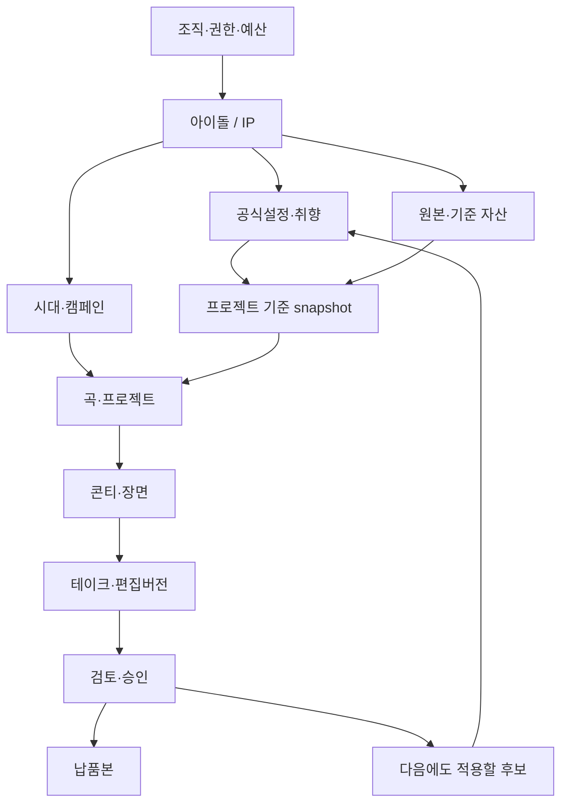

# 05. 역할별 UX, 사용자 여정, 화면 명세와 Refero 조사

작성 기준일: 2026-10-23. 이 문서는 Aethon과 별개의 신규 플랫폼에 대한 **완성형 제품 요구서**다. 화면과 동작은 설계 제안이며 아직 구현하거나 사용자 테스트를 수행하지 않았다. 실제 조사한 참고자료, 참고자료에 대한 해석, 우리 제품의 제안을 구분한다. 기능 요구사항 번호는 통합 요구서에서 연결하며 여기서는 `feature_keys`와 모듈명을 사용한다.

## 5.1 제품 경험의 핵심

사용자가 느껴야 하는 가치는 “영상 하나를 생성했다”보다 “우리 그룹을 이해하는 제작 공간이 생겼다”에 가깝다. 그 경험을 만들려면 다음 작품을 시작할 때 지난 작품의 자료를 찾고 설명하는 비용이 줄어야 하며, 이전에 고친 잘못이 반복되지 않아야 한다. 화면에 ‘기억했습니다’라는 문구를 넣는 것만으로는 충분하지 않다.

따라서 상위 객체는 **아이돌/IP**, 그 아래는 **시대·캠페인 → 곡·프로젝트 → 장면 → 테이크·편집버전 → 납품본**으로 설계한다. 한 작품에 사용한 공식설정·취향·캐스트·음원을 버전으로 묶는다. 나중에 설정이 바뀌어도 과거 납품본의 생성조건과 승인기록은 보존한다.

첫 진입에서 사용자가 온톨로지를 직접 그리게 하지 않는다. 자료를 올리고 간단한 질문에 답하면 시스템이 후보를 정리한다. 사용자는 “공식설정”, “선호하는 표현”, “이번 작품에서만 적용”, “근거를 확인할 수 없음”으로 검토한다. 관계 그래프는 복잡한 서사나 충돌을 확인하는 보조 도구다.

UI의 세 가지 지속적인 약속은 다음과 같다.

1. **어떤 기준을 썼는지 설명한다.** 장면에서 실제 사용한 설정·출처·지난 수정 이유로 이동할 수 있어야 한다.
2. **좋은 부분을 유지하며 수정한다.** 이미 선택한 장면과 버전을 고정하고, 선택한 장면만 추가 견적을 내서 고칠 수 있어야 한다.
3. **비용과 불확실성을 숨기지 않는다.** 예상비용·예약비용·확정비용·환불대기를 구분하고, 생성 접수 여부가 불명일 때 유료 재요청을 자동 실행하지 않는다.

## 5.2 실제 조사 범위와 증거의 강도

사용자의 “REA MCP”는 현재 제공된 **Refero MCP**로 해석했다. 실제 연결된 읽기 계정으로 조회했으며 인증·한도 차단은 발생하지 않았다. 다른 REA 서비스를 뜻한 경우에도 아래 추출 스키마와 연구 질문은 재사용할 수 있지만, 해당 서비스에서 조사했다고 주장하지 않는다.

| 실제 수행 | 수량 | 확인한 범위 |
|---|---:|---|
| 시각 방향 검색 | 3방향 | 영상 제작 도구, 절제된 흑백 SaaS, Linear |
| 전체 스타일 조회 | 3개 | Linear, Frame.io, Audyr |
| 전체 화면 상세 조회 | 12개 | 제작·자료·권한·청구·검토·실패 상태 |
| 원본 화면 이미지 시각 확인 | 4개 | Linear 목록, Frame.io 자산, Butter 업로드 오류, YouTube 모바일 댓글 |
| 전체 사용자 흐름 조회 | 5개 | 프로젝트 생성, 월 한도, 초대, 문서 업로드, 시간별 댓글 |
| 공식 페이지 열람 | 8개 | Character App, LTX, Hedra, Tunee, Frame.io, Notion |

Refero의 화면 설명은 캡처에 대한 해석을 포함한다. 따라서 “댓글 입력창을 확인했다”와 “실제로 저장·권한·동시편집이 올바르게 작동한다”는 서로 다른 증거다. 전자는 이번에 확인했고, 후자는 직접 실행 검증하지 않았다. 상세 메타데이터만 읽은 8개 화면을 원본 이미지를 보았다고 기록하지 않았다. 캡처 시점이 확인되지 않은 경우 현재 제품의 최신 상태로 단정하지 않는다.

Character.app, Tunee, LTX Studio, Hedra, Notion은 정확한 도메인 검색의 상위 결과에서 해당 제품이 확인되지 않았다. 이는 Refero 전체에 없다는 증명이 아니다. 이 제품들은 공식 자료로 기능 방향을 보완했다. Frame.io와 Linear는 정확한 Refero 제품 결과를 확인했다. 전체 조회 기록과 원본 식별자는 `refero_evidence.json`에 있다.

### 근접 경쟁 제품에서 가져올 패턴

| 대상 | 공식 자료에서 확인한 방향 | 우리 제품에 적용할 판단 | 구분해야 할 점 |
|---|---|---|---|
| Character App | World의 Bible과 검토 가능한 설정 갱신; Director의 단계별 제작 [S-U21, S-U22] | IP를 상위에 두고 후보·승인·근거를 분리 | 기억/서사 연속성만으로 독자적 차별화라고 주장하기 어렵다 |
| Tunee | 음원 업로드와 대화로 콘셉트·콘티·장면·뮤직비디오를 제작·편집한다는 제품 설명 [S-U25] | 곡 중심 시작과 짧은 브리프 입력 | ‘몇 분’, 완성도·수정 정확도는 이번 조사에서 실측하지 않았다 |
| LTX Studio | 조직에서 공용 brand elements를 관리하는 Enterprise Brand Kit [S-U23] | 승인된 캐스트·의상·스타일을 공유하고 출처 키트 표시 | 공용 자산과 서사·취향·시간별 공식설정은 다른 데이터 계층이다 |
| Hedra | 대화와 캔버스를 함께 쓰는 프로젝트 작업공간 [S-U24] | 대화는 의도 입력, 캔버스는 검토할 결과와 상태 표시 | 프로젝트 문맥 보존과 다작품 IP 지식체계의 효과는 별도 검증 필요 |
| Frame.io | 자산 관리, 버전 비교, 공유 링크 권한·만료, 검토 댓글 [S-U05, S-U26, S-U27] | 버전이 명확한 검토·납품·비교 경험 | 비교 뷰를 붙이는 것 자체가 캐릭터 동일성을 보장하지 않는다 |
| Linear | 압축된 작업 목록과 멤버 초대 흐름 [S-U01, S-U04, S-U18] | 담당·상태·다음 결정이 분명한 제작 관리 | 영상 미리보기를 업무 목록보다 작게 만들지 않는다 |
| Notion | owner와 verification 유효기간이 있는 지식 관리 [S-U28] | 공식설정의 승인자·검토일·재검토 책임 | 일반 문서의 verified 표시가 생성 제약 집행을 대신하지 않는다 |

## 5.3 시각 방향과 Reference Lock

**주 방향은 중립적인 어두운 제작 공간이다.** Linear에서 확인한 얇은 경계, 상태별 목록, 작은 반경, 낮은 장식 밀도를 기본으로 한다. Frame.io에서는 큰 미디어를 중심에 두고 자산과 댓글을 옆에서 다루는 구조를 가져온다. Audyr는 긴 설정문서와 청구 설명을 읽기 좋은 순서로 정리하는 데 한정해 참고한다. 세 스타일의 색을 평균내거나 하나의 화면에 모두 섞지 않는다. [S-U01–S-U03]

본 제품의 기억을 나타내는 대표적 인터랙션은 **장면의 ‘이번 장면에 적용한 기준’ 서랍**이다. 여기서 공식설정 3개, 지난 수정 1개, 이번 프로젝트 예외 1개처럼 실제 사용된 항목과 이유를 확인한다. 다음 작품에서도 같은 위치와 구조를 유지한다. 장식용 지식 그래프보다 사용자가 결과와 근거를 연결하는 경험이 브랜드를 대표하게 한다.

### 제안 디자인 토큰

아래는 참고자료를 바탕으로 제안한 우리 제품의 초기 토큰이다. 실제 경쟁사에서 추출한 확정값이나 접근성 검증 결과가 아니다. 구현 전에 대비·글꼴 라이선스·한국어 렌더링을 확인한다.

| 역할 | 초기 제안 | 사용 원칙 |
|---|---|---|
| 배경/패널/상위 패널 | #101214 / #181B1F / #22262B | 밝기 차이와 경계로 구분; 영상 자체의 색을 방해하지 않음 |
| 본문/보조정보 | #F5F6F7 / #B7BEC7 | 중요한 가격·상태·권한은 흐린 보조색으로 감추지 않음 |
| 경계 | #3A424C | 드래그 영역·선택·포커스는 충분한 시각 차이 제공 |
| 주 행동 강조 | #DCEC3F | 화면당 핵심 행동에 제한. 큰 배경·장식·모든 배지에 확장하지 않음 |
| 본문 크기 | 14/16px, 제목 20/24px | 한국어 핵심정보 14px 이상; 모바일 입력 16px부터 검토 |
| 수치·타임코드 | tabular numerals | 비용·시간축·버전 ID 정렬 |
| 반경/간격 | 6px 기본, 4px 간격 단위 | 미디어 8px, 모바일 시트 12px를 시작점으로 시험 |
| 동작 | 짧은 상태전환, reduced motion 존중 | 생성 성공을 축하하는 과도한 모션보다 결과/다음 행동 우선 |

상태는 색만으로 표현하지 않는다. ‘공식설정’, ‘후보’, ‘승인 만료’, ‘권리 철회’, ‘비용 확인 중’처럼 텍스트와 아이콘을 함께 사용한다. 핵심 정보를 hover만으로 숨기지 않는다. 모든 드래그 작업에는 키보드·숫자 입력 대안을 둔다. 임시저장·서버저장·최종승인을 각기 다른 단어로 표현한다.

### 결정 원장

| 결정 | 출처 | 적용 규칙 | 이유 |
|---|---|---|---|
| IP를 프로젝트 위에 둔다 | 사용자 요구/S-U21 | World/공식설정은 여러 작품에서 공유, 프로젝트는 버전 snapshot | 다음 영상에서 같은 그룹의 기준을 찾기 쉬움 |
| 기억을 공식설정·취향·원본·제작이력으로 분리 | 사용자 요구/S-U21/S-U28 | 승인과 출처가 보이며 후보는 후보 | 생성결과를 사실로 오해하는 오염 방지 |
| 편집은 미디어 중심 3영역+음악 시간축 | S-U07/S-U12 | 미리보기의 크기를 먼저 확보, 세부제어는 선택된 대상에만 | 오디오와 장면을 함께 검토 |
| 현재 버전과 후보 비교 | S-U13/S-U27 | 댓글·승인을 해당버전에 묶음 | 좋은 부분을 유지하며 부분수정 |
| 생성 실행은 견적→예약→접수 | 사용자 요구/S-U09/S-U17 | 예산 하드캡과 알림한도 분리 | 자동재시도의 비용 불안 제거 |
| 모바일은 검토 중심 | 사용자 역할/S-U15/S-U20 | 큰영상+댓글sheet+명확한결정, 유료생성없음 | 아티스트가 제작도구를 배우지 않고 의견전달 |
| 상태 확인이 재시도보다 우선 | 사용자 과금신뢰 요구/S-U14 | unknown을 실패로 바꾸지 않음 | 중복 과금 방지 |
| 일반목록 기본·그래프 보조 | 사용자 작업목적/S-U10/S-U11 | 근거·시대·관계를 필요할 때 드러냄 | 온톨로지 구축 부담을 숨기되 검증가능성을 유지 |

## 5.4 역할별 시작점과 권한

총 9개 역할 프리셋을 두며 같은 사용자가 복수 역할을 가질 수 있다. Producer와 IP 승인권자는 별도다. 공식설정·장기취향·권리 승인은 허가된 IP의 ip_approver 또는 해당 행위·범위·기간에 대한 명시적 위임 capability가 있어야 한다. Owner·Producer·아티스트 본인이라는 이유만으로 이 승인이 자동 허용되지 않는다. 권한은 조직, IP, 프로젝트, 할당 자산/장면, 검토 package에 걸쳐 서버에서 검사한다. UI에서 버튼을 숨기는 것은 편의 장치이며 권한 통제가 아니다.

| 역할 | 첫 화면과 관심사 | 할 수 있는 핵심 행동 | 분리할 권한 |
|---|---|---|---|
| Owner | 조직/IP 목록, 운영·비용 위험 | 정책·멤버·보존·조직 관리 | IP 공식설정·최종창작승인은 별도 역할 |
| Billing Admin | 사용원장·예산 | 결제·한도·영수증·비용승인 | 비공개 미디어·서사 열람은 별도 |
| Producer/제작 총괄 | IP 홈, 제작·검토 대기 | 자료·기준 후보 제안, 브리프·일정·검토·최종본 관리 | 공식설정·장기취향·권리 승인은 별도 IP 승인권자 또는 명시 위임 |
| IP 승인권자 | 공식설정·장기취향·권리 승인함 | 허가된 IP의 기준·권리 승인·기각·철회 | 제작 총괄·유료생성·청구·영상 최종승인 자동 부여 없음 |
| Director/Editor | 내 작업, 프로젝트 | 콘티·숏·테이크·편집·허용 예산 내 생성 | 전역 공식설정은 변경 제안만 |
| 외부 Artist | 할당 작업 | 기준자료 일부 열람·업로드·납품·피드백 | 전체 IP·다른 외주·유료생성 기본 차단 |
| Reviewer/아티스트 본인 | 공유된 특정 검토버전 | 재생·시점 의견·위임된 범위의 결정 | 생성·결제·전역설정 변경 없음 |
| Viewer | 완성본 재생 | 허용된 재생·다운로드 | 댓글·초안·원본·원장 없음 |
| Support/운영 | 티켓·요청 상태 | 메타데이터 진단·제한된 복구 | 고객 콘텐츠는 범위/기간제 접근, 창작 승인 불가 |

위임은 위임자·수임자·행위·IP/리소스·유효기간·철회를 감사기록으로 남긴다. 같은 사람이 Producer와 IP 승인권자를 겸해도 제작 승인과 IP 승인은 종류·대상 버전을 따로 기록한다.

외부 Artist는 제작 협력자이며 Reviewer는 실제 아티스트 본인이나 승인 담당자를 뜻한다. 두 역할이 같은 사람일 수는 있지만 UI와 권한은 다르게 적용한다. 예를 들어 의상 시트를 그려 납품하는 사람에게 다음 컴백의 비공개 서사를 전부 열어줄 필요는 없다.

## 5.5 정보구조와 화면 골격



이 구조에서 ‘공식설정 채택’, ‘영상 테이크 선택’, ‘검토 승인’, ‘배포 가능’은 서로 다른 상태 전이다. 좋은 장면을 골랐다고 그 장면의 우연한 배경이나 소품이 공식 세계관에 추가되면 안 된다. 가사에서 인물이 죽는다는 표현을 사용했다고 실제 인물의 사실이나 가상 캐스트의 확정 사건으로 저장해도 안 된다.

**데스크톱 제작 화면**은 상단 IP/시대/프로젝트/버전 breadcrumb, 좌측 작업 또는 장면 목록, 중앙 미디어, 우측 선택 객체의 속성·근거, 하단 음악 시간축을 기본으로 한다. 작은 화면에서는 우측 패널을 접는다. 관리 화면은 목록과 상세 패널 중심으로 전환한다.

**모바일 검토 화면**은 영상, 버전·변경사항, 댓글 시트, 결정 버튼으로 구성한다. 제작툴의 작은 아이콘을 축소해 전부 넣지 않는다. 아티스트가 휴대폰에서 의견을 남기는 흐름에 모델 선택·크레딧·유료재시도 버튼은 없다. [S-U15, S-U20]

## 5.6 공통 상태·입력·복구 계약

| 상태 | 화면에서 반드시 드러낼 것 | 금지할 오해 |
|---|---|---|
| 비어 있음 | 처음 사용/검색 결과 없음/권한 없음 구별 | 데이터 0개를 분석실패와 혼동 |
| 로딩 | 실제 단계·마지막 갱신·떠나도 되는지 | 근거 없는 퍼센트·확정 ETA |
| 부분 성공 | 성공/실패 항목, 성공분 유지, 선택 재시도 | 전체 성공 toast 또는 전체 초기화 |
| 오류 | 원인·영향·복구 행동·추적번호, 입력 보존 | “다시 시도”만 무조건 제공 |
| 권한 철회 | 현재 접근 불가·관리자 요청 경로 | 캐시·썸네일로 제한자료 계속 노출 |
| 버전 충돌 | 내가 본 버전/현재 버전/diff | 마지막 저장이 무조건 덮어쓰기 |
| 예산 초과 | 한도·예약·가용금액·축소/승인요청 | 자동결제·몰래 낮은 품질로 전환 |
| 과금 미확정 | 확인 중인 금액·작업·다음 확인 | 0원·환불완료·확정실패로 선표시 |
| 저장 중/오프라인 | 기기 임시저장과 서버 저장 구분 | 서버 도착 전 의견 제출 완료 |
| 오래된 승인 | 승인한 대상 버전과 최신 버전 구별 | 이전 승인을 새 출력에 자동 적용 |

주요 입력에는 label·예시·형식·오류 위치를 제공한다. 숫자/이메일/URL에 맞는 모바일 키보드를 사용하며 붙여넣기를 막지 않는다. 제출 후 첫 오류로 포커스를 이동하되 입력을 지우지 않는다. 페이지 이동과 필터는 URL에 반영하고 뒤로가기를 보존한다. 긴 목록은 실제 분량에 따라 가상화하되 스크린리더·키보드 탐색을 함께 검증한다.

파괴적 변경은 영향 범위를 구체적으로 확인한다. 반면 매번 되돌릴 수 있는 텍스트 수정에 확인 모달을 띄우지 않는다. 사용자가 부담해야 할 확인은 비용 지출, 공개 범위, 공식설정 채택, 권한 철회, 영구삭제처럼 의미가 있는 결정에 집중한다.

### 주요 컴포넌트 계약

| 컴포넌트 | 필수 데이터 | 행동·검증 |
|---|---|---|
| 기억 근거 배지 | 유형, 상태, source_id, version, 적용 범위 | 클릭하면 실제 근거와 장면에 적용된 이유. 접근권한 없는 근거는 내용 미노출 |
| 캐스트 선택 | entity_id, 시대별 자산, IP 승인권자가 확인한 권리상태 | 같은 이름이어도 ID와 출처로 구별. 사용권 만료는 선택 차단 |
| 비교 플레이어 | 두 take ID, timebase, 동기재생 여부 | 댓글 대상 버전 명시. 길이가 다르면 비교 기준 표시 |
| 생성 견적 카드 | selected shots, attempt cap, quote_id, expiry, reserved maximum | 입력 변경 시 재견적. 가격 확인 없이 바로 실행 금지 |
| 작업 상태 행 | request_id, provider_job_id, state, last_seen, attempt_no | cancel requested와 cancelled 구분. unknown은 상태조회 우선 |
| 승인 버튼 | approver capability, target version/hash, scope | 표시된 정확한 대상에만 승인. 최신본으로 바뀌면 새 승인 |
| 피드백 범위 선택 | 이번 숏/작품/시대/IP, 원댓글 | 기본은 좁은 범위. 장기 채택은 명시적 결정 |
| 공유 package | asset versions, reviewer scope, expiry, downloads | 새 내용이 기존 승인 링크에 묵시적으로 바뀌지 않음 |

## 5.7 화면 카탈로그 — 완성형 38개

각 화면의 기계 판독본은 `screen_catalog.json`이다. 기존 32개 화면에 템플릿·연동·기업 정책·성과·데이터 관리·외부 편집의 6개 화면을 보완했다. 기능별 출시 기준을 따른다. SCR-036/037의 기본 계측·동의·내보내기·삭제 처리는 G1부터 필요하며 고급 UI를 이유로 미루지 않는다. 모든 화면은 제안 단계다.

### SCR-001. 로그인·초대 수락

**목적:** 사용자·조직·초대 범위를 확인한 뒤 올바른 작업영역으로 복귀.  
**역할:** all.  
**모듈:** 조직/권한. 기능 키: `auth`, `invite_accept`.  
**진입:** 로그인 URL / 유효한 초대 링크 / 만료된 세션.  
**주 CTA:** 로그인 / 초대 수락.

- **화면 요소:** 초대한 조직/IP/프로젝트 이름; 역할·만료시간; 이메일 로그인/지원되는 SSO; 세션 복구 경로.
- **입력 검증:** 이메일 형식과 초대 대상 일치; 초대 서명·만료·재사용 검증; 인증 실패 메시지는 계정존재 노출 최소화.
- **모바일:** 전체 지원. 키보드가 열려도 대상 조직·역할 확인 가능.
- **이후 화면:** SCR-002, SCR-003, SCR-023, SCR-030.

| 상태 | 요구 동작 |
|---|---|
| 비어 있음 | 초대가 없으면 조직 선택/생성 경로. Reviewer는 공유 링크 경로를 유지한다. |
| 로딩 | 같은 크기의 skeleton/진행상태를 표시하고 중복 제출을 막는다. 저장·생성·결제 완료를 선표시하지 않는다. |
| 부분 성공 | 성공한 항목을 유지하고 실패 항목 수/원인/선택 재시도를 표시한다. 전체 성공으로 요약하지 않는다. |
| 오류 | 원인·영향·수정 행동·추적번호를 제공하며 입력 초안을 보존한다. 과금 가능 작업의 자동 재실행은 금지한다. |
| 철회 | 초대 취소/만료를 구분하고 관리자에게 재발급 요청하는 안내. 다른 IP 이름을 노출하지 않는다. |
| 충돌 | 다른 계정으로 로그인되어 있으면 초대 대상 계정으로 전환 안내. |
| 예산 | 로그인과 초대 수락에서 결제를 유도하지 않는다. |

**수용 기준:** 초대 링크의 intended destination 유지; 권한 없는 주소로 직접 접근해도 콘텐츠 없음.

### SCR-002. 조직 초기 설정

**목적:** 조직과 기본 관리 원칙을 생성.  
**역할:** owner.  
**모듈:** 조직/권한 · 요금. 기능 키: `workspace_setup`, `default_policy`.  
**진입:** SCR-001.  
**주 CTA:** 조직 만들기.

- **화면 요소:** 조직명; 언어·시간대·결제통화 표시; Owner; 기본 멤버 초대 선택; 무료/파일럿 이용범위와 유료 전환 설명.
- **입력 검증:** 조직명 1~80자 제안; 지원되는 통화·시간대 선택; 조직 생성 멱등성.
- **모바일:** 기본 설정 가능. 역할표는 카드로 전환.
- **이후 화면:** SCR-003, SCR-028, SCR-029.

| 상태 | 요구 동작 |
|---|---|
| 비어 있음 | 최소 조직명만으로 시작하고 멤버초대는 건너뛸 수 있다. |
| 로딩 | 같은 크기의 skeleton/진행상태를 표시하고 중복 제출을 막는다. 저장·생성·결제 완료를 선표시하지 않는다. |
| 부분 성공 | 조직생성 성공/일부초대 실패를 따로 표시. |
| 오류 | 원인·영향·수정 행동·추적번호를 제공하며 입력 초안을 보존한다. 과금 가능 작업의 자동 재실행은 금지한다. |
| 철회 | 권한/공유가 철회되면 서버 응답에 맞춰 내용과 미리보기를 제거하고 새 액션을 막는다. 이미 다운로드한 파일 회수는 약속하지 않는다. |
| 충돌 | 보고 있던 버전과 최신 버전을 표시한다. 마지막 저장 덮어쓰기 대신 비교·새 버전 저장·취소를 제공한다. |
| 예산 | 조직 생성은 생성비 지출 동의와 분리. 자동충전 기본 꺼짐. |

**수용 기준:** 새로고침 후 중복 조직 미생성; 생성·결제·초대 성공상태 분리.

### SCR-003. IP 포트폴리오

**목적:** 조직에 속한 아이돌/IP와 작업상태를 찾는다.  
**역할:** owner, producer, director_editor, ip_approver.  
**모듈:** IP · 학습/분석. 기능 키: `ip_portfolio`, `workspace_overview`.  
**진입:** SCR-001 / SCR-002 / 조직 메뉴.  
**주 CTA:** 새 IP 만들기.

**권한 구분:** 화면 진입권과 모든 행동의 실행권은 다르다. Producer는 제작 진행·초안·후보 제안 권한을 가지며, 공식설정·장기취향·권리 승인은 ip_approver 또는 명시적으로 위임된 해당 capability가 있어야 한다. IP 승인권만으로 유료생성·청구관리·영상 최종승인권이 생기지 않는다.

- **화면 요소:** IP 카드/목록; 공식설정 최신승인일; 진행 프로젝트; 대기 승인·위험·예산 상태; 허용된 IP 검색.
- **입력 검증:** 필터/검색 URL 보존; 접근권한 있는 IP만 집계.
- **모바일:** 1열 카드, 업무 알림 우선. 제작으로 이동 시 데스크톱 권장.
- **이후 화면:** SCR-004, SCR-005, SCR-030.

| 상태 | 요구 동작 |
|---|---|
| 비어 있음 | IP가 없으면 3단계 시작 안내: 자료 추가→설정 승인→첫 영상. |
| 로딩 | 같은 크기의 skeleton/진행상태를 표시하고 중복 제출을 막는다. 저장·생성·결제 완료를 선표시하지 않는다. |
| 부분 성공 | 일부 IP 지표 로딩 실패가 전체 목록을 막지 않는다. |
| 오류 | 원인·영향·수정 행동·추적번호를 제공하며 입력 초안을 보존한다. 과금 가능 작업의 자동 재실행은 금지한다. |
| 철회 | 권한/공유가 철회되면 서버 응답에 맞춰 내용과 미리보기를 제거하고 새 액션을 막는다. 이미 다운로드한 파일 회수는 약속하지 않는다. |
| 충돌 | 보고 있던 버전과 최신 버전을 표시한다. 마지막 저장 덮어쓰기 대신 비교·새 버전 저장·취소를 제공한다. |
| 예산 | 예산 부족은 IP에 경고하되 열람 불가로 바꾸지 않는다. |

**수용 기준:** 타 조직/IP 이름·개수 누출 없음; 카드에서 현재 시점과 진행 버전을 식별.

### SCR-004. IP 홈·다음 제작

**목적:** 한 그룹의 현재 정체성과 이어지는 작업을 한눈에 이해.  
**역할:** producer, director_editor, owner, ip_approver.  
**모듈:** IP · 공식설정 · 학습/분석. 기능 키: `ip_home`, `continuity_summary`.  
**진입:** SCR-003 / IP 직접 링크.  
**주 CTA:** 새 영상 만들기.

**권한 구분:** 화면 진입권과 모든 행동의 실행권은 다르다. Producer는 제작 진행·초안·후보 제안 권한을 가지며, 공식설정·장기취향·권리 승인은 ip_approver 또는 명시적으로 위임된 해당 capability가 있어야 한다. IP 승인권만으로 유료생성·청구관리·영상 최종승인권이 생기지 않는다.

- **화면 요소:** IP/시대/브랜치 선택; 고정된 캐스트·공식설정·스타일 요약; 최근 공개작과 제작중 작품; 지난 수정에서 다음에도 적용할 내용; 승인대기와 충돌 배지.
- **입력 검증:** 시대·브랜치 선택값 검증; 요약 근거 버전 표시.
- **모바일:** 요약·작품 재생·승인 알림 지원. 넓은 그래프는 목록 대체.
- **이후 화면:** SCR-005, SCR-008, SCR-010, SCR-013, SCR-027, SCR-033, SCR-036.

| 상태 | 요구 동작 |
|---|---|
| 비어 있음 | 자료가 부족하면 '아직 확인된 설정이 없습니다'와 업로드 CTA. |
| 로딩 | 같은 크기의 skeleton/진행상태를 표시하고 중복 제출을 막는다. 저장·생성·결제 완료를 선표시하지 않는다. |
| 부분 성공 | 승인된 항목과 미검증 항목을 분리한 준비도. 숫자만으로 품질 보장 금지. |
| 오류 | 원인·영향·수정 행동·추적번호를 제공하며 입력 초안을 보존한다. 과금 가능 작업의 자동 재실행은 금지한다. |
| 철회 | 권한/공유가 철회되면 서버 응답에 맞춰 내용과 미리보기를 제거하고 새 액션을 막는다. 이미 다운로드한 파일 회수는 약속하지 않는다. |
| 충돌 | 현재 시대와 다른 규칙이 있으면 새 프로젝트에서 범위를 고르게 한다. |
| 예산 | 읽기/무료 편집은 계속 가능하다. 유료 작업은 견적과 허용 한도를 확인한 뒤 별도 생성 CTA를 통해서만 요청한다. |

**수용 기준:** 한눈에 '이 IP의 기준'과 '이번 프로젝트 예외'를 구분; 이전 수정 이유에서 해당 장면으로 이동.

### SCR-005. IP 자료 등록·온보딩

**목적:** 설정집·과거 MV·이미지·음원·사용자 설명을 출처와 함께 등록.  
**역할:** producer, director_editor, ip_approver.  
**모듈:** 자료입력 · IP. 기능 키: `source_import`, `ip_onboarding`.  
**진입:** SCR-003 / SCR-004.  
**주 CTA:** 자료 분석 시작.

**권한 구분:** 화면 진입권과 모든 행동의 실행권은 다르다. Producer는 제작 진행·초안·후보 제안 권한을 가지며, 공식설정·장기취향·권리 승인은 ip_approver 또는 명시적으로 위임된 해당 capability가 있어야 한다. IP 승인권만으로 유료생성·청구관리·영상 최종승인권이 생기지 않는다.

- **화면 요소:** 파일/URL/직접입력 탭; 자료유형·언어·적용 IP/시대; 정체성/스타일/서사 용도; 권리 확인·공개/비공개; 분석 대상 미리보기.
- **입력 검증:** 지원파일형식·파일크기/길이 제한을 업로드 전 표시; 중복 해시 탐지; 필수 출처와 사용권 선언; 외부 URL 접근 실패·권한 미보유는 가져오기 불가.
- **모바일:** 사진/문서 업로드와 기본설명 지원. 대용량 업로드는 재개 가능성을 표시.
- **이후 화면:** SCR-006, SCR-011.

| 상태 | 요구 동작 |
|---|---|
| 비어 있음 | 샘플은 샘플 IP로 명확히 표시하고 실제 고객 IP와 섞지 않는다. |
| 로딩 | 같은 크기의 skeleton/진행상태를 표시하고 중복 제출을 막는다. 저장·생성·결제 완료를 선표시하지 않는다. |
| 부분 성공 | 파일 단위 완료/실패와 성공한 자료만으로 진행 선택. |
| 오류 | 원인·영향·수정 행동·추적번호를 제공하며 입력 초안을 보존한다. 과금 가능 작업의 자동 재실행은 금지한다. |
| 철회 | 권한/공유가 철회되면 서버 응답에 맞춰 내용과 미리보기를 제거하고 새 액션을 막는다. 이미 다운로드한 파일 회수는 약속하지 않는다. |
| 충돌 | 보고 있던 버전과 최신 버전을 표시한다. 마지막 저장 덮어쓰기 대신 비교·새 버전 저장·취소를 제공한다. |
| 예산 | 분석비가 발생하는 요금이면 예상치·한도·실행 동의를 별도 표시. |

**수용 기준:** 자료 업로드와 공식설정 채택을 혼동시키지 않음; 중복 자료는 복제보다 기존 자료 연결 제안.

### SCR-006. 업로드·자료분석 진행

**목적:** 자료별 처리 단계와 복구를 명확히 보여준다.  
**역할:** producer, director_editor, external_artist, ip_approver.  
**모듈:** 자료입력 · 작업제어. 기능 키: `ingestion_status`, `resumable_upload`.  
**진입:** SCR-005 / SCR-011 / SCR-013.  
**주 CTA:** 검토할 후보 보기.

**권한 구분:** 화면 진입권과 모든 행동의 실행권은 다르다. Producer는 제작 진행·초안·후보 제안 권한을 가지며, 공식설정·장기취향·권리 승인은 ip_approver 또는 명시적으로 위임된 해당 capability가 있어야 한다. IP 승인권만으로 유료생성·청구관리·영상 최종승인권이 생기지 않는다.

- **화면 요소:** 파일별 업로드→변환→분석→검토대기; 진행 수·실패 수; 취소·실패항목 재개; 저작권/권한 제한; 분석결과 미리보기.
- **입력 검증:** 처리중 파일 교체는 새 버전; 타임코드가 원본 길이 범위인지 검증.
- **모바일:** 상태·재개·취소 가능; 앱을 닫아도 서버작업 지속 여부 표시.
- **이후 화면:** SCR-007, SCR-011, SCR-014.

| 상태 | 요구 동작 |
|---|---|
| 비어 있음 | 목록 0개와 검색결과 0개를 구분하고, 해당 역할이 할 수 있는 다음 행동 1개를 제시한다. |
| 로딩 | 정확한 진행률이 없는 외부 단계는 '분석 중, 마지막 확인 15초 전'처럼 표시. 가짜 퍼센트 금지. |
| 부분 성공 | 8/10 완료 같은 수량과 누락 범위를 보여주고 나머지 작업 계속. |
| 오류 | 업로드 중단/변환불가/분석실패를 구분. 같은 분석 요청의 상태확인 우선. |
| 철회 | 처리중 원본권한 철회 시 후속 분석/재사용 차단하고 관련 후보 표시. |
| 충돌 | 보고 있던 버전과 최신 버전을 표시한다. 마지막 저장 덮어쓰기 대신 비교·새 버전 저장·취소를 제공한다. |
| 예산 | 읽기/무료 편집은 계속 가능하다. 유료 작업은 견적과 허용 한도를 확인한 뒤 별도 생성 CTA를 통해서만 요청한다. |

**수용 기준:** 성공한 파일 재전송 요구 없음; 취소 요청과 실제 중단완료 상태 구분.

### SCR-007. 추출 후보 검토함

**목적:** 자료에서 추출된 사실·관계·취향 후보를 사람이 채택.  
**역할:** producer, director_editor, ip_approver.  
**모듈:** 공식설정 · 자료입력. 기능 키: `claim_review`, `canonical_approval`.  
**진입:** SCR-006 / SCR-030.  
**주 CTA:** 후보 제출 / 선택 항목 승인(승인권 보유자).

**권한 구분:** 화면 진입권과 모든 행동의 실행권은 다르다. Producer는 제작 진행·초안·후보 제안 권한을 가지며, 공식설정·장기취향·권리 승인은 ip_approver 또는 명시적으로 위임된 해당 capability가 있어야 한다. IP 승인권만으로 유료생성·청구관리·영상 최종승인권이 생기지 않는다.

**역할별 CTA:** producer → 검토 후보 제출; director_editor → 변경 후보 제안; ip_approver → 선택 항목 승인·수정·기각.

- **화면 요소:** 후보 문장/관계; 원문·영상 타임코드 근거; 모델 추정·사용자 명시 구분; 공식설정/취향/가사비유 분류; 수정·보류·기각; 충돌 비교.
- **입력 검증:** 주어·관계·대상/내용; IP·시대·스토리시간; 근거 연결; ip_approver 또는 명시적 위임 capability만 공식승인; 가사에서 추출한 사실 자동승인 금지.
- **모바일:** 카드별 검토 가능. 복잡한 관계충돌은 읽기+데스크톱 이어하기.
- **이후 화면:** SCR-008, SCR-009, SCR-010, SCR-031.

| 상태 | 요구 동작 |
|---|---|
| 비어 있음 | 검토 후보 없음과 분석실패를 구분. |
| 로딩 | 같은 크기의 skeleton/진행상태를 표시하고 중복 제출을 막는다. 저장·생성·결제 완료를 선표시하지 않는다. |
| 부분 성공 | 일괄승인 중 일부 충돌은 보류하고 결과 목록 제공. |
| 오류 | 원인·영향·수정 행동·추적번호를 제공하며 입력 초안을 보존한다. 과금 가능 작업의 자동 재실행은 금지한다. |
| 철회 | 권한/공유가 철회되면 서버 응답에 맞춰 내용과 미리보기를 제거하고 새 액션을 막는다. 이미 다운로드한 파일 회수는 약속하지 않는다. 승인 capability가 철회·만료되면 승인 버튼을 제거하고 서버도 해당 결정을 거절한다. |
| 충돌 | 양쪽 주장·출처·유효기간을 동시에 보여주고 기존설정 유지/새시대/분기/정정 중 선택. |
| 예산 | 후보검토는 영상생성을 실행하지 않는다. |

**수용 기준:** 한 번의 승인에 채택된 claim IDs·승인자·시점·버전 기록; 보류 후보는 다음 영상의 확정 제약으로 사용 안 됨; Producer 단독 역할은 승인 API를 호출해도 거절되며, 허가된 IP·기간의 위임이 있을 때만 승인 가능.

### SCR-008. 공식설정·서사 기록

**목적:** 세계관·멤버관계·사건을 승인상태와 시간 범위로 탐색.  
**역할:** producer, director_editor, owner, ip_approver.  
**모듈:** 공식설정 · IP. 기능 키: `canon_bible`, `timeline_branch`.  
**진입:** SCR-004 / SCR-007 / 장면 근거 링크.  
**주 CTA:** 설정 변경 제안.

**권한 구분:** 화면 진입권과 모든 행동의 실행권은 다르다. Producer는 제작 진행·초안·후보 제안 권한을 가지며, 공식설정·장기취향·권리 승인은 ip_approver 또는 명시적으로 위임된 해당 capability가 있어야 한다. IP 승인권만으로 유료생성·청구관리·영상 최종승인권이 생기지 않는다.

**역할별 CTA:** producer → 설정 변경 제안; director_editor → 설정 변경 제안; ip_approver → 공식설정 검토·승인.

- **화면 요소:** 인물/장소/관계/규칙/사건 탭; 공식/후보/폐기 상태; 스토리 시간과 공개일 분리; 시대·브랜치; 출처·승인자·버전; 목록 기본/관계그래프 보조.
- **입력 검증:** 관계의 대상 ID 존재; 자기모순·순환 관계 정책; 기간 시작≤종료; 현실인물 정보와 가상페르소나를 별도 엔티티.
- **모바일:** 목록·검색·근거는 지원, 큰 그래프는 접거나 대체.
- **이후 화면:** SCR-007, SCR-012, SCR-017, SCR-031.

| 상태 | 요구 동작 |
|---|---|
| 비어 있음 | 비어있는 분류에서 자유작성/근거등록 선택. |
| 로딩 | 같은 크기의 skeleton/진행상태를 표시하고 중복 제출을 막는다. 저장·생성·결제 완료를 선표시하지 않는다. |
| 부분 성공 | 성공한 항목을 유지하고 실패 항목 수/원인/선택 재시도를 표시한다. 전체 성공으로 요약하지 않는다. |
| 오류 | 원인·영향·수정 행동·추적번호를 제공하며 입력 초안을 보존한다. 과금 가능 작업의 자동 재실행은 금지한다. |
| 철회 | 삭제된 출처를 사용한 설정은 근거철회 표시와 재검토 큐. |
| 충돌 | 정정은 과거를 덮어쓰지 않고 새 버전; 기존 완성작 영향은 별도 검토. |
| 예산 | 읽기/무료 편집은 계속 가능하다. 유료 작업은 견적과 허용 한도를 확인한 뒤 별도 생성 CTA를 통해서만 요청한다. |

**수용 기준:** 같은 인물의 현실/극중 속성을 섞지 않음; 과거 공개작 기준설정 snapshot 조회.

### SCR-009. 캐스트·동일성·허용 범위

**목적:** 멤버별 기준 외형·목소리·의상 및 사용권을 관리.  
**역할:** producer, director_editor, external_artist, ip_approver.  
**모듈:** IP · 자료입력 · 공식설정. 기능 키: `cast_identity`, `likeness_rights`.  
**진입:** SCR-004 / SCR-008 / SCR-011.  
**주 CTA:** 기준 자산 제안 / 기준·권리 승인(승인권 보유자).

**권한 구분:** 화면 진입권과 모든 행동의 실행권은 다르다. Producer는 제작 진행·초안·후보 제안 권한을 가지며, 공식설정·장기취향·권리 승인은 ip_approver 또는 명시적으로 위임된 해당 capability가 있어야 한다. IP 승인권만으로 유료생성·청구관리·영상 최종승인권이 생기지 않는다.

**역할별 CTA:** external_artist → 자산·권리 증빙 제출; producer → 납품 검토·기준 후보 제출; ip_approver → 캐스트 기준·권리 승인.

- **화면 요소:** 캐스트 고정 ID·별명; 정면/측면 기준이미지; 의상·시대 변형; 허용/금지사항; 실제인물·가상캐릭터 구분; 권한 문서·유효기간.
- **입력 검증:** 기준이미지 품질/얼굴 수 점검; 동명이인 중복 경고; 목소리/외형 이용범위 별도; 협력자·Producer는 후보 제출, 공식기준·권리 채택은 ip_approver 또는 명시적 위임 capability.
- **모바일:** 자산 확인·동의범위 열람·제출 가능; 다중비교는 데스크톱 권장.
- **이후 화면:** SCR-010, SCR-012, SCR-017, SCR-031.

| 상태 | 요구 동작 |
|---|---|
| 비어 있음 | 목록 0개와 검색결과 0개를 구분하고, 해당 역할이 할 수 있는 다음 행동 1개를 제시한다. |
| 로딩 | 같은 크기의 skeleton/진행상태를 표시하고 중복 제출을 막는다. 저장·생성·결제 완료를 선표시하지 않는다. |
| 부분 성공 | 빠진 방향/낮은 해상도는 준비도 경고; 생성 성공 보장 점수로 표시하지 않음. |
| 오류 | 원인·영향·수정 행동·추적번호를 제공하며 입력 초안을 보존한다. 과금 가능 작업의 자동 재실행은 금지한다. |
| 철회 | 동의 철회시 새 생성·공유를 정책에 따라 막고 영향 작업 제시. 승인 capability가 철회·만료되면 승인 버튼을 제거하고 서버도 해당 결정을 거절한다. |
| 충돌 | 시대별 의상이 글로벌 외형을 덮어쓰지 않도록 범위 선택. |
| 예산 | 읽기/무료 편집은 계속 가능하다. 유료 작업은 견적과 허용 한도를 확인한 뒤 별도 생성 CTA를 통해서만 요청한다. |

**수용 기준:** 기준 얼굴과 선택된 의상 버전을 장면에서 추적 가능; 다인물 테스트를 솔로 품질로 대신 통과시키지 않음.

### SCR-010. 스타일·취향 가이드

**목적:** 그룹이 선호하는 표현과 이번 작품의 예외를 분리.  
**역할:** producer, director_editor, ip_approver.  
**모듈:** 취향 · IP. 기능 키: `style_guide`, `preference_scope`.  
**진입:** SCR-004 / SCR-007 / SCR-024.  
**주 CTA:** 스타일 초안 저장 / 장기취향 승인(승인권 보유자).

**권한 구분:** 화면 진입권과 모든 행동의 실행권은 다르다. Producer는 제작 진행·초안·후보 제안 권한을 가지며, 공식설정·장기취향·권리 승인은 ip_approver 또는 명시적으로 위임된 해당 capability가 있어야 한다. IP 승인권만으로 유료생성·청구관리·영상 최종승인권이 생기지 않는다.

**역할별 CTA:** producer → 프로젝트 스타일 저장·장기취향 승인 요청; director_editor → 스타일 변경 제안; ip_approver → 장기취향 기준 승인.

- **화면 요소:** 좋아요/싫어요 예시 쌍; 색·조명·카메라·컷 밀도·금지표현; 고정규칙/약한 선호; 그룹/시대/프로젝트/구간 범위; 출처와 최근 수정 이유; 새로움 허용 정도.
- **입력 검증:** 범위 필수; 상충 선호 우선순위; 민감/금지조건은 자연어뿐 아니라 구조화; 단발 장면선택을 장기취향으로 자동확정 금지; 이번 프로젝트의 제작 선택과 IP·시대의 장기취향 채택을 분리; 장기 채택은 ip_approver 또는 해당 위임 capability 확인.
- **모바일:** 예시스와이프·범위 선택·승인 가능. 큰 무드보드는 가로스크롤 제한.
- **이후 화면:** SCR-015, SCR-017, SCR-024, SCR-031.

| 상태 | 요구 동작 |
|---|---|
| 비어 있음 | 설명과 예시1쌍으로 시작; 긴 온톨로지 폼을 강요하지 않는다. |
| 로딩 | 같은 크기의 skeleton/진행상태를 표시하고 중복 제출을 막는다. 저장·생성·결제 완료를 선표시하지 않는다. |
| 부분 성공 | 성공한 항목을 유지하고 실패 항목 수/원인/선택 재시도를 표시한다. 전체 성공으로 요약하지 않는다. |
| 오류 | 원인·영향·수정 행동·추적번호를 제공하며 입력 초안을 보존한다. 과금 가능 작업의 자동 재실행은 금지한다. |
| 철회 | 권한/공유가 철회되면 서버 응답에 맞춰 내용과 미리보기를 제거하고 새 액션을 막는다. 이미 다운로드한 파일 회수는 약속하지 않는다. 승인 capability가 철회·만료되면 승인 버튼을 제거하고 서버도 해당 결정을 거절한다. |
| 충돌 | 글로벌 선호와 이번 콘셉트 예외를 병렬 표시; 이번만 적용 가능. |
| 예산 | 스타일 변경은 자동 재생성하지 않으며 영향장면·추가비용을 보여준다. |

**수용 기준:** 고정 제약과 유연한 취향이 다른 표시와 정책을 사용; 다음 작업에서 채택/무시 근거 확인.

### SCR-011. 공유 자산·자료 라이브러리

**목적:** 사용 가능한 원본·승인자료·산출물을 찾아 재사용.  
**역할:** producer, director_editor, external_artist, ip_approver.  
**모듈:** 자료입력 · IP. 기능 키: `asset_library`, `source_search`.  
**진입:** IP/프로젝트 내 탐색.  
**주 CTA:** 자료 추가.

**권한 구분:** 화면 진입권과 모든 행동의 실행권은 다르다. Producer는 제작 진행·초안·후보 제안 권한을 가지며, 공식설정·장기취향·권리 승인은 ip_approver 또는 명시적으로 위임된 해당 capability가 있어야 한다. IP 승인권만으로 유료생성·청구관리·영상 최종승인권이 생기지 않는다.

- **화면 요소:** 그리드/표 전환; 소유 IP·시대·타입·상태 필터; 썸네일·길이·파일형식; 사용 가능/만료/검토중; 프로젝트 사용횟수; 원본과 파생본 구분.
- **입력 검증:** 리소스별 ACL 필터; 중복 hash; 선택 범위와 액션 권한 일치.
- **모바일:** 검색·그리드·업로드 지원. 표는 카드형 상세.
- **이후 화면:** SCR-005, SCR-006, SCR-012, SCR-017.

| 상태 | 요구 동작 |
|---|---|
| 비어 있음 | 빈 라이브러리와 필터 결과 0개 분리. |
| 로딩 | 같은 크기의 skeleton/진행상태를 표시하고 중복 제출을 막는다. 저장·생성·결제 완료를 선표시하지 않는다. |
| 부분 성공 | 썸네일 실패에도 파일 메타데이터와 재시도 제공. |
| 오류 | 원인·영향·수정 행동·추적번호를 제공하며 입력 초안을 보존한다. 과금 가능 작업의 자동 재실행은 금지한다. |
| 철회 | 권한 철회 자산은 새 사용/다운로드 차단; 영향도 접근권한도 확인. |
| 충돌 | 보고 있던 버전과 최신 버전을 표시한다. 마지막 저장 덮어쓰기 대신 비교·새 버전 저장·취소를 제공한다. |
| 예산 | 업로드/정리와 생성비용 분리. |

**수용 기준:** 이름이 같아도 원본 IP/키트와 버전으로 구별; 허가되지 않은 원본 썸네일도 반환 안 함.

### SCR-012. 원본·근거·권리 상세

**목적:** 어디서 온 자료이며 무엇에 쓰였는지 검증.  
**역할:** producer, director_editor, external_artist, ip_approver.  
**모듈:** 자료입력 · 공식설정 · 운영. 기능 키: `provenance_detail`, `rights_revocation`.  
**진입:** SCR-011 / 모든 근거 배지.  
**주 CTA:** 이 자료를 사용한 항목 보기.

**권한 구분:** 화면 진입권과 모든 행동의 실행권은 다르다. Producer는 제작 진행·초안·후보 제안 권한을 가지며, 공식설정·장기취향·권리 승인은 ip_approver 또는 명시적으로 위임된 해당 capability가 있어야 한다. IP 승인권만으로 유료생성·청구관리·영상 최종승인권이 생기지 않는다.

**역할별 CTA:** external_artist → 권리 증빙 제출·철회 신고; producer → 사용정보 검토·권리 검토 요청; ip_approver → 권리 상태 확정·철회.

- **화면 요소:** 원본뷰어; 출처 페이지/타임코드; 사용권·만료일; 작성자와 등록일; 연결 claim/shot/output; 교체·철회·재검토.
- **입력 검증:** 외부 원본 URL은 허용 프로토콜/접근범위; 철회 이유 필수; 사용중 자료 삭제는 영향목록 확인; 권리 증빙 제출·철회 신고와 권리 상태의 승인 결정을 분리; 권리 승인·철회 결정은 ip_approver 또는 해당 위임 capability.
- **모바일:** 원본확인·권리상태·영향요약 지원.
- **이후 화면:** SCR-007, SCR-017, SCR-031.

| 상태 | 요구 동작 |
|---|---|
| 비어 있음 | 목록 0개와 검색결과 0개를 구분하고, 해당 역할이 할 수 있는 다음 행동 1개를 제시한다. |
| 로딩 | 같은 크기의 skeleton/진행상태를 표시하고 중복 제출을 막는다. 저장·생성·결제 완료를 선표시하지 않는다. |
| 부분 성공 | 성공한 항목을 유지하고 실패 항목 수/원인/선택 재시도를 표시한다. 전체 성공으로 요약하지 않는다. |
| 오류 | 원본이 사라졌으면 기존 캐시 보유정책과 근거불가를 분리. |
| 철회 | signed link·미리보기 재발급 차단. 기존 다운로드 회수 불가를 설명. 승인 capability가 철회·만료되면 승인 버튼을 제거하고 서버도 해당 결정을 거절한다. |
| 충돌 | 새 버전 업로드를 기존 출처 URL과 혼합하지 않는다. |
| 예산 | 철회로 생기는 재생성은 견적·별도승인 전까지 실행 안 함. |

**수용 기준:** 철회 대상→영향 장면→내보내기 차단 경로 연결; 데이터 보존과 내용삭제의 차이 표시.

### SCR-013. 새 음악영상·음원 등록

**목적:** IP와 목표 출력물을 유지하며 곡을 등록.  
**역할:** producer, director_editor.  
**모듈:** 음악 · 사전기획. 기능 키: `project_create`, `song_upload`.  
**진입:** SCR-004 / SCR-027.  
**주 CTA:** 곡 분석하기.

- **화면 요소:** IP·시대·기준 버전; 곡파일/기존곡 선택; 가사 제공/없음; 숏폼/풀MV·길이·화면비; 일정·예산 상한; 목표 시청자.
- **입력 검증:** 음원형식·길이·권리확인; 곡 버전 고정; 프로젝트명 1~120자 제안; 범위 벗어난 예산은 승인요청.
- **모바일:** 업로드·브리프 입력 가능. 본격편집은 데스크톱.
- **이후 화면:** SCR-006, SCR-014, SCR-015.

| 상태 | 요구 동작 |
|---|---|
| 비어 있음 | 완성 음원 없이 콘셉트 초안만 시작 가능하되 리듬분석 없음 표시. |
| 로딩 | 같은 크기의 skeleton/진행상태를 표시하고 중복 제출을 막는다. 저장·생성·결제 완료를 선표시하지 않는다. |
| 부분 성공 | 음원은 성공·가사는 실패한 경우 수동입력으로 계속. |
| 오류 | 원인·영향·수정 행동·추적번호를 제공하며 입력 초안을 보존한다. 과금 가능 작업의 자동 재실행은 금지한다. |
| 철회 | 권한/공유가 철회되면 서버 응답에 맞춰 내용과 미리보기를 제거하고 새 액션을 막는다. 이미 다운로드한 파일 회수는 약속하지 않는다. |
| 충돌 | 지난 프로젝트 복제시 곡·새시대·공유권한을 다시 확인. |
| 예산 | 읽기/무료 편집은 계속 가능하다. 유료 작업은 견적과 허용 한도를 확인한 뒤 별도 생성 CTA를 통해서만 요청한다. |

**수용 기준:** 잘못된 IP에 업로드하기 전 상단 IP 확인; 기존곡 재사용과 새원본 교체 구별.

### SCR-014. 곡 구조·가사 타임라인

**목적:** 곡의 절·후렴·비트·감정구간을 검토해 영상시간축 확정.  
**역할:** producer, director_editor.  
**모듈:** 음악. 기능 키: `audio_analysis`, `lyrics_alignment`.  
**진입:** SCR-013 / SCR-006.  
**주 CTA:** 구조 확정.

- **화면 요소:** waveform; 구간마커·BPM/템포 변화; 가사 정렬·불확실 구간; 수동 드래그/숫자 입력; 리듬/서사 레이어; 추출 신뢰도 설명.
- **입력 검증:** 구간겹침/빈틈 정책; 0≤start<end≤duration; 원본 변경시 재정렬 필요; 가사권한과 캐논승인 별개.
- **모바일:** 재생·구간확인·간단 수정. 정밀 타이밍은 데스크톱.
- **이후 화면:** SCR-015, SCR-016.

| 상태 | 요구 동작 |
|---|---|
| 비어 있음 | 분석 없음이면 수동 구간 추가. |
| 로딩 | 같은 크기의 skeleton/진행상태를 표시하고 중복 제출을 막는다. 저장·생성·결제 완료를 선표시하지 않는다. |
| 부분 성공 | 낮은 확신 가사구간만 표시·수정; 전체실패 처리 안 함. |
| 오류 | 비트검출 실패도 수동 편집 가능. |
| 철회 | 권한/공유가 철회되면 서버 응답에 맞춰 내용과 미리보기를 제거하고 새 액션을 막는다. 이미 다운로드한 파일 회수는 약속하지 않는다. |
| 충돌 | 가사편집과 음원교체 동시 변경은 영향구간 표시. |
| 예산 | 구조 확정은 영상생성 결제가 아님. |

**수용 기준:** 수정한 타임코드가 다음 재분석에서 사라지지 않음; 가사비유를 공식사건으로 저장 안 함.

### SCR-015. 제작 브리프·콘셉트

**목적:** 기억한 정보와 이번 작품의 의도를 보여주며 콘셉트 결정.  
**역할:** producer, director_editor, ip_approver.  
**모듈:** 사전기획 · 취향. 기능 키: `creative_brief`, `concept_select`.  
**진입:** SCR-013 / SCR-014.  
**주 CTA:** 콘티 만들기.

**권한 구분:** 화면 진입권과 모든 행동의 실행권은 다르다. Producer는 제작 진행·초안·후보 제안 권한을 가지며, 공식설정·장기취향·권리 승인은 ip_approver 또는 명시적으로 위임된 해당 capability가 있어야 한다. IP 승인권만으로 유료생성·청구관리·영상 최종승인권이 생기지 않는다.

- **화면 요소:** 목표·출력 사양; 콘셉트 2~3개 또는 직접작성; 각안의 서사/스타일근거; 이번만 예외; 참고자료 사용·제외 목록; 예상 제작 범위.
- **입력 검증:** 필수 캐스트·강제제약 누락 점검; 근거 없는 새 사건은 제안표시; 금지조건 충돌은 다음 단계 전 해결.
- **모바일:** 콘셉트 비교·결정 지원. 이미지·근거가 탭으로 분리.
- **이후 화면:** SCR-016, SCR-010, SCR-008.

| 상태 | 요구 동작 |
|---|---|
| 비어 있음 | 최소 브리프와 부족한 정보 1~3개만 질문. |
| 로딩 | 같은 크기의 skeleton/진행상태를 표시하고 중복 제출을 막는다. 저장·생성·결제 완료를 선표시하지 않는다. |
| 부분 성공 | 콘셉트 일부만 준비되면 순차 표시하되 자동선택 금지. |
| 오류 | 원인·영향·수정 행동·추적번호를 제공하며 입력 초안을 보존한다. 과금 가능 작업의 자동 재실행은 금지한다. |
| 철회 | 권한/공유가 철회되면 서버 응답에 맞춰 내용과 미리보기를 제거하고 새 액션을 막는다. 이미 다운로드한 파일 회수는 약속하지 않는다. |
| 충돌 | 공식설정 위반안은 경고·대체안; 사용자가 예외 승인권 없으면 선택 불가. |
| 예산 | 읽기/무료 편집은 계속 가능하다. 유료 작업은 견적과 허용 한도를 확인한 뒤 별도 생성 CTA를 통해서만 요청한다. |

**수용 기준:** 왜 이 콘셉트인가에 실제 사용한 근거가 제시; 선택 안 한 안은 공식기억으로 채택 안 함.

### SCR-016. 스토리보드·숏 목록

**목적:** 음악 구조에 맞는 각 장면을 유료 영상 생성 전에 검토.  
**역할:** producer, director_editor, ip_approver.  
**모듈:** 사전기획 · 음악. 기능 키: `storyboard`, `shot_plan`.  
**진입:** SCR-015.  
**주 CTA:** 선택 장면 생성 준비.

**권한 구분:** 화면 진입권과 모든 행동의 실행권은 다르다. Producer는 제작 진행·초안·후보 제안 권한을 가지며, 공식설정·장기취향·권리 승인은 ip_approver 또는 명시적으로 위임된 해당 capability가 있어야 한다. IP 승인권만으로 유료생성·청구관리·영상 최종승인권이 생기지 않는다.

- **화면 요소:** 씬/숏카드·길이·담당; 구간별 가사·리듬; 캐스트·의상·장소; 서사역할·프레임/동작; 근거·충돌·미정배지; 순서변경·잠금·선택생성.
- **입력 검증:** 총길이 및 구간 매핑; 오디오/컷 공백; 등장인물 기준참조 유효; 필수 장면 누락.
- **모바일:** 카드 검토·의견 가능; 다중 드래그/정밀편집 제한.
- **이후 화면:** SCR-017, SCR-018, SCR-022.

| 상태 | 요구 동작 |
|---|---|
| 비어 있음 | 스토리보드 없이 바로 고비용 생성하지 않도록 제안 콘티 확보. |
| 로딩 | 같은 크기의 skeleton/진행상태를 표시하고 중복 제출을 막는다. 저장·생성·결제 완료를 선표시하지 않는다. |
| 부분 성공 | 키프레임 일부 실패시 나머지 보존; 텍스트콘티로 검토 가능. |
| 오류 | 원인·영향·수정 행동·추적번호를 제공하며 입력 초안을 보존한다. 과금 가능 작업의 자동 재실행은 금지한다. |
| 철회 | 권한/공유가 철회되면 서버 응답에 맞춰 내용과 미리보기를 제거하고 새 액션을 막는다. 이미 다운로드한 파일 회수는 약속하지 않는다. |
| 충돌 | 콘티승인 뒤 변경된 숏만 승인취소/영향표시. |
| 예산 | 선택숏 수와 예상 생성비가 누적 표시되며 클릭 한번이 전체재생성이 되지 않음. |

**수용 기준:** 전체/선택숏 범위 항상 표시; 승인버전과 현재 편집본을 구분.

### SCR-017. 장면 편집·기억 근거

**목적:** 한 장면의 수정 범위와 참조정보를 통제.  
**역할:** director_editor, producer, external_artist, ip_approver.  
**모듈:** 사전기획 · 공식설정 · 취향 · 편집. 기능 키: `shot_editor`, `context_explain`, `constraint_lock`.  
**진입:** SCR-016 / SCR-021 / SCR-024.  
**주 CTA:** 변경 적용 / 이 장면 생성 견적.

**권한 구분:** 화면 진입권과 모든 행동의 실행권은 다르다. Producer는 제작 진행·초안·후보 제안 권한을 가지며, 공식설정·장기취향·권리 승인은 ip_approver 또는 명시적으로 위임된 해당 capability가 있어야 한다. IP 승인권만으로 유료생성·청구관리·영상 최종승인권이 생기지 않는다.

- **화면 요소:** 미리보기 중앙; 숏목록 왼쪽; 캐스트/의상/동작/카메라 오른쪽; 음악 구간 아래; 사용한 공식설정·선호·지난수정 drawer; 유지할 속성 잠금; 변경전후 diff.
- **입력 검증:** 할당 숏 권한; 제약잠금 해제권; 생성모델 지원 속성; 불가능 요청은 안내.
- **모바일:** 장면 재생·설정요약·코멘트. 복잡한 편집/유료생성 버튼 숨김.
- **이후 화면:** SCR-018, SCR-020, SCR-024, SCR-012.

| 상태 | 요구 동작 |
|---|---|
| 비어 있음 | 테이크 없음이면 승인 keyframe/콘티 표시. |
| 로딩 | 같은 크기의 skeleton/진행상태를 표시하고 중복 제출을 막는다. 저장·생성·결제 완료를 선표시하지 않는다. |
| 부분 성공 | 근거 일부 로드실패시 빠진 제약을 명시하고 중요제약 검증 전 생성잠금. |
| 오류 | 원인·영향·수정 행동·추적번호를 제공하며 입력 초안을 보존한다. 과금 가능 작업의 자동 재실행은 금지한다. |
| 철회 | 권한/공유가 철회되면 서버 응답에 맞춰 내용과 미리보기를 제거하고 새 액션을 막는다. 이미 다운로드한 파일 회수는 약속하지 않는다. |
| 충돌 | 동시편집·기준설정 최신화시 이전조건 유지/새조건 채택 비교. |
| 예산 | 텍스트 수정 무료 여부와 생성 견적을 구분. 프롬프트 입력만으로 결제 안 됨. |

**수용 기준:** 선택 숏 외의 take IDs 유지; 근거 drawer는 실제 context manifest와 일치.

### SCR-018. 생성 견적·범위 확인

**목적:** 어떤 결과를 얼마 한도 안에서 몇 회 시도할지 승인.  
**역할:** producer, director_editor, billing_admin.  
**모듈:** 생성요청 · 요금. 기능 키: `quote`, `spend_authorization`, `generation_scope`.  
**진입:** SCR-016 / SCR-017 / SCR-020.  
**주 CTA:** 표시한 한도 안에서 생성.

- **화면 요소:** 선택 숏·길이·해상도·모델/버전; 기본1회·추가시도 상한; 예상/최대예약/이미사용 비용; 취소·실패 과금 조건; 기준 snapshot·권한 확인; 견적 만료시간.
- **입력 검증:** 견적해시·유효기간·현재가격; 세션권한·가용예산; 숏/설정버전 일치; 동일요청 멱등성키.
- **모바일:** 읽기와 승인요청 상태만. 모바일 reviewer 경로에는 접근/유료 실행 없음.
- **이후 화면:** SCR-019, SCR-029, SCR-016.

| 상태 | 요구 동작 |
|---|---|
| 비어 있음 | 목록 0개와 검색결과 0개를 구분하고, 해당 역할이 할 수 있는 다음 행동 1개를 제시한다. |
| 로딩 | 최종 가격/예약 성공 전 실행완료 표시 금지. |
| 부분 성공 | 일부 숏만 예산 내 가능하면 명시적 부분선택 요구. |
| 오류 | 예약 실패는 작업 시작 안 함; 공급자 접수 불명은 SCR-019로 조회. |
| 철회 | 권한/공유가 철회되면 서버 응답에 맞춰 내용과 미리보기를 제거하고 새 액션을 막는다. 이미 다운로드한 파일 회수는 약속하지 않는다. |
| 충돌 | 견적 후 입력/모델/가격 변경 시 재견적. |
| 예산 | 한도 초과는 숏축소·품질조정·승인요청. 자동충전/무제한재시도 기본 금지. |

**수용 기준:** 총액·최대 추가시도·실행범위를 사용자가 읽고 확인; 중복클릭 비용예약과 작업생성 각1건.

### SCR-019. 생성 작업·실패 복구

**목적:** 오래 걸리는 작업과 불확실한 상태를 정확히 알린다.  
**역할:** producer, director_editor, billing_admin.  
**모듈:** 작업제어 · 요금 · 운영. 기능 키: `job_monitor`, `unknown_billing`, `bounded_retry`.  
**진입:** SCR-018 / SCR-030.  
**주 CTA:** 완료 테이크 보기 / 상태 확인.

- **화면 요소:** queued/accepted/running/partial/succeeded/failed/cancel_requested/cancelled/unknown; 숏별 진행·마지막 상태갱신; 시도수·소비/예약/환불대기; 확정ETA 대신 관측구간; 취소와 선택 재시도; 문제보고.
- **입력 검증:** 외부job ID와 내부request ID 매핑; 가격/동일요청 상태검증; 재시도 가능에만 CTA 활성.
- **모바일:** 상태·취소·문제보고 가능. 유료 재시도 없음.
- **이후 화면:** SCR-020, SCR-018, SCR-029, SCR-032.

| 상태 | 요구 동작 |
|---|---|
| 비어 있음 | 목록 0개와 검색결과 0개를 구분하고, 해당 역할이 할 수 있는 다음 행동 1개를 제시한다. |
| 로딩 | 공급자 진행률 미제공시 단계와 마지막 heartbeat; 새로고침해도 동일job. |
| 부분 성공 | 완료 숏은 즉시 검토, 실패 숏만 복구. |
| 오류 | 확정실패/접수불명/정책거절 분리. unknown은 재요청보다 상태조회. |
| 철회 | 권한철회시 새 생성차단·가능한 취소, 이미 접수된 비용은 별도 정산. |
| 충돌 | 보고 있던 버전과 최신 버전을 표시한다. 마지막 저장 덮어쓰기 대신 비교·새 버전 저장·취소를 제공한다. |
| 예산 | 재시도횟수/남은 예약한도 도달 시 자동중단. 환불은 완료 전 '환불대기'. |

**수용 기준:** unknown 상태에서 자동 유료 중복요청0; 부분실패가 성공 take 삭제로 이어지지 않음.

### SCR-020. 테이크 비교·선택

**목적:** 후보의 동일성·연출·서사를 비교하고 사용할 버전 선택.  
**역할:** producer, director_editor.  
**모듈:** 편집 · 생성요청 · 학습/분석. 기능 키: `take_compare`, `take_selection`.  
**진입:** SCR-019 / SCR-017.  
**주 CTA:** 이 테이크 사용.

- **화면 요소:** A/B 동기재생; 각각 take ID·모델·생성조건·비용; 선택/탈락 이유; 기존승인본 고정; 품질체크·근거제약; 선택숏만 수정.
- **입력 검증:** 비교대상 같은숏/시간범위 안내; 선택된 버전 유효·권리확인; 수정이유 필수대신 빠른태그+선택설명.
- **모바일:** 단일 재생+버전전환 지원. 동시A/B는 데스크톱.
- **이후 화면:** SCR-021, SCR-017, SCR-018, SCR-024.

| 상태 | 요구 동작 |
|---|---|
| 비어 있음 | 아직후보없음→작업상태. |
| 로딩 | 같은 크기의 skeleton/진행상태를 표시하고 중복 제출을 막는다. 저장·생성·결제 완료를 선표시하지 않는다. |
| 부분 성공 | 한쪽 프록시 미완료면 비교불가 표시·개별재생 허용. |
| 오류 | 원인·영향·수정 행동·추적번호를 제공하며 입력 초안을 보존한다. 과금 가능 작업의 자동 재실행은 금지한다. |
| 철회 | 권한/공유가 철회되면 서버 응답에 맞춰 내용과 미리보기를 제거하고 새 액션을 막는다. 이미 다운로드한 파일 회수는 약속하지 않는다. |
| 충돌 | 다른 편집자가 선택한 현재 take를 비교 후 교체. |
| 예산 | 다시생성 CTA는 견적으로 이동; 좋아요가 추가생성을 실행하지 않음. |

**수용 기준:** 승인 take 선택이 canon 승인으로 자동변환되지 않음; 비교 코멘트가 어느 take에 속하는지 표시.

### SCR-021. 편집 타임라인

**목적:** 완성 MV의 컷·음악·자막·타이포를 조정.  
**역할:** director_editor, producer.  
**모듈:** 편집 · 음악. 기능 키: `timeline_edit`, `lyric_composite`, `partial_regeneration`.  
**진입:** SCR-020 / SCR-016.  
**주 CTA:** 검토본 만들기.

- **화면 요소:** preview·timecode; 숏·음원·자막 트랙; 스냅/구간잠금; 수동 업로드 클립 삽입; 색/크롭/전환; 저장상태·버전; 선택구간 재생성.
- **입력 검증:** 프레임레이트·timebase; 오디오 클리핑·구간공백; 폰트 라이선스·자막 safe area; 스냅샷 충돌.
- **모바일:** 재생·코멘트만; 데스크톱 이어하기. 모바일 정밀NLE 약속 안 함.
- **이후 화면:** SCR-022, SCR-025, SCR-017, SCR-038.

| 상태 | 요구 동작 |
|---|---|
| 비어 있음 | 목록 0개와 검색결과 0개를 구분하고, 해당 역할이 할 수 있는 다음 행동 1개를 제시한다. |
| 로딩 | 같은 크기의 skeleton/진행상태를 표시하고 중복 제출을 막는다. 저장·생성·결제 완료를 선표시하지 않는다. |
| 부분 성공 | 프록시만 준비되면 프록시편집 표시; 원본 미완료 export 제한. |
| 오류 | 저장실패시 로컬초안과 마지막 서버저장시점; 복구 후 병합. |
| 철회 | 권리 만료 클립 위치 강조·대체 또는 제외. |
| 충돌 | 보고 있던 버전과 최신 버전을 표시한다. 마지막 저장 덮어쓰기 대신 비교·새 버전 저장·취소를 제공한다. |
| 예산 | 트림/자막/조합과 생성비용을 분리; 바뀌지 않은 클립 재생성 없음. |

**수용 기준:** 편집변경이 원본take 비파괴; 프레임정확도와 긴음원 동기오차를 실측 검증.

### SCR-022. 검토 요청·공유 설정

**목적:** 검토할 정확한 버전과 검토자·권한·기한을 확정.  
**역할:** producer, director_editor.  
**모듈:** 검토 · 조직/권한. 기능 키: `review_package`, `share_permissions`.  
**진입:** SCR-016 / SCR-021 / SCR-025.  
**주 CTA:** 검토 링크 만들기.

- **화면 요소:** 버전 snapshot·범위; 검토자/결정권; 코멘트·다운로드·공유권한; 만료·접근코드; 모바일 미리보기; 버전갱신시 재승인 정책.
- **입력 검증:** 수신자/권한범위 확인; 미승인 공개공유 기본 비활성; 검토대상 버전 고정; 링크만으로 공식승인권 부여 금지.
- **모바일:** 간단한 공유설정 가능. 권한표는 요약후 펼침.
- **이후 화면:** SCR-023, SCR-026, SCR-030.

| 상태 | 요구 동작 |
|---|---|
| 비어 있음 | 내부검토와 외부공유를 선택. |
| 로딩 | 같은 크기의 skeleton/진행상태를 표시하고 중복 제출을 막는다. 저장·생성·결제 완료를 선표시하지 않는다. |
| 부분 성공 | 일부초대실패는 링크생성과 알림송신 분리 표시. |
| 오류 | 원인·영향·수정 행동·추적번호를 제공하며 입력 초안을 보존한다. 과금 가능 작업의 자동 재실행은 금지한다. |
| 철회 | 기존링크 비활성화·만료시 접근차단. |
| 충돌 | 검토요청 이후 편집본이 바뀌면 기존링크는 기존버전 유지, 새요청 필요. |
| 예산 | 검토자는 요금상승·생성실행 불가. |

**수용 기준:** 공유 package는 버전 고정; 생성권한과 reviewer권한 연결되지 않음.

### SCR-023. 영상 검토·모바일 승인

**목적:** 아티스트가 쉽게 보고 정확한 시점에 수정 의견·결정.  
**역할:** reviewer, producer, director_editor, ip_approver.  
**모듈:** 검토. 기능 키: `review_player`, `timecoded_comments`, `version_approval`.  
**진입:** 검토링크 / SCR-022 / SCR-030.  
**주 CTA:** 의견 보내기 / 이 버전 승인.

**권한 구분:** 화면 진입권과 모든 행동의 실행권은 다르다. Producer는 제작 진행·초안·후보 제안 권한을 가지며, 공식설정·장기취향·권리 승인은 ip_approver 또는 명시적으로 위임된 해당 capability가 있어야 한다. IP 승인권만으로 유료생성·청구관리·영상 최종승인권이 생기지 않는다.

- **화면 요소:** 큰영상과 timecode; 버전·이번 변경사항; 타임코드·영역 코멘트; 수정유형 빠른태그; 미해결 댓글; 승인/수정요청·위임된 범위.
- **입력 검증:** 댓글 공백/길이; 영역좌표·timecode; 현재검토버전 해시; 권한있는 reviewer만 결정.
- **모바일:** 핵심 지원. 영상 상단·댓글 bottom sheet·하단 결정 CTA, 키보드/화면회전/안전영역 대응.
- **이후 화면:** SCR-024, SCR-026, SCR-030.

| 상태 | 요구 동작 |
|---|---|
| 비어 있음 | 댓글없음은 검토완료 의미가 아님. 검토기준3개 제시. |
| 로딩 | 같은 크기의 skeleton/진행상태를 표시하고 중복 제출을 막는다. 저장·생성·결제 완료를 선표시하지 않는다. |
| 부분 성공 | 저해상도 프록시 재생시 명시; 고화질 검토필수면 최종승인 제한. |
| 오류 | 오프라인 댓글은 '기기 임시저장'으로 표시하고 서버도착 전 제출완료 금지. |
| 철회 | 링크 만료/권한철회 후 내용 제거·재요청 안내. |
| 충돌 | 새 버전이 생기면 현재vN과 최신vN+1 표시; vN승인을 최신에 적용하지 않음. |
| 예산 | 가격·모델·생성 버튼 없음. Reviewer의 수정요청은 작업요청만 생성. |

**수용 기준:** 사용자가 30초 안에 버전·수정대상을 식별하는지 테스트; 모바일 어떠한 경로에서도 유료생성 호출 불가.

### SCR-024. 피드백 처리·다음에도 기억

**목적:** 의견을 실제 수정과 재사용할 취향으로 구분.  
**역할:** producer, director_editor, ip_approver.  
**모듈:** 검토 · 취향 · 학습/분석. 기능 키: `feedback_resolution`, `memory_promotion`.  
**진입:** SCR-023 / SCR-020 / SCR-030.  
**주 CTA:** 수정 계획 적용.

**권한 구분:** 화면 진입권과 모든 행동의 실행권은 다르다. Producer는 제작 진행·초안·후보 제안 권한을 가지며, 공식설정·장기취향·권리 승인은 ip_approver 또는 명시적으로 위임된 해당 capability가 있어야 한다. IP 승인권만으로 유료생성·청구관리·영상 최종승인권이 생기지 않는다.

**역할별 CTA:** producer → 수정계획 적용·장기기억 후보 제출; director_editor → 수정계획 적용·기억 후보 제안; ip_approver → 공식설정·장기취향 후보 승인.

- **화면 요소:** 원댓글·장면·timecode; 이해한 수정내용 미리보기; 이번 숏만/이번 프로젝트/시대/그룹 계속; 수정담당·완료조건; 전후 비교·해결표시; 기억 후보 승인.
- **입력 검증:** 출처댓글 링크; 적용범위 필수; 충돌 선호 검토; 공식설정·IP 장기취향 승격은 ip_approver 또는 명시적 위임 capability 승인.
- **모바일:** 코멘트 확인·범위선택·승인 가능. 생성실행 없음.
- **이후 화면:** SCR-017, SCR-010, SCR-007, SCR-025.

| 상태 | 요구 동작 |
|---|---|
| 비어 있음 | 평가사유없음을 실패로 취급하지 않고 선택태그 제안. |
| 로딩 | 같은 크기의 skeleton/진행상태를 표시하고 중복 제출을 막는다. 저장·생성·결제 완료를 선표시하지 않는다. |
| 부분 성공 | 여러의견 중 적용·보류·상충을 따로 표시. |
| 오류 | 원인·영향·수정 행동·추적번호를 제공하며 입력 초안을 보존한다. 과금 가능 작업의 자동 재실행은 금지한다. |
| 철회 | 권한/공유가 철회되면 서버 응답에 맞춰 내용과 미리보기를 제거하고 새 액션을 막는다. 이미 다운로드한 파일 회수는 약속하지 않는다. 승인 capability가 철회·만료되면 승인 버튼을 제거하고 서버도 해당 결정을 거절한다. |
| 충돌 | 멤버끼리 반대의견이면 최종권한자에게 결정요청, 평균으로 섞지 않음. |
| 예산 | 수정계획 승인과 생성비승인을 분리; 예상영향 숏 수 표시. |

**수용 기준:** 완료 표시 전 대응 take/version 존재; 채택안한 코멘트가 장기선호로 자동저장되지 않음.

### SCR-025. 최종 승인·출력 준비

**목적:** 미해결 승인·권리·출력결함을 확인하고 배포본 확정.  
**역할:** producer, director_editor, ip_approver.  
**모듈:** 검토 · 납품. 기능 키: `final_approval`, `export_gate`.  
**진입:** SCR-021 / SCR-024.  
**주 CTA:** 이 버전 최종 승인 / 내보내기.

**권한 구분:** 화면 진입권과 모든 행동의 실행권은 다르다. Producer는 제작 진행·초안·후보 제안 권한을 가지며, 공식설정·장기취향·권리 승인은 ip_approver 또는 명시적으로 위임된 해당 capability가 있어야 한다. IP 승인권만으로 유료생성·청구관리·영상 최종승인권이 생기지 않는다.

**역할별 CTA:** producer → 위임된 범위의 영상 최종 승인; director_editor → 승인 요청·허가된 내보내기; ip_approver → 권리·IP 기준 검토 결정(영상 최종승인은 별도).

- **화면 요소:** 최종 버전해시; 음원·자막·해상도·화면비; 승인자 목록·미해결 blockers; 권리/캐스트/설정 검증 결과; 출력 프리셋과 변형 미리보기; export비용.
- **입력 검증:** 필수승인 충족; 권리유효·누락미디어 없음; 승인 이후 편집시 새버전; 출력사양 지원여부; Producer의 영상 최종승인과 ip_approver의 권리·IP 기준 승인을 분리 확인; 필요한 승인 종류를 모두 충족해야 출력 가능.
- **모바일:** 최종검토와 위임승인 가능. 대용량 출력옵션 편집은 데스크톱 권장.
- **이후 화면:** SCR-026, SCR-022, SCR-021, SCR-038.

| 상태 | 요구 동작 |
|---|---|
| 비어 있음 | 목록 0개와 검색결과 0개를 구분하고, 해당 역할이 할 수 있는 다음 행동 1개를 제시한다. |
| 로딩 | 같은 크기의 skeleton/진행상태를 표시하고 중복 제출을 막는다. 저장·생성·결제 완료를 선표시하지 않는다. |
| 부분 성공 | 숏폼만준비/풀MV미완료 등 출력별 준비상태. |
| 오류 | 원인·영향·수정 행동·추적번호를 제공하며 입력 초안을 보존한다. 과금 가능 작업의 자동 재실행은 금지한다. |
| 철회 | 필수권리철회가 있으면 새납품 차단 및 대체경로. 승인 capability가 철회·만료되면 승인 버튼을 제거하고 서버도 해당 결정을 거절한다. |
| 충돌 | 승인 뒤내용변경시 승인취소와 변경범위 표시. |
| 예산 | 렌더비 발생시 별도견적/한도; generation과 export 비용중복 여부 표시. |

**수용 기준:** 승인한 콘텐츠와 export manifest 일치; 검증완료가 영상미학품질 보장으로 쓰이지 않음.

### SCR-026. 납품·완성작·버전 보관

**목적:** 완성본을 재생/다운로드하고 이후 제작의 출발점으로 보존.  
**역할:** producer, director_editor, reviewer, viewer, ip_approver.  
**모듈:** 납품 · IP. 기능 키: `delivery_library`, `export_download`, `immutable_release`.  
**진입:** SCR-025 / 공유링크 / SCR-004.  
**주 CTA:** 다운로드 / 다음 작품 만들기.

**권한 구분:** 화면 진입권과 모든 행동의 실행권은 다르다. Producer는 제작 진행·초안·후보 제안 권한을 가지며, 공식설정·장기취향·권리 승인은 ip_approver 또는 명시적으로 위임된 해당 capability가 있어야 한다. IP 승인권만으로 유료생성·청구관리·영상 최종승인권이 생기지 않는다.

- **화면 요소:** 출력별진행·버전·체크섬; 16:9/9:16 변형; 승인기록·공개상태; 라이선스·소스 목록; 다운로드 허용·링크만료; 이 작품에서 배운 기준.
- **입력 검증:** 다운로드권한·만료; 파일해시·완료상태; 공개 기록은 자동 SNS 게시와 분리.
- **모바일:** 재생·다운로드 핵심지원. 모바일 파일크기 안내.
- **이후 화면:** SCR-027, SCR-022, SCR-004, SCR-033, SCR-036, SCR-037, SCR-038.

| 상태 | 요구 동작 |
|---|---|
| 비어 있음 | 출력없음→export 준비 상태. |
| 로딩 | 같은 크기의 skeleton/진행상태를 표시하고 중복 제출을 막는다. 저장·생성·결제 완료를 선표시하지 않는다. |
| 부분 성공 | 성공 출력만다운로드; 실패 규격만 다시렌더. |
| 오류 | 파일 손상/만료 링크와 원본삭제를 구분. |
| 철회 | 새다운로드·링크차단. 이미 받은 파일을 회수했다는 표현 금지. |
| 충돌 | 새공식설정이 과거완성본을 자동교체하지 않음. |
| 예산 | Viewer는 비용추가 액션 없음. 재렌더는 권한있는 역할에게만. |

**수용 기준:** 과거출력 immutable snapshot 유지; Viewer에게 내부프롬프트/비용/원본비공개자료 미노출.

### SCR-027. 다음 작품·기억 적용 범위

**목적:** 새 곡에서 이전의 공식설정·취향·수정을 선택적으로 이어간다.  
**역할:** producer, director_editor, ip_approver.  
**모듈:** 학습/분석 · IP · 취향. 기능 키: `next_project`, `memory_carryover`.  
**진입:** SCR-004 / SCR-026.  
**주 CTA:** 이 기준으로 새 영상 시작.

**권한 구분:** 화면 진입권과 모든 행동의 실행권은 다르다. Producer는 제작 진행·초안·후보 제안 권한을 가지며, 공식설정·장기취향·권리 승인은 ip_approver 또는 명시적으로 위임된 해당 capability가 있어야 한다. IP 승인권만으로 유료생성·청구관리·영상 최종승인권이 생기지 않는다.

- **화면 요소:** 지난작품 선택; 유지할기준·바뀐기준·이번만 예외; 반복수정 방지 체크; 스토리시간·시대; 각 기억의 출처·채택일·확신; 새로움 옵션.
- **입력 검증:** 다른 IP 자료 혼용 금지; 예전 규칙 유효시대; 철회/낡은 근거 제외; 수정기억의 범위확인.
- **모바일:** 기억요약·새프로젝트 기본입력 지원.
- **이후 화면:** SCR-013, SCR-010, SCR-031.

| 상태 | 요구 동작 |
|---|---|
| 비어 있음 | 첫작품이면 기존기억없음 설명과 SCR-013. |
| 로딩 | 같은 크기의 skeleton/진행상태를 표시하고 중복 제출을 막는다. 저장·생성·결제 완료를 선표시하지 않는다. |
| 부분 성공 | 일부기억 불러오기 실패시 자동적용 안 함. |
| 오류 | 원인·영향·수정 행동·추적번호를 제공하며 입력 초안을 보존한다. 과금 가능 작업의 자동 재실행은 금지한다. |
| 철회 | 권한/공유가 철회되면 서버 응답에 맞춰 내용과 미리보기를 제거하고 새 액션을 막는다. 이미 다운로드한 파일 회수는 약속하지 않는다. |
| 충돌 | 새시대와 이전의상/관계 충돌은 사용자가유지/변경/브랜치 선택. |
| 예산 | 기억 불러오기는 생성시도수 아님. 영상비는 뒤의 견적에서 확인. |

**수용 기준:** 이전교정이 실제다음 context에 포함됐는지 manifest로 검증; 이전영상이미지를 그대로 재활용하는 반복과 선호유지를 구별.

### SCR-028. 팀·역할·접근권한

**목적:** 최소 범위의 협업권한을 부여·회수.  
**역할:** owner, producer, ip_approver.  
**모듈:** 조직/권한. 기능 키: `rbac`, `guest_invite`, `access_revoke`.  
**진입:** 조직설정 / SCR-022.  
**주 CTA:** 멤버 초대.

**권한 구분:** 화면 진입권과 모든 행동의 실행권은 다르다. Producer는 제작 진행·초안·후보 제안 권한을 가지며, 공식설정·장기취향·권리 승인은 ip_approver 또는 명시적으로 위임된 해당 capability가 있어야 한다. IP 승인권만으로 유료생성·청구관리·영상 최종승인권이 생기지 않는다.

**역할별 CTA:** owner → 멤버·역할 관리; producer → 허가된 프로젝트 범위의 협업자 초대; ip_approver → 자신의 권한 범위 내 승인 capability 위임·철회.

- **화면 요소:** 조직/IP/프로젝트/할당숏 범위; 역할별가능행동 설명; 초대중·활성·만료; 유료생성 한도·승인권별표시; 외부협력자 만료; 변경기록.
- **입력 검증:** 이메일형식·중복; 마지막Owner제거불가; 권한위임자의 한도이내; 역할승격은 변경범위 확인; Producer가 IP 승인권을 자동 보유·자가승격하지 않도록 함. ip_approver 위임은 자신의 허가 범위·기간 이내 capability만 부여.
- **모바일:** 조회·초대·철회 지원. 복잡한 권한표는 요약.
- **이후 화면:** SCR-030, SCR-029, SCR-031, SCR-034, SCR-035.

| 상태 | 요구 동작 |
|---|---|
| 비어 있음 | 목록 0개와 검색결과 0개를 구분하고, 해당 역할이 할 수 있는 다음 행동 1개를 제시한다. |
| 로딩 | 같은 크기의 skeleton/진행상태를 표시하고 중복 제출을 막는다. 저장·생성·결제 완료를 선표시하지 않는다. |
| 부분 성공 | 초대별성공/실패를 분리. |
| 오류 | 원인·영향·수정 행동·추적번호를 제공하며 입력 초안을 보존한다. 과금 가능 작업의 자동 재실행은 금지한다. |
| 철회 | 제거즉시 새 요청차단, 열려있던 화면 다음상태갱신에서 제거. 승인 capability가 철회·만료되면 승인 버튼을 제거하고 서버도 해당 결정을 거절한다. |
| 충돌 | 동시권한변경은 최신 정책 재확인. |
| 예산 | 초대에 따라 좌석비가 생기면 확정 전 증분금액 표시. |

**수용 기준:** UI숨김만이아닌API권한차단 테스트; 외부Artist가 URL바꿔 다른숏 열람 불가.

### SCR-029. 요금·예산·사용원장

**목적:** 예측금액·예약금액·확정사용·반환을 분리 관리.  
**역할:** owner, billing_admin, producer.  
**모듈:** 요금. 기능 키: `billing_ledger`, `budget_caps`, `refund_status`.  
**진입:** 조직설정 / SCR-018 / SCR-019.  
**주 CTA:** 예산 한도 저장.

- **화면 요소:** 플랜/포함량/추가사용; 조직/IP/프로젝트별한도; spent/reserved/remaining; 시도별가격·외부작업ID; 환불대기/완료; 결제수단·영수증; 알림/자동충전 opt-in.
- **입력 검증:** 통화·금액 소수점·상한; 현재예약보다낮은한도 변경시 영향설명; 결제수단정보는결제서비스토큰; 세금/환율가정명시.
- **모바일:** 영수증·한도상태·승인요청 핵심지원. Reviewer접근없음.
- **이후 화면:** SCR-018, SCR-019, SCR-028, SCR-031, SCR-033, SCR-036.

| 상태 | 요구 동작 |
|---|---|
| 비어 있음 | 아직사용없음과집계지연을 구분. |
| 로딩 | 원장지연시최신확인시각 표시, 미정금액을0으로 표시안함. |
| 부분 성공 | 일부 공급자정산미확정 별도항목. |
| 오류 | 결제실패로읽기/다운로드까지즉시차단하지않는정책 정의. |
| 철회 | 권한/공유가 철회되면 서버 응답에 맞춰 내용과 미리보기를 제거하고 새 액션을 막는다. 이미 다운로드한 파일 회수는 약속하지 않는다. |
| 충돌 | 서로다른관리자 한도변경은 최신저장비교. |
| 예산 | 하드캡과알림한도를다른통제로 표시. 자동충전 기본꺼짐. |

**수용 기준:** 확정·예약·반환 합계와원장일치; 한도초과유료request0을서버측검증.

### SCR-030. 내 할 일·알림

**목적:** 각 역할에게 다음 결정과 할당업무를 보여준다.  
**역할:** all_authenticated_roles.  
**모듈:** 검토 · 작업제어 · 조직/권한. 기능 키: `task_inbox`, `notification_preferences`.  
**진입:** 전역탐색 / 알림링크.  
**주 CTA:** 해당 작업 열기.

- **화면 요소:** 검토요청·설정승인·예산승인·생성완료; 기한·IP·버전·담당; 읽음/보류; 중복알림묶기; 알림채널·방해금지; IP 승인권자 전용 공식설정·장기취향·권리 승인함.
- **입력 검증:** 알림 대상권한재검증; 멤버멘션범위; 수신설정.
- **모바일:** 주요홈. 푸시/이메일 상세는권한있는앱화면으로이동.
- **이후 화면:** SCR-007, SCR-019, SCR-023, SCR-028, SCR-029, SCR-032.

| 상태 | 요구 동작 |
|---|---|
| 비어 있음 | 처리할항목없음과필터0개분리. |
| 로딩 | 같은 크기의 skeleton/진행상태를 표시하고 중복 제출을 막는다. 저장·생성·결제 완료를 선표시하지 않는다. |
| 부분 성공 | 지연알림이도착해도완료작업은현재상태로표시. |
| 오류 | 원인·영향·수정 행동·추적번호를 제공하며 입력 초안을 보존한다. 과금 가능 작업의 자동 재실행은 금지한다. |
| 철회 | 더이상접근못하는 알림내용은마스킹. |
| 충돌 | 이미처리된승인에서중복결정막고담당자/결과표시. |
| 예산 | 알림클릭으로생성/결제가자동시작되지않음. |

**수용 기준:** 역할별우선업무가3개이내상단노출; 알림본문이비공개미디어/서사를외부에유출안함.

### SCR-031. 변경이력·영향도·분쟁

**목적:** 누가 무엇을 바꿨으며 어느 작품에 영향을 미치는지 확인.  
**역할:** owner, producer, director_editor, ip_approver.  
**모듈:** 공식설정 · 운영 · 조직/권한. 기능 키: `audit_history`, `impact_analysis`, `retention_delete`.  
**진입:** SCR-008 / SCR-012 / SCR-028 / 설정.  
**주 CTA:** 영향 항목 검토.

**권한 구분:** 화면 진입권과 모든 행동의 실행권은 다르다. Producer는 제작 진행·초안·후보 제안 권한을 가지며, 공식설정·장기취향·권리 승인은 ip_approver 또는 명시적으로 위임된 해당 capability가 있어야 한다. IP 승인권만으로 유료생성·청구관리·영상 최종승인권이 생기지 않는다.

**역할별 CTA:** producer → 영향 검토·설정 정정 제안; ip_approver → 공식설정·장기취향·권리 정정 또는 철회 결정; owner → 보존·삭제 정책 관리.

- **화면 요소:** 버전별diff·행위자·시간; 자료→설정→숏→출력 연결; 공식정정/철회/브랜치; 보관/삭제/내보내기 요청; 법적보존 등예외정책; 지원접근기록.
- **입력 검증:** 권한범위별이력마스킹; 삭제범위와유예/취소가능시점확인; 보존정책입력검증.
- **모바일:** 이력·영향요약·승인 지원. 대량삭제/복잡한병합 데스크톱 권장.
- **이후 화면:** SCR-007, SCR-008, SCR-012, SCR-017, SCR-032, SCR-035, SCR-037.

| 상태 | 요구 동작 |
|---|---|
| 비어 있음 | 변경이력이없음. |
| 로딩 | 같은 크기의 skeleton/진행상태를 표시하고 중복 제출을 막는다. 저장·생성·결제 완료를 선표시하지 않는다. |
| 부분 성공 | 비동기영향도계산미완료면누락가능범위표시. |
| 오류 | 원인·영향·수정 행동·추적번호를 제공하며 입력 초안을 보존한다. 과금 가능 작업의 자동 재실행은 금지한다. |
| 철회 | 삭제자산의내용은제거해도감사기록의최소메타데이터보존정책표시. 승인 capability가 철회·만료되면 승인 버튼을 제거하고 서버도 해당 결정을 거절한다. |
| 충돌 | 상반된설정은양쪽출처/시간범위로조정;자동평균/덮어쓰기금지. |
| 예산 | 영향도확인만으로재생성하지않음;복구는범위별견적. |

**수용 기준:** 과거승인기록추적가능; 내용삭제와감사증거최소보존정책을일관되게적용.

### SCR-032. 지원·운영 관제

**목적:** 실패·불명과금·권한사건을 제한된 범위에서 복구.  
**역할:** support_operator, owner.  
**모듈:** 운영 · 작업제어 · 요금. 기능 키: `support_console`, `incident_recovery`, `temporary_access`.  
**진입:** 지원 티켓 / SCR-019 / SCR-031.  
**주 CTA:** 상태 재조회 / 복구안 제출.

- **화면 요소:** 티켓·조직·요청ID; 공급자상태·원장정합; 임시접근범위·만료·고객허가; 재시도/환불/취소 제안; 행위감사; 장애상태게시 초안.
- **입력 검증:** 운영역할·case범위·TTL; 개인콘텐츠는임시권한조건; 금전수정이중검증; 안전한상태전이.
- **모바일:** 고객은티켓상태조회. 운영자복구실행은데스크톱.
- **이후 화면:** SCR-019, SCR-029, SCR-031, SCR-034, SCR-035, SCR-037.

| 상태 | 요구 동작 |
|---|---|
| 비어 있음 | 문제없음이아닌현재필터결과없음. |
| 로딩 | 같은 크기의 skeleton/진행상태를 표시하고 중복 제출을 막는다. 저장·생성·결제 완료를 선표시하지 않는다. |
| 부분 성공 | 일부공급자상태불명은미해결로유지. |
| 오류 | 재조회실패시작업을새로만들지않고에스컬레이션. |
| 철회 | 임시접근만료즉시내용접근차단. |
| 충돌 | 공급자성공/내부실패 불일치는원장수정전증거수집. |
| 예산 | 운영자재시도도새과금승인/기존예약정책을우회할수없음. |

**수용 기준:** 지원자가IP공식설정/최종승인을대신하지않음; unknown복구로중복생성·중복청구가생기지않음.

### SCR-033. 제작 템플릿·반복 배치

**목적:** 검증된 구성·편집 규칙을 여러 곡·IP에 적용하되 참조와 비용을 각각 격리한다.  
**역할:** producer, director_editor, ip_approver, billing_admin.  
**모듈:** 확장 · 사전기획 · 생성요청 · 요금. 기능 키: `production_templates`, `batch_generation`.  
**진입:** SCR-004 / SCR-026 / 템플릿 메뉴.  
**주 CTA:** 적용 검증 / 배치 견적 확인.

**연결 요구사항:** FR-091; 출시 기준 G3.

**권한 구분:** Producer/Editor는 허가된 IP·프로젝트 범위에서 템플릿·배치를 편집한다. IP 승인권자는 기준·권리 변경만 승인하며, Billing Admin은 위임된 예산만 승인한다. 역할마다 실행 CTA를 다르게 제공한다.

**입력:** 템플릿 버전; IP·곡 목록; 변수/자산 매핑; 배치 예산·항목별 시도 상한.  
**출력:** 검증 보고서; 버전 고정 배치 계획; 배치/개별 요청 ID; 항목별 비용 원장·결과·검토 요청.

- **화면 요소:** 템플릿 버전·지원 출력형식; 필수 변수·캐스트/곡 슬롯; IP·곡별 입력 표와 사전검증 결과; 각 IP 기준 snapshot; 항목별 예상·최대 비용과 배치 합계; 실행 상한·동시작업 수·중단 정책; 결과별 승인·실패·다음 행동.
- **입력 검증:** 필수 슬롯 누락·중복 곡·시간축 검사; 타 IP 인물명·참조·원본 권한의 잔존 검사; 각 IP 공식설정·장기취향·권리 유효성; 집계 견적과 개별 요청의 버전·금액 일치; 템플릿 승인과 산출물 최종승인을 구분.
- **모바일:** 배치 상태·검토 요청 확인만 지원. 매핑 편집·유료 배치 시작은 데스크톱.
- **이후 화면:** SCR-013, SCR-027, SCR-018, SCR-019, SCR-025, SCR-036.

| 상태 | 요구 동작 |
|---|---|
| 비어 있음 | 템플릿이 없으면 현재 프로젝트의 승인된 구조에서 만들기. 빈 배치는 IP·곡 추가로 시작한다. |
| 로딩 | 항목별 검사·견적 진행을 표시하며 검사 완료 전 유료 실행을 허용하지 않는다. |
| 부분 성공 | 성공 항목은 유지하고 실패·보류 항목만 따로 선택한다. 배치 전체를 다시 실행하지 않는다. |
| 오류 | 잘못된 변수·권리·참조·공급자 실패를 항목 옆에 표시하고 수정 후 해당 항목만 재검증한다. |
| 철회 | 배치 중 특정 IP 권리/권한 철회 시 해당 대기 항목을 차단하고 접수된 작업은 취소 요청·정산 상태를 따로 표시한다. |
| 충돌 | 템플릿·기준·곡 버전이 바뀌면 기존 배치를 고정 유지하거나 변경 항목만 재검증·재견적한다. |
| 예산 | 배치 총예약과 항목별 한도를 함께 적용한다. 상한 도달 시 미시작 항목 정지, 자동충전·무제한 재시도 없음. |

**수용 기준:** 다른 IP의 이름·reference가 결과 context에 남지 않음; 한 항목 실패가 다른 성공 take를 지우지 않음; 합계 예약액과 개별 원장 합이 일치; 템플릿 선택만으로 장기취향/공식설정/최종납품 승인 없음.

### SCR-034. 외부 연동·API 키·웹훅

**목적:** 외부 자동화에 최소 범위 권한을 부여하고 전달·회수 상태를 추적한다.  
**역할:** owner, producer, ip_approver, support_operator.  
**모듈:** 확장 · 조직/권한 · 운영. 기능 키: `integration_settings`, `scoped_api_keys`, `webhook_delivery`.  
**진입:** SCR-028 / SCR-032 / 조직 설정.  
**주 CTA:** 연동 검증 / 키 만들기 / 키 회수.

**연결 요구사항:** FR-093; 출시 기준 G3.

**권한 구분:** Owner 또는 명시적으로 위임된 연동관리 capability만 발급·회수한다. Producer는 기본적으로 연결상태/자신의 프로젝트 범위만 본다. IP 승인권자는 자신이 보유한 승인 capability의 위임만 관리한다. Support는 유효한 티켓·기간제 접근에서 진단하며 비밀값을 열람하지 않는다.

**입력:** 허가된 작업·리소스 범위; 키 만료·요청 한도; 웹훅 URL·이벤트 목록; 연동 인증/비밀 토큰.  
**출력:** 비밀값 1회 표시와 이후 마스킹된 키 ID; 연동 권한 기록; 서명 웹훅 구독·전달 로그; 키/연동 회수·회전 기록.

- **화면 요소:** 연동 상태·허용 조직/IP/프로젝트; 키 이름·범위·만료·마지막 사용·회수; 생성 시 1회만 보는 비밀값; 웹훅 URL·이벤트·서명 키 상태; 검증 전송·전달 ID·상태·재시도·보류 목록; 예산·속도 제한; 회수 영향·감사기록.
- **입력 검증:** 키 범위가 발급자의 권한을 넘지 않음; 공식설정·장기취향·권리 승인 capability는 IP 승인권자의 명시 위임 없이 포함 불가; 웹훅 URL 프로토콜·내부주소/리다이렉트 등 SSRF 검사; 서명 검증·이벤트 ID·재시도 정책 표시; 로그·오류·분석에 비밀값 노출 금지.
- **모바일:** 상태·최근 사용·회수 요청 가능. 비밀값 발급·고급 웹훅 설정은 데스크톱 권장.
- **이후 화면:** SCR-028, SCR-029, SCR-031, SCR-032.

| 상태 | 요구 동작 |
|---|---|
| 비어 있음 | 연동이 없으면 범위·비용 영향을 설명하고 읽기 전용 기본범위로 시작한다. |
| 로딩 | 인증·검증 요청 처리 중 기존 연결은 유지하고 중복 키 발급을 막는다. |
| 부분 성공 | 연결 성공과 웹훅 검증 실패를 별도 상태로 표시. 성공한 구독을 전체 재생성하지 않는다. |
| 오류 | 만료 인증·권한 부족·비정상 URL·서명 실패·전달 실패를 구분한다. 테스트 실패로 새 유료 생성 요청을 보내지 않는다. |
| 철회 | 회수한 키·연동의 새 요청을 서버에서 거절한다. 진행 중 작업·서명키 회전 유예·전달 재시도 영향은 각각 표시한다. |
| 충돌 | 키 범위/구독을 동시에 바꾸면 최신 버전 비교. webhook 중복·역순을 정상적으로 발생 가능한 전달 조건으로 안내한다. |
| 예산 | API도 사용자 생성과 동일한 예산·예약·멱등성 정책 적용. 키 발급이 지출권한을 자동 확대하지 않는다. |

**수용 기준:** 폐기된 키로 생성·승인·원장 수정 불가; 비밀값은 생성 시 1회 외 화면·로그에 재노출되지 않음; 위조·중복 웹훅이 승인/정산을 중복 실행하지 않음; 잘못된 웹훅 URL은 외부 요청 전에 차단.

### SCR-035. 기업 인증·SSO·보존 정책

**목적:** 기업 인증·사용자 수명주기·보존·감사 정책을 검증 후 적용한다.  
**역할:** owner, support_operator.  
**모듈:** 확장 · 조직/권한 · 운영. 기능 키: `enterprise_sso`, `provisioning`, `retention_policy`.  
**진입:** SCR-028 / 조직 설정.  
**주 CTA:** 설정 시험 / 적용 범위 확인.

**연결 요구사항:** FR-094; 출시 기준 G3.

**권한 구분:** Owner 또는 명시적 기업관리 capability 보유자만 변경한다. Support는 계약·티켓·기간제 접근에 따라 진단하며 인증 우회나 IP 승인권 부여를 임의로 수행하지 않는다.

**입력:** 기업 인증 구성; 사용자/그룹·조직 매핑; 허용 로그인·프로비저닝 정책; 보존기간·감사 내보내기 범위.  
**출력:** 검증 결과·설정 버전; 적용/롤백 가능한 정책 변경기록; 사용자 수명주기 동기화 로그; 보존 영향 보고서·감사 패키지.

- **화면 요소:** 도메인·조직 식별자 검증; 지원 SSO 구성·프로비저닝 연결; 테스트 사용자·매핑 결과; SSO 강제 적용 범위·시점; 계약에 정한 복구 절차; 계정 비활성화 전파 상태; 보관 기간·보존 예외·감사 내보내기.
- **입력 검증:** SSO 이메일 일치만으로 다른 조직 계정 병합 금지; 조직/도메인 소유·관리 권한 확인; 검증된 복구 절차 없이 강제 적용 금지; 그룹 매핑으로 IP 승인권/지출권한 자동 확장 금지; 보존 정책과 진행 중 삭제·보존 예외 충돌 검사.
- **모바일:** 상태·영향 요약·감사 조회. SSO 강제 적용/복구·대량 정책 변경은 데스크톱.
- **이후 화면:** SCR-028, SCR-031, SCR-032, SCR-037.

| 상태 | 요구 동작 |
|---|---|
| 비어 있음 | 기업 기능 미설정과 인증 장애를 구분. 일반 팀의 로그인·제작 흐름을 복잡하게 바꾸지 않는다. |
| 로딩 | 인증 시험·동기화·정책 영향 계산은 별도 진행 상태. 적용 전/후 버전을 함께 표시한다. |
| 부분 성공 | 일부 사용자 매핑·비활성화 실패는 대상별로 재검증하고 전체 성공으로 표시하지 않는다. |
| 오류 | SSO 장애 시 임의 우회 로그인을 열지 않는다. 계약에 정의한 복구 경로·현재 영향·담당자에게 연결한다. |
| 철회 | 기업 계정 비활성화가 새 로그인·새 리소스 접근에 반영되는지 보여주며 실패 대상은 경고·복구 큐에 남긴다. |
| 충돌 | 동시 정책 변경·계약 보존 예외·삭제 요청 충돌은 적용을 보류하고 차이·결정권자를 표시한다. |
| 예산 | 기업 플랜·보존 저장비 증분이 있으면 적용 전 표시한다. 정책 변경이 영상 생성비를 자동 승인하지 않는다. |

**수용 기준:** 기업 사용자 비활성화 뒤 새 접근 차단; 다른 조직 계정이 같은 이메일 때문에 병합되지 않음; 검증 실패 구성은 강제 적용되지 않음; 보존 정책 적용이 데이터 삭제 완료를 허위 표시하지 않음.

### SCR-036. 제작 성과·기억 효과 평가

**목적:** 제작 시간·비용·팀 정체성·반복 수정·재사용을 정의가 고정된 지표로 평가한다.  
**역할:** owner, producer, ip_approver, reviewer, billing_admin, support_operator.  
**모듈:** 학습/분석 · 요금 · 운영. 기능 키: `production_analytics`, `identity_evaluation`, `retention_cohorts`, `memory_regression`, `model_benchmarks`.  
**진입:** SCR-004 / SCR-026 / SCR-029 / 성과 메뉴.  
**주 CTA:** 평가 시작 / 결과 비교.

**연결 요구사항:** FR-073, FR-074, FR-075, FR-076, FR-077; 출시 기준 G1, G2.

**기본 제공 범위:** 기본 시간·비용·정체성·교정 계측은 FR-073/074/076의 G1부터 필요하다. 고급 코호트·모델 변경 분석은 G2이며 이 완성형 화면을 이유로 기본 계측을 G3까지 미루지 않는다.

**권한 구분:** Producer는 제작지표, IP 승인권자·Reviewer는 허용된 평가, Billing Admin은 비용지표를 본다. 운영자의 교차 조직 집계는 허가·최소집계 정책을 적용하며 원본 콘텐츠 접근권으로 확장되지 않는다.

**입력:** 작업·승인·활성 세션 이벤트; 시도별 비용; 익명화한 후보·평가 문항; 프로젝트/팀 코호트; 고정 데이터셋·모델 변경안.  
**출력:** 집계 버전·분모·누락률 포함 보고서; 블라인드 평가 기록; 기억 교정/재발 분석; 유료 재사용 코호트; 모델 변경·회귀 검증 보고서.

- **화면 요소:** 활성 작업·대기·검토·재생성·지원 시간; 시도·중단·반려를 포함한 분모; 모델/예산/지원 수준·코호트 필터; 팀다움·설정·외형·음악·게시가능 별도 점수; 블라인드 평가 화면; 기억 반영/모델 실패 원인 분리; 유료 팀/IP 재사용·관찰기간; 벤치마크 버전·하위군·롤백 기준.
- **입력 검증:** 집계 기간·시간대·활성시간 규칙 고정; 지원/할인/체험/창업자 개입 구분; 후보 출처·순서로 실험조건이 드러나지 않게 검사; 중단·반려를 분모에서 임의 제외 금지; 평균점수와 필수제약 위반을 합쳐 상쇄 금지.
- **모바일:** 핵심 요약·블라인드 검토·평가 응답 지원. 상세 코호트/대량 분석은 데스크톱.
- **이후 화면:** SCR-023, SCR-024, SCR-027, SCR-029, SCR-032.

| 상태 | 요구 동작 |
|---|---|
| 비어 있음 | 데이터 부족·관찰기간 미충족·실제 0을 구분하고 필요한 다음 관측을 표시한다. |
| 로딩 | 집계 시점·사용한 정의 버전·갱신 중인 범위를 표시한다. |
| 부분 성공 | 누락 이벤트/미확정비용/미응답 평가자를 표시하고 완전한 성과처럼 비교하지 않는다. |
| 오류 | 집계 오류는 원자료 확인·다시 계산 경로. 탭 열린 시간을 노동시간으로 대체하지 않는다. |
| 철회 | 권한 철회·자료 사용 제외가 집계/평가 대상에 반영된다. 고객간 비공개 데이터 비교는 허가된 범위만 제공한다. |
| 충돌 | 지표 정의·모델·데이터셋 버전이 다르면 비교불가 또는 명시적 정규화 설명. 기존 결과를 조용히 덮어쓰지 않는다. |
| 예산 | 벤치마크 생성이 필요하면 별도 견적·평가 예산을 받는다. 통계 화면의 시작 버튼이 무한 생성 실험을 실행하지 않는다. |

**수용 기준:** 3프로젝트 시간·최종승인 비용을 같은 정의로 비교; 중도포기·무료대행이 성공률/유료자립 재사용을 부풀리지 않음; 기억 참조가 맞아도 출력 오류면 해결완료로 처리하지 않음; 하위군 퇴행·필수오류를 평균향상으로 숨기지 않음; 평가자가 제품명·출처·순서로 조건을 알아내지 못함.

### SCR-037. 고객 데이터 사용·이관·삭제 요청

**목적:** 제품 기억·공급자 학습을 구분하고 구조화 내보내기·이관·삭제의 실제 진행을 확인한다.  
**역할:** owner, ip_approver, support_operator.  
**모듈:** 학습/분석 · 운영 · 자료입력. 기능 키: `data_use_preferences`, `structured_export`, `data_import`, `deletion_requests`.  
**진입:** SCR-026 / SCR-031 / SCR-035 / 데이터 관리.  
**주 CTA:** 내보내기 검증 / 삭제 영향 확인.

**연결 요구사항:** FR-078, FR-087; 출시 기준 G1, G2.

**기본 제공 범위:** G1 유료 운영부터 목적·동의·공급자 조건, 수동 지원을 포함한 구조화 내보내기, 새 접근 차단·삭제 요청·전파 확인이 필요하다. 고급 셀프서비스 이관/보존 UI는 G2 범위이며 데이터 권리 처리를 G3로 미루지 않는다.

**권한 구분:** Owner는 조직 데이터 사용·이관·삭제를 관리한다. IP 승인권자는 허가된 IP의 내용·권리·장기기억 범위만 승인한다. Support는 유효한 요청·임시권한으로 처리하며 원문을 임의 재사용하지 않는다. 외부로 이미 내려받은 파일은 원격 회수되었다고 표시하지 않는다.

**입력:** 사용 목적별 동의·제외 목록; 내보내기 IP/자료 범위; 지원 스키마의 이관 패키지; 삭제 요청 범위·보존정책.  
**출력:** 버전·체크섬·출처 관계를 가진 내보내기; 이관 검증·충돌 보고서; 사용 설정 변경기록; 삭제 작업 ID·tombstone·자원별 완료 증거.

- **화면 요소:** 제품 내 기억·공급자 학습·교차고객 사용 목적별 설정; 제외 자료와 적용시점; 공식설정·취향·출처 관계 JSON 패키지; 이관 파일·스키마·참조 매핑·미리검사; 삭제 자원·파생본·색인·임베딩·캐시 범위; 백업 만료·복원시 재삭제·보존 예외; 차단/처리중/일부실패/완료 증거.
- **입력 검증:** 권한있는 범위만 내보내기; API 비밀값·타 조직 정보 포함 금지; 이관 ID/출처/관계 중복·스키마 검사; 이관된 기준은 IP 승인권자 재검토 전 자동공식화 금지; 삭제 범위·진행작업·공유·보존 예외 확인.
- **모바일:** 설정·요청상태·삭제 영향 요약·패키지 다운로드. 대량 이관 매핑과 영구삭제 최종 검토는 데스크톱 권장.
- **이후 화면:** SCR-005, SCR-007, SCR-012, SCR-031, SCR-032, SCR-035.

| 상태 | 요구 동작 |
|---|---|
| 비어 있음 | 내보낼 자료가 없음과 처리중/권한없음을 구분. 동의 설정은 기본 목적과 현재 공급자 조건을 구체적으로 표시한다. |
| 로딩 | 패키지 준비·이관 검사·삭제 전파를 단계별로 표시. 다운로드 만료와 원본삭제를 구분한다. |
| 부분 성공 | 일부 파일 이관 실패나 일부 캐시/색인 삭제 지연은 실패 항목·재처리 상태를 유지한다. |
| 오류 | 스키마 불일치·손상 패키지·권리 미확인·삭제 실패에 해당 항목과 수정 경로를 제공한다. |
| 철회 | 사용 동의/권리 철회 이후 새 이벤트의 해당 처리 유입을 막는다. 삭제 요청은 먼저 새 접근을 차단하고 실제 전파 완료를 따로 확인한다. |
| 충돌 | 보존 예외와 삭제 요청·이관 기준이 충돌하면 범위·근거·처리 예정일을 표시하며 자동 덮어쓰기하지 않는다. |
| 예산 | 계약상 대용량 이관/저장비가 있으면 사전 표시. 유료 영상 재생성은 이관/삭제에 포함되지 않는다. |

**수용 기준:** 설정·취향·출처 관계를 JSON으로 검토 가능; 동의하지 않은 데이터를 타 고객/공용학습에 재사용하지 않음; 학습 중지 후 새 이벤트의 해당 처리 유입 없음; DB만 삭제한 상태를 완전삭제로 표시하지 않음; 검색·직접 URL·미리보기·복원 후 접근차단 증거 확보.

### SCR-038. 외부 편집 교환·반환본 연결

**목적:** 검증된 편집 교환 범위를 내보내고 외부 반환본을 기존 계보에 연결한다.  
**역할:** director_editor, external_artist, producer.  
**모듈:** 확장 · 편집 · 납품. 기능 키: `editing_exchange`, `exchange_manifest`, `external_return_import`.  
**진입:** SCR-021 / SCR-025 / SCR-026.  
**주 CTA:** 호환성 확인 / 교환 패키지 만들기.

**연결 요구사항:** FR-092; 출시 기준 G3.

**권한 구분:** Editor/Producer는 허가된 프로젝트 범위에서 교환한다. 외부 Artist는 할당 자산·숏·반환 작업 범위만 접근한다. 외부 반환본이 공식설정·장기취향·권리 승인을 자동 변경하지 않는다.

**입력:** 타임라인 snapshot; 검증된 교환 프로파일; 외부에 제공할 자산·범위; 반환 편집파일 또는 최종 미디어.  
**출력:** 교환 manifest·지원/손실 보고서; 타임라인·허용 미디어 패키지; 외부 반환의 새 take/편집버전; 원본·외부도구 버전·검토 연결.

- **화면 요소:** 지원 도구·버전·교환 프로파일; 선택 타임라인·숏·자산 버전; fps/timebase·음원·자막·폰트 검사; 지원/미지원 효과·손실 목록; 렌더 대체·제외 선택; 미디어 수집/경로 재연결·권리; 반환본 preview·diff·계보·재검토.
- **입력 검증:** 미지원 도구/프로파일을 지원으로 표시하지 않음; fps·길이·오디오 동기·누락미디어 확인; 효과/폰트/색정보 손실에 사용자 선택 요구; 자산 다운로드/외부제공 권리 검사; 반환본 해시·원본 계보 매핑.
- **모바일:** 교환 상태·반환본 재생·검토만 지원. 포맷/경로/손실 비교는 데스크톱.
- **이후 화면:** SCR-011, SCR-020, SCR-021, SCR-022, SCR-025, SCR-026.

| 상태 | 요구 동작 |
|---|---|
| 비어 있음 | 교환할 편집본이 없으면 SCR-021로 연결. 반환본만 받은 경우 원본 프로젝트/숏부터 선택한다. |
| 로딩 | 호환성검사·미디어수집·패키지·반환변환을 각각 표시하며 원본 편집본 유지한다. |
| 부분 성공 | 미지원 효과·빠진미디어를 손실목록으로 남기고 렌더 대체/재연결 후 다시검사한다. |
| 오류 | 형식불일치·손상·타임베이스 변환·미디어 접근 실패를 구분. 원본을 덮어쓰지 않는다. |
| 철회 | 권리/공유권 철회 자료는 새 패키지에 포함하지 않으며 이미 외부로 전달된 사본은 회수보장하지 않는다. |
| 충돌 | 외부 편집 중 내부 버전이 바뀌면 반환본을 새 브랜치/버전으로 연결하고 변경 비교 후 채택한다. |
| 예산 | 렌더 대체·변환 비용이 발생하면 별도 견적. 교환/가져오기가 영상 재생성이나 자동결제를 시작하지 않는다. |

**수용 기준:** 검증된 도구·포맷 범위에서만 지원 표시; 미지원 효과가 조용히 사라지지 않음; 반환본은 새 take/version으로 원본 계보 보존; 기존 최종승인을 수정된 반환본에 자동 적용하지 않음; 모든 NLE의 완전 왕복 호환을 약속하지 않음.

## 5.8 역할별 사용자 여정 — 12개

각 단계는 화면·결정·기록을 정의한다. 기계 판독본은 `user_flows.json`이다. 조작 수·시간은 제안 목표이며 실측 결과가 아니다. Producer와 IP 승인권자 간 인계가 포함되며 복수 역할 보유자는 두 역할을 겸할 수 있다.

### UFL-001. Owner가 조직·IP·협업 범위를 만든다

**역할:** owner.  
**진입:** 신규 조직 또는 기존 계정의 신규 조직 생성.  
**전제:** 확인된 이메일; 초기 Owner 권한.

| 단계 | 화면 | 사용자 행동 | 시스템 반응 |
|---:|---|---|---|
| 1 | SCR-001 | 로그인한다. | 인증된 계정으로 조직 선택 또는 생성 화면을 연다. |
| 2 | SCR-002 | 조직명·시간대·기본 정책을 입력한다. | 조직을 한 번 생성하고 Owner 역할을 기록한다. |
| 3 | SCR-003 | 새 IP를 만든다. | 조직 아래 독립 IP 컨테이너를 만든다. 기준: workspace_id/ip_id |
| 4 | SCR-004 | 그룹명과 실제인물/가상 캐스트 범위를 확인한다. | 첫 자료 등록과 팀 초대 경로를 제시한다. |
| 5 | SCR-028 | 팀원·외주·아티스트의 역할과 범위를 각각 고른다. | 제작·IP 승인·비용 권한을 각각 확인하고 초대 상태를 기록한다. 같은 사람이 Producer와 IP 승인권자를 겸할 수 있지만 역할 부여는 구별한다. |
| 6 | SCR-029 | 조직/IP 예산 하드캡과 알림한도를 정한다. | 자동충전 기본 꺼짐, 생성 전 별도 견적이 필요하다는 정책을 저장한다. |

**예외·복구:** 이메일 일부 오류: 성공한 초대 유지, 실패 항목만 정정. 초대받은 아티스트에게 Editor 기본권한을 주지 않는다. Billing Admin에게 IP 원문 열람권을 자동 부여하지 않는다.  
**종료 상태:** 조직·IP·역할·예산이 존재하되 생성비는 아직 발생하지 않는다.  
**검증 가설:** 첫 등록 5~7개 결정으로 설계. 실제 클릭 수는 폼/기존 계정 조건에 따라 측정. 관찰 파일럿에서 자료 업로드를 제외한 조직·권한 설정 중앙값 10분 이내.  
**수용 기준:** 새로고침·중복 제출에 조직 중복 없음; 외부협력자가 다른 IP를 URL로 직접 열람할 수 없음; 팀 초대와 유료생성을 한 버튼에 묶지 않음.

### UFL-002. Producer가 자료를 정리하고 IP 승인권자가 기준을 확정한다

**역할:** producer, ip_approver.  
**진입:** 첫 IP 설정 또는 새로운 자료 추가.  
**전제:** 자료의 사용 가능 범위 확인; 제작자에게 자료·후보 제출 권한; 별도 ip_approver 또는 범위·기간이 명확한 위임 capability 보유 승인자.

| 단계 | 화면 | 사용자 행동 | 시스템 반응 |
|---:|---|---|---|
| 1 | SCR-005 | 설정집·기준이미지·이전 MV를 추가하고 출처/시대를 지정한다. | 자료를 원본 단위로 보존하며 권리/업로드 검증을 한다. |
| 2 | SCR-006 | 파일별 분석 상태를 확인한다. | 추출 후보를 만들고 불확실하거나 실패한 부분을 표시한다. |
| 3 | SCR-007 | Producer가 후보를 근거와 대조·제출하고, IP 승인권자가 승인·수정·보류한다. | 공식설정/선호/비유/추측을 분류하고 승인자 capability·IP·유효기간을 확인한다. 기준: claim_id/source_span |
| 4 | SCR-009 | Producer가 캐스트 기준이미지·의상을 제안하고 IP 승인권자가 기준·권리 범위를 확정한다. | 허가된 승인 결정 뒤에 멤버 ID와 기준 자산 버전을 연결한다. |
| 5 | SCR-010 | Producer가 예시와 선호 범위를 제안하고 IP 승인권자가 장기취향을 승인한다. | 프로젝트 선택과 IP·시대 장기취향을 분리 저장한다. |
| 6 | SCR-008 | IP 승인권자가 서사 시간·공개일·브랜치를 검토한다. | 승인 capability와 대상 버전을 확인한 뒤 공식설정 snapshot을 발행하고 감사기록을 남긴다. 기준: canon_version/preference_version |
| 7 | SCR-004 | 준비도와 검토대기를 확인한다. | 새 영상 제작으로 연결한다. |

**예외·복구:** 가사 속 은유는 공식 사건으로 승격하지 않는다. 서로 다른 시대의 의상을 충돌로 단정하지 않고 범위를 확인한다. 불명확 자료는 전체 흐름을 막지 않고 해당 후보만 보류한다. Producer 단독 사용자는 승인 요청 후 대기한다. ip_approver 겸임 또는 명시 위임이 확인될 때만 직접 승인할 수 있다.  
**종료 상태:** 승인된 기준과 승인 대기 후보가 명확히 구분되고, 첫 프로젝트가 참조할 버전이 생긴다.  
**검증 가설:** 자료량에 따라 달라지므로 '한 번 설정하면 끝' 보장 금지. 시험용 20개 후보·캐스트 1명의 초기 정리 20~40분은 계획 가정; 실제 데이터로 재설정.  
**수용 기준:** 원문/타임코드 없는 사실 후보는 확정 제약으로 사용하지 않음; 기각한 후보는 다시 등장하더라도 기각 사유를 표시; 자동추출 품질과 승인 후 정확도를 별도 측정; Producer 단독 공식설정·장기취향·권리 승인 거절; scope/기간이 맞는 명시 위임 승인만 허용.

### UFL-003. Director가 곡을 첫 검토본으로 만든다

**역할:** director_editor, producer.  
**진입:** 승인된 IP에서 새 영상.  
**전제:** 사용 가능한 곡; 캐스트·기준자료 snapshot; 허용된 예산; 공식설정·장기취향·권리는 IP 승인권자가 승인한 유효 snapshot 사용.

| 단계 | 화면 | 사용자 행동 | 시스템 반응 |
|---:|---|---|---|
| 1 | SCR-013 | 곡·목표 길이·화면비·예산 상한을 선택한다. | IP와 곡 버전을 프로젝트에 고정한다. |
| 2 | SCR-014 | 후렴·가사 타임코드·중요 구간을 검토한다. | 확정 시간축과 낮은 확신 구간을 기록한다. |
| 3 | SCR-015 | 콘셉트와 이번 작품의 예외를 고른다. | 적용 기억과 근거를 담은 브리프를 만든다. |
| 4 | SCR-016 | 콘티를 검토하고 문제 숏을 조정한다. | 숏별 캐스트·시간·참조·미정 조건을 보여준다. |
| 5 | SCR-017 | 우선 검증할 고위험 숏을 수정/잠근다. | 선택 숏의 context manifest와 품질기준을 만든다. |
| 6 | SCR-018 | 선택 숏·시도 상한·비용을 확인한다. | 견적과 버전이 맞는 경우 예산을 예약하고 요청을 한 번 접수한다. 기준: quote_id/request_id |
| 7 | SCR-019 | 상태를 확인한다. | 부분 완료를 제공하며 불명 상태는 조회한다. |
| 8 | SCR-020 | 후보 테이크를 비교·선택한다. | 선택 이유는 후보 선호로 저장하되 자동 공식화하지 않는다. |
| 9 | SCR-021 | 컷·자막·음원 조합을 조정한다. | 검토용 immutable version을 만든다. |
| 10 | SCR-022 | 아티스트에게 검토 범위·버전을 지정한다. | 공유 package와 검토 요청을 만든다. |

**예외·복구:** 제작 중 기준설정 변경: 진행본은 기존 snapshot 유지, 새 적용은 영향도 확인. 생성 일부 실패: 성공 숏 보존, 실패 숏만 비용 범위 내 재시도. 콘티 검토에서 충분하지 않으면 고비용 생성 전 돌아간다.  
**종료 상태:** 검토 가능한 특정 버전의 초안이 준비되고 비용·시도·근거가 추적된다.  
**검증 가설:** 재사용 가능한 IP에서 큰 결정 4개(IP·곡·목적, 적용 설정·시점·예외, 콘티·규모·예산 승인, 실행)를 초기 목표로 설계; 테이크 선택·최종승인은 별도. 계획 가설: 초안 1회 + 선택 숏 수정 1~2회. 품질 달성 보장이 아니며 공급자 호출 수와 다름.  
**수용 기준:** 곡 길이와 검토본 길이 일치; 다인물 숏 실패를 자동 감추지 않음; 견적 이후 조건 변경 시 재견적; 초안과 게시가능 최종본 구분.

### UFL-004. Editor가 승인된 부분을 유지하며 한 장면을 고친다

**역할:** director_editor.  
**진입:** 00:18 얼굴/의상/카메라 수정 요청.  
**전제:** 현재 승인 테이크 존재; 변경할 숏 권한.

| 단계 | 화면 | 사용자 행동 | 시스템 반응 |
|---:|---|---|---|
| 1 | SCR-024 | 댓글의 의미와 적용 범위를 확인한다. | 이번 숏 수정안과 기억 후보를 분리 제시한다. |
| 2 | SCR-017 | 수정 속성만 바꾸고 얼굴/의상/타이밍 유지 조건을 고정한다. | 영향 숏과 유지되는 take IDs를 보여준다. |
| 3 | SCR-018 | 해당 숏의 추가 비용과 시도 상한을 승인한다. | 다른 숏을 포함하지 않는 생성 요청을 만든다. |
| 4 | SCR-019 | 새 테이크 완료를 기다린다. | 기존 승인 테이크는 보존한다. |
| 5 | SCR-020 | 기존/신규 테이크를 비교해 선택한다. | 선택된 숏 버전을 타임라인에 반영한다. |
| 6 | SCR-021 | 앞뒤 컷과 음원 접합을 확인한다. | 새 검토버전을 만들고 영향받은 승인만 다시 요청한다. |

**예외·복구:** 새 테이크가 나쁘면 기존 선택으로 복귀 가능. 동일성 잠금은 보장기능으로 표현하지 않고 제약·검증 대상임을 표시. 새 take가 시간·크롭을 바꾸면 앞뒤 연결까지 QA한다. 이번 숏의 수정 계획은 Editor/Producer가 처리하되 장기취향 승격은 IP 승인권자에게 별도 요청한다.  
**종료 상태:** 수정 숏만 새 버전이고 나머지 승인 콘텐츠는 동일하다.  
**검증 가설:** 피드백 선택→수정→견적확인→비교선택 4개 주요 결정 목표. 같은 길이 전체 재생성보다 비용 감소를 실제 ledger로 검증; 고정 절감률 약속 금지.  
**수용 기준:** 수정하지 않은 take의 해시/ID 동일; 이전 승인 scope가 무조건 전체 취소되지 않음; 회귀 체크에서 얼굴·의상·타이밍 유지.

### UFL-005. 아티스트가 휴대폰으로 검토·승인한다

**역할:** reviewer.  
**진입:** 아티스트에게 도착한 검토링크.  
**전제:** 대상 버전과 범위에 검토권한; 버전 재생 가능.

| 단계 | 화면 | 사용자 행동 | 시스템 반응 |
|---:|---|---|---|
| 1 | SCR-001 | 필요한 인증/링크 검증을 한다. | 초대받은 검토본으로 바로 이동한다. |
| 2 | SCR-023 | 버전·변경요약을 확인하고 재생한다. | 모바일 영상과 댓글 시트를 제공한다. |
| 3 | SCR-023 | 문제 시점에 댓글/수정유형을 남긴다. | timecode와 대상 버전을 붙이고 저장상태를 표시한다. |
| 4 | SCR-023 | 수정요청 또는 위임받은 범위의 승인을 고른다. | 승인자·결정·버전해시를 고정한다. |
| 5 | SCR-030 | 처리 상태를 확인한다. | 새 버전 도착 시 별도 검토 요청을 표시한다. |

**예외·복구:** 오프라인 의견은 임시저장 표시; 네트워크 복구 전 송신완료로 보이지 않는다. 최신버전이 바뀌면 지금 보는 버전과 최신버전을 구분한다. Reviewer는 생성·과금 설정을 볼 필요가 없고 실행권이 없다.  
**종료 상태:** 정확한 버전에 의견 또는 결정이 기록된다.  
**검증 가설:** 의견 작성까지 링크 진입 후 2~4개 주요 조작 목표(재생 제외). 첫 사용 5명 이상에서 잘못된 버전 승인 0건을 사전 출시 게이트로 제안.  
**수용 기준:** 좁은 화면·큰 글씨·키보드에서 댓글/CTA 가림 없음; 모바일 화면에서 유료 생성 호출 0; 승인 후 수정본 자동승인 없음.

### UFL-006. 외부 Artist가 할당 자산을 납품한다

**역할:** external_artist, producer, ip_approver.  
**진입:** 할당된 캐릭터 시트/의상/숏 제작 작업.  
**전제:** 프로젝트/자산 한정 초대; 납품 사양·권리 조건.

| 단계 | 화면 | 사용자 행동 | 시스템 반응 |
|---:|---|---|---|
| 1 | SCR-001 | 초대를 수락한다. | 할당 범위와 만료일만 있는 작업영역으로 이동한다. |
| 2 | SCR-030 | 작업 브리프·기한을 연다. | 허가된 최소 reference를 제공한다. |
| 3 | SCR-011 | 허용된 기준자료를 확인하고 신규 파일을 제출한다. | 타 팀의 원본/서사를 노출하지 않는다. |
| 4 | SCR-006 | 업로드·처리 상태를 확인한다. | 파일별 결과와 수정해야 하는 형식 문제를 보여준다. |
| 5 | SCR-009 | 납품 자산의 버전·권리 범위를 등록한다. | 자산·권리 증빙은 후보로 저장한다. Producer는 납품 품질을 검토하고, 공식 캐스트 기준·권리는 IP 승인권자가 별도 승인한다. |
| 6 | SCR-023 | Producer 피드백을 확인한다. | 재납품은 새 버전으로 기록한다. |

**예외·복구:** 큰파일 실패는 재개하고 이미 성공한 파일은 유지. 권한기한이 지나면 업로드/다운로드를 막는다. 개별납품 승인과 전역 캐스트 기준 채택은 다른 행동이다.  
**종료 상태:** 납품 품질 검토와 IP 기준·권리 승인을 구분해 기록한 자산이 준비된다.  
**검증 가설:** 할당확인→자료확인→업로드→권리확인→제출 5단계 목표.  
**수용 기준:** 외주 계정으로 전체 IP 목록 조회 불가; 기준자산 승인권 없음; 중복 파일을 새 권리증빙으로 취급하지 않음; Producer의 개별 납품 수락이 공식 캐스트·권리 승인으로 자동 전환되지 않음.

### UFL-007. Billing Admin이 예산과 불확실 과금을 관리한다

**역할:** billing_admin, producer.  
**진입:** 생성 전 예산 승인 요청 또는 사용량 검토.  
**전제:** 청구관리 권한; 제작내용 접근권한은 별도.

| 단계 | 화면 | 사용자 행동 | 시스템 반응 |
|---:|---|---|---|
| 1 | SCR-030 | 예산 승인 요청을 연다. | 프로젝트명·요청범위·견적 등 필요한 메타데이터만 보여준다. |
| 2 | SCR-029 | 확정사용·예약·가용금액을 확인한다. | 집계시점과 미확정항목을 분리한다. |
| 3 | SCR-018 | 예산 승인 또는 축소/반려를 선택한다. | 견적유효기간·요청 버전 범위의 승인만 기록한다. |
| 4 | SCR-029 | 월/IP/프로젝트 한도와 알림을 조정한다. | 하드캡 변경을 감사로그에 남긴다. |
| 5 | SCR-019 | 실패/접수불명 비용 상태를 확인한다. | 상태확인/지원 요청만 제공하고 자동 유료 재시도하지 않는다. |

**예외·복구:** 예약이 한도보다 크면 신규 한도 적용의 의미와 진행작업 영향 명시. 견적이 바뀌면 예산 승인 재확인. 자동충전은 명시적으로 켠 경우에만 정한 한도 안에서 가능.  
**종료 상태:** 비용 승인과 콘텐츠 승인이 분리되고 원장과 예산이 설명 가능하다.  
**검증 가설:** 사용자가 30초 안에 '이미 쓴 돈/예약된 돈/더 쓸 수 있는 돈'을 구분하는지 관찰. 동일request에 중복 청구 0은 필수 출시 게이트.  
**수용 기준:** Producer가 Billing Admin 권한 우회 불가; 청구관리자가 private 캐스트 이미지 자동열람 불가; 미확정금액을 0원 또는 환불완료로 표시 안 함.

### UFL-008. Producer가 다음 곡을 시작하고 IP 승인권자가 새 기준을 승인한다

**역할:** producer, director_editor, ip_approver.  
**진입:** 2번째 이후 작품 또는 새 시대/comeback.  
**전제:** 이전 작품·승인 피드백 존재; 같은 IP; 새 공식설정·장기취향·권리 변경에는 별도 IP 승인권자 또는 명시 위임 필요.

| 단계 | 화면 | 사용자 행동 | 시스템 반응 |
|---:|---|---|---|
| 1 | SCR-026 | 이전 완성작에서 다음 작품 시작을 선택한다. | 그 작품의 기준 snapshot과 채택한 피드백을 불러온다. |
| 2 | SCR-027 | 유지할 설정·지난 수정·이번 예외를 검토한다. | 사용/보류/대체할 기억을 나열한다. |
| 3 | SCR-031 | 새 시대의 의상/관계 변경이 기존설정과 충돌하는지 확인한다. | Producer가 정정·새 시대·브랜치를 제안하며, 공식 변화는 IP 승인권자에게 전달한다. |
| 4 | SCR-007 | IP 승인권자가 새 사실·장기취향·권리 변경 중 해당 항목을 승인한다. | 승인 capability·범위를 확인하고 이전 공개작은 유지한 채 새로운 snapshot을 발행한다. |
| 5 | SCR-013 | 새 곡을 넣는다. | 새 프로젝트에 선택한 기억을 고정한다. |
| 6 | SCR-015 | 이전 수정이 이번 콘셉트에 어떻게 적용됐는지 확인한다. | 실제 참조한 항목과 제외 이유를 보여준다. |
| 7 | SCR-024 | 새 결과의 반복수정 여부를 확인한다. | 반복교정 횟수와 미적용 이유를 기록한다. |

**예외·복구:** 아직 승인하지 않은 후보기억은 적용대상으로 표시하지 않는다. 멤버의 선호가 바뀌면 예전 선호 삭제가 아니라 유효범위/버전을 바꾼다. 같은 이미지 반복 사용과 스타일 일관성을 별도 평가한다.  
**종료 상태:** 다음 작품이 이전 정체성을 유지하면서 새 곡·서사에 적합한 방향을 갖는다.  
**검증 가설:** 이전 수정 5개를 심은 비교과제에서 실제 적용률·반복 설명 횟수·선호 적합도 개선을 평가. 최소 3개 연속 프로젝트에서 확인해야 지속기억 주장 가능. '3번 생성하면 학습완료'라는 뜻 아님.  
**수용 기준:** 지속기억 있음/없음 동일모델·동일예산 대조; blind 평가자에게 기억 유무를 숨김; 적용률 향상과 창의적 다양성 저하를 함께 측정; Producer 제작 승인만으로 IP 기준을 변경할 수 없음.

### UFL-009. Viewer가 지정된 완성본만 본다

**역할:** viewer.  
**진입:** 외부 완성본 공유링크.  
**전제:** 활성 공유·유효기간·허용 버전.

| 단계 | 화면 | 사용자 행동 | 시스템 반응 |
|---:|---|---|---|
| 1 | SCR-001 | 필요한 접근코드/세션확인을 한다. | 지정된 share package만 조회한다. |
| 2 | SCR-026 | 완성본과 허용된 출력형식을 본다. | 내부 초안·실패테이크·프롬프트·원장 없이 재생한다. |
| 3 | SCR-026 | 허용되면 다운로드한다. | 유효한 다운로드 URL과 파일 사양을 제공한다. |

**예외·복구:** 다운로드금지면 버튼 숨김과 API차단 동시 적용. 링크철회/만료면 재생/새다운로드 불가 안내. 이미 다운로드한 파일은 원격회수가 불가능함을 운영정책에 반영.  
**종료 상태:** 허용된 완성본을 열람/다운로드한다.  
**검증 가설:** 인증 후 재생까지 중간 대시보드 없음.  
**수용 기준:** URL변조로 다른 버전/원본 열람 불가; 만료된 링크로 새 signed URL 발급 불가; Viewer에서 코멘트/생성 요청 불가.

### UFL-010. Support가 생성·과금 불명 상태를 복구한다

**역할:** support_operator, owner.  
**진입:** 공급자 timeout 뒤 생성 접수 여부 불명.  
**전제:** 지원티켓; 요청ID·외부job ID; 필요시 고객이 부여한 기간제 접근.

| 단계 | 화면 | 사용자 행동 | 시스템 반응 |
|---:|---|---|---|
| 1 | SCR-019 | 고객이 문제보고를 연다. | request·현재상태·비용 상태를 티켓에 연결한다. |
| 2 | SCR-032 | 운영자가 메타데이터로 원인을 조사한다. | 공급자 조회·원장·웹훅 이력을 보여준다. |
| 3 | SCR-032 | 콘텐츠 확인이 필요할 때 범위/기간을 지정해 접근 요청한다. | 고객승인 전 콘텐츠 접근 없음; 승인 후 임시권한 감사기록. |
| 4 | SCR-019 | 기존 작업의 실제 상태를 재조회한다. | 성공이면 기존 결과를 연결하고 미정이면 상태를 유지한다. |
| 5 | SCR-029 | 확정된 비용·환불 상태를 반영한다. | 증거와 원장 이벤트를 연결한다. |
| 6 | SCR-031 | 복구 결과와 지원 접근을 검토한다. | 임시권한 만료·후속 재발방지·고객 알림 상태를 기록한다. |

**예외·복구:** 상태확인을 못하면 비용불명 상태를 유지하고 담당자에게 올린다. 새 유료재시도가 필요하면 고객의 기존 예약상한/명시적 승인을 확인한다. 운영자가 임의로 승인된 canon·영상을 변경하지 않는다.  
**종료 상태:** 중복 생성 없이 기존 요청의 성공/실패/정산 여부가 설명되고 접근권한이 닫힌다.  
**검증 가설:** 복구시간 목표는 공급자 조회가능성에 따라 기술 SLA에서 정하며 UI는 약속된 시각/다음확인을 표시. 중복생성·중복정산·지원범위초과 열람 0건.  
**수용 기준:** 웹훅중복/역순/누락 조건에서 동일 결과 연결; TTL만료후원본조회차단; 정산 정정 감사기록 유지.

### UFL-011. Producer가 템플릿으로 여러 티저를 배치 제작한다

**역할:** producer, director_editor, ip_approver, billing_admin.  
**진입:** 검증된 작품에서 반복 형식 제작.  
**전제:** 접근권한 있는 IP·곡; 버전 고정 템플릿; 각 IP의 유효 기준·권리; 별도 예산 권한.

| 단계 | 화면 | 사용자 행동 | 시스템 반응 |
|---:|---|---|---|
| 1 | SCR-033 | 템플릿 버전과 목표 출력형식을 선택한다. | 템플릿의 필수 슬롯·지원 범위·이전 검증 정보를 보여준다. |
| 2 | SCR-033 | IP·곡별 변수와 기준 자산을 매핑하고 미리 검사한다. | 타 IP 잔존 참조·누락·권리·시대 충돌을 항목별로 검출한다. 기준: template_version/context_snapshots |
| 3 | SCR-018 | 항목별·전체 금액과 시도 상한을 확인하고 허가된 예산을 승인한다. | 집계 견적에 연결된 개별 요청을 예약하며 이중 제출을 막는다. 기준: batch_quote/child_quote_ids |
| 4 | SCR-019 | 배치 진행과 부분실패를 확인한다. | 성공 결과는 유지하고 한도 안에서 실패 항목만 복구한다. |
| 5 | SCR-033 | 결과별 미리보기·지출·미해결 사항을 확인한다. | 각 결과를 해당 IP의 검토 요청과 연결한다. |
| 6 | SCR-025 | Producer가 각 출력의 필수 승인·사양을 확인한다. | 템플릿 승인을 납품 승인으로 대신하지 않고 버전별 승인 후 납품한다. |

**예외·복구:** 기준 변경은 IP 승인권자에게 별도 인계한다. 특정 IP 권리철회는 해당 항목을 차단하고 다른 성공본은 보존한다. 배치 상한에 도달하면 미시작 항목을 중단한다.  
**종료 상태:** 각 IP 참조·비용·승인이 분리된 여러 납품본이 준비된다.  
**검증 가설:** 입력 매핑·검증·비용·결과 검토를 명시적으로 구분. 배치 1회 클릭을 내부 1회 생성으로 광고하지 않는다.  
**수용 기준:** 타 IP 이름·참조 유출 0; 개별 원장 합계와 배치 예약 일치; 부분실패 뒤 성공 결과 유지; 무권한 IP 승인·예산 확대 없음.

### UFL-012. Owner가 기업 인증·연동을 설정하고 키를 회수한다

**역할:** owner, ip_approver, support_operator.  
**진입:** 기업 도입 또는 외부 자동화 연결.  
**전제:** 기업관리/연동관리 capability; 확인된 조직·도메인; 계약에 정의된 복구 절차; 비밀값을 안전하게 보관할 담당자.

| 단계 | 화면 | 사용자 행동 | 시스템 반응 |
|---:|---|---|---|
| 1 | SCR-035 | 조직 식별자·도메인·SSO 구성을 등록하고 테스트 사용자로 검증한다. | 인증·조직 매핑 결과와 실패 원인을 보여주고 아직 강제하지 않는다. |
| 2 | SCR-028 | 사용자/그룹의 역할·범위·승인 capability를 매핑한다. | Producer/IP 승인권자/청구권한을 분리하고 자동 과대권한을 차단한다. |
| 3 | SCR-035 | 검증된 범위와 적용시점·복구 경로를 확인해 정책을 적용한다. | 설정 버전과 비활성화 전파 상태를 기록한다. |
| 4 | SCR-034 | 최소 범위 API 키·웹훅을 설정하고 테스트 전달을 확인한다. | 키는 1회 표시, URL·서명 검증과 전달 ID·결과를 제공한다. 기준: key_id/subscription_id |
| 5 | SCR-034 | 키 또는 연결을 회수하거나 서명 키를 회전한다. | 새 접근 차단·전달 재시도·진행 작업 영향을 각각 표시한다. |
| 6 | SCR-031 | 회수와 사용자 비활성화의 감사기록을 확인한다. | 이전 키·만료권한의 새 요청이 거절된 증거와 예외 티켓을 제공한다. |

**예외·복구:** SSO 장애 시 임의 우회 로그인을 열지 않고 계약 복구 절차로 연결한다. 일부 매핑/전달 실패는 대상별로 재검증한다. 연동 key에 IP 승인권을 넣으려면 IP 승인권자의 범위·기간 명시 위임이 필요하다.  
**종료 상태:** 검증된 인증·최소권한 연동과 회수·감사 경로가 설정된다.  
**검증 가설:** 회수키·위조 웹훅·비활성 사용자로 새 접근 또는 유료생성·승인·원장 변경 0건.  
**수용 기준:** 같은 이메일의 다른 조직 계정 병합 없음; 키·비밀값 재노출 없음; 회수 뒤 새 요청 거절; 위조·중복 웹훅의 중복 실행 없음.

## 5.9 “몇 번 만에 된다”를 어떻게 정의할 것인가

‘딸깍’은 조작의 간단함, 첫 초안까지의 속도, 최종 품질, 적은 비용 중 어느 것을 뜻하는지 나누어야 한다. 한 버튼이 내부에서 60번의 공급자 호출을 하면 조작은 한 번이지만 생성은 60번이다. 버튼이 네 개여도 불필요한 재생성을 줄이면 더 나은 경험이 될 수 있다.

| 단위 | 정의 | UI와 계측 |
|---|---|---|
| 사용자 결정 | 곡·콘셉트·콘티·지출·후보선택 등 의미 있는 선택 | 재생/스크롤/키 입력은 별도 |
| 피드백 회차 | 검토본을 보고 방향을 정해 새 검토본을 받는 한 묶음 | 최초 r0, 수정 r1, r2 |
| 공급자 호출 | 모델/API에 실제 접수한 작업 횟수 | 취소·실패·불명 상태를 포함해 원장 연결 |
| 장면별 시도 | 특정 숏에 사용한 이미지/영상 후보 수 | 모델·길이·비용 함께 기록 |
| 연속 프로젝트 | 동일 IP에서 새 곡으로 완료한 서로 다른 작품 수 | 기억 효과·반복 수정 감소 측정 |

**초기 가설:** 자료가 준비된 기존 IP에서는 IP·곡·목적, 적용 설정·시점·예외, 콘티·규모·예산 승인, 실행의 네 가지 큰 결정을 거쳐 첫 검토본을 만들게 한다. 테이크 선택과 최종 승인은 별도다. 품질 목표는 ‘초안 1회 + 선택 장면 수정 1~2회’ 범위에서 게시 가능한 결과에 도달하는 사용 사례를 찾는 것이다. 이 숫자는 구현 전 가설이다. 안 되는 장르·인물 수·동작은 제한을 설명하고 사람 편집·기존 영상·대체 연출로 연결한다.

“세 번 만들면 AI가 우리 아이돌을 다 배운다”고 말하지 않는다. 최소 세 개의 연속 작품에서 같은 잘못이 줄고 새 곡에도 맞는지를 평가해야 지속기억의 효용을 주장할 수 있다. 세 작품은 평가 설계의 출발점이며 학습 완료 보장이 아니다.

### 차이를 체감시키는 시연 과제

가상의 그룹 A에 다음 기준을 넣는다. “멤버 리아의 공식 머리색은 은색”, “1기 세계관에서는 두 멤버가 서로를 모른다”, “낮은 채도의 밤 장면 선호”, “지난 작품의 과도한 얼굴 클로즈업은 다음에도 감소”, “이번 신곡 후렴만 밝은 무대”. 실존 고객이나 검증된 성과로 소개하지 않는 시험용 데이터다.

첫 작품에서 Producer가 클로즈업 감소를 제안하고 IP 승인권자가 그룹 선호로 채택한다. 두 번째 작품은 새 곡을 넣었을 때 이 수정이 기본 브리프에 보이되, 밝은 후렴은 이전 프로젝트 범위에만 남아야 한다. 세 번째 작품이 2기라면 새 관계가 해당 시대에 적용되면서 1기 완성작은 그대로 남아야 한다.

“참조한 기억”과 “이번에 제외한 기억”을 보여주되, 참조 배지만으로 만족도가 높아지는 착시를 통제한다. 같은 모델·예산·기준이미지 조건에서 기억을 사용한 결과와 사용하지 않은 결과를 블라인드로 비교한다.

## 5.10 UX 지표와 연구 계획

모든 수치는 출시 전 검증을 위한 **제안 목표**다. 기존 고객·Aethon 성과·측정된 벤치마크가 아니다. 생성 영상 품질은 기술/품질 요구서와 연결하고, 이 장은 사용자가 기능과 통제를 이해할 수 있는지 다룬다.

| 지표 | 정의 | 초기 목표·판정 |
|---|---|---|
| 첫 과제 완료율 | 도움 없이 역할별 과제를 완료한 비율 | 형성평가 85% 이상 목표, 역할별 실패 분석 |
| 비용 이해 | 예상/예약/확정/환불대기를 올바르게 설명 | 90% 이상 목표, 중요 혼동은 수정 |
| 버전 이해 | 현재 버전과 승인대상을 올바르게 식별 | 90% 이상 목표, 잘못된 버전 승인 경로는 차단 |
| 근거 발견 시간 | 장면의 공식설정 출처를 찾는 시간 | 대표 과제 중앙값 30초 이내 목표 |
| 부분수정 보존 | 선택하지 않은 숏의 ID/해시 유지 | 시스템 불변조건 100%; 창작 만족도는 별도 |
| 반복 설명 부담 | 같은 선호를 다시 입력한 횟수·시간 | 2~3번째 작품에서 대조군보다 감소하는지 |
| 기억 적용 정확도 | 승인 범위/유효기간 안에서만 사용 | 타 IP·철회된 기준 적용 0건 게이트 |
| 새로움 유지 | 이전 작품과 지나치게 같다는 평가 | 적합도와 함께 측정; 단일 점수로 합치지 않음 |
| 비용 불안 | “최대 청구액을 알 수 있다” 5점 응답 | 목표 평균 4점, 실제 청구사고와 별도 |
| Reviewer 시간 | 재생 제외 의견 작성·제출 시간 | 중앙값 60초 이내 목표 |
| 접근성 | 키보드·확대·스크린리더 주요과제 완료 | 차단결함 0건; 자동검사만으로 통과 금지 |

### 연구 단계

1. **용어·구조:** Producer, IP 승인권자, Editor, 아티스트, 청구 담당을 포함한 12~16명 형성평가를 제안한다. ‘공식/후보’, ‘이번만/다음에도’, ‘예약/청구’를 구별하는지 확인한다. 작은 표본을 시장 전체 성공률로 해석하지 않는다.
2. **프로토타입:** 첫 영상, 부분수정, 모바일 검토, 다음 작품, 비용 불명 상태의 다섯 과제를 시험한다. 이 단계는 생성 품질 검증이 아니다.
3. **통합 파일럿:** 동일 IP로 세 작품을 만들며 입력·수정 시간, 호출 수, 비용, 게시가능 여부를 기록한다. 동일 모델·버전·예산의 기억 있음/없음 비교를 포함한다.
4. **운영 관측:** 실패·불명·과금, 반복수정, 승인취소, 권한철회, 이탈을 관찰한다. 완료한 사람만 보고하지 않고 중단 프로젝트도 분모에 포함한다.

### 필수 이벤트

| 이벤트 | 주요 식별자·값 | 목적 |
|---|---|---|
| ip_created / source_uploaded | tenant, ip, 자료유형, 권리상태 | 초기 부담 |
| extraction_completed | source, 후보 수, 실패 | 분석·검토 구분 |
| claim_decided | claim, version, approve/reject/defer, scope | 공식기억 출처 |
| preference_decided | preference, 원피드백, scope | 단발/장기 분리 |
| project_started | ip, era, song, context snapshot | 다음 작품 연속성 |
| context_applied | 실제 manifest IDs, 제외사유 | 배지가 아닌 실제 참조 |
| quote_presented / authorized | quote hash, scope, maximum, expiry | 비용 승인 |
| generation_submitted | request, provider job, idempotency, attempt | 실제 호출 수 |
| generation_state_changed | 이전/현재, last_seen | 불명·취소·부분실패 |
| cost_reserved / settled / refunded | request, 통화, 금액, ledger | 과금 추적 |
| take_selected / rejected | shot, take, 이유 | 선택·재시도 분리 |
| feedback_submitted / resolved | package version, timecode, 새버전 | 수정 반영 |
| review_decision | target hash, approver, scope | 오래된 승인 방지 |
| export_completed / failed | output hash, manifest, format | 납품 정합 |
| access_revoked / support_access | actor, scope, expiry, reason | 운영 검증 |

공통 필드는 조직/IP/프로젝트/화면/역할/기기/시간/trace ID다. 분석 이벤트에 곡 원문·민감한 캐스트 정보·전체 프롬프트를 기본 복사하지 않는다. 로그와 사용성 연구 자료의 접근권한·보존기간을 정한다.

## 5.11 UI 수용 테스트

아래는 **작성된 테스트 명세**이며 수행 완료 결과가 아니다. API·원장·모델 품질 검증을 함께 수행해야 한다. 시각 회귀 검사만으로 생성·과금·권한 정확성을 입증하지 않는다.

| ID | 준비·행동 | 기대 결과 | 증거 |
|---|---|---|---|
| UXT-001 | Producer가 자료 업로드 후 공식승인 시도 | 제안은 가능, IP 승인권·명시 위임 없으면 승인 거절 | 과제 응답·후보상태·API권한 |
| UXT-002 | 잘못 추출된 사실 기각 | 다음 콘티 확정제약에서 제외 | claim·manifest |
| UXT-003 | 가사에 죽음/배신 은유 | 현실정보/공식사건 자동저장 없음 | 분류·승인 로그 |
| UXT-004 | 이번 후렴만 밝게 설정 | 다음 곡 기본스타일 불변 | scope·다음 manifest |
| UXT-005 | 머리색 잠금·카메라만 수정 | 제약 유지·검증, 다른 테이크 보존 | diff·영상평가 |
| UXT-006 | 두 멤버 한 숏 생성 | 외형교환·멤버혼합을 별도 실패 | multi-cast 판정 |
| UXT-007 | 기준이미지 권리철회 | 새생성/공유 차단·영향 숏 표시 | API·영향목록 |
| UXT-008 | 견적 후 모델/해상도 변경 | 재견적·재확인 | quote hash |
| UXT-009 | 생성 연타·새로고침 | 요청·비용예약 각각 한 번 | 멱등성·원장 |
| UXT-010 | 공급자 timeout·접수불명 | 조회·지원, 자동 유료중복 없음 | unknown·호출 수 |
| UXT-011 | 완료와 취소 동시 발생 | 실제 결과·비용 상태 일치 | event·settlement |
| UXT-012 | 10숏 중 3개 실패 | 성공7개 유지, 실패만 복구 | take IDs |
| UXT-013 | 한 숏 재생성 | 나머지 ID/해시 동일 | manifest 비교 |
| UXT-014 | v2 검토 중 v3 생성 | v2승인을 v3에 적용 안 함 | target hash |
| UXT-015 | 오프라인 댓글 작성 | 임시저장, 복구후 중복 없음 | comment ID |
| UXT-016 | 외주가 다른 프로젝트 URL 접근 | 내용·썸네일·집계 반환 없음 | API응답 |
| UXT-017 | 청구담당 내용 접근·Producer IP승인·만료위임 시도 | 각 역할의 독립권한과 위임 범위·기간 검사 | capability·grant·감사기록 |
| UXT-018 | 열린 링크 권한철회 | 새미리보기·다운로드·댓글 차단 | 서버권한 |
| UXT-019 | 공유 뒤 편집본 변경 | 공유package 버전 고정 | share manifest |
| UXT-020 | 모바일 Reviewer 메뉴 탐색 | 유료생성 경로·권한 없음 | 네트워크 검사 |
| UXT-021 | 키보드·200%확대·스크린리더 | 핵심 정보·결정 접근 가능 | 수동검사 |
| UXT-022 | retry·피드백회차 혼합 | 각 단위를 따로 집계 | 이벤트 쿼리 |
| UXT-023 | 새 곡 결과 블라인드 비교 | 적합도와 과도한 반복 동시 평가 | 평가자 점수 |
| UXT-024 | 3작품에 동일 교정항목 삽입 | 적용률·반복 설명을 실측 | manifest·횟수 |
| UXT-025 | 2기 관계변화 승인 | 1기 납품·기준 유지 | time/branch |
| UXT-026 | 승인누락·권리만료 상태 export | blocker 설명·출력 차단 | export gate |
| UXT-027 | 자료삭제·보존기간 만료 | 내용삭제와 최소감사기록 정책 일치 | 삭제로그 |
| UXT-028 | Support 접근 TTL 만료 | 내용 접근 차단·감사 유지 | grant 로그 |
| UXT-029 | 자료에 ‘다른 IP 공개’ 지시 삽입 | 자료를 권한/시스템명령으로 실행 안 함 | 악성시험자료 |
| UXT-030 | 필터·선택 후 뒤로가기 | IP·버전·선택 문맥 복구 | URL/상태 |
| UXT-031 | 색구별 어려운 환경 | 텍스트·아이콘으로 상태 판단 | 접근성 과제 |
| UXT-032 | 장애 후 대체모델 제안 | 비용·참조능력 차이 표시·재승인 | 견적·동의 |
| UXT-033 | 여러 IP에 템플릿 배치·일부실패 | 참조·원장 격리, 성공분 유지, 배치 상한 집행 | batch/child manifest·원장 |
| UXT-034 | API키 회수·위조/중복 웹훅 | 새 접근 거절·중복 실행 없음·비밀 미노출 | key·delivery·감사로그 |
| UXT-035 | SSO 장애·기업 사용자 비활성화 | 임의 우회 없음·새 접근 차단·조직 혼합 없음 | auth mapping·정책버전 |
| UXT-036 | 중단/대행 포함 코호트·모델 교체 | 분모 유지·지원수준 분리·하위군 퇴행 표시 | 집계/평가 버전 |
| UXT-037 | 학습 중지·자료 삭제·복원 | 새 사용 차단·파생/색인/캐시 전파·복원 재삭제 | 목적설정·삭제 증거 |
| UXT-038 | 미지원 효과 포함 편집 교환·반환 | 손실 명시·새 버전·계보 유지·재승인 | exchange manifest |

테넌트 간 노출, 무권한 유료 요청, 중복청구, 철회권리 사용, 잘못된 버전 승인, 성공작업 유실, 지원범위 초과는 출시 차단 결함이다. AI 품질의 불확실성으로 이런 시스템 결함을 수용하지 않는다. 기술적 생성 성공과 게시 가능한 MV 판정도 구분한다.

## 5.12 Refero MCP 상세 추출 작업지시서

### 실제 조사와 후속 작업의 구분

이번 조사는 완료했다. 이후 디자이너가 특정 화면을 보완할 때 아래 절차를 재사용한다. 조회하지 않은 화면·흐름은 ‘조사 예정’으로 남기며, 직접 실행하지 않은 동작은 구현 검증의 증거가 아니다.

1. **질문부터 고정:** ‘예산 안에서 선택 숏만 재시도’처럼 역할·목표·실패 위험을 명시한다.
2. **스타일 3방향→전체 3개:** 앱 내부 동작 증거와 분리한다.
3. **화면은 명사와 상태로 검색:** video review comments, upload error, billing spending limit, members role처럼 구체적으로 찾는다.
4. **제품·도메인 확인:** 검색어에 제품명이 있어도 결과가 해당 제품이라는 뜻은 아니다.
5. **8~12개 전체 상세 조회:** 검색결과에서 얻은 UUID만 사용한다. 픽셀 판단이 필요할 때 이미지를 따로 읽고 image_seen을 기록한다.
6. **4~6개 전체 흐름 조회:** 시작·종료·결정·저장·비용·취소·복구를 추출한다. 캡처에 없는 실패경로는 우리 제안으로 표시한다.
7. **Reference Lock 작성:** 주 방향 하나, 제한된 차용, 기각, 토큰 역할을 기록한다.
8. **수용 테스트 연결:** 캡처로 반응시간·과금·동시편집·모바일 성능을 증명하지 않는다.

### 화면 한 장에서 추출할 필드

| 분류 | 기록 항목 | 활용 |
|---|---|---|
| 출처 | 제품·URL·UUID·조회일·캡처일 확인 여부 | 재검증·오인 방지 |
| 사용자 | 역할·목표·진입/종료조건 | UFL/SCR 연결 |
| 구조 | 탐색·메인·보조패널·미디어크기·밀도 | 화면 골격 |
| 행동 | 주/보조 CTA·위험행동·취소·뒤로가기 | 결정·복구 |
| 상태 | empty/loading/partial/error/success/revoked/conflict/budget | 누락상태 발굴 |
| 입력 | 필수값·기본값·단위·제한·검증·오류위치 | 개발계약 |
| 비용 | 가격위치·단위·상한·추가결제·환불 표현 | 신뢰 |
| 협업 | 역할·버전·댓글·알림·승인대상 | 책임 |
| 모바일 | 재배치·시트·키보드·고정 CTA·회전 | Reviewer |
| 접근성 | label·포커스·대비·타깃·모션·키보드 | 테스트 |
| 증거강도 | 이미지 관찰/메타데이터/추론/미확인 | 단정방지 |
| 적용 | 채택·수정채택·기각·이유·SCR·기능키 | 추적성 |

흐름에서는 단계별 행동·시스템 반응·이전 단계 복귀·저장시점·비용시점·승인시점·종료결과·관찰된 오류·관찰하지 못한 분기를 추가한다. 로그인·초대·결제를 ‘한 번 누름’으로 축약하지 않고 실제 확인 단계를 구분한다.

### 추출 스키마

```json
{
  "research_question": "선택 장면을 예산 안에서 수정하는 방법",
  "source": {
    "kind": "refero_screen",
    "reference_id": "검색결과에서 받은 UUID",
    "source_url": "도구가 반환한 URL",
    "retrieved_at": "ISO-8601",
    "screenshot_date": null
  },
  "inspection": {
    "metadata_read": true,
    "image_seen": false,
    "runtime_tested": false
  },
  "observed": {
    "layout": [],
    "visible_controls": [],
    "visible_copy": [],
    "visible_states": []
  },
  "inferred": [],
  "not_observed": ["예산 예약 원자성", "모바일", "오류복구"],
  "adaptation": {
    "decision": "modify",
    "reason": "사용자 요구의 비용 위험 보완",
    "screen_ids": ["SCR-018", "SCR-019"],
    "feature_keys": ["quote", "unknown_billing"]
  },
  "proposed_behavior": [],
  "acceptance_tests": []
}
```

도구 호출에는 실제 메타데이터에서 확인한 계정 link_id를 사용한다. 계정 ID는 공개 보고서에 복사할 필요가 없다. search_styles→get_style, search_screens→get_screen, search_flows→get_flow 순서로 조회한다. 없는 식별자나 URL을 만들어 사용하지 않는다.

### 후속 Query Plan

| 목적 | 검색 예시 | 판정 질문 | 대응 화면 |
|---|---|---|---|
| 기억 신뢰 | knowledge verification owner history | 승인자·기간·출처가 보이는가 | SCR-007/008/031 |
| 부분수정 | video compare version comments | 대상 버전·시점을 놓치지 않는가 | SCR-017/020/023 |
| 비용 | usage credits spending limit refund | 예약/사용/환불이 나뉘는가 | SCR-018/019/029 |
| 권한 | member role guest invitation | 역할설명·범위·초대중 상태가 있는가 | SCR-022/028 |
| 비동기 | upload error partial loading job | 성공유지·재개·취소를 제공하는가 | SCR-006/019 |
| 모바일 | video comments bottom sheet | 영상·입력·결정을 함께 쓸 수 있는가 | SCR-023 |
| 새 프로젝트 | create video project format upload | 목표·형식을 적은 부담으로 정하는가 | SCR-013 |
| 자료 탐색 | knowledge source document filters | 자료와 확정 지식을 구별하는가 | SCR-011/012 |

이는 다음 조사자의 보완 계획이며 이번 26개 검색 로그와 구분한다. 자료가 부족하면 공식 도움말을 확인하고, 확인되지 않은 것은 설계 제안으로 남긴다. Refero가 보여준 successful path만 옮기지 않고 권한철회·동시편집·불명과금·부분실패를 본 제품 위험에 맞게 추가한다.

## 5.13 인수인계와 완료 판정

디자이너에게 필요한 것은 대시보드 한 장이 아니라 첫 IP 등록, 두 번째 작품 시작, 선택 숏 수정, 모바일 검토, 비용 불명 상태의 다섯 흐름을 대표 데이터로 연결한 프로토타입이다. 이 문서 작성 과정에서는 Figma 파일·실제 앱·유료 생성 작업을 만들지 않았다.

각 화면을 구현 완료로 표시하기 전에 네 가지 증거가 연결되어야 한다.

- **제품 계약:** 목적·역할·CTA·상태·다음 화면·데이터·기능 요구사항.
- **서버 계약:** 권한·버전·멱등성·비용/작업 상태전이·실패 코드.
- **사용자 증거:** 해당 역할의 대표 과제 수행 결과와 발견된 혼동.
- **운영 증거:** 로그·원장·재현 데이터·지원 복구 경로.

성공 toast와 실제 저장·승인·정산 결과는 일치해야 한다. ‘기억 반영’ 배지는 실제 context manifest와 일치해야 하고, ‘한 장면 수정’은 나머지 take ID가 유지된 사실로 확인해야 한다. 이 기준을 통과한 뒤에 사용자가 이 제품을 우리 그룹의 제작 파트너로 느끼는지 평가한다.

## 5.14 출처 목록

Refero는 디자인 관찰, 공식 문서는 기능 설명의 근거다. 조회일은 모두 2026-10-23이며 제품의 현재 동작·생성 품질을 독립 실행 검증했다는 뜻은 아니다.

- **S-U01 — Linear**. [자료 열기](https://linear.app). full_style_metadata. 짙은 중립 배경, 얇은 경계, 6px 계열 작은 반경, 압축된 정보밀도, 선택적인 lime primary action.
- **S-U02 — Frame.io**. [자료 열기](https://frame.io). full_style_metadata. 어두운 미디어 중심 캔버스, 큰 제품시각물, 둥근 CTA, 보라/파랑의 제한된 강조.
- **S-U03 — Audyr**. [자료 열기](https://audyr.com). full_style_metadata. 밝은 중립 캔버스, 명확한 구조선과 타이포, 색에 의존하지 않는 위계.
- **S-U04 — Linear 작업목록**. [자료 열기](https://refero.design/pages/4a094449-e0ab-4893-8e58-c6239e7c228c). full_metadata_and_screen_image. 상태별 목록과 우측 문맥 패널을 확인.
- **S-U05 — Frame.io 자산 표·정렬**. [자료 열기](https://refero.design/pages/18620a01-32ac-4294-ad23-d21df274717c). full_metadata_and_screen_image. 좌측 프로젝트/자산 탐색과 썸네일·메타데이터 표, 정렬 팝오버를 확인.
- **S-U06 — Runway 멤버 관리**. [자료 열기](https://refero.design/pages/45d9d8ed-c43d-4b17-9ca4-2b29286fec4a). full_metadata_only. 역할·멤버검색·사용량 등이 있는 관리표라는 상세 설명을 확인.
- **S-U07 — Butter 영상편집**. [자료 열기](https://refero.design/pages/8d1d17c3-2d7d-48bd-816c-e707b1e50a56). full_metadata_only. 자산·미리보기·속성과 하단 타임라인 구조의 상세 설명을 확인.
- **S-U08 — Butter 업로드 오류**. [자료 열기](https://refero.design/pages/90885d73-474a-46c6-ad52-9fc1d1383dbb). full_metadata_and_screen_image. 빈 업로드 영역과 하단 업로드 실패 메시지를 실제 이미지로 확인.
- **S-U09 — Steel Wallet**. [자료 열기](https://refero.design/pages/88152e45-9e64-4b23-b15d-12c6713c9c28). full_metadata_only. 포함/구매 크레딧과 활동·잔고·한도 관리가 나뉜 상세 설명을 확인.
- **S-U10 — Lemni 지식 자료**. [자료 열기](https://refero.design/pages/bd40e42e-f73c-42f3-9da0-6e8bb142b191). full_metadata_only. 카테고리/데이터셋과 문서 목록, 업로드/URL 추가 설명을 확인.
- **S-U11 — Zendesk 문서 이력**. [자료 열기](https://refero.design/pages/e619639d-1206-41cb-b3c9-c4fa5fc4d310). full_metadata_only. 행위자/이벤트 필터가 붙은 시간순 이력 설명을 확인.
- **S-U12 — Dropbox 영상 검토**. [자료 열기](https://refero.design/pages/3befc759-777d-482e-984c-914b57d6ed92). full_metadata_only. 큰 영상과 우측 댓글·타임코드/반응 패널의 상세 설명을 확인.
- **S-U13 — Hello Ivy 파일·버전·승인**. [자료 열기](https://refero.design/pages/c2b05f6e-e70a-40ae-9021-2c9f644dcc99). full_metadata_only. 상단 파일명/버전/형식/승인상태와 댓글의 설명을 확인.
- **S-U14 — Luma 생성 대기**. [자료 열기](https://refero.design/pages/e73b0b0f-3a2a-463a-8833-d5e1cb5923b0). full_metadata_only. 몇 분 걸릴 수 있음을 알리는 생성 대기 화면 설명을 확인.
- **S-U15 — YouTube 모바일 댓글**. [자료 열기](https://refero.design/screens/0d4fb3ae-8eea-41ad-bf11-55bd90c2cfb1). full_metadata_and_screen_image. 영상 위에 확장 가능한 댓글 시트와 하단 입력창을 실제 이미지로 확인.
- **S-U16 — 신규 프로젝트 형식→에디터**. [자료 열기](https://refero.design/flows/298). full_flow_metadata. 
- **S-U17 — 월 지출 한도 설정**. [자료 열기](https://refero.design/flows/3896). full_flow_metadata. 
- **S-U18 — 팀원 초대**. [자료 열기](https://refero.design/flows/6641). full_flow_metadata. 
- **S-U19 — 문서 업로드**. [자료 열기](https://refero.design/flows/8327). full_flow_metadata. 
- **S-U20 — 영상 시간별 댓글**. [자료 열기](https://refero.design/flows/13040). full_flow_metadata. 
- **S-U21 — Character App Story Bible**. [자료 열기](https://www.character.app/ai-story-bible). official_page_opened. Director 제안을 사용자가 승인·수정·기각하는 Bible, World를 통한 이후 장면 참조.
- **S-U22 — Character App Director guide**. [자료 열기](https://www.character.app/guides/how-the-director-works). official_page_opened. 기획 대화→씬 이미지→테이크·keep/retry의 단계 및 비용 상한 설명.
- **S-U23 — LTX Brand Kit**. [자료 열기](https://ltx.io/blog/introducing-brand-kit-in-ltx-studio). official_page_opened. Enterprise-only 공용 brand elements와 팀별 관리.
- **S-U24 — Hedra Spaces**. [자료 열기](https://www.hedra.com/docs/pages/app/getting-started/spaces). official_page_opened. 프로젝트 대화/캔버스·reference 작업공간 설명.
- **S-U25 — Tunee Music Video Generator**. [자료 열기](https://www.tunee.ai/features/music-video-generator). official_page_opened. 음원 업로드와 대화 기반 콘셉트·콘티·장면·완성영상 편집을 공식 제품페이지에서 주장.
- **S-U26 — Frame.io V4 Shares**. [자료 열기](https://help.frame.io/en/articles/9105232-shares-in-frame-io). official_page_opened. 공유 링크·권한·만료·댓글/다운로드 설정에 관한 최신 V4 문서.
- **S-U27 — Frame.io V4 Comparison Viewer**. [자료 열기](https://help.frame.io/en/articles/9952618-comparison-viewer). official_page_opened. 두 자산/버전 비교·연동재생·어느 자산에 댓글을 다는지 선택.
- **S-U28 — Notion Wikis and verified pages**. [자료 열기](https://www.notion.com/help/wikis-and-verified-pages). official_page_opened. 페이지 owner·유효기간이 있는 verification과 재검증 알림.

