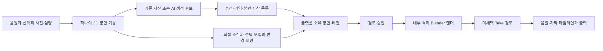

# AI 3D 조사와 단계별 플랫폼 아키텍처 — 2026-10-27

## 공개 비교 자료와 교정된 형상 진단 · 2026-10-28

제품 중심은 음원 기반 영상이며 3D는 선택 기능이다. [제3자 TripoSG 표본](../../.omo/evidence/continuation-native-benchmark-20261028/public-triposg-driver-acceptance.json)의 입력/clay/painted PNG를 고정 revision·해시로 확인했다. 표면 표현의 차이는 관찰할 수 있으나 원본 GLB가 없어 같은 기하·면수·시간은 입증하지 못한다. [상용 UV 공개 영상](../../.omo/evidence/continuation-native-benchmark-20261028/commercial-uv-driver-acceptance.json)은 원본 파일·전체 decode·프레임을 확보했지만 편집된 비교이고 포즈가 다르다. UV 편집 조작·동일 원본 mesh의 정량 비교로 표현하지 않는다. 샘플 사용권과 별도 RMBG 의존 조건을 확인하기 전 제품 복사·도입을 완료하지 않는다.

[고정 v2 조건](../../.omo/evidence/geometry-benchmark-20261028/v2-calibration/protocol.json)과 [결과](../../.omo/evidence/geometry-benchmark-20261028/v2-calibration/summary.json)는 기존 cube/chair 원본과 정확한 기본도형 합집합 경계를 비교한다. 표면 중심/RMS 반경으로 정규화한 뒤 동일 형상의 회전·이동·양의 균일 크기 변환 대조군을 먼저 통과했다. 새 학습/추론 없이 정렬용·평가용 표본 seed를 분리하고, 원본 좌표 조건과 정답 도움으로 정렬한 조건을 따로 보존했다. 후자는 하나의 강체 변환을 5개 고정 시점에 사용한 낙관적 진단이다.

정답 도움 정렬 조건의 실루엣 IoU는 cube 약0.956–0.980, chair 약0.893–0.927이다. 두 합성 표본의 조건부 결과이며 사용자 품질 합격선·실제 입력 자세 복원 성능이 아니다. v1 AABB 정규화의 회전 의존 오차와 원본 증거를 보존했고 v1/v2 단위가 달라 모델 개선율로 비교하지 않는다. [무결성·교정](../../.omo/evidence/geometry-benchmark-20261028/v2-calibration/verification.json), [독립 수락](../../.omo/evidence/geometry-benchmark-20261028/driver-acceptance.json), [동결 프로토콜의 v1 문구 잔존 정정](../../.omo/evidence/geometry-benchmark-20261028/v2-calibration-errata.json)을 실제 모델·재질·움직임·플랫폼 수용과 구분한다. 같은 입력의 상용 원본이 없어 동등 품질은 계속 미입증이다.

## 색 해석·재조명 통제 실험 · S819 · 2026-10-28

**제품 중심은 음원 기반 영상이며 3D는 선택이다.** [실제4조건 진단](codex-workflow-review-20261027/workflow-simplification-20261028/color-controlled/report.json)은 동일 의자·기하·구도·조명·AgX에서 native BYTE PBR/정확 FLOAT PBR/inverse-sRGB 가정/emission을 비교했다. PNG·선형 EXR·float 버퍼와 설정을 보존했고 [독립 재계산](codex-workflow-review-20261027/workflow-simplification-20261028/benchmark-driver-acceptance.json)으로 원본 바이트·기하 및 지정 ROI 수치를 확인했다. 새 모델 추론이나 상용 서비스 호출은 없다.

원색 PBR과 emission은 옅은 베이지색, 전달함수 가정은 더 어두운 갈색이었다. 좌석/등받이 ROI의 선형 밝기는 가정 변경에서 약49.7/55.6% 낮아졌으나 **정답 교정의 증거가 아니다**. 무조명 전환만으로 현재 색 차이가 해소되지 않았고, 모델 학습 출력의 색공간·albedo는 미확인이다. [TripoSR 보고서](https://arxiv.org/html/2403.02151v1)의 NeRF 색/밀도 예측과 렌더 손실 설명도 상용 제품의 동등 품질을 보증하지 않는다. 현재 두 합성 표본/한 seed로 전체 모델 품질을 일반화하지 않는다.

현행 내부 편집·승인·출력과 제한 GLB 가져오기는 유지한다. 다음 모델 adapter의 계약에는 색/재질 의미, 고정 code/weight revision, 원본 입력/출력 hash, 선택한 변환과 자원 예산을 포함해야 한다. 미확인 감마 변환을 자동 적용하거나 원본을 다시 저장하지 않는다. 이후 동일 입력·정렬/구도/빛·사용권이 확인된 산출물로 비교하며 아래 LangChain/LangGraph/RAG의 단계별 채택 조건은 유지한다. 이는 다음 구현의 요구이고 사이트 생성 adapter 완료가 아니다.

복잡한 원본은 자동 감량하지 않고 한도 초과와 잘못된 구조를 구분해 안내하도록 S819에서 개선했다. [현재 기능·실제 출력·잔여](codex-workflow-review-20261027/REPORT-ko.md)를 따르며 상용 Tripo 동등 품질·움직이는3D·실제 Claude/AI영상 모델 검증은 미완료다. 아래 원문과 이전 조사 산출물은 보존한다.

## 실제 공개 모델·내부 편집 산출물 · S813 · 2026-10-28

**상용 Tripo와 공개 모델의 동등 품질은 계속 미입증이다.** [현행 실행 보고서](codex-workflow-review-20261027/REPORT-ko.md)의 고정 코드107cefd·HF 가중치5b521936·Torch2.10/CPU2threads 실험에서 실제 원본 GLB 두 개를 얻었다. cube46,223정점/92,304면·약29.35초, chair42,186/84,216·약29.63초다. 기본 해상도256, 원본 RGB 입력을 그대로 썼고 OS 네트워크 차단과 소유 경로를 확인했다. 원본색/형상 버퍼는 남지만 native BYTE_COLOR의 선형 채널 오차와 cube 퇴화면4개 제거를 명시했다. 라이선스·핀·실패/복구·원본은 [실험 증거](codex-workflow-review-20261027/paired-assets-20261028/triposr-original/acceptance-evidence.json)에 보존했다.

[공식 run.py](https://github.com/VAST-AI-Research/TripoSR/blob/107cefdc244c39106fa830359024f6a2f1c78871/run.py)는 자동 배경 분리 시 전경0.85·RGB0.5 배경 합성을 사용하며, --no-remove-bg는 크기가 맞는 회색 RGB 입력을 요구한다. 정확 RGB58만 분리한 합성 의자 파생 실험은 불투명 bbox가 전체에 남아 완전한 분리가 아니었다. 결과는129,841정점/259,260면·177성분으로 커져 실제 플랫폼에서 거절됐다. [실험 기록](codex-workflow-review-20261027/paired-assets-20261028/triposr-preprocess/report.json). 이 실패를 일반 사진 배경 제거 성능이나 원 모델의 최종 품질 한계로 확대하지 않는다.

[입력](codex-workflow-review-20261027/paired-assets-20261028/inputs/case-2-chair.png), [기본 가져오기 구도](codex-workflow-review-20261027/paired-assets-20261028/ui/default-chair.png), [회전·크기·카메라 편집](codex-workflow-review-20261027/paired-assets-20261028/ui/edited-chair.png), [음원 MP4](codex-workflow-review-20261027/paired-assets-20261028/ui/music-video.mp4)를 직접 확인했다. 방향·프레임 배치는 회복했으나 옅은 색·거친 표면은 관찰로 남고 모델/베이크된 빛/색 공간·PBR/조명 원인을 분리하지 못했다. 해상도·카메라·빛이 다르므로 동등 품질 점수나 ‘개선율’을 만들지 않는다. 앞선 창작자 사례의 수작업 전후·재질/입력 차이도 그대로 유지한다.

### 현행·다음 레벨의 역할과 데이터 경계

- **현재:** 검역된 원본 GLB와 권리→별도 v2 SceneSpec 참조→변경안/사람 승인→소스·환경이 고정된 내부 worker→Take→음원/자막 편집·출력. World 배경 오류를 실제 픽셀로 발견해 수정하고 실제 loaded renderer 지문을 context/runtime binding에 연결했다. 옛 승인/대기 작업을 새 구현에 묵시 사용하지 않고 결과·구성은 보존한다.
- **다음 모델 연결:** 실험용 venv/weight를 사이트 기능으로 간주하지 않는다. 검증된 전처리와 모델 adapter의 입력 출처·권리·범위·자원·취소/미확정·출력 형상/색·사용자 복구를 기존 작업 계약에 연결해야 한다. 채팅은 같은 typed 변경안·승인·SceneSpec을 다뤄야 하며 임의 코드를 실행하는 지름길을 만들지 않는다.
- **품질·운영 확장:** 같은 입력/전처리/카메라/조명/재질의 상용 산출물과 비교하고, 실제 업무·반복 편집·성능·인증/협업 ACL·배포/복구를 각각 입증한다. 3D는 음원 중심 과업의 선택 도구다. RAG/LangChain/LangGraph 이름 추가로 이 경계를 대신하지 않으며 현재 구조화 조회·원문 동의 snapshot·불변 출처를 유지한다.

아래 상용 사례/과거 미실행·아키텍처 단계는 해당 관측 시점의 기록이다. 연구 문서·등록 사본·생성 문맥·제품 런타임 온톨로지는 별개이며 등록/승격을 실행하지 않았다.

> 조사·설계 기록. Tripo AI를 대상으로 조사했으며 사용자는 이후 Tripo와 Blender를 결합해 우리 플랫폼의 한 기능으로 제공하도록 방향을 명확히 했다. 제품 전체나 실제 AI 3D 통합이 완료됐다는 뜻은 아니다. 기존 현행 문서·등록부는 자동 교체하지 않는다.

## 추가 창작자 산출물 직접 비교 · S789 · 2026-10-28

[공식 버섯 소품 사례](https://www.tripo3d.ai/blog/tripo-blender-godot-playable-prop)는 Tripo v3.1·4K PBR 생성 후 Blender 수리·감량·장면 적용을 설명한다. 원문의 57.5MB→10.6MB 및 폴리곤 수는 작성자 수치이며 실제 메시를 내려받아 측정하지 않았다. 생성물·수리 전후·소켓 이미지 3개를 직접 열었다. 수리 전후에 표시된 검은 영역이 양쪽에 남고 재질도 달라 구멍 수리 성공이나 개선 원인을 이미지로 확정하지 않는다. 이것이 수리 실패를 입증하는 것도 아니다. 현재 8MiB 프로파일의 실제 지원 자산으로 취급하지 않는다.

[공식 캐릭터 사례](https://www.tripo3d.ai/blog/tripo-to-ue5-character-walk)는 부품 참조→Tripo P2→Blender 조립·재질·리깅→UE5를 설명한다. 참조 보드와 조립 와이어프레임 2개를 직접 열었고 이미지 생성 표시와 긴 바지/반바지의 조건 차이를 확인했다. 참조 이미지를 원시 Tripo 출력으로 분류하거나 의상이 다른 결과를 순수 형상 개선으로 점수화하지 않는다. 게임 엔진 연결·캐릭터 리깅을 음악영상 핵심 요구로 가져오지 않는다.

[다섯 이미지의 공개 GET·해시·시각 관측](codex-workflow-review-20261027/history-color-20261028/tripo-pairs/source-evidence.json)을 보존했다. 공개 조회는 재배포·제품 자산 사용권이 아니며 원본 입력/생성 메시/수정 메시·동일 조건 비교는 미확인이다. **상용·공개 모델 동등 품질은 미입증**이다. 참고할 원리는 생성·국소 수정·최적화·장면 채택의 분리와 원본 보존이며, 실제 플랫폼의 채팅 이력·색 충실도·30초 과업 검증은 [S789 기록](codex-workflow-review-20261027/REPORT-ko.md)을 따른다.

## 후속 조사와 증거 경계 · S774 · 2026-10-28

[공개 결과 추가 탐색](codex-workflow-review-20261027/current-774-20261028/tripo-public-recovery/attempt2-audit.json)에서 공식 Gradio 예제 경로가 캐시 miss 시 GPU 추론을 실행할 수 있음을 소스로 확인했다. 실행 환경의 캐시 hit 여부는 미확인이라 POST·추론·생성 메시 다운로드는 0이다. 공개 메시 전체 부재나 호환 불가로 판정하지 않는다. 자체 내부 렌더의 [비교 입력 2개](codex-workflow-review-20261027/current-774-20261028/benchmark-inputs/manifest.json)는 실제 PNG를 준비한 단계이며 상용·공개 모델 동등 품질은 여전히 미입증이다. 배경 명세와 실제 모서리 색의 차이는 원인 미확인으로 기록하고 출력이나 렌더러를 임의 보정하지 않았다.

일반 Claude adapter는 기본 비활성의 명시 설정 경로가 구현됐고 합성 전송·실제 HTTP/내부 편집·출력 검사를 수행했다. 실제 Claude·청구·계정 검증과 3D 채팅 도구는 남아 있다. [774개 전체 회귀·원장·UI 경계](codex-workflow-review-20261027/REPORT-ko.md)를 따르며 이 변경을 RAG·LangChain/LangGraph 도입, AI 3D 생성 또는 플랫폼 전체 완료로 확대하지 않는다. 제품의 중심은 음악영상, 3D는 선택 수단이다.

## 구현·산출물 비교 후속 — 2026-10-28

작은 정적 GLB의 비공개 등록→SceneSpec v2 자산 참조→내부 재질 보존·구도/빛 변경→격리 Blender PNG→미승인 Take→음원·한글 자막 MP4까지 자체 합성 표본으로 구현·검증했다. [725개 단계 및 실제 UI 기록](codex-workflow-review-20261027/REPORT-ko.md)을 따른다. 제한 프로파일은 `gltf2-static-pbr-v1`, 8MiB이며 실제 Tripo 생성물 전체의 호환·품질이나 AI adapter 구현을 입증하지 않는다.

[독립 산출물 검토](codex-workflow-review-20261027/current-725-20261028/tripo-artifact-review-20261027.json)는 등롱 입력·생성·Blender 보정 이미지와 TripoSG 논문 Fig.7을 직접 확인했다. 상용 등롱의 멀티뷰·4K 재질·Blender 후처리와 공개 모델의 단일뷰·주로 무텍스처 형상 비교는 조건이 달라 **동등 품질은 미입증**이다. 공통 단일 이미지 조건과 각 엔진의 최적 설정 조건을 분리하고 형상/재질/내부 재편집/음악영상 출력·실패를 각각 평가한다. 공개 사례의 시각적 전후가 직접 동일조건 모델 실행을 대신하지 않는다.

[공식 GitHub 2개·Hugging Face Space 2개·모델 2개](codex-workflow-review-20261027/current-725-20261028/tripo-public-asset-availability/audit.json)의 고정 revision 파일 목록에서는 사용할 실제 생성 메시를 찾지 못했다. GLB 출력·캐시 설정의 소스는 있었지만 캐시 결과·개별 자산 사용권은 미확인이다. 공개 결과 파일이 없다는 범위 제한이며 형식 미지원이나 다른 공개물 전체 부재로 해석하지 않는다. 추론·유료 호출·메시 다운로드는 수행하지 않았다.

## 현재 결정: 플랫폼의 한 선택 기능으로 결합

**제품의 중심은 음원 기반 음악영상 제작·편집·출력이다. 3D는 그 안의 선택형 제작 수단이다.** 사용자가 3D 없이도 음원만 또는 음원+사진으로 완주할 수 있어야 하며, 이 설계를 메인 메뉴·필수 단계·3D 전문 제품 확대의 근거로 삼지 않는다. 현재 작은 GLB의 내부 연결은 이 선택 수단의 제한된 구현 단계다.

사용자에게는 **‘3D 장면 만들기 · 선택’** dialog 안에서 기존 자산 가져오기·선택→구도·빛 수정→검토→정지 후보를 영상에 사용하는 경로를 제공한다. 설명·사진으로 AI 자산을 새로 생성하거나 재질을 다시 생성하는 경로는 아직 제안이다. 음원을 먼저 넣는 흐름 안의 선택 기능이고 사진이나 3D를 모든 사용자에게 강제하지 않는다. 외부 편집 사이트로 이동하거나 Blender를 직접 실행할 필요 없이 내부 worker가 처리한다. AI 공급자·전송 자료·비용은 실제 외부 실행 결정 때 표시한다.

### 결합할 이유와 공개 근거

Tripo는 생성형 자산 제작, Blender는 장면 구성·통제된 편집·렌더에 활용할 수 있다. 공식 Tripo API는 텍스트→형상과 텍스처 생성의 seed를 구분하고, 기존 모델에 텍스처를 다시 입히는 별도 작업도 제공한다. 따라서 **카메라나 조명만 바꿀 때 형상을 매번 재생성하지 않는 구성**이 가능하다는 것이 설계 판단이다. 실제 절감 금액·편집 시간·결과 품질은 아직 측정하지 않았다. [공식 생성 API](https://developers.tripo3d.ai/en/docs/generation-text-to-model/standard), [공식 텍스처 API](https://developers.tripo3d.ai/en/models/texture)

권장 교환 후보는 GLB/glTF 2.0이지만 첫 지원 형식은 작은 실제 fixture와 설치된 Blender 버전으로 확인한 뒤 고정한다. Tripo의 일부 옵션은 FBX를 강제하며 geometry/texture 버전, 축 변환과 후처리 조합에도 제약이 있다. 모든 옵션을 하나의 호환 형식이라고 가정하지 않는다. Blender 공식 문서는 glTF import/export와 PBR·mesh·animation 지원 및 버전별 변경을 설명하지만 이것이 우리 worker의 importer 연결 증거는 아니다. [Tripo 형식 변환](https://developers.tripo3d.ai/en/docs/models-convert), [Blender glTF 통합](https://developer.blender.org/docs/release_notes/4.2/pipeline_assets_io/), [Blender 5.0 I/O 변경](https://developer.blender.org/docs/release_notes/5.0/pipeline_io/)

### 현재 코드와 추가 아키텍처

|영역|현재 구현|통합에 필요한 변화·수용조건|
|---|---|---|
|제품 상태의 소유권|SQLite의 프로젝트/대화와 버전·사람 승인. v1 기본 도형 계약을 보존하고 v2의 등록 mesh 참조·원본 해시·transform을 추가|플랫폼이 장면·자산·승인·작업 상태를 계속 소유한다. 공급자의 task 성공을 장면 채택이나 권리 승인으로 취급하지 않음|
|생성 작업|내부 3D 렌더만 연결. 현재 3D 모델용 공급자 adapter는 없음|기존 큐/원장의 계약을 재사용 가능한 범위부터 확인하고 별도 생성 작업을 추가. 입력·모델 snapshot·견적·명시 전송 동의·요청 ID·수신 상태를 기록. 중복과 timeout/unknown의 무조건 재전송 금지|
|자산 수신·등록|`scene_asset_import`가 제한 GLB를 비공개 저장·ID/해시/권리 등록. `scene_asset_dependencies`로 원본→PNG→MP4 권리 전파|실제 AI 공급자 파일 수신·프로파일 호환은 별도. 외부 URI·animation·compression 등 비지원 구조는 거절. 모든 GLB의 지원으로 확대하지 않음|
|장면 계약|v2 등록 mesh 참조와 `object.asset` 교체를 카메라·조명 변경과 같은 제안·승인에 연결. 위치·회전·크기 보존|잠금·충돌·다른 대화의 승인/자산 사용 거절을 유지하고 실제 AI 자산과 자연어 도구 연결을 다음 수용으로 검증|
|내부 렌더|검역된 GLB와 내장 이미지의 읽기 전용 입력·고정 importer, PNG/JPEG 실제 decode·재질 확인. 비루트·읽기 전용·네트워크 없는 Blender|손상 JPEG·texture/원본 변조·권리 철회는 게시/다운로드 거절. 정상 API 경로와 DB 다중 기록 동시 손상의 신뢰 경계를 구분|
|사용자·채팅 편집|3D 폼은 구도 정지 편집이며 실시간 뷰포트가 아님. 현재 모델 도구 목록에는 3D 장면 도구가 없음|UI와 선택 모델이 같은 서버 명령으로 대상 조회→typed 변경 제안→사람 적용→승인된 렌더 요청→결과 확인. 임의 Python·파일 경로·자동 승인을 모델에 제공하지 않음|
|영상 연결|정지 PNG를 새 미승인·권리 미확인 Take로 연결하고 기존 음원/자막 타임라인에 사용할 수 있음|1차는 AI mesh→정지 장면→Take 연결. 다음 단계는 카메라/객체 keyframe·fps·기간·프레임/취소 복구를 추가해 내부 동영상 출력. 리깅/인체 동작은 별도 후속 수용|

위 표는 현재 구현과 남은 제안을 구분한다. 아직 존재하지 않는 AI 생성 API나 모델 도구를 실행 가능한 기능으로 표시하지 않는다. 제품의 IP·자산 관계와 개발 문서 registry를 섞지 않는다.



### 세 가지 도입 경로의 비교

|경로|장점|제약·판정|
|---|---|---|
|Tripo 상용 API + 내부 Blender|상용 생성/texture/후처리를 후보 생성기로 활용하고 편집·저장은 내부에 유지|유료 전송·약관·보존·수신 파일 검역·실제 품질 확인 필요. 연결 여부는 AI 실행 선택이며 아직 실제 통합하지 않음|
|적합한 공개 모델 자체 추론 + 내부 Blender|자산 생성까지 자체 인프라에 둘 수 있고 모델을 고정하기 쉬움|GPU·코드/weights/전처리 license·서빙 운영비·품질 실측 필요. 공개 모델이 상용 Tripo와 동등하다는 근거 없음|
|기존 절차적 장면 + 내부 Blender|AI 생성 없이 음원만으로 구도/도형을 만드는 현재 경로를 계속 사용|인물·사물의 복잡한 형상을 자동 추론하지 못함. AI 후보 실패 시 이 경로로 돌아올 수 있지만 동일 품질의 대체라고 표시하지 않음|

사용자 기능과 내부 adapter 경계는 통합하되 세 엔진을 지금 모두 구현하지 않는다. 먼저 형식이 고정된 자산 한 개로 검역→배치→편집→정지 렌더→Take→음원 출력을 끝까지 검증하고 실제 수용 결과에 따라 확대한다. 현재 적은 도구에 LangChain/LangGraph를 추가하는 것만으로 이 경계가 해결되지 않는다.

### 디자인 시스템과 과업 방법론

- [reference lock](design-system-redesign-20261026/REFERENCE-LOCK.md), [semantic tokens](design-system-redesign-20261026/SEMANTIC-TOKEN-SPEC.md), [방법론 matrix](design-system-redesign-20261026/METHODOLOGY-FIT-MATRIX-ko.md)의 중성 작업대·시스템 글꼴·선택/포커스/승인 구분을 재사용한다. 별도 3D 브랜드나 테마를 만들지 않는다.
- **과업 분석/인지 walkthrough:** 음원만/사진 추가, 기존 자산/AI 후보, 직접 수정/채팅 제안의 성공·실패 경로를 나누고 불필요한 화면 이동·중복 입력을 확인한다. 전문가 예상과 실제 사람 평가를 구분한다.
- **객체·버전 중심 설계:** 후보 자산·장면·Take·출력의 정체성을 유지한다. 원본 형상 재생성, texture 변경, 위치/조명 변경을 동일 버튼으로 섞지 않는다.
- **단계적 공개:** 기본은 대상·구도·빛·미리보기와 다음 행동. 모델 revision·폴리곤·해시·task ID는 상세에 둔다. 비용/전송 자료/권리/실패·복구는 결정 시점의 필수 정보로 남긴다.
- **상태 전이/회귀:** 생성 대기/진행/미확정/실패/후보 수신, dirty/저장/승인, 렌더/취소/완료를 독립 상태로 둔다. 취소나 자동 retry가 이미 발생한 과금을 숨기지 않도록 한다.
- **산출물 벤치마크:** 같은 입력·버전·출력 조건의 비교와 공개 제작자의 서로 다른 작품 사례를 분리한다. 아래 공개 모델 표는 성능 순위가 아니다.

색·타입·간격의 새 수치를 이 문서에서 중복 정의하지 않는다. 표준 컴포넌트의 focus/disabled/error/empty/loading/retry와 긴 한글·자산명, 키보드 포커스 복귀, 1920/1280 및 실제 모바일 전환점은 구현 후 같은 조건에서 검사한다. 단일 기능이라는 이유로 비용 동의와 서로 다른 승인 책임까지 자동 합치지 않는다.

### 구현 순서와 종료 증거

1. **현재 기반 유지:** 기존 SceneSpec/승인/취소/Take 회귀가 유지되고, 현재 도형 정지 장면을 다시 열 수 있다.
2. **안전한 내부 자산:** 허용된 작은 3D fixture를 검역·등록·배치하고 카메라/조명 변경 후 내부 정지 프레임을 렌더한다. texture·좌표축·단위·색/재질·해시가 기대와 맞고 손상/외부 URI/자원 초과는 차단돼야 한다.
3. **선택 AI 생성 연결:** 정확한 입력·모델·비용·자료 전송 범위 아래 실제 후보를 수신한다. 결과 mesh와 편집 가능성·재시작·취소·미확정을 확인한다. 외부 AI와 자체 추론 중 실제 사용할 환경을 확인한 뒤 실행한다.
4. **자연어/직접 편집의 동일성:** 선택 모델이 장면을 조회하고 UI와 같은 변경안을 제출한다. 장면/자산 버전 충돌과 다른 대화의 승인 사용을 거절하고 before/after와 실제 프레임이 일치해야 한다.
5. **영상·품질 확대:** 우선 정지 장면을 기존 음악영상에 사용하고, 카메라 이동 등 필요한 움직임은 별도 계약으로 추가한다. 원본 자산을 보존한 재편집·내보내기·복원을 검증한다. 인물 리깅·동작·생성형 AI 영상은 앞 단계 수용과 실무 준비 이후다.

위 순서는 결합 기능의 구현 계획이며 완료 체크리스트가 아니다. 기존 실제 로그와 미완료 범위는 [최신 보고서](codex-workflow-review-20261027/REPORT-ko.md)에 연결한다.

## 공개 산출물을 직접 확인한 비교 — 2026-10-27 후속

공개 결과를 보는 작업과 우리 환경에서 모델을 실행하는 작업을 구분한다. 독립 Ego TaskSpace 82에서 아래 사례를 열었고, 주관 담당도 등롱 3장과 논문 그림을 원본 파일로 내려받아 직접 열었다. [원본 URL·SHA·연구 목적](codex-workflow-review-20261027/current-690-20261027/tripo-benchmark/sources.json)을 보존한다. 유료 생성, 모델 추론, 원본 mesh 검사·재편집은 수행하지 않았다. 이미지의 제품 자산 사용·재배포 권한을 얻었다는 뜻도 아니다.

|사례·출처|실제 관찰|적용 판단·비교 한계|
|---|---|---|
|[Tripo Team 등롱 작업](https://www.tripo3d.ai/blog/workflow-image-to-3d-mid-autumn), 페이지 갱신일 2026-10-27|[입력 이미지](codex-workflow-review-20261027/current-690-20261027/tripo-benchmark/lantern-input.webp)→[생성 후보](codex-workflow-review-20261027/current-690-20261027/tripo-benchmark/lantern-generated.webp)→[Blender 보정 결과](codex-workflow-review-20261027/current-690-20261027/tripo-benchmark/lantern-refined.webp)를 직접 열었다. 주요 실루엣은 연결되지만 문양·세부 구조/색은 달랐고 최종에는 내부 빛·종이 면의 투과 표현이 보임|형상 생성 후 특정 면의 재질과 빛을 조정하는 과업의 근거. 공식 안내는 Blender에서 면 선택/재질 분리를 설명함. 서로 다른 시점·조명이므로 개선량·형상 정확도나 속도 순위로 쓰지 않음|
|[Nano 창작자 작업을 연결한 공식 게시물](https://www.tripo3d.ai/blog/gpt-6-astra-3d-character-workflow), 페이지 갱신일 2026-10-27|독립 브라우저가 creator showcase의 0.2/4/20/45초 프레임에서 분리된 캐릭터 파트, Blender 조립·wire/rig 화면을 확인. [원저자 연결](https://x.com/Dstudio_ai/status/2096475126942560677)은 공식 글에 있음|논문의 조건 통제 실험과 다른 창작 사례. 게시물은 튜토리얼 입력·인사·얼굴 demo가 별도 자산이라고 명시하므로 이를 동일 캐릭터의 정확한 전후로 연결하지 않음. 원저자 게시물 자체를 별도로 검증하거나 mesh를 받지는 않음|
|[TripoSG v3 논문 §5.3·Fig.7](https://arxiv.org/html/2502.06608v3#S5.SS3)|[같은 입력의 normal-map 비교 그림](codex-workflow-review-20261027/current-690-20261027/tripo-benchmark/triposg-figure7.png)을 직접 열었다. 의자/책상·자전거·인물에서 방법별 구조·세부 표현 차이가 보임|논문이 설명하는 배경 제거·같은 시점의 저자 비교. TripoSR·CRM·InstantMesh·MeshLRM·MeshFormer·CraftsMan-1.5·TripoSG이며 상용 Tripo는 포함되지 않음. 저자 선정 사례이고 공개 weight가 논문의 모든 모델 크기와 같다는 보장 없음|

**결과로부터 채택한 설계:** 후보 생성 후 `위치/카메라/빛`, `재질/texture`, `형상` 변경을 나눠 필요한 부분만 수정한다. 캐릭터 조립·리깅은 정지 소품과 다른 수용 과업으로 둔다. 공개 최종 렌더의 외관을 그대로 복제하거나 우리 플랫폼에서 같은 품질이 난다고 선언하지 않는다. 현재 상용 Tripo와 공개 모델의 품질 동등성은 **미입증**이다.

### 직접 실행 벤치마크의 조건

1. 권리가 확인된 고정 입력에서 소품·복잡한 가는 구조·인물/반신 등 과업에 맞는 사례를 정하고 입력 SHA·배경 처리·시점 수를 보존한다. 음원만 있는 사용자는 사진 복원을 강제하지 않는다.
2. 공급자/공개 모델의 정확한 버전·설정·seed·폴리곤/texture 옵션·하드웨어를 고정한다. 다른 하드웨어 시간과 서로 다른 입력의 결과로 순위를 만들지 않는다.
3. 입력/정면·측면·후면의 형상, 동일 카메라·조명 normal render, texture/PBR render를 따로 비교한다. 숨겨진 면·mesh/UV 결함·투명 재질·크기/축을 확인한다.
4. 같은 결과에서 위치·카메라·조명·부분 재질 변경, 저장/재열기·Take·음원 출력·복원을 수행하고 원본 보존/편집 가능성을 확인한다. 시간·VRAM·비용과 실패/취소·재시도 결과는 실제 측정한 값만 기록한다.
5. 결과물이 기대 과업에 적합한지 실무자와 확인한다. 공개 이미지 관찰, 전문가 판단, 자동 측정, 실제 사용자 평가를 서로 다른 증거로 둔다. 모델별 품질 목표와 실제 실행 결과가 없으면 완료 판정하지 않는다.

## 목적과 사용자 흐름

음원을 먼저 넣고, 사진은 선택하는 음악영상 제작 흐름을 유지한다. 사진이 없는 사용자는 타이포그래피·도형·절차적 장면으로 시작할 수 있어야 한다. 사진이 있는 사용자는 사용권을 확인한 뒤 선택적으로 3D 후보를 만들 수 있다. 실존 인물의 외형을 음원만으로 안다고 가정하지 않는다.

제품의 자산 저장·편집·승인·렌더·복구는 플랫폼 내부에서 수행한다. AI 모델 실행은 사용자가 허용한 예외이며, 자체 추론과 사용자가 승인한 외부 AI 중 어느 쪽을 우선할지는 확인 대기다. 외부 3D 편집 플랫폼 연결을 필수로 삼지 않는다. 실제 AI 영상 생성 모델 시험은 사용자가 정한 대로 실무 워크플로가 준비된 뒤 수행한다.

## Tripo와 Blender: 역할과 공개 근거

Blender는 장면·메시·재질·카메라·조명·리깅·애니메이션·렌더를 다루는 제작 도구다. Tripo AI는 공개 문서상 텍스트·이미지·다중 시점에서 3D 후보를 생성하고, 텍스처·메시 처리·리깅 등을 별도 작업으로 제공한다. 이 둘은 대체 관계로 고정할 필요가 없다. **생성 후보 → 플랫폼 소유 자산 → 내부 장면 편집 → 검토·음악 편집 → 내부 렌더**가 가능한 구성이다. [Tripo 기능 설명](https://www.tripo3d.ai/help/getting-started/what-features-does-tripo-have), [Blender 기능](https://www.blender.org/features/)

TripoSG의 공개 논문은 이미지 조건을 사용하는 3D 형상 생성, SDF 표현, rectified flow, 학습 데이터 구성을 설명한다. 이는 학습된 모델이 형상을 추정하는 경로다. Claude가 텍스트 명령으로 Blender를 제어하는 경로와 구분한다. TripoSG가 현재 상용 Tripo의 내부 모델과 같거나 같은 품질이라는 근거는 없다. [TripoSG 논문](https://arxiv.org/abs/2502.06608)

**REA 실관찰:** 격리 Chromium에서 Tripo의 공개 제품 화면을 열었으나 보안 확인 화면만 관측됐다. 우회하지 않았다. 별도 [공식 텍스처 개발자 문서](https://developers.tripo3d.ai/en/models/texture)는 REA로 관찰했으며 이미지·다중 시점·텍스트를 재질 생성의 별도 입력으로 설명한다. 관찰 ID `ev_20723dba90a305e670efd998149619a0603bc3947d7b63a2fd32d8702afcbe67`; 소유 브라우저 종료 확인. 이는 문서 화면에 대한 관찰이지 서버 내부 모델, 결과 품질, 실제 API 실행의 증거가 아니다.

## 공개 모델 후보: 코드·가중치·파이프라인을 분리

아래 하드웨어는 공식 문서가 제시한 조건이며 이 프로젝트에서 측정한 수치가 아니다. 동일 입력·같은 품질 기준의 실행 비교는 아직 없다.

| 후보 | 공개 역할·조건 | 도입 전 확인할 점 |
|---|---|---|
| **TripoSR** | 단일 이미지 기반 3D 재구성. 공식 저장소는 기본 약 6GB VRAM을 제시한다. [고정 README](https://github.com/VAST-AI-Research/TripoSR/blob/107cefdc244c39106fa830359024f6a2f1c78871/README.md), [고정 HF 카드](https://huggingface.co/stabilityai/TripoSR/blob/5b521936b01fbe1890f6f9baed0254ab6351c04a/README.md) | 코드·공개 가중치는 MIT로 설명된다. 텍스처·뒷면·리깅·실무 품질, 전이 의존성 및 입력 권리는 별도 검증한다. 상용 Tripo와 동일 모델로 가정하지 않는다. |
| **TripoSG** | 이미지 조건의 고해상도 형상 생성. [고정 HF 카드](https://huggingface.co/VAST-AI/TripoSG/blob/2c1c516d22d58db486a058d98d31bb6177344e06/README.md) | 루트 MIT 표기와 별개로 저장소에 [FlashVDM 지역 제한](https://github.com/VAST-AI-Research/TripoSG/blob/fc5c40990181e2a756c4e0b1c2f4d6b5202faf8c/triposg/LICENSE) 및 [별도 구성요소 고지](https://github.com/VAST-AI-Research/TripoSG/blob/fc5c40990181e2a756c4e0b1c2f4d6b5202faf8c/NOTICE)가 있다. 적용 경계를 확인하기 전 대한민국 사용을 승인된 것으로 판단하지 않는다. 기본 경로의 RMBG-1.4는 별도 [상업 이용 조건](https://huggingface.co/briaai/RMBG-1.4/blob/2ceba5a5efaec153162aedea169f76caf9b46cf8/README.md)을 확인해야 한다. |
| **TRELLIS.2** | 이미지 기반 형상·PBR 재질. 모델 카드는 NVIDIA GPU 24GB 이상을 요구한다. [고정 모델 카드](https://huggingface.co/microsoft/TRELLIS.2-4B/blob/af44b45f2e35a493886929c6d786e563ec68364d/README.md) | 모델·코드 MIT 표시와 별개로 하위 구성요소 라이선스, Linux/CUDA 환경, 실제 VRAM·품질·입력 권리 확인이 필요하다. [고정 의존성 고지](https://github.com/microsoft/TRELLIS.2/blob/75fbf0183001ed9876c8dbb35de6b68552ee08bd/README.md#L312-L320) |
| **Stable Fast 3D** | 단일 이미지 기반 UV mesh·텍스처 등. 공식 저장소는 Mac MPS를 실험적으로 지원한다고 설명한다. [고정 README](https://github.com/Stability-AI/stable-fast-3d/blob/ff21fc491b4dc5314bf6734c7c0dabd86b5f5bb2/README.md) | 가중치 접근과 상업 이용은 별도 조건이다. 매출 경계·계약 원문을 확인하고 단순 MIT로 표시하지 않는다. [고정 모델 카드](https://huggingface.co/stabilityai/stable-fast-3d/blob/f0c9a8ffd62cb1bbc8a7a53c9f87a0be1b6be778/README.md) |
| **Hunyuan3D-2.1** | 이미지 기반 형상·재질 생성. [고정 README](https://github.com/Tencent-Hunyuan/Hunyuan3D-2.1/blob/82920d643c0dc2f7bfd7255f45f62d386edfe60c/README.md) | [고정 라이선스](https://github.com/Tencent-Hunyuan/Hunyuan3D-2.1/blob/82920d643c0dc2f7bfd7255f45f62d386edfe60c/LICENSE)는 대한민국 제외를 명시한다. 별도 권한 없이 국내 서비스에 도입 가능한 것으로 판단하지 않는다. |

모델의 코드·가중치·전처리 모델·하위 모듈·학습/입력 자산·생성물의 조건을 각각 확인한다. 위 표는 법률 의견이나 라이선스 승인이 아니다. 생성된 mesh는 리깅, 애니메이션, 음악 동기화나 영상 납품을 자동으로 충족하지 않는다.

**현재 조사 기기의 확인값:** Apple M2, 8개 CPU 코어, 통합 메모리 24GiB, 10코어 GPU와 Metal 지원이 관찰됐다. 이는 NVIDIA CUDA 전용 모델의 24GB VRAM 보유와 같지 않다. Stable Fast 3D의 공식 문서가 MPS를 실험적으로 지원한다고 해서 이 기기에서 해당 모델을 실행하거나 충분한 성능을 얻었다는 뜻은 아니다. 실제 GPU 메모리 점유, 다른 실행 환경, 지연·품질은 미측정이다.

## 현재 구현과 구분할 목표 구조

현행 코드는 단일 로컬 작업실의 SQLite와 내부 모션·타임라인·FFmpeg 경로를 갖는다. 3D는 제한된 도형·카메라·조명의 정지 프레임과 사용자 승인 기반 후보 경로를 개발·시험 중이며, 사람 mesh·사진 텍스처·리깅·애니메이션·일반 AI 3D 생성은 미구현이다. 일반 Claude 채팅 경로는 fake 전용 계약과 일부 제한된 과거 실모델 시험을 구분해야 한다. 개발 문서 등록부와 제품 IP 온톨로지는 별개의 체계다. 구현 여부는 해당 시점의 코드·실행 증거를 다시 확인한다.

```text
사용자: 음원 → 선택적 사진/자산 → 계획·장면
                  │
      직접 편집 ──┼── 채팅 모델의 typed 변경 제안
                  ▼
    플랫폼 소유 장면/타임라인·제품 IP·자산 상태
                  │  검증 → 사용자 적용·권리·실행 승인
         ┌────────┴────────┐
         ▼                 ▼
  선택적 AI 3D 후보      내부 3D·모션 편집/렌더
  입력·모델·권리 기록    카메라·조명·시간·출력 계약
         └────────┬────────┘
                  ▼
       후보 검토·편집 → 출력 → 재생·재열기
```

모델의 설명과 실제 저장·적용·출력은 별개다. AI와 수동 편집은 동일한 서버 소유 typed 명령, 현재 revision, 승인 범위와 결과 영수증을 사용한다. 모델이 쓴 임의 Python·`.blend`·외부 경로를 그대로 실행하지 않는다. 3D 입력 파일·외부 URI·메시 크기·텍스처·폴리곤·포맷은 검증된 내부 가져오기 경계를 통과해야 한다.

## 단계별 목표와 합격 증거

| 단계 | 범위 | 다음 단계 전 확인 |
|---|---|---|
| **현재: 제한된 제작 기반** | 음원, 선택적 이미지, 2D 모션·편집·출력, 기본 도형 3D 정지 후보 | 각 화면과 서버·실제 파일·재열기·실패 복구의 증거를 현행 코드와 대조한다. fixture와 실제 외부 모델을 구분한다. |
| **1: 한 사람이 끝까지 작업** | 음원만 또는 음원+사진으로 계획→제작→검토→편집→출력→재개 | 실제 사용자 과업, 음원·자막 재생, 권리·승인, 취소·실패·재시작과 접근성을 검증한다. |
| **2: 채팅 모델이 플랫폼 편집을 수행** | 선택된 실제 모델의 문맥 조회→편집 제안→사람의 적용·출력 승인→실제 결과 확인 | 전송 manifest, 수신처·회차/총비용, 도구 권한, 대화 격리, 미확정 복구, 실제 모델 결과와 서버 영수증을 대조한다. |
| **3: 선택형 AI 3D 자산** | 권리가 확인된 이미지 또는 허용된 입력으로 생성 후보를 만들고 플랫폼 내 검토·편집 | 코드/weights/전처리 라이선스·해시, 하드웨어·비용 실측, 형상·UV·재질·가려진 면·재수입·취소 및 출처를 검증한다. |
| **4: 확장 3D와 운영** | 검증된 자산·카메라·조명·시간·필요한 리깅을 기존 편집과 연결 | 모델 일관성·프레임/음악 동기화, 보안·격리·자원·복구, 백업과 실무자 평가. 팀 사용은 인증·ACL과 함께 별도 수용한다. |

정지 프레임은 애니메이션 또는 최종 영상과 다르다. 각 단계는 선행 기능의 안전성과 사용자 과업을 검증한 뒤 확대한다. 일정·완성도·품질 향상을 임의로 수치화하지 않는다.

## LangChain·LangGraph·RAG 선택 기준

현재의 `search_project_context`는 제한된 작품 snapshot을 조회하는 도구이며 벡터 검색이 아니다. 다음 선택지는 **도입 결정 전 비교 대상**이다.

- **기존 typed 어댑터와 SQLite 상태 기계:** 현재 적은 도구와 승인·멱등·복구를 검증하기에 우선인 경로. 직접 수동 조작과 같은 서버 계약을 사용한다.
- **LangChain:** 여러 모델·도구 연동의 중복이 실제 유지보수 문제일 때 비교한다. 라이브러리 설치 자체가 사용자 승인이나 도구 안전성을 제공하지 않는다. [공식 개요](https://docs.langchain.com/oss/python/langchain/overview)
- **LangGraph:** 장기 작업의 중단·재개와 복잡한 분기가 현재 상태 기계보다 어려워질 때 비교한다. 기존 DB·큐와 누가 상태의 최종 소유자인지 먼저 정한다. [공식 개요](https://docs.langchain.com/oss/python/langgraph/overview)
- **구조화 조회와 필요 시 RAG:** 우선 기존 SQL/키워드 조회의 실패·양·지연을 측정한다. 관련 문서가 많아 실제 근거 누락이 발생하면 권한·작품·revision·유효기간으로 먼저 범위를 제한한 검색을 비교한다. 검색 결과는 실행 권한이나 승인된 사실이 아니다. 원본 수정·철회와 인덱스 갱신, 출처·상충·인용·프롬프트 주입 평가가 필요하다. [공식 retrieval 안내](https://docs.langchain.com/oss/python/deepagents/retrieval), [RAG 원 논문](https://arxiv.org/abs/2005.11401)

개발 문서 온톨로지를 제품의 IP 자산 문맥과 무차별적으로 합치지 않는다. 검색이나 MCP 스타일 도구 스키마 자체가 모델의 완전한 이해, 권한 확인 또는 결과의 정확성을 보장하지 않는다. [MCP 도구 명세](https://modelcontextprotocol.io/specification/2025-11-25/server/tools)

## 다음 검증과 미결정

1. Tripo와 Blender를 하나의 플랫폼 기능으로 결합하는 최신 방향을 적용한다. 세부적인 첫 생성 자산(캐릭터/소품/배경)과 실제 자체 추론/외부 AI 실행 환경·비용 범위를 확인한다. 그 결정 전에도 작은 합성 자산의 내부 검역·편집 경계는 검증할 수 있다.
2. 사용자 권리가 확인된 합성·허용 참조 이미지에 같은 모델 버전·하드웨어·해상도 조건을 적용한다. 형상 충실도, 보이지 않는 면, UV·PBR·메시 결함, 수정 가능성, 지연·메모리·비용을 측정한다. 실측 전 공개 데모의 속도·품질을 우리 성과로 쓰지 않는다.
3. 도입 후보의 코드·모델·전처리·서빙 라이선스, 지역·상업 조건을 확인한다. 불명확한 후보는 검토 대상으로 남기며 무단 복사·배포하지 않는다.
4. 내부 3D 후보의 사용자 UI·승인·취소·재시작·기존 타임라인 연결을 실제로 검증한다. 모델 출력은 자동 선택·권리 승인·최종 납품 승인하지 않는다.
5. 실제 Claude의 플랫폼 명령 이해와 도구 실행은 별도 승인·전송 경계 아래 결과·편집·렌더까지 검증한다. AI 영상 모델 시험은 이 플랫폼의 실무 수준 검증 이후에 별도로 한다.

이 조사에서는 후보 AI 3D 모델을 다운로드·실행하거나 유료 API를 호출하지 않았다. 개별 사용자 경험·모델 품질·운영 성능·전이 의존성 전체는 미검증이다.
