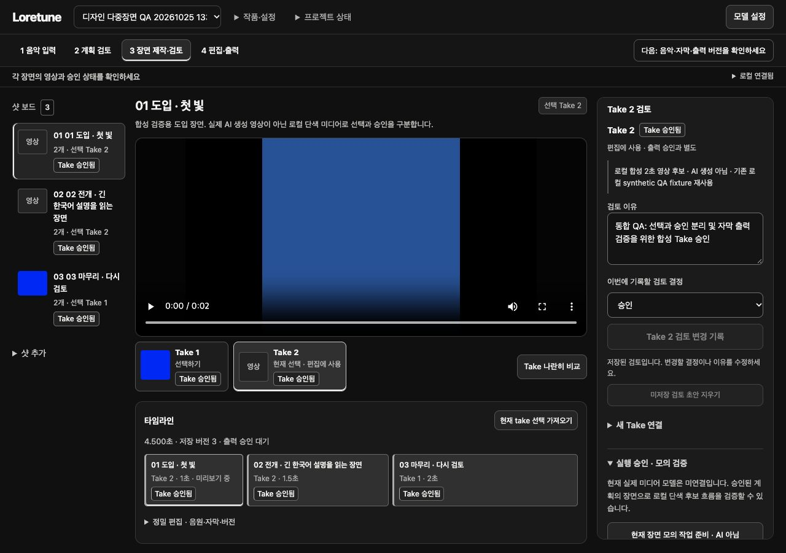
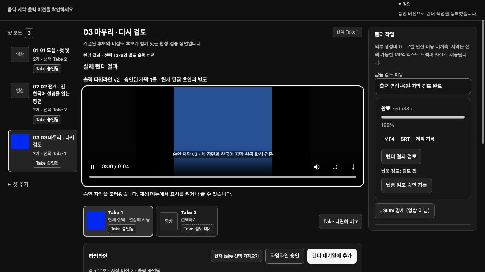

# Runway 역할 정정·자막/복구·Studio 상태 통합 결과

검증일: 2026-10-25. 최종 소스 고정: 14:31:32 UTC. 이 보고서는 staging 제안이 아니라 **실제 Loretune 원본에 적용한 버전**의 결과다.

## 적용 및 실행 버전

- 앱: `http://127.0.0.1:8773`, 검증 데이터: `/tmp/loretune-ms-qa-20261025`.
- HTML source/served SHA-256: `0a8ef8436b8d751c4581c648beeaa688f054217b5781d1a9528c30d2cca5c6ae`.
- 95개 기존 소스 baseline 일치를 확인한 뒤 20개 파일을 적용했다. 변경 전 파일은 `integrated/pre-integration/`에 보존했다. 실제 적용 목록·해시는 [applied.json](integrated/applied.json), 패치는 [combined.patch](integrated/combined.patch), 고정 릴리스는 [fixed-release.json](integrated/fixed-release.json)이다.
- 소유한 이전 검증 서버를 정상 종료하고 승인된 localhost 경로로 재시작했다. 임시 staging 서버는 검증 후 정상 종료했다. 8773 서버는 유지한다.
- 최종 HTML 해시 읽기는 기본 sandbox의 네트워크 제한으로 한 번 실패한 뒤, 정식 권한 심사를 거친 localhost 읽기로 HTTP 200과 해시 일치를 확인했다. 미해결 실행 차단이나 불확실한 제출은 없다.
- 사용자 원본 자료, `.env`, 기존 실제 비용·실패 요청 기록을 변경하지 않았다. 이 통합의 신규 유료 호출·키 조회·공급자 활성화는 모두 0이다.

## 무엇을 바로잡았는가

| 영역 | 실제 변경 | 검증 범위 |
|---|---|---|
| Runway 역할 | 활성 모델 catalog/resolver, 연결 allowlist, worker/비용 경로에서 제외. `runway_provider.py`는 생성 즉시 차단하는 stub. 이전 미활성 프로토타입은 `historical-inactive/`에 보존 | 5개 배제·과거 job 보존 회귀. 실제 Runway 연결·호출 이력은 이 작업에서 없음 |
| 이미지 공통 경계 | 특정 공급자를 선택한 것처럼 보이지 않게 정리. generic pipeline은 명시적인 synthetic fixture만 허용. 기존 job은 원래 connection으로만 처리 | 권리/승인/가격 재검사, 중복 submit, unknown 보존, 취소, 결과 검증, 등록 rollback 계약 시험 |
| 자막 미리보기 | 완료된 export의 고정 snapshot에서 WebVTT 제공. 편집 중인 최신 자막을 과거 출력 미리보기에 덮어쓰지 않음 | 실제 MP4·VTT v2와 이후 미승인 v3 분리, 재개, Host/권한/미완료·파일변조 거부 |
| 이미지 상태/복구 | 미선택·미설정·미검증·차단·사용 가능 조건을 분리. 미설정 상태에서는 활성화 불가. 복구는 기존 receipt의 조회/수집만 별도 1회 gate로 허용 | fake 상태 및 권리 증거·만료·scope·재시작 검증. 403은 새 관련 권한 근거 없으면 재시도하지 않음. 실제 과거 fal 403 재접근 0 |
| Studio 상태 | 비교 기본값을 서로 다른 Take로 선택. 프로젝트+장면+Take별 검토 초안 분리. 선택·Take 승인·편집 사용·출력 승인을 구분 | 실제 다중 장면/Take UI + 정확한 JS 함수의 14개 scoped fixture 검사 |
| 비동기 초안 | 저장 요청 당시 revision만 지우고 이후 입력·다른 컨텍스트는 보존. `sendRequest` 후 검토 prerequisites 재계산 유지 | F05/F06/F07 지연 fake fetch 16개 control 및 새 review-state 검사. 실제 브라우저에 지연 네트워크를 주입한 검사는 아님 |

Runway를 fal 이미지 모델로 자동 치환하지 않았다. 현재 이미지 모델은 미선택이며 기존 이미지 업로드를 안내한다. 선택된 이미지 공급자의 **실제 adapter는 아직 없다**. 공통 fixture 검증을 실제 공급자 통합 완료로 표시하지 않는다.

## 문서 등록부 정정

다음 두 native registry에 동일하게 SPEC-MS-001을 추가했다.

1. `docs/knowledge/project_kit/registry/knowledge.json`
2. `docs/specification/IP_Music_Video_Platform/project_kit/registry/knowledge.json`

각 등록부는 revision 3→9, 1,666→1,772 objects, 882→982 current heads다. 기존 1,666 objects와 882 heads의 값은 그대로이며 28개 MS-FR 및 38개 MS-AT의 현재 식별자를 추가했다. 변경은 기존 CLI의 expected revision 검사·merge·editorial promotion으로 수행했다. 제품 IP 온톨로지 DB와 문서 계보 등록부는 별개다.

- 원문 MD SHA-256: `962f15269eec2367df635209636a2e96baa72a5cc3331647175242a0f8c93378`. 루트 원본과 각 kit의 보관 사본을 동일하게 유지했다.
- 정확한 원문 ID/행/내용, 구현 상태, local/fake 검증과 기존 제한된 Claude live 근거, 남은 범위를 `docs/modules/spec-ms-001/20261025/`의 catalog/coverage로 연결했다.
- **38개 전체 수용시험 모두 `not_run / not_fully_verified`**다. 일부 local/fake 및 Claude 하위 경로의 통과 근거는 별도 필드다. 단위 시험 통과를 전체 MS-AT 통과로 전환하지 않았다.
- BYOK 연결 관리(MS-FR-22)와 자동 선택 기능(MS-FR-28)은 `not_implemented`로 명시했다. 이를 참조하는 4개 수용시험의 새 버전을 추가해 stale 링크를 해소했다.
- Runway의 기존 문서 예시를 고치지 않고, 사용자의 최신 해석을 우선하는 별도 Decision 및 benchmark-only Source 역할을 기록했다.
- 두 kit의 최종 strict validation issues는 0이다. native CLI의 16개 fixture tests도 각각 통과했다. 이는 문서 등록부 검사이지 서비스 기능 수용시험이 아니다.
- 두 번째 kit에 원래 등록되어 있으나 누락된 `archive/v1/output/MANIFEST.sha256.json`을 첫 kit의 **기등록 hash와 일치하는 bytes**로 복원했다. 등록 해시를 바꾸지 않았다. [복원 증거](registry/restored-missing-file.json)

등록 과정의 baseline, dry-run, guarded apply, strict 검사는 [registry/](registry/)에 보존했다.

## 실제 사용자 흐름 검증

기존 허용된 합성 프로젝트 `디자인 다중장면 QA 20261025 1330`의 3개 장면·6개 Take를 사용했다. 실사용자 프로젝트를 시험 자료로 보내거나 수정하지 않았다.

1. 첫 장면 Take 2의 미저장 검토 초안을 입력한 뒤 다른 장면/Take로 전환했다. 각 컨텍스트의 검토가 분리되고 원래 초안이 복원됐다. 새로고침 후에도 보존됐다.
2. 비교창이 Take 2/Take 1로 열렸다. 비교를 여닫아도 선택·승인이 바뀌지 않았다.
3. 선택과 승인을 별도로 조작하고, 기존 거절 이력을 보존한 채 합성 Take를 승인했다.
4. 한국어 자막 v2를 저장하고 타임라인 v2를 출력 승인했다. 3컷·4.5초·1080p·음원 포함·외부 비용 0을 확인하고 **로컬 렌더 한 번**을 실행했다.
5. 결과를 브라우저에서 재생해 한국어 자막을 확인했다. 이후 미승인 자막 v3를 저장하고 새로고침했지만 기존 출력과 미리보기에는 승인 v2가 유지됐다.
6. 320/390px에서 장면·미리보기·검토 패널 전환과 이미지 미설정 상태를 확인했다. document 수평 overflow는 없었고 필요한 내부 Take/타임라인 스크롤은 유지됐다. 모델 창 Escape 후 `모델 설정` 버튼으로 포커스가 돌아왔다.

새 후보를 생성하는 실제 외부 경로는 실행하지 않았다. 이 브라우저 회귀는 기존 합성 Takes를 사용했다. 모의 후보 생성·등록 및 저장 중 최신 입력 보존은 local contract/정확한 JS fixture 검사로 구분했다.

### 출력 증거

- Job: `7eda38fc84b14c94acc6da8f413031eb` (`completed`).
- 파일: `/tmp/loretune-ms-qa-20261025/exports/7eda38fc84b14c94acc6da8f413031eb.mp4`.
- 동일 hash의 프로젝트 보관 사본: [verified-output.mp4](integrated/verified-output.mp4).
- SHA-256: `c1750cafc1e49c65a91b4f2b50c276ca64060ce87d68fcb3d880e1d14cf7d1c8`.
- ffprobe: H.264 1920×1080 / 4.500초 / 108프레임, AAC 48kHz / 4.500초, mov_text / 4.500초.
- 디코딩한 음원 RMS 0.1715638로 무음이 아님을 측정했다. 청취 품질이나 모든 컷의 프레임별 정밀 동기를 평가한 결과는 아니다.
- MP4 내장 자막과 HTTP WebVTT는 같은 한국어 v2, 0.000–4.500초다. 편집 v3·새로고침 이후에도 이전 파일 hash가 같다.
- 6개 원본 Take 객체와 기존 검토 이력이 보존됐다. [미디어 증거](integrated/media-evidence.json)

## 회귀 결과와 한계

- 실제 원본의 전체 unittest: **277/277 통과**, 33.568초. [로그](integrated/main-full-regression.log)
- Studio 집중 검사 14개(검토 9, 비교 5)는 위 277개 중 2개의 wrapper에 포함된다. 별도 14개를 더해 총계를 부풀리지 않는다.
- Python AST, inline JS syntax, DOM ID 중복 검사 통과. 브라우저 수집 warn/error는 최종 확인 시 0이었다.
- 첫 통합 검사는 275개 중 1개가 오래된 F07 VM harness의 새 helper 누락으로 실패했다. 역사적 감사 스크립트는 그대로 두고 현재 시험 harness를 보완했으며, 이후 staging과 실제 원본에서 277개 전체 통과했다. 첫 실패 로그도 보존했다.
- 실제 200/400% 확대, screen reader, 전체 키보드 단독 완주, 실제 고객 사용성 시험은 이 패스에서 미검증이다. 반응형 viewport 축소를 browser zoom으로 계산하지 않는다.
- 디자인 90/100은 이번 테스트 개수나 화면 높이만으로 판정하지 않았다. 독립 디자인 재평가 대상이다.

## 남은 경계

1. **이미지 공급자/모델 미선택**: Runway 연결은 취소됐다. fal 후보의 공식 계약 조사는 활성화·유료 호출 권한이 아니다. 실제 image adapter가 없으므로 이 항목은 단순 API 키 차단이 아닌 미완료 연결 범위다.
2. **fal 영상 접근 문제**: 이전 요청/원장 보존. 과거 CDN 403과 후속 단기 토큰 발급 403은 별도 단계다. 이 통합에서 원인 해결·재접근·재생성하지 않았다.
3. **실제 청구 대조**: recorded/estimated/actual/unknown hooks만 있다. 이번 과금은 0이며 인증된 공급자 billing 조회는 미실행이다.
4. MS-AT 전체 및 원래 96 FR/143 API 제품 범위는 아직 완전 검증되지 않았다. 새 등록부의 부분 근거·미구현·외부 차단 분류를 따른다.

확정된 수정과 원본 통합은 완료했다. 이를 실제 미디어 API까지 검증된 MVP, 다중사용자 출시 준비, 또는 디자인 목표 달성으로 확대 해석하지 않는다.
