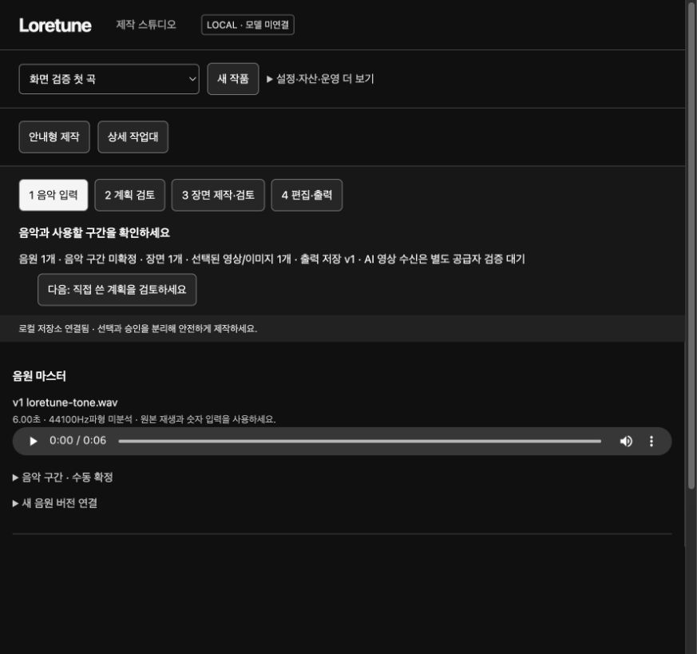
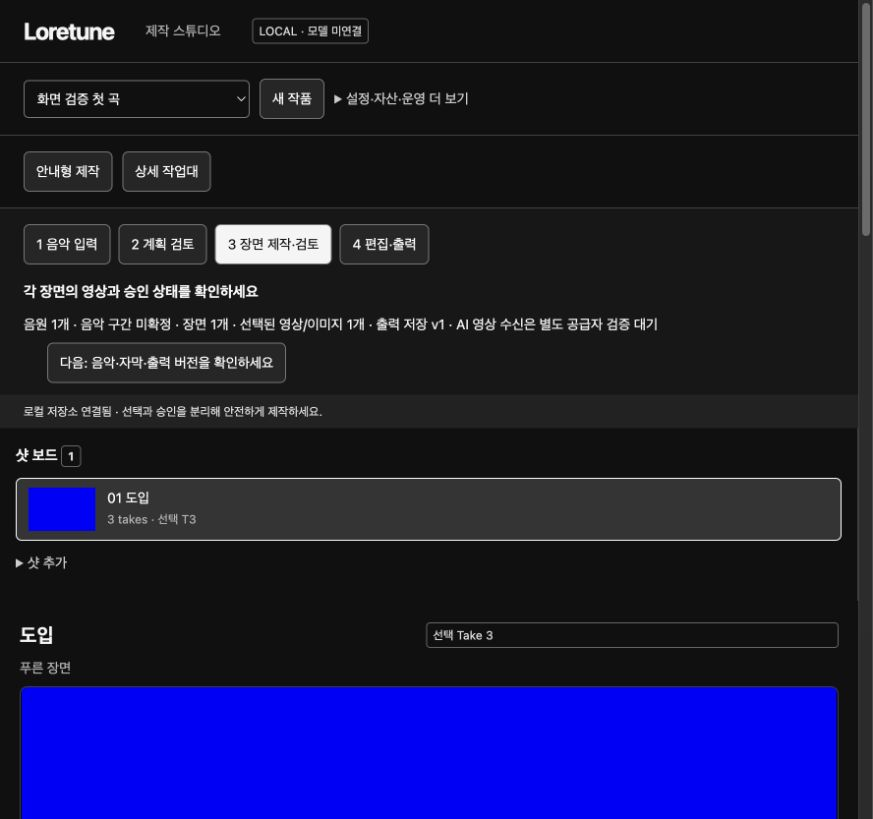

# 디자인 QA 체크포인트 및 통합 인계

결론: 작업 순서와 승인 분리는 이미 유용하지만, 미디어 작업대보다 관리 폼처럼 보이는 위계가 남는다. 독립 CSS 후보 구현 완료, 실서비스 적용 및 이후 화면 검증은 대기. 완성도 점수는 실사용자 테스트 없이 산정하지 않았다.

## 현재 화면에서 확인한 우선 결함 5개

1. 상단 제어 영역이 873×819 캡처에서 약 428px를 차지한다. 작업물 확인 공간을 압박한다. toolbar/nav 간격 축소 후보 작성.
2. 현재 작업 제목과 설명 글자의 위계가 작다. 제목 20px·설명 muted로 구분하는 후보 작성.
3. 다음 행동이 일반 보조 버튼과 같고 왼쪽 정렬도 24px 더 들어간다. primary 처리와 정렬 수정 후보 작성.
4. 안내형 장면 화면에서 샷 목록 다음에 미디어가 수직으로 밀린다. 1000px 이상에서 보드/미디어 2열 후보 작성. 현재 873px에서는 수직 흐름 유지.
5. 안내형/상세 작업대 선택은 접근성 상태가 있지만 시각적 차이가 약하다. aria-pressed 선택 표시 보강 후보 작성.

## 실제 확인 단계

1. 음악 입력: 단계·모델 미연결·6초 오디오가 명확. 현재 단계의 핵심 음악 구간 확정은 접힘 안에 있다. `01-music-before.jpg`.
2. 장면 검토: 샷/선택 take/실제 테스트 이미지 확인. 작업물은 화면 하단에 밀리고 속성은 더 아래에 있다. `02-scenes-before.jpg`.
3. Tunee 공개 홈→Make Your MV Now: 가입 보상 모달이 존재하고 진입 클릭 이후 접근성 트리 변화 없음. 로그인·가입 없이 중단. 내부 editor 미검증.

## 연구와 결정

Refero styles 검색 1회 성공, Krea/Pika full style 2개 및 Clipchamp/ElevenLabs flow 2개 상세 조회 성공. 최초 styles 호출은 link_id 누락 오류, 공개 스키마 확인 후 정상 성공. 원문은 refero-0.json/refero-1.json. reference-lock.md에 토큰 역할/채택·제외 항목 명시.

직접 경쟁사 공개 페이지 조회: https://www.neuralframes.com 은 음악→스타일/인물→다운로드 및 장면별 chat 편집을 설명한다. https://www.tunee.ai 는 대화 및 작업별 모델 변경을 설명한다. https://freebeat.ai 는 링크/음원 입력 진입을 노출한다. 이는 현재 공개 정보 관측이며 내부 editor 품질 또는 생성 성능 검증이 아니다. Neural Frames/Freebeat 내부 제작 화면과 Anijam은 이번 체크포인트에서 미검증. 과거 research zip은 현재 감사 증거로 사용하지 않았다.

## 파일과 통합

- design-polish.css: 독립 후보. 기존 클래스/ID만 대상으로 하고 hide, 데이터, 이벤트 변경 없음.
- integration.patch: 현재 index.html의 첫 style 뒤에 CSS를 inline 추가하는 정확한 diff. 서버 재시작 없이 index 재읽기로 통합 가능. 다른 스레드 최신 index와 충돌 검사 후 적용할 것. 이 에이전트는 적용하지 않았다.
- app.py do_GET는 `/` index만 제공하고 일반 CSS route 없음. 임의 static directory 제공을 추가하지 않도록 inline diff를 제안한다.
- DOM 후속: 음악 구간 미확정 상태에서 수동 확정 disclosure를 자동으로 열기. 상태 요약을 음악/장면/출력으로 나누고, 선택과 승인 상태를 별도 텍스트로 표시. 이 부분은 기능 스레드와 새 계획 카드 구조 통합 후 정확한 DOM 대상으로 결정할 것.

## 검증 한계와 다음 수락 기준

이번 직접 관측은 873×819 기존 음악·장면 화면과 AX 트리. 저장 캡처를 파일에서 다시 열어 확인했고 계정/비밀/결제 내용 없음. CSS 적용 후 캡처는 아직 없음. 기존 테스트 133개 통과를 이번 변경 검증으로 재사용하지 않는다.

통합 후 필수: 데스크톱/390px/320px, 실제 브라우저 200%·400% 확대, 긴 한국어 계획/모델명, Tab focus/모달 복귀, 모든 active/disabled/error 대비 측정, reduced-motion 환경, 빈/진행/오류 상태 및 비용·모델·승인 카드 검증. 현재 항목들은 미검증이며 CSS 선언만으로 통과 표시하지 않는다. 타임라인 가로 스크롤은 의미상 필요하므로 페이지 전체 overflow와 분리해서 검사한다.

Chrome 전용 신규 QA 탭 1489480520 사용. 기존 사용자/기능 QA 탭 조작 없음. Aside CLI 설치와 guide 호출 성공 확인했으나 Aside 브라우저 작업은 실행하지 않음. REA 도구는 현재 노출 목록에서 찾지 못했고 실행하지 않음. 공유 서버 재시작·키/.env 읽기·외부 업로드·유료 호출 없음.

대기 대상: 부모/기능 스레드의 index CSS 통합. 이유: 명시된 파일 소유권. 거절된 작업 없음; 적용을 시도하지 않았으므로 불확실한 쓰기 결과 없음.
